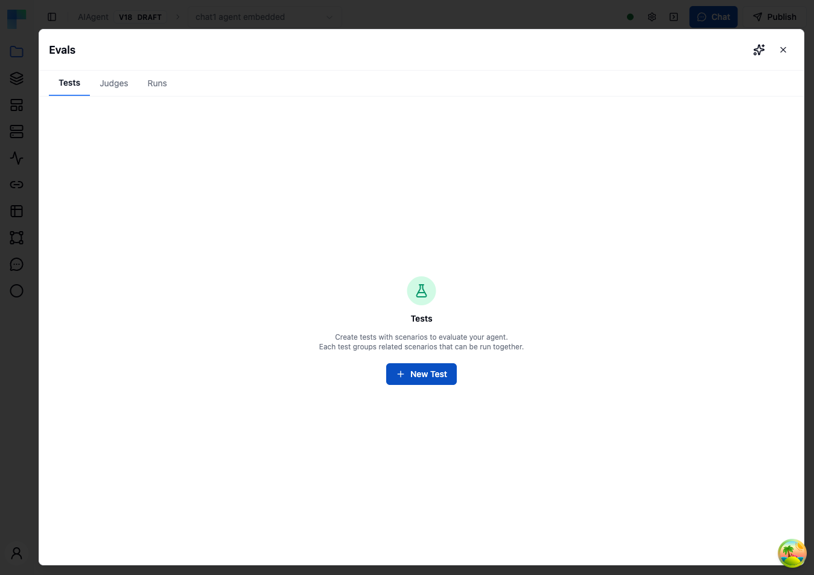
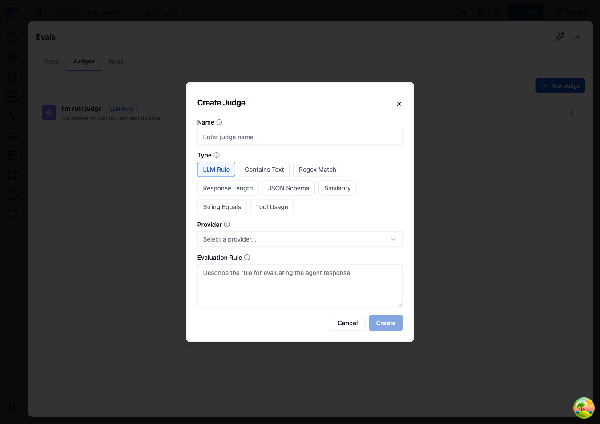
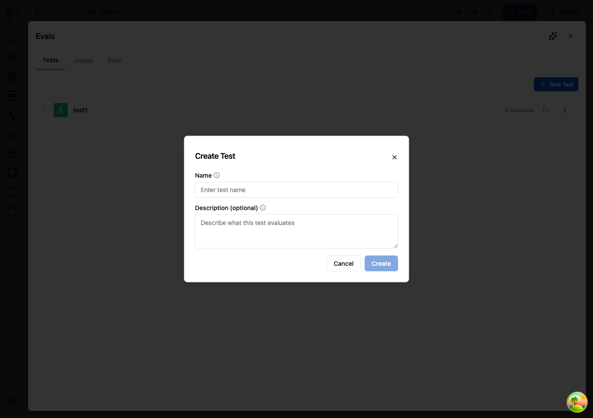
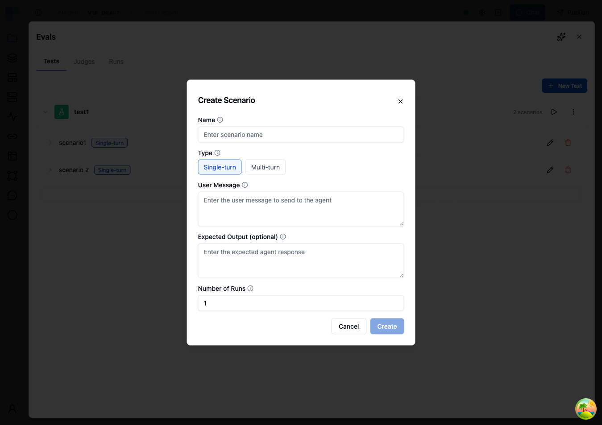
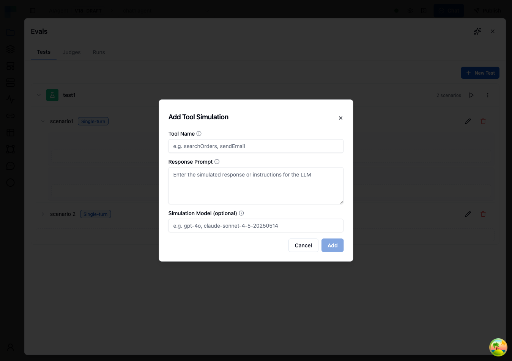
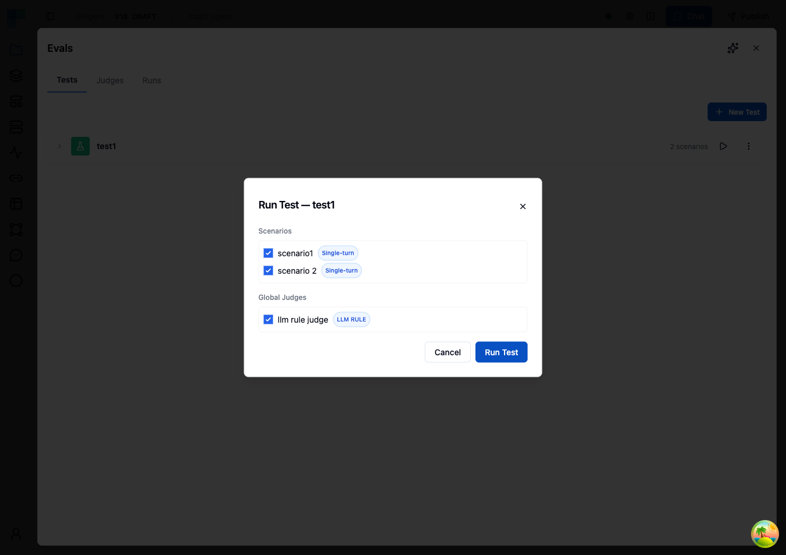
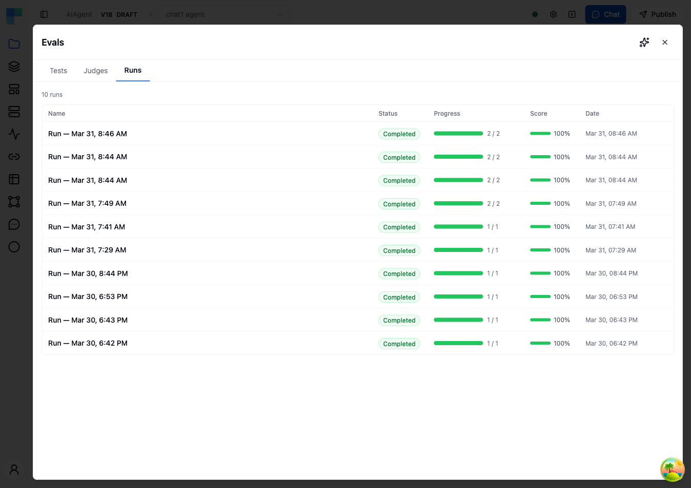
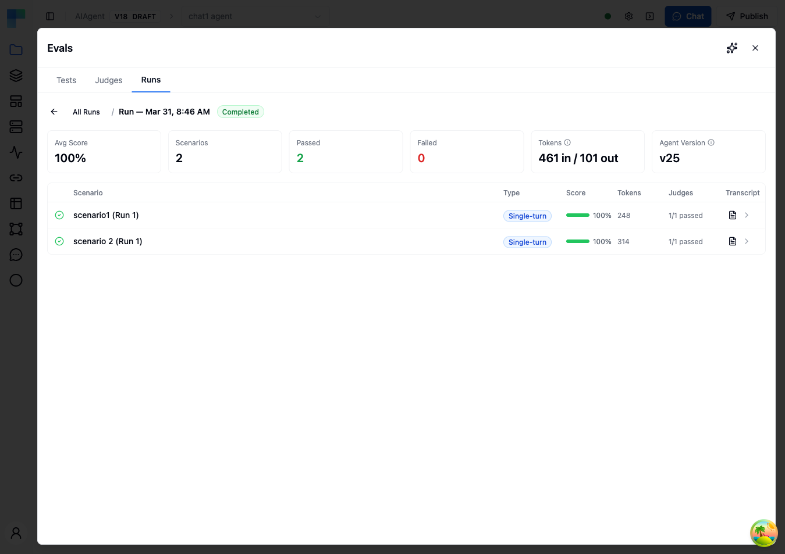
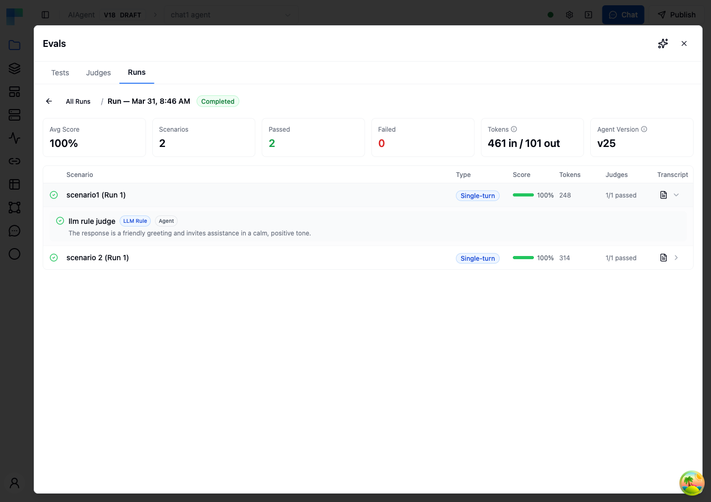
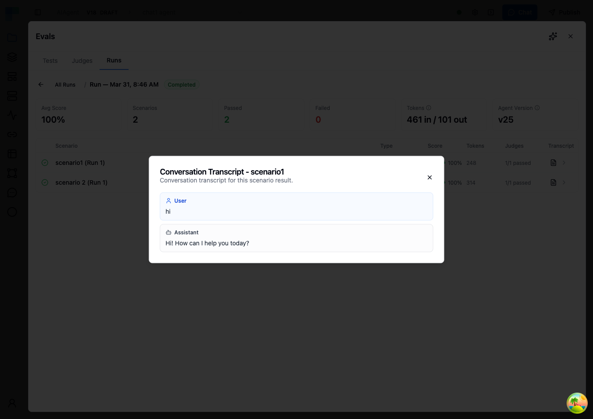

**Evals** test an AI Agent node with repeatable scenarios and score each conversation automatically. A scenario sends the agent one message, or simulates a conversation with a user persona, and judges decide whether the agent's response passes. Each run records per-scenario scores, judge verdicts with explanations, the full transcript and token usage, so you can compare the agent before and after a change to its model, instructions, guardrails or tools. Workflow builders use evals to catch regressions before they deploy an agent.



---

## Open Evals

Click the **Agent Evals** button (flask icon) in the header of an AI Agent node on the canvas, or in the header of the AI Agent Editor. The **Evals** panel opens with three tabs:

- **Tests** - groups of scenarios for this agent. Each scenario has its own judges and tool simulations.
- **Judges** - agent-level judges, which run on every scenario of every test by default.
- **Runs** - the history of evaluation runs and their results.

Tests, judges and runs belong to one AI Agent node in one workflow.

---

## Judges

A judge evaluates one conversation and returns a verdict. There are two scopes:

| Scope | Where you create it | Applies to |
|---|---|---|
| **Scenario** | On a scenario in the **Tests** tab, with **Add Judge** | That scenario only. Always included in a run. |
| **Agent** | In the **Judges** tab, with **New Judge** | Every scenario. Included in a run by default; you can deselect it when you start the run. |

Use agent judges for criteria you want checked on every scenario, such as tone, safety or brand voice.

### Create an agent judge

1. Open the **Judges** tab and click **New Judge**.
2. Enter a **Name**, for example `Professional Tone`.
3. Select a **Type** and fill in its fields (see [Judge types](#judge-types)).
4. Click **Create**.



### Judge types

| Type | Fields | Passes when |
|---|---|---|
| **LLM Rule** | **Provider**, **Model**, **Connection**, **Evaluation Rule** | A chat model judges that the conversation meets the rule you describe in natural language. Use it for subjective or complex criteria. |
| **Contains Text** | **Text**, **Mode** (**Must Contain** or **Must Not Contain**) | The response contains the text, or does not contain it. |
| **Regex Match** | **Pattern**, **Mode** (**Must Match** or **Must Not Match**) | The regular expression finds a match in the response, or finds none. Use it for formats such as dates, order numbers or URLs. |
| **Response Length** | **Min Length** (optional), **Max Length** (optional) | The response length in characters is within the bounds. |
| **JSON Schema** | **JSON Schema** | The response is valid against the JSON Schema. Use it for agents that return structured output. |
| **Similarity** | **Expected Output**, **Threshold (0-1)** (default `0.8`), **Algorithm** (**Cosine**, the default, or **Edit Distance**) | The similarity between the response and the expected output reaches the threshold. Cosine suits semantic similarity; Edit Distance suits exact wording. |
| **String Equals** | **Expected Value**, **Case Sensitive** (default on) | The response equals the expected value. |
| **Tool Usage** | **Tool Name**, **Position** (**Anywhere**, **First** or **Last**), **Comparison** (**At Least**, **Exactly** or **At Most**), **Count** | The agent called the tool in that position the required number of times. |

Write precise rules for LLM Rule judges. A rule such as "the response should be good" gives inconsistent results; state what a passing response contains, for example "The agent acknowledges the issue, gives the order status and offers at least one resolution."

---

## Create a test with scenarios

<Steps>
<Step>

Open the **Tests** tab and click **New Test**. Enter a **Name** and an optional **Description**, then click **Create**.



</Step>
<Step>

Expand the test and click **Add Scenario**.

</Step>
<Step>

Fill in the scenario and click **Create**:

| Field | Type | Description |
|---|---|---|
| **Name** | Both | Identifies the scenario in the results. |
| **Type** | Both | **Single-turn** sends one message and evaluates the response. **Multi-turn** simulates a conversation with a user persona. |
| **User Message** | Single-turn | The message sent to the agent. |
| **Expected Output (optional)** | Single-turn | A reference response that judges such as Similarity can compare against. |
| **Persona Prompt** | Multi-turn | The persona the simulated user adopts. |
| **First Message (Optional)** | Multi-turn | The opening message. When empty, the simulated user writes it from the persona. |
| **Max Turns** | Multi-turn | The maximum number of turns, from 1 to 50. Default: 10. |
| **Number of Runs** | Both | How many times the scenario runs in each evaluation run. Default: 1. |



</Step>
<Step>

On the scenario row, click **Add Judge** to add scenario judges. The fields are the same as for [agent judges](#judge-types). Add several judges to evaluate different aspects of the scenario.

</Step>
<Step>

Optionally, click **Add Tool Simulation** to replace a tool call with a simulated response. See [Tool simulations](#tool-simulations).

</Step>
</Steps>

A test can contain any number of scenarios, and each scenario has its own judges and tool simulations.

---

## Tool simulations

A tool simulation replaces the response of one tool during evaluation, so a test run does not call the real service. Use it to avoid side effects such as real tickets or emails, to run evaluations without the service's credentials, and to test how the agent handles specific results, including errors.

| Field | Description |
|---|---|
| **Tool Name** | The exact name of the tool to intercept, for example `searchOrders`. |
| **Response Prompt** | Without a simulation model, this text is returned as the tool result. With a simulation model, it is the instruction an LLM uses to generate a realistic result from the tool call's input. |
| **Simulation Model (optional)** | The name of the model that generates the simulated response, for example `gpt-4o`. Leave it empty to return the response prompt as it is. |

Tool simulations belong to one scenario, so different scenarios of the same agent can simulate the same tool differently.



---

## Run a test

1. In the **Tests** tab, click the run button (play icon) on the test.
2. In the **Run Test** dialog, select the **Scenarios** to run. All are selected by default.
3. Under **Global Judges**, select the agent judges to include. All are selected by default. Scenario judges are always included.
4. Click **Run Test**.

The run is named after its start date and time, and uses the environment selected in the workflow editor.



The **Runs** tab lists every run with its **Name**, **Status**, **Progress**, **Score** and **Date**. While a run is in progress, its progress bar shows how many scenario runs have finished. To stop a run, click **Cancel run**. Scenarios that already finished keep their results, and the remaining ones are skipped.



---

## Results

Click a run in the **Runs** tab to open its results.



### Run summary

| Card | Description |
|---|---|
| **Avg Score** | The average of the scored scenario results. |
| **Scenarios** | The number of scenario results in the run. |
| **Passed** / **Failed** | The number of scenario results the judges passed or failed. |
| **Inconclusive** | Scenario results where a judge errored or could not decide; they count as neither passed nor failed. |
| **Tokens** | Total input and output tokens consumed by the run. |
| **Agent Version** | The version of the agent that was tested. |

### Scenario results

Each row is one execution of a scenario. A scenario with **Number of Runs** greater than 1 appears once per execution, for example `Shipping delay (Run 2)`.

| Column | Description |
|---|---|
| Status icon | Pending, running, completed or failed. |
| **Scenario** | The scenario name and run number. |
| **Type** | **Single-turn** or **Multi-turn**. |
| **Score** | The average score of the scenario's judges. A scenario whose verdict is inconclusive, or that has no judges, has no score. |
| **Tokens** | Tokens consumed by this execution, including the user simulator on multi-turn scenarios. |
| **Judges** | How many judges passed, for example `1/1 passed`. |
| **Transcript** | Opens the conversation. |

Expand a row to see the verdict of each judge: its name, type, scope (**Agent** or **Scenario**), status and explanation. A judge that cannot reach a pass or fail decision is shown as **Abstained**, **Judge error** or **Not applicable**.



Click the transcript icon to open the **Conversation Transcript** dialog with the messages exchanged between the user (or simulated user) and the agent.



When a scenario fails with an error, its status is failed, the error is stored with the result, and the other scenarios continue.

---

## Multi-turn scenarios

A multi-turn scenario tests behavior that one message cannot show, such as keeping context, handling follow-up questions and solving multi-step problems.

1. The **First Message** is sent to the agent. When it is empty, the user simulator writes the opening message from the persona.
2. The agent responds.
3. The user simulator, an LLM, writes the next user message from the conversation so far and the persona prompt.
4. Steps 2 and 3 repeat until **Max Turns** is reached or the simulator ends the conversation.

Write the persona prompt with the persona's role and background, their goal, their knowledge level and communication style, and any constraints. For example:

```
You are the operations lead at a logistics company that processes
500+ shipments daily. Your team enters tracking updates manually
into spreadsheets and you want to automate this. You have a REST API
from your shipping provider but no experience building integrations.
Push back if the agent suggests technical solutions without explaining them.
```

A persona such as "You are a user who asks questions" produces unfocused conversations.

Multi-turn scenarios consume more tokens than single-turn ones: the context grows with each turn, the user simulator makes its own LLM calls, and judges evaluate a longer conversation. Lower **Max Turns** to reduce cost.

---

## Example scenarios

| Scenario | Type | Input | Judges |
|---|---|---|---|
| Password reset guidance | Single-turn | **User Message**: "I can't log into my account. It says my password is incorrect but I'm sure it's right." | LLM Rule: "The agent suggests troubleshooting steps such as checking caps lock or starting a password reset, in a logical order, without assuming the user is at fault." |
| Missing item resolution | Multi-turn, **Max Turns** 12, **Number of Runs** 3 | **Persona Prompt**: "You are a repeat customer who received an order with one of five items missing. You want the missing item shipped, not a refund, and a clear timeline." | LLM Rule: "The agent verifies the order, acknowledges the missing item and gives a concrete resolution with an estimated timeline." |
| Time-off policy inquiry | Single-turn | **User Message**: "How many vacation days do I get in my first year, and can I take them all at once?" | LLM Rule: "The agent quotes the company policy instead of guessing." Tool Usage: **Tool Name** `lookupPolicy`, **Comparison** At Least, **Count** 1. |

---

## Best practices

- **Start with a few scenarios** that cover the agent's main use cases, then add edge cases: angry users, off-topic requests, attempts to bypass rules, ambiguous input and questions the agent cannot answer.
- **Run important scenarios several times.** Agents are non-deterministic; set **Number of Runs** to 3 to 5 to tell consistent behavior from a lucky response.
- **Combine judge types.** Use LLM Rule judges for subjective quality and deterministic judges (Contains Text, String Equals, Tool Usage) for functional correctness.
- **Simulate tools with side effects** so that evaluation runs do not change real data.

---

## Related

- [AI Agent](/platform/automation/build/workflows/ai/agent)
- [Agent Utils Tools](/platform/automation/build/workflows/ai/agent/agent-utils)
- [Guardrails](/platform/automation/build/workflows/ai/agent/guardrails)
