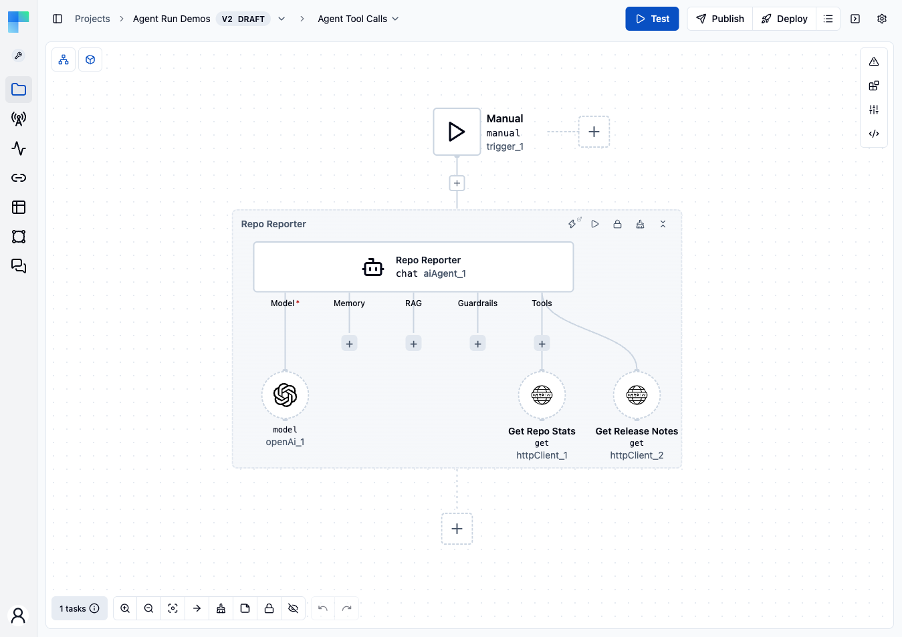
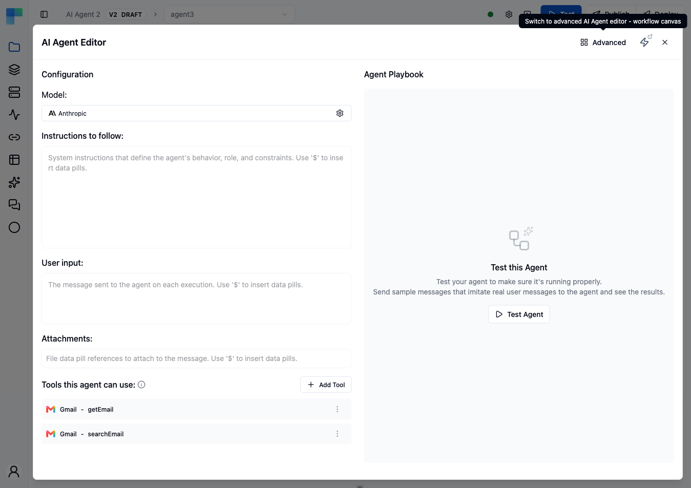
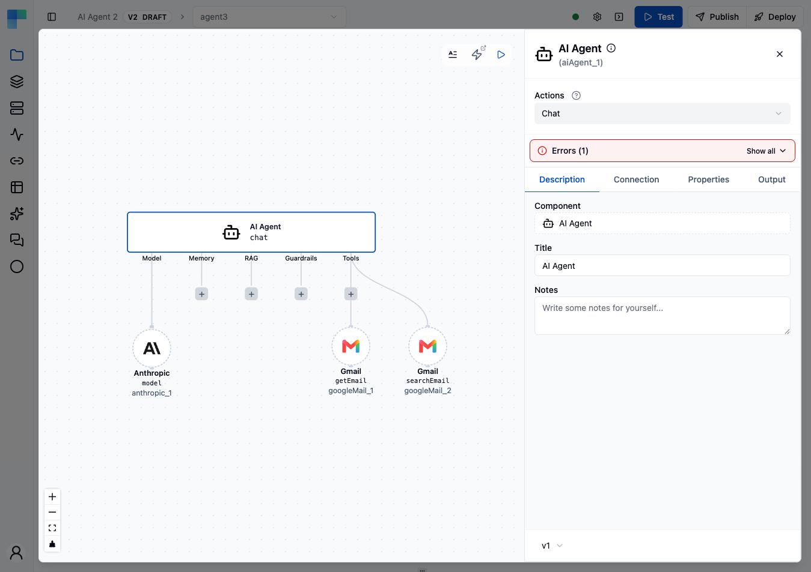

The **AI Agent** is a cluster root component: one workflow node that turns a chat model into an assistant that can hold a conversation and call tools. You configure it by attaching other components to its slots as *cluster elements*: a **Model** (required), and optionally **Memory**, **RAG**, **Guardrails** and **Tools**. Swapping a provider, a memory backend or a retrieval strategy means replacing one cluster element, not rewiring the workflow. Workflow builders use it for multi-turn assistants, answers grounded in your own documents, agents that act through ByteChef actions, and agents that call other agents.



---

## Reference: AI Agent Component

| Component | Reference |
|---|---|
| **AI Agent** | [aiAgent/v1](/reference/components/ai-agent_v1): actions `chat` (**Chat**) and `streamChat` (**Chat (stream)**), and the **AI Agent** tool element |

The **AI Agent** tool element lets one agent attach another agent in its Tools slot and call it as a tool.

---

## Creating an AI Agent

### Step 1: Add the AI Agent node

1. Open a workflow in the **Workflow Editor**.
2. Click the **+** button on a canvas edge to open the **Components** menu.
3. Search for `AI Agent` and click it. A node labelled **AI Agent** appears on the canvas.

{/* TODO screenshot: - agent/agent-create-add-node.png showing the Components popover with "AI Agent" highlighted in the search results. */}

### Step 2: Choose where to edit the agent

The workflow editor shows cluster elements in one of two views. The toolbar button on the right side of the canvas switches between them, and your choice is remembered in your browser.

- **Inline view** (the default; tooltip **Show cluster elements in the editor dialog**). The agent and its cluster elements are drawn on the workflow canvas inside a frame, with a handle for each slot. The frame header has a **Manage AI Skills** link, a **Test agent** button, and buttons to lock node movement, reset the layout and collapse the cluster elements. Clicking the agent opens its properties in the side panel.
- **Dialog view** (tooltip **Show cluster elements inline**). Clicking the agent node opens it in a full-screen dialog.

In the dialog view the agent opens in one of two editors:

- **AI Agent Editor** (the simple editor, the default). The left column, **Configuration**, has the **Model** selector, the **Stream response** switch, the **Instructions to follow**, **User input** and **Attachments** fields, and the **Tools this agent can use** section. The right column, **Agent Playbook**, has a **Test Agent** button for sending test prompts without leaving the editor.
- **Advanced editor.** Click **Advanced** in the editor header. The agent and its cluster elements are drawn on a canvas, with one handle for each slot (**Model**, **Memory**, **RAG**, **Guardrails**, **Tools**). This is the only dialog editor that reaches the Memory, RAG and Guardrails slots.

Both editors change the same configuration, so switching loses nothing. The editor you used last is remembered in your browser for every AI Agent node.





### Step 3: Attach a model (required)

In the **Model** field, click **Select a model...** and pick a provider, for example **Anthropic**, **OpenAI** or **Ollama**. Configure its connection and parameters in the panel that opens. The agent needs exactly one model before it can run.

{/* TODO screenshot: - agent/agent-create-model.png showing the cluster element picker filtered to model providers. */}

### Step 4: Write the prompts

- **Instructions to follow** (`systemPrompt`): the system prompt that defines the agent's role, behavior and constraints.
- **User input** (`userPrompt`, required): the message sent to the agent on each execution, usually a data pill from the trigger.
- **Attachments**: file data pills to attach to the message. Only text and image files are supported, and only some models accept images.

Type `$` in a field to insert data pills.

### Step 5: Attach chat memory (optional)

Use the **Memory** handle on the inline frame or in the advanced editor, and pick one backend. Without chat memory, every execution starts a new conversation with no prior context. See [Chat Memory Slot](#chat-memory-slot).

{/* TODO screenshot: - agent/agent-create-chat-memory.png showing the chat-memory picker. */}

### Step 6: Attach RAG (optional)

Use the **RAG** handle to attach one retrieval pipeline. See [RAG Slot](#rag-slot).

{/* TODO screenshot: - agent/agent-create-rag.png showing a RAG child being added. */}

### Step 7: Attach guardrails (optional)

Use the **Guardrails** handle to attach a [Check For Violations](/reference/components/checkForViolations_v1) parent (blocks the request or reply) or a [Sanitize Text](/reference/components/sanitizeText_v1) parent (masks matches in place), then attach detectors such as PII or Jailbreak inside it. An agent accepts at most one parent of each kind; put all detectors of one kind under the same parent. See [Guardrails Slot](#guardrails-slot).

{/* TODO screenshot: - agent/agent-create-guardrails.png showing Check For Violations with child detectors expanded. */}

### Step 8: Attach tools (optional)

In **Tools this agent can use**, click **Add Tool** to expose a component action, a script, an MCP server or another AI Agent as a tool. The model sees each tool's name and description and decides which to call.

Every tool has optional **Tool Name** and **Tool Description** fields above its own properties. When left blank, the underlying operation's name and description are used. Set them when the default reads poorly to a model or when two tools are hard to tell apart. A tool name can have up to 64 characters: letters, digits, `_`, `-`, `.` and `/`. Any other character, including a space, is rejected as you type.

A tool placed inside an **Approval Gate Tool** appears in a group marked **requires approval**, with its own **Add Tool** and **Add Channel** buttons. See [Agent Utils Tools](agent-utils#approval-gate-tool).

{/* TODO screenshot: - agent/agent-create-tools.png showing the Tools section with two tools attached. */}

### Step 9: Test the agent

In the **Agent Playbook** column (or with **Test agent** on the inline frame), click **Test Agent** and send sample prompts. Tool calls appear in the conversation, so you can check the wiring before you deploy the workflow.

{/* TODO screenshot: - agent/agent-create-test.png showing a test prompt + the assistant's response with tool-call traces. */}

### The agent in the workflow definition

In the workflow JSON, the prompts are `parameters` of the AI Agent task, and the model, memory, RAG, guardrails and tools are stored under `clusterElements`. This support agent uses an OpenAI model and a Slack tool. The channel is fixed, and the model writes the message text through [`fromAi`](#supplying-tool-parameters-with-fromai):

```json
{
  "name": "aiAgent_1",
  "type": "aiAgent/v1/chat",
  "parameters": {
    "format": "SIMPLE",
    "systemPrompt": "You are a support assistant for Acme. Answer in two sentences or fewer. If the customer reports an outage, post a short summary to the on-call Slack channel before you reply.",
    "userPrompt": "${trigger_1.body.message}",
    "response": {
      "responseFormat": "TEXT"
    }
  },
  "clusterElements": {
    "model": {
      "name": "openAi_1",
      "type": "openAi/v1/model",
      "parameters": {
        "model": "gpt-4o-mini",
        "temperature": 0.2
      }
    },
    "tools": [
      {
        "name": "slack_1",
        "type": "slack/v1/sendChannelMessage",
        "parameters": {
          "channel": "C01234567",
          "text": "=fromAi('text', 'STRING', { description: 'a one-line summary of the outage report', required: true })"
        }
      }
    ]
  }
}
```

`model` holds one element, and `tools` holds a list. Connections are not part of the definition, so the model and the Slack tool still need a connection selected in the editor.

---

## Cluster Element Types

A **cluster element** is a component attached to a slot of the AI Agent instead of being connected as a step in the workflow graph. Each slot has a type that controls which components fit and how many.

| Type name | JSON key | UI label | Required | Multiple | What it provides |
|---|---|---|---|---|---|
| `MODEL` | `model` | Model | Yes | No | The chat model the agent calls, with its provider settings (model name, temperature, maximum tokens). |
| `CHAT_MEMORY` | `chatMemory` | Memory | No | No | Loads earlier turns of the conversation into the model context and stores new turns after each call. |
| `RAG` | `rag` | RAG | No | No | Retrieves relevant documents from a knowledge source and adds them to the prompt. |
| `GUARDRAILS` | `guardrails` | Guardrails | No | Yes | Checks the input and the output: Check For Violations blocks, Sanitize Text masks. |
| `TOOLS` | `tools` | Tools | No | Yes | Actions the model can call during a turn. Each tool is described to the model by name, description and a JSON schema of its parameters. |

---

## Model Slot

The Model slot binds one chat model to the agent.

| Provider | Reference |
|---|---|
| Amazon Bedrock | [amazonBedrock/v1](/reference/components/amazon-bedrock_v1) |
| Anthropic | [anthropic/v1](/reference/components/anthropic_v1) |
| Azure OpenAI | [azureOpenAi/v1](/reference/components/azure-open-ai_v1) |
| DeepSeek | [deepseek/v1](/reference/components/deepseek_v1) |
| Gemini | [gemini/v1](/reference/components/gemini_v1) |
| Groq | [groq/v1](/reference/components/groq_v1) |
| LiteLLM | [liteLlm/v1](/reference/components/lite-llm_v1) |
| Mistral | [mistral/v1](/reference/components/mistral_v1) |
| NanoGPT | [nanoGpt/v1](/reference/components/nano-gpt_v1) |
| Nvidia | [nvidia/v1](/reference/components/nvidia_v1) |
| Ollama | [ollama/v1](/reference/components/ollama_v1) |
| OpenAI | [openAi/v1](/reference/components/open-ai_v1) |
| OpenRouter | [openRouter/v1](/reference/components/open-router_v1) |
| Perplexity | [perplexity/v1](/reference/components/perplexity_v1) |
| Requesty | [requesty/v1](/reference/components/requesty_v1) |

Many provider components also have standalone workflow actions (image generation, speech synthesis, transcription, embeddings) that you use outside the agent; see each provider's reference page. Some AI components have standalone actions only and cannot fill this slot. For example, [stability/v1](/reference/components/stability_v1) has a Create Image action but no model cluster element.

### Model routers

**OpenRouter**, **Requesty**, **NanoGPT** and **LiteLLM** are routers: one connection gives access to models from many vendors, so you change models by changing only the model name. Use a router to compare models or to send all traffic through one billing account. Use a direct provider (Anthropic, OpenAI, Gemini and others) for a first-party connection to one vendor.

{/* TODO screenshot: - agent/agent-model-picker.png showing the model cluster element selector with the list of providers above. */}

---

## Chat Memory Slot

Chat memory lets the agent recall earlier turns of the same conversation. The slot is labelled **Memory** and accepts one memory element. Each element has a **Conversation ID** property: executions that pass the same ID share one history. Choose a backend by durability and latency, or use Vector Store chat memory to recall similar turns instead of the chronological history.

| Backend | Reference | Notes |
|---|---|---|
| Built-in | [chatMemory/v1](/reference/components/chat-memory_v1) | Uses the server's chat memory store, set by [`BYTECHEF_AI_MEMORY_PROVIDER`](/platform/use-bytechef/self-hosted/configuration/environment-variables#ai-chat-memory-configuration) (`JDBC` by default). |
| In-Memory | [inMemoryChatMemory/v1](/reference/components/in-memory-chat-memory_v1) | Kept in the server process; lost on restart. |
| JDBC | [jdbcChatMemory/v1](/reference/components/jdbc-chat-memory_v1) | Stored in a relational database. |
| Redis | [redisChatMemory/v1](/reference/components/redis-chat-memory_v1) | Stored in Redis. |
| MongoDB | [mongoDbChatMemory/v1](/reference/components/mongo-db-chat-memory_v1) | Stored in MongoDB. |
| Cassandra | [cassandraChatMemory/v1](/reference/components/cassandra-chat-memory_v1) | Stored in Apache Cassandra. |
| Neo4j | [neo4jChatMemory/v1](/reference/components/neo4j-chat-memory_v1) | Stored in a Neo4j graph database. |
| AWS S3 | [awsChatMemory/v1](/reference/components/aws-chat-memory_v1) | Stored as JSON objects in an Amazon S3 bucket. |
| Vector Store | [vectorStoreChatMemory/v1](/reference/components/vector-store-chat-memory_v1) | Recalls semantically similar earlier turns instead of the chronological history. |

Each memory component also has workflow actions to read and manage stored conversations outside the agent (**Add Messages**, **Get Messages**, **Delete Conversation** and, except for Vector Store, **List Conversations**).

### Version 2

Built-in, In-Memory, JDBC, Redis and AWS S3 chat memory also have a version 2: [chatMemory/v2](/reference/components/chat-memory_v2), [inMemoryChatMemory/v2](/reference/components/in-memory-chat-memory_v2), [jdbcChatMemory/v2](/reference/components/jdbc-chat-memory_v2), [redisChatMemory/v2](/reference/components/redis-chat-memory_v2) and [awsChatMemory/v2](/reference/components/aws-chat-memory_v2). Version 2 stores each conversation as a session of events, including tool calls. It can compact long histories (**Compaction Strategy**: sliding window, turn window, token count, or recursive summarization with an optional summarizer **Model** element), can give the agent a conversation search tool, and has the same four actions. History stored by version 1 is not visible to version 2. MongoDB, Cassandra, Neo4j and Vector Store chat memory have version 1 only.

{/* TODO screenshot: - agent/agent-chat-memory.png showing a Chat Memory child wired into the AI Agent. */}

### Chat memory vs Auto Memory

Chat memory and Auto Memory solve different problems, and an agent can use both:

- **Chat memory** (this slot) replays the transcript of the current conversation. It is keyed by conversation ID and keeps nothing across conversations.
- **Auto Memory** (the **Auto Memory Tool** in the [Agent Utils toolset](#the-agent-utils-toolset)) stores durable facts the agent decides to keep, such as preferences, learned context and decisions, and makes them available in every later conversation of the same deployment. Memory is kept per owner and per environment. In deployed automation workflows the owner is the project deployment. Connected-user embedded workflows run as automation workflows, so their memory belongs to the connected user's project deployment (it is not shown on the [Memories](/platform/settings/ai/memories) page). Embedded integration workflows keep memory per integration instance. During editor test runs the tool is offered, but every call returns an error saying that memory works only once the workflow is deployed. In a microservices deployment every call returns an error saying that memory requires the ByteChef server application.

Auto Memory uses the same storage as the [Memories](/platform/settings/ai/memories) page. To enable it, attach the **Auto Memory Tool** in the Tools slot.

---

## RAG Slot

RAG (retrieval-augmented generation) retrieves text from a knowledge source at query time and passes it to the model as extra context. The slot accepts one RAG element, which runs on every turn.

| Strategy | Reference | Use when |
|---|---|---|
| Modular RAG | [modularRag/v1](/reference/components/modular-rag_v1) | You want to configure each stage separately: query transformer, query expander, document retriever, document joiner, query augmenter. |
| Question Answer RAG | [questionAnswerRag/v1](/reference/components/questionanswer-rag_v1) | You want one retrieve-and-answer pipeline with default settings. |
| Vector Store Document Retriever | [vectorStoreDocumentRetriever/v1](/reference/components/vector-store-document-retriever_v1) | You need the document retriever stage of a Modular RAG pipeline. |

The Modular RAG stages are cluster elements of their own: **query transformers** (Compression, Rewrite, Translation), a **Multi-Query Expander**, the **Vector Store Document Retriever**, a **Concatenation Document Joiner** and a **Contextual Query Augmenter**, each attached to the Modular RAG element.

### Compatible Vector Stores

The retriever stage reads from any of these vector stores:

| Vector Store | Reference |
|---|---|
| Couchbase | [couchbase/v1](/reference/components/couchbase_v1) |
| Knowledge Base | [knowledgeBase/v1](/reference/components/knowledgeBase_v1) |
| MariaDB Vector | [mariaDbVectorStore/v1](/reference/components/mariaDbVectorStore_v1) |
| Milvus | [milvus/v1](/reference/components/milvus_v1) |
| MongoDB Atlas | [mongodbAtlas/v1](/reference/components/mongodbAtlas_v1) |
| Neo4j | [neo4j/v1](/reference/components/neo4j_v1) |
| Oracle | [oracleVectorStore/v1](/reference/components/oracleVectorStore_v1) |
| pgVector | [pgVector/v1](/reference/components/pgVector_v1) |
| Pinecone | [pinecone/v1](/reference/components/pinecone_v1) |
| Qdrant | [qdrant/v1](/reference/components/qdrant_v1) |
| Redis | [redisVectorStore/v1](/reference/components/redisVectorStore_v1) |
| S3 Vector Store | [s3VectorStore/v1](/reference/components/s3VectorStore_v1) |
| Typesense | [typesense/v1](/reference/components/typesense_v1) |
| Weaviate | [weaviate/v1](/reference/components/weaviate_v1) |

### RAG slot vs search tool

The RAG slot retrieves on every turn and adds the documents to the prompt, whether or not the question needs them. To let the agent decide when to look something up, attach the vector store's or Knowledge Base's **Search** tool in the [Tools slot](#tools-slot) instead; the model then calls it only when it needs to. An agent can use both.

{/* TODO screenshot: - agent/agent-rag-pipeline.png showing a Modular RAG child with retriever, query expander, and document joiner sub-elements configured. */}

---

## Guardrails Slot

Guardrails check the text that flows through the agent: the user's input before the model is called, and the model's reply before it leaves the step. Each check has **Validate Input** and **Validate Output** options (both on by default). The slot accepts guardrail parents; the agent fails with an error when more than one **Check For Violations** or more than one **Sanitize Text** parent is attached.

Workspace-wide [AI Guardrails](/platform/automation/settings/ai-agents/guardrails) are a separate feature and are not configured here.

| Parent | Reference | Behavior |
|---|---|---|
| Check For Violations | [checkForViolations/v1](/reference/components/checkForViolations_v1) | Blocks the request or the reply when any attached check finds a violation. |
| Sanitize Text | [sanitizeText/v1](/reference/components/sanitizeText_v1) | Masks matched text (PII, URLs, secrets) in place without blocking. |

### Child detectors

Detectors attach inside a Check For Violations or Sanitize Text parent. Rule-based detectors run first; LLM classifiers need a **Model** element of their own.

| Detector | Stage | Reference |
|---|---|---|
| PII | Rule-based | [pii/v1](/reference/components/pii_v1) |
| Secret Keys | Rule-based | [secretKeys/v1](/reference/components/secretKeys_v1) |
| URLs | Rule-based | [urls/v1](/reference/components/urls_v1) |
| Custom Regex | Rule-based | [customRegex/v1](/reference/components/customRegex_v1) |
| Keywords | Rule-based | [keywords/v1](/reference/components/keywords_v1) |
| Jailbreak | LLM classifier | [jailbreak/v1](/reference/components/jailbreak_v1) |
| NSFW | LLM classifier | [nsfw/v1](/reference/components/nsfw_v1) |
| Topical Alignment | LLM classifier | [topicalAlignment/v1](/reference/components/topicalAlignment_v1) |
| LLM PII | LLM classifier | [llmPii/v1](/reference/components/llmPii_v1) |
| Custom | LLM classifier | [custom/v1](/reference/components/custom_v1) |

The [TypeSafe AI](/reference/components/typesafe_v1) component adds two more detectors for Check For Violations, **Jev Input Guardrail** and **Jev Output Guardrail**. They call the TypeSafe service through their own connection and need no **Model** element.

{/* TODO screenshot: - agent/agent-guardrails-wired.png showing both Check for Violations and Sanitize Text wired to an agent with multiple child detectors. */}

See [Guardrails](guardrails) for detector settings, thresholds and the failure behavior.

---

## Tools Slot

Tools turn workflow components into actions the agent can call during a conversation. The slot accepts any number of tools; the model chooses which to call from the user's prompt and the tool descriptions.

| Tool source | Reference | Notes |
|---|---|---|
| Agent Utils | [aiAgentUtils/v1](/reference/components/ai_agent-utils_v1) | Built-in tools; see [The Agent Utils toolset](#the-agent-utils-toolset). |
| Any component action | [Components reference](/reference/components) | Most ByteChef actions can be attached as tools. |
| MCP Client | [mcpClient/v1](/reference/components/mcp-client_v1) | Connects the agent to an external MCP server and exposes that server's tools. |
| Vector store or Knowledge Base search | The **Search** tool of any [supported vector store](#compatible-vector-stores) or of [knowledgeBase/v1](/reference/components/knowledgeBase_v1) | Retrieval the model calls when it needs it, unlike the [RAG slot](#rag-slot), which runs on every turn. |
| Script | [script/v1](/reference/components/script_v1) | Runs custom JavaScript or Python as a tool. |
| Workflow | [workflow/v1](/reference/components/workflow_v1) | The **Call Workflow** tool runs another workflow as a tool. |
| Request Approval | [approval/v1](/reference/components/approval_v1) | Pauses the run until a human approves or rejects, and returns the response to the agent. See [Human in the loop](/platform/automation/build/workflows/human-in-the-loop#request-approval-tool). |
| A2A | [a2a/v1](/reference/components/a2a_v1) | The **A2A Agent Tool** delegates a task to a remote agent over the A2A (Agent2Agent) protocol. See [Call an A2A agent from an AI Agent](/platform/automation/deploy/a2a-servers#call-an-a2a-agent-from-an-ai-agent). |
| AI Agent | [aiAgent/v1](/reference/components/ai-agent_v1) | Lets one agent call another agent as a tool. |

### Seeing which tools ran

Tool calls are colored on the workflow canvas, live while a
[test run](/platform/automation/build/workflows/workflows#run-test-and-the-output-panel) executes and
afterwards on the [execution detail](/platform/automation/monitor/workflow-executions#what-the-detail-view-shows)
of a deployed run.

A tool turns blue while the agent calls it, then green with its duration when the call returns, or red
when the call throws an error. Its wire from the Tools slot follows the same color.

- **Only tools are colored.** The model, memory, RAG and guardrail elements stay plain, and so does a
  tool the agent never called.
- **A Task Tool subagent is colored too**, along with the tools it calls, including a subagent running
  in the background, which can finish after its agent's task has.
- **Failure means the call threw.** A tool that returns an error message as its result has completed;
  the model reads that result and decides what to do next.
- **Red stays red.** A tool that failed once stays red for the rest of the run, even if a later call
  succeeds or the agent recovers and finishes.
- **A tool called several times** in one run of the agent shows the time from its first call to its
  last, and stays blue while any of its calls is still running. When the agent itself runs again, in a
  loop for example, the times add up. A call waiting on a human-in-the-loop answer stays blue until it
  resumes.
- **Simulated calls** are colored like real ones.

Each tool call is also a row of its own under the agent's task row, in the test output and in the
execution detail:

- **One row per call**, in the order the calls happened. A tool called several times gets numbered
  rows, such as `fetch_ok` and `fetch_ok #2`.
- **Selecting a row** shows that call's **Input**, **Output** or **Error**, and its **Logs** show only
  the entries from that call. On the execution detail, **Input** and **Output** are read from the call's
  log entry. A tool backed by an external provider, such as an MCP Client tool, has no logs of its own,
  so its **Logs** tab shows only that entry. The agent's own **Logs** tab is unchanged.
- **Rows appear live.** During a test run a row appears as soon as the call starts and fills in when
  it returns.
- **A Task Tool subagent nests three levels deep.** The agent's `Task` call is a row (its **Input** is
  the prompt, its **Output** the result), the subagent run is nested under it, and the tools the
  subagent called are nested under that run. A background run's result is collected by separate Task
  output calls, which are rows under the agent.
- **Long values are cut off while a test runs.** A live row's input or output over 65,536 characters is
  truncated and ends with a marker giving the original length. The execution detail shows the full value
  from the call's log entry.
- **A call waiting on a human** reads "Waiting for a response" and completes with the answer when the
  run resumes. Its **Input** and **Output** appear on the execution detail once it completes.
- **A background subagent's call** that was still running when the agent finished reads "Still running
  when the agent finished".
- **Only tools and Task Tool subagents get rows.** The model, memory, RAG and guardrail elements do
  not, unless they fail, block or redact, as described below.

The model, chat memory, RAG and guardrail elements stay grey on a normal run and get a row only in
these cases:

| Element and event | Canvas | Agent | Row |
|---|---|---|---|
| Model, chat memory or RAG raises an error | The element turns red | Fails | Shows the error |
| An error from below a guardrail | The guardrail turns red | Fails (no blocked message or withheld text is produced) | Shows the error |
| A Check For Violations check blocks the input or the output | The check and its Check For Violations frame turn amber | Stays green with a **Blocked** badge | Shows the side (input or output) and the match count or confidence score |
| A check cannot run because its model failed | | | Reads "could not run" |
| A check crashes | The check turns red | | |
| A Sanitize Text sanitizer changes the text | The sanitizer turns blue | Unchanged | **Details** show how many values were masked |
| A sanitizer crashes | The sanitizer turns red and its Sanitize Text frame turns amber | The reply is withheld; **Withheld** badge | |

Guardrail rows have a **Details** tab instead of **Input** and **Output**. They never show the matched
or redacted text, only which check or sanitizer, which side and how many.

### Supplying tool parameters with fromAi

When you attach a tool, you see its full input form. For every parameter you decide who fills it:

- **You** - type a constant or insert a data pill. The value is the same on every call, and the model neither sees nor controls it.
- **The model** - set the field to a `fromAi(...)` expression. At call time the model provides the value, and the parameter is part of the tool's JSON schema that the model sees.

The **Generate content with AI** button (sparkles icon) next to a field writes the `fromAi(...)` expression for you. On dropdowns, true/false fields and code editors, the button appears once you turn on the field's **Text** or **Formula** switch, because the expression replaces the regular control.

The expression form is:

```
=fromAi('<name>', '<type>', { description: '<hint>', required: true })
```

| Argument | Required | Default | Description |
|---|---|---|---|
| `name` | Yes | | Parameter name the model sees. Characters other than letters, digits, `_`, `.` and `-` are replaced with `_`, and the name is cut to 64 characters. |
| `type` | No | `STRING` | One of `STRING`, `NUMBER`, `INTEGER`, `BOOLEAN`, `ARRAY`, `OBJECT`, `DATE`, `TIME`, `DATE_TIME`. |
| options map | No | | `description` (tells the model what to pass), `defaultValue`, `options` (a list of allowed values) and `required` (default `false`). |

A tool can be partly fixed and partly filled by the model. For example, a Slack message tool can pin the channel and let the model write the text:

```
channel: general
text: =fromAi('text', 'STRING', { description: 'the message body to post' })
```

The same `fromAi` syntax selects which tool parameters the AI fills for [MCP server tools](/platform/automation/deploy/mcp-servers) and [embedded MCP tools](/platform/embedded/configure/mcp-servers).

### The Agent Utils toolset

Agent Utils provides built-in tools you attach one by one. See [Agent Utils Tools](agent-utils) for details on each.

| Tool | What the agent can do with it |
|---|---|
| **Skills Tool** | Consult operator-authored [skills](/platform/settings/ai/skills) on demand. |
| **Create AI Skill**, **Update AI Skill**, **Append Files to AI Skill**, **Remove File from AI Skill**, **Delete AI Skill** | Manage skills from within a conversation. |
| **Todo Write Tool** | Keep a task list with state tracking during the run. |
| **Task Tool** | Delegate work to **Subagent** elements you define, each with its own instructions, model and tools. |
| **Ask User Question Tool** | Pause and ask the user clarifying questions; the run resumes with the answers. Requires the **Chat (stream)** action. |
| **Approval Gate Tool** | Require a human approval before any tool placed inside it runs. |
| **Auto Memory Tool** | Keep durable facts across conversations of the same deployment. See [Chat memory vs Auto Memory](#chat-memory-vs-auto-memory). |
| **Smart Web Fetch Tool** | Fetch a web page and return a summary written by an attached **Model**, with caching. |
| **Brave Web Search Tool** | Search the web through the Brave Search API. Offered only when the server enables Brave. |
| **File System Tools**, **Glob Tool**, **Grep Tool**, **List Directory Tool** | Read, write and search files in the agent's workspace. Offered only when the server enables them. |
| **Shell Tools** | Run shell commands in the agent's workspace. Offered only when the server enables them. |

{/* TODO screenshot: - agent/agent-tools-attached.png showing a list of attached tool children (Agent Utils + two custom workflow components) under the Tools slot. */}

---

## Actions

The AI Agent has two actions. Both have the same properties.

| Action | Name | Behavior |
|---|---|---|
| **Chat** | `chat` | Runs the agent, including guardrails and tool calls, and returns the final reply when it is complete. |
| **Chat (stream)** | `streamChat` | Sends the reply back token by token as it is generated. The **Stream response** switch in the AI Agent Editor switches the node between the two actions. |

On **Chat (stream)**, rule-based output checks run on each chunk, and an LLM output check runs only if it supports streamed output; the stream is then held back until the check has passed on the whole reply. Sanitize Text masks each chunk separately, so a pattern split across two chunks is not masked, and chunks already sent cannot be recalled. Use **Chat** when output guardrails must see the full reply.

### Properties

| Property | Name | Type | Default | Description |
|---|---|---|---|---|
| **Format** | `format` | STRING | `SIMPLE` | `SIMPLE` shows the prompt fields below. `ADVANCED` takes a list of messages instead. |
| **Prompt** | `userPrompt` | STRING | | The user message (Simple format). Required. |
| **System Prompt** | `systemPrompt` | STRING | | Instructions for the agent (Simple format). |
| **Attachments** | `attachments` | ARRAY | | Text or image files to attach (Simple format). |
| **Messages** | `messages` | ARRAY | | The conversation so far (Advanced format). |
| **Response** > **Response Format** | `response.responseFormat` | STRING | `TEXT` | `TEXT` or `JSON`. |
| **Response** > **Response Schema** | `response.responseSchema` | STRING | | JSON Schema for the structured reply. |

See [aiAgent/v1](/reference/components/ai-agent_v1) for the full property and output reference.

{/* @coming-soon Realtime Chat is coming soon - the aiAgent/v1 realtimeChat action is not in the latest released
version, so this section is commented out. Tracked in .agents/coming-soon-inventory.md.

### Realtime Chat

Bidirectional audio/text channel for low-latency voice agents. The realtime model handles
speech-to-text and text-to-speech internally; guardrails and tools still run on the text path.

Reference: aiAgent/v1 realtimeChat */}

---

## Structured Output

By default the agent returns plain text. When a later step needs to branch on or map the answer, configure structured output so the agent returns JSON:

1. Set **Response Format** to `JSON`.
2. In **Response Schema**, enter a JSON Schema for the shape you expect.

For example, a lead-scoring agent can use this schema:

```json
{
  "type": "object",
  "properties": {
    "score": { "type": "integer", "description": "Lead quality from 1 to 10" },
    "reason": { "type": "string" },
    "nextStep": { "type": "string", "enum": ["call", "email", "discard"] }
  },
  "required": ["score", "reason", "nextStep"]
}
```

Later steps then read `${aiAgent_1.score}`, `${aiAgent_1.reason}` and `${aiAgent_1.nextStep}`, for example in a [Condition](/platform/automation/build/workflows/flow-controls#condition) that checks `${aiAgent_1.score}` with **Greater or Equals** `7`.

The reply is validated against the schema before it leaves the step, so a malformed or incomplete object fails the step instead of passing bad data downstream. Each field of the result is available as a data pill in later steps. The standalone chat actions of the model providers (OpenAI, Anthropic, Ollama and others) have the same **Response Format** and **Response Schema** properties.

---

## How a Turn Executes

1. **Input guardrails.** Checks with **Validate Input** run on the user prompt. If a Check For Violations check finds a violation, the model is not called and the agent returns the blocked response. Sanitize Text masks matches in the prompt.
2. **Chat memory load.** If a memory element is attached, earlier turns for the same conversation ID are added to the model context.
3. **RAG retrieval.** If a RAG element is attached, it retrieves documents and adds them to the context.
4. **Model call.** The model generates a reply, possibly with tool calls.
5. **Tool execution.** The agent runs each requested tool, returns the results to the model and repeats until the model gives a final answer.
6. **Output guardrails.** Checks with **Validate Output** run on the reply. Check For Violations blocks it, and Sanitize Text masks matches. A reply that contains only tool calls and no text is passed through unchanged.
7. **Chat memory write.** The new turn is stored for the next call.

{/* TODO screenshot: - agent/agent-execution-flow.png showing the inbound → memory → RAG → model → tools → outbound pipeline rendered as a diagram. */}

---

## Best Practices

### Choose the smallest model that meets your quality bar

A small, fast model is often enough for classification and most tool calling. Use a larger model where reasoning quality changes the result.

### Pass a stable conversation ID to chat memory

If the conversation ID changes on every execution, the agent loses earlier turns. See [chatMemory/v1](/reference/components/chat-memory_v1).

### Use guardrails on both sides

Use [Check For Violations](/reference/components/checkForViolations_v1) for adversarial input such as jailbreak attempts, NSFW content and secret leaks. Use [Sanitize Text](/reference/components/sanitizeText_v1) to mask sensitive data that tool results or retrieved passages put into the reply.

### Write precise tool descriptions

The model picks tools by their descriptions. A vague description such as `do stuff` leads to wrong or missed calls. Describe what the tool does, which inputs it needs and what it returns.

### Test with Evals

Use [Evals](evals) *(coming soon)* to catch regressions when you change the model, a guardrail or a tool.

---

## Frequently Asked Questions (FAQs)

<Accordions type="single">
<Accordion title="Can I attach more than one model?">

No. The Model slot holds one model. To use a second model, for example a cheap classifier before the main agent, add it as a separate workflow step, or use an LLM-based [guardrail](guardrails) detector, which has its own Model element.

</Accordion>

<Accordion title="Can I attach more than one chat memory?">

No. The Memory slot holds one memory element.

</Accordion>

<Accordion title="Can I attach more than one RAG pipeline?">

No. The RAG slot holds one element. To retrieve from more sources, attach additional vector stores or Knowledge Bases as **Search** tools in the Tools slot.

</Accordion>

<Accordion title="How many tools is too many?">

There is no hard limit, but every tool description is sent to the model on every turn, and models choose less reliably as the list grows. If you have many related tools, group them behind fewer tools, for example with the **Task Tool** and subagents.

</Accordion>

<Accordion title="What happens if a tool throws an error?">

The error is returned to the model, which can retry, choose a different tool or report the problem to the user. Add retry logic to the underlying workflow if a tool is known to be unreliable.

</Accordion>

<Accordion title="Are guardrails fail-open or fail-closed?">

Fail-closed. If a Check For Violations check fails (for example, its model is unavailable), the request is blocked. If a Sanitize Text sanitizer fails, the reply is withheld. See [Guardrails](guardrails) for details.

</Accordion>

<Accordion title="Can the agent call other agents?">

Yes. Attach another **AI Agent** in the Tools slot to call it as a tool, use the **Task Tool** with subagents, or use the **A2A Agent Tool** to call a remote agent.

</Accordion>
</Accordions>

---

## Related

- [Agent Utils Tools](agent-utils)
- [Guardrails](guardrails)
- [Evals](evals)
- [Human in the loop](/platform/automation/build/workflows/human-in-the-loop)
- [Skills](/platform/settings/ai/skills)
- [Memories](/platform/settings/ai/memories)
