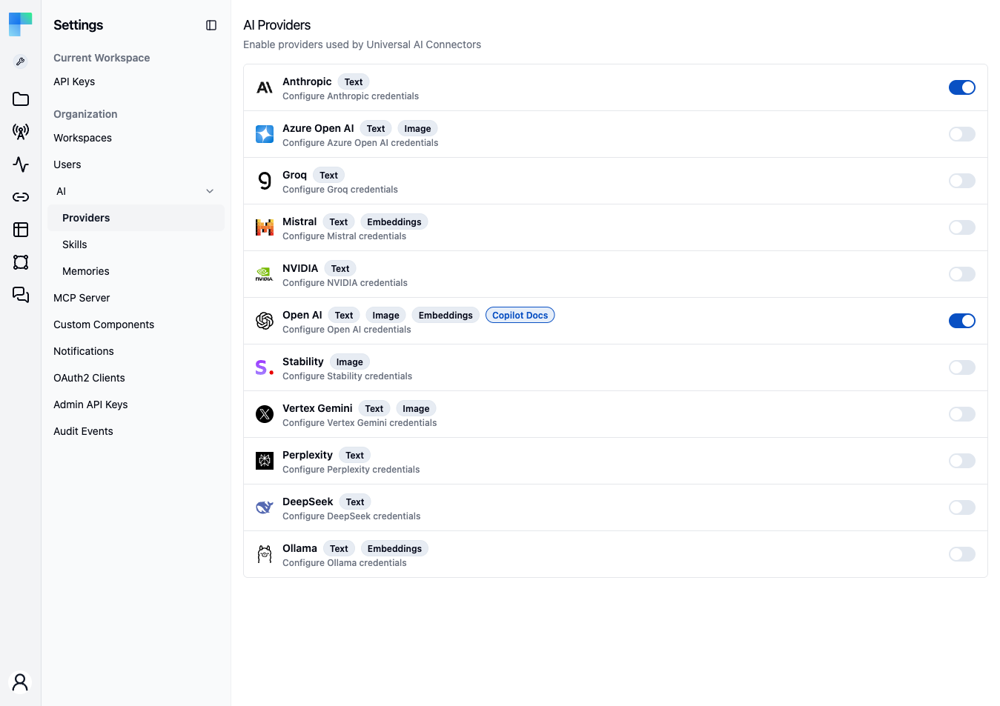
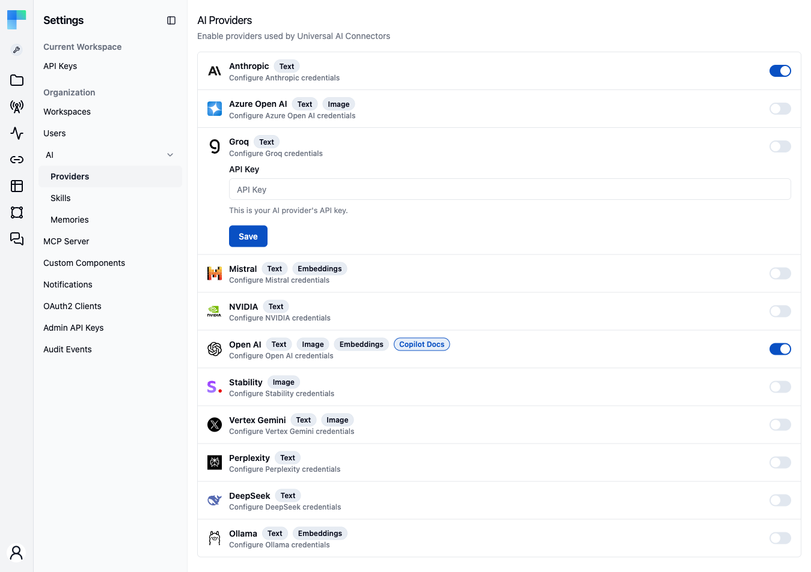
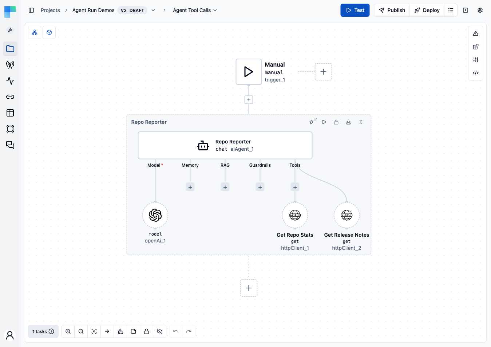

The universal AI components, **AI Text** and **AI Image**, run a single AI operation as a workflow step. You select the provider and model on each step from the providers enabled in [AI Providers](/platform/settings/ai/ai-providers), so you do not create a separate connection for each provider.

## Prerequisites

- Administrator role. The **AI Providers** settings page is available to administrators only.
- An API key for at least one provider (Ollama needs a base URL instead).

## Enable a provider

AI providers are configured per environment. The environment selector is in the page header.

<Steps>
<Step>

Click your user avatar at the bottom of the left sidebar and select **Settings**.

</Step>
<Step>

Under **AI**, select **Providers**. The **AI Providers** page lists the supported providers. The badges next to each name (**Text**, **Image**, **Embeddings**) show what the provider can be used for.

</Step>
<Step>

Turn on the switch next to the provider.

</Step>
<Step>

Expand the provider and enter the **API Key**. Ollama asks for a **Base URL** (default `http://localhost:11434`) and an optional API key. Azure OpenAI also asks for an **Endpoint**.

</Step>
<Step>

Click **Save**.

</Step>
</Steps>





After you save, the provider appears in the **Provider** field of AI Text and AI Image steps. Select it, then select a **Model**.

## AI Text actions

| Action | Description |
|---|---|
| **Text Generation** | Generates text from a prompt. |
| **Classify Text** | Classifies the text into one of the categories you define. You can add examples. |
| **Extract Data** | Extracts structured data from unstructured text according to a response schema. |
| **Summarize Text** | Summarizes the text in the selected format, optionally with a custom prompt. |
| **Sentiment Analysis** | Classifies the sentiment of the text, typically as `POSITIVE`, `NEGATIVE` or `NEUTRAL`. |
| **Similarity Search** | Splits a large text into chunks and returns the chunks most relevant to a query, as a JSON list. |
| **Score** | Scores the text against criteria you define. |
| **Mask** | Detects sensitive content (keywords, PII, custom patterns) and replaces it with placeholders. Returns the masked text and a mask map. |
| **Unmask** | Restores masked text to its original values using the mask map from **Mask**. |

### Example: route and extract from incoming email

A support workflow receives an email and needs to know what it is about and which order it refers to.

1. Add **Classify Text**. Set **Text** to the email body data pill and add the **Categories** `billing`, `technical` and `sales`. The output is one category as a string, for example `billing`, so a [Branch](/platform/automation/build/workflows/flow-controls#branch) with the expression `${aiText_1}` can route on it.
2. Add **Extract Data**. Set **Text** to the same data pill and **Response Schema** to:

   ```json
   {
     "type": "object",
     "properties": {
       "orderId": { "type": "string", "description": "The order number, such as A-1001" },
       "customerName": { "type": "string" },
       "refundRequested": { "type": "boolean" }
     }
   }
   ```

   The output follows the schema, so later steps read `${aiText_2.orderId}`, `${aiText_2.customerName}` and `${aiText_2.refundRequested}`.

## AI Image actions

| Action | Description |
|---|---|
| **Generate Image** | Generates an image from a text prompt with the selected provider and model. |

## AI Agent

AI Text and AI Image run one request per step. For a step that works toward a goal, calls tools and keeps context across turns, use the [AI Agent](/platform/automation/build/workflows/ai/agent) component. It is a cluster root with its own editor for the model, instructions, tools, chat memory and guardrails.



## Related

- [AI Providers](/platform/settings/ai/ai-providers)
- [AI Agent](/platform/automation/build/workflows/ai/agent)
- [Skills](/platform/settings/ai/skills)
- [Guardrails](/platform/automation/build/workflows/ai/agent/guardrails)
- [AI Text component reference](/reference/components/ai-text_v1)
