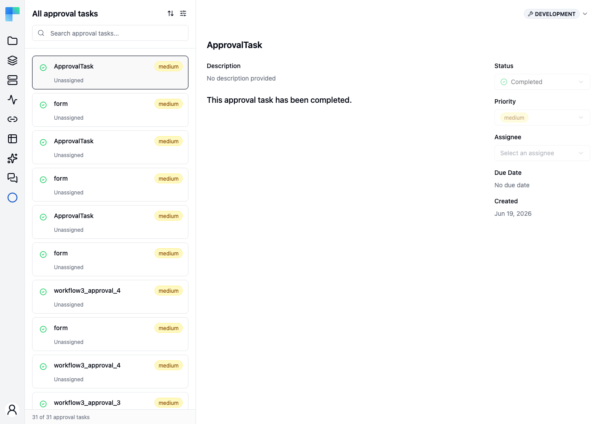

A **human-in-the-loop (HITL)** step pauses a workflow run until a person responds. The person either approves or discards the request, or fills in a form. The run then continues from the same step, and the response is available to later steps as output data.

Human-in-the-loop steps are built with the [Approval](/reference/components/approval_v1) component. Its **Request Approval** action is available as a workflow step and as a tool for an [AI Agent](/reference/components/ai-agent_v1).

## Use cases

- **Approve an action before it runs**, such as a refund above a threshold, sending a contract, or deleting customer data.
- **Review automation output**, such as a lead scored by AI or a drafted reply.
- **Collect input that the trigger did not provide**, such as a discount percentage.
- **Control an AI agent**, by requiring approval before the agent calls specific tools.

## Approval and Ask User Question

ByteChef has two separate human-in-the-loop primitives:

| Primitive | Purpose | How it is answered |
|---|---|---|
| **Approval** | A decision. The result contains `approved` (`true` or `false`). | The buttons on an approval card, a channel message, the hosted form, or the Approval Tasks inbox. Typing a reply in a chat never resolves an approval. |
| **Ask User Question** | A clarifying question from an AI agent. No decision. | A reply in the agent's conversation. See [AI Agent Utils](/platform/automation/build/workflows/ai/agent/agent-utils). |

The rest of this page describes Approval.

## How it works

1. The **Request Approval** step runs and suspends the run. The run state is saved and the worker is released.
2. ByteChef creates a signed resume link and sends the request to every channel attached to the step.
3. The first person to respond resolves the request. Later responses are rejected.
4. The run continues with the next step. The step output contains `approved`, `comment`, `approvedBy` and one property per form field.

### Server configuration

| Setting | Purpose |
|---|---|
| `BYTECHEF_PUBLIC_URL` | Base URL of the approval links. It must be reachable by the approvers. If it is not set, the step fails with *"Cannot generate approval form URL"*. |
| `bytechef.approval.signed-token.secret` | Secret used to sign approval links. When unset, it is derived from the instance's encryption key. In a distributed Enterprise Edition deployment, set the same value on every app that issues or accepts approval links (worker, execution, webhook and runtime job apps). |
| `bytechef.approval.signed-token.required` | When `true`, unsigned links are rejected and an app without a secret fails at startup. Approval resumes always require a signed link, whatever this value is. |

## Interaction modes

The **Request Approval** action supports two modes, selected by whether you define form inputs.

### Approve or discard

Leave **Form Inputs** empty. The channels show **Approve** and **Discard** buttons. The output is `{"approved": true}` or `{"approved": false}`, plus `comment` and `approvedBy`.

A one-click link in an email or message does not resolve the request when the page opens. It opens the hosted form with the decision preselected, and the approver clicks **Confirm**. This prevents link scanners and preview bots from resolving requests.

### Form

Add one or more **Form Inputs**. The channels show an **Open Approval Form** button. The approver fills in the form and clicks **Approve** or **Discard**.

Available field types: Checkbox, Custom HTML, Date Picker, Datetime Picker, Email, File, Hidden Field, Input, Number, Password, Radio Button, Select (single or multiple), and Textarea.

The output schema is generated from the fields: one property per **Field Name**, typed to match the field. For example, a Date Picker named `dueDate` becomes a `DATE` property, and later steps reference it as `${approval_1.dueDate}`.

In a chat (the workflow editor's test chat, the Chats page, AI Hub workflow chats and the `@bytechef/chat` widget), the form renders inside the approval card, and the run continues in the same conversation. The `@bytechef/chat` widget shows the **Open Approval Form** link instead when the form contains a File or Custom HTML field.

### Output

| Property | Type | Description |
|---|---|---|
| `approved` | boolean | `true` if approved, `false` if discarded. |
| `comment` | string | The approver's comment, on either outcome. Empty when none was given. A form field named `comment` takes precedence. |
| `approvedBy` | string | The approver's identity, when the channel authenticated the user (an in-place resolution with a verified signature). Empty for the hosted form, which is anonymous. A value submitted in the form body is ignored. |
| *field name* | per field type | One property per form field. |

## Request Approval properties

| Property | Description |
|---|---|
| **Form Title** | Heading of the form, and subject of email and message notifications. |
| **Form Description** | Text shown under the title. |
| **Form Inputs** | Optional form fields. Each field has a **Field Type**, **Field Label**, **Field Name**, **Field Description**, **Placeholder**, **Default value** and **Required** setting. Select and Radio Button fields also have **Field Options**, and Select has **Multiple Choice**, **Min selection** and **Max selection**. |
| **Expires In** | How long the request can be resolved. Minimum `1`. Default: 60 days. |
| **Expires In Unit** | **Hours** or **Days**. Default: **Days**. |

## Approval channels

A channel is a cluster element of type **Channels** (`approvalChannels`) attached to the Approval step. Each channel receives the same request. Delivery is best-effort: a channel that fails is logged and skipped, and the step fails only when every channel fails. The step error lists the cause for each channel.

A step without channels sends no notification. The request can then be resolved only from the Approval Tasks inbox (pending run approvals) or the hosted form.

| Channel | Component | Delivery | Resolves in place |
|---|---|---|---|
| **Chat** | [`chat/v1`](/reference/components/chat_v1) | Inline approval card in the conversation that started the run. Requires a chat trigger. | Yes |
| **Slack** | [`slack/v1`](/reference/components/slack_v1) | Message in a channel or direct message. | Yes, when configured |
| **Discord** | [`discord/v1`](/reference/components/discord_v1) | Message with buttons. | Yes, when configured |
| **Telegram** | [`telegram/v1`](/reference/components/telegram_v1) | Message with buttons. | Yes, when configured |
| **Mattermost** | [`mattermost/v1`](/reference/components/mattermost_v1) | Interactive message. | Yes, without `approvedBy` |
| **Rocket.Chat** | [`rocketchat/v1`](/reference/components/rocketchat_v1) | Message with links to the hosted form. | No |
| **Gmail** | [`google-mail/v1`](/reference/components/google-mail_v1) | HTML email. | No |
| **Microsoft Outlook 365** | [`microsoft-outlook-365/v1`](/reference/components/microsoft-outlook-365_v1) | HTML email. | No |
| **Email** | [`email/v1`](/reference/components/email_v1) | HTML email over SMTP. | No |
| **WhatsApp (Meta)** | [`whatsapp/v1`](/reference/components/whatsapp_v1) | WhatsApp message through the Meta Cloud API. | Yes, when configured |
| **Twilio** | [`twilio/v1`](/reference/components/twilio_v1) | SMS or WhatsApp message with a link. | No |
| **Infobip** | [`infobip/v1`](/reference/components/infobip_v1) | SMS or WhatsApp message with a link. | No |
| **Approval Task** | `approvalTask/v1` | Row in the [Approval Tasks](#approval-tasks-inbox) inbox. | Yes, from the inbox |

### Channel notes

- **Chat** works only for runs started by a chat trigger. A run started by a webhook or schedule with only the chat channel pauses without a visible card; resolve it from the pending run approvals list or the hosted form. Workflow validation warns when a step's channels resolve to chat only and the workflow has no chat trigger.
- **WhatsApp** free-form messages are delivered only inside an open 24-hour customer service window. Add another channel for recipients who have not messaged you recently.
- **Approval Task** sets the task's **Due Date** to the request's expiry.

### Resolving in place

Channels that resolve in place let the approver respond inside the messenger, without opening the hosted form. Each needs a setting on its connection or server, and the messenger's callback URL pointed at ByteChef:

| Channel | Callback URL | Required setting |
|---|---|---|
| Slack | `<public-url>/slack/interactivity` (Slack app **Interactivity Request URL**) | **Signing secret** on the Slack connection |
| WhatsApp (Meta) | `<public-url>/whatsapp/interactivity` | **App secret** on the connection, and `bytechef.webhook.whatsapp.verify-token` for the verification handshake |
| Telegram | `<public-url>/telegram/interactivity` | **Webhook secret token** on the connection |
| Discord | `<public-url>/discord/interactivity` | `bytechef.webhook.discord.public-key` |
| Mattermost | `<public-url>/mattermost/interactivity` | None. The callback is unsigned, so `approvedBy` is not set. |

When a request was already resolved, expired or cancelled, the messenger reply states which.

## Add an approval step

{/* TODO screenshot: workflow editor with an approval task node selected - its properties panel showing the interaction mode and approval channel */}

1. In the workflow editor, click **+** and search for **Approval**.
2. Select the **Request Approval** action.
3. Set **Form Title** and **Form Description**.
4. Optional: add **Form Inputs**. Leave them empty for approve or discard.
5. Optional: set **Expires In** and **Expires In Unit**.
6. Add one or more channels under **Channels** and configure each one.
7. Reference `${approval_1.approved}` and the form field names in later steps.

Use a [Condition](/reference/flow-controls/condition_v1) after the approval step to branch on the result.

### Example

```yaml
tasks:
  - name: approval_1
    type: approval/v1/requestApproval
    label: "Approve refund"
    parameters:
      formTitle: "Refund request"
      formDescription: "Customer ${trigger_1.body.email} requested a refund of ${trigger_1.body.amount} USD."
      expiresIn: 4
      expiresInUnit: "HOURS"
    clusterElements:
      approvalChannels:
        - name: slack_notify
          type: slack/v1/slack
          parameters:
            channel: "C01234567"
  - name: condition_1
    type: condition/v1
    parameters:
      rawExpression: true
      expression: "=${approval_1.approved} == true"
```

### Example with a form

This step asks the approver for a discount percentage. In the definition, **Field Type** is stored as a number (`9` is Number); the values are the same as for the [Form](/platform/automation/build/workflows/forms) trigger.

```yaml
- name: approval_1
  type: approval/v1/requestApproval
  parameters:
    formTitle: "Approve discount"
    formDescription: "Quote ${trigger_1.body.quoteId} for ${trigger_1.body.customer}"
    inputs:
      - fieldType: 9
        fieldLabel: "Discount (%)"
        fieldName: "discount"
        required: true
```

When the approver fills in the hosted form and clicks **Approve**, the step output looks like this. `approvedBy` is empty because the hosted form is anonymous:

```json
{
  "approved": true,
  "comment": "Within the quarterly budget",
  "approvedBy": "",
  "discount": 15
}
```

Later steps read the value as `${approval_1.discount}`.

## Approval in AI agents

### Request Approval tool

**Request Approval** is also a tool. Attach it to an AI Agent under **Tools**. When the agent calls it, the run pauses, the channels notify the approver, and the response is returned to the agent as the tool result.

### Approval Gate

The **Approval Gate Tool** (AI Agent Utils) requires approval before the agent calls specific tools. Attach the gate to the agent under **Tools**, then attach the tools to protect beneath the gate.

- Each call to a gated tool pauses the run and shows the reviewer the tool name and the arguments chosen by the model.
- **Approve** runs the call with exactly those arguments.
- **Discard** returns a "denied by reviewer" result to the agent, which can then choose another approach.
- The model cannot call a gated tool without approval, and does not see the gate itself.

Gate properties:

| Property | Description |
|---|---|
| **Name** | Shown in the approval request and used to group the gated tools in the editor. |
| **Expires In** / **Expires In Unit** | How long a request from this gate can be resolved. Default: 60 days. |

An agent can have several gates, each with its own channels and expiry. A gate without channels uses the chat channel.

Restrictions, checked by workflow validation and at run time:

- A gate cannot be nested inside another gate.
- **Request Approval** cannot be attached inside a gate.
- Neither can be used in a subagent.

In the execution view, each gated call appears in the agent's call list as **Waiting for a response** while it waits, **Denied** (with the reviewer and comment) when discarded, or completed with the approved tool run nested under it.

### MCP and A2A callers

- An MCP tool call that pauses on an approval returns an `approval_required` result with the form URL. Clients that support URL elicitation are prompted to open the form; clients that support only form elicitation get an inline approve and comment form. After approval, the same tool call returns the run's output. At most three elicitation rounds run per call.
- An A2A `message/send` call returns the paused task with `input-required` status and the form URL. A later `tasks/get` returns the final output.

## Approval Tasks inbox

The **Approval Tasks** page is the in-app inbox for approval requests. Open it from the account menu at the bottom of the sidebar: **Approval Tasks**. It shows the requests of the [environment](/platform/automation/deploy/environments) selected in the page header.



### Pending run approvals

Administrators see a **Pending run approvals** list at the top of the page. It lists every run waiting on an approval in the current environment, whatever channel delivered the request, with the workflow name, start time, expiry, and an **Open form** link. The list refreshes every 30 seconds.

### Task list

The left pane lists approval tasks as cards with status, title, priority and assignee. An **Overdue** badge marks tasks past their due date. Use the search box, the sort menu and the filters (status, priority, assignee) to narrow the list. The list opens filtered to **Open** tasks; click **Clear filters** to show all tasks.

Tasks are created by the **Approval Task** channel. Click **New Approval Task** to create one manually.

### Task detail

The right pane shows the selected task: title, **Description**, and the approval form. Submit the form to resolve the request; the run continues as if the approver had used an external link. Completed and expired tasks show a message instead of the form.

| Field | Description |
|---|---|
| **Status** | **Open**, **In Progress**, **Completed** or **Expired**. |
| **Priority** | **High**, **Medium** or **Low**. |
| **Assignee** | The user responsible. New tasks are unassigned. |
| **Due Date** | The request's expiry, when set by the approval step. |
| **Created** | When the request was raised. |

Use the comments section to add notes to a task.

### Task status updates

ByteChef updates task status automatically:

- **Completed** when the run resumes.
- **Expired** when the approval expires, or the run is stopped, fails or is deleted.

A reconciliation job runs every 15 minutes and corrects tasks whose run state changed without an update (property `bytechef.automation.approval-task.reconciliation.enabled`, default `true`).

## Lifecycle

| Event | Behavior |
|---|---|
| Expiry | Default 60 days, set per step with **Expires In**. After expiry, the request cannot be resolved, the run fails with the reason stored on the run, links return HTTP `410`, and the inbox task becomes **Expired**. A sweep runs every 15 minutes on the coordinator. |
| Response | The resume link is single-use. Later responses return HTTP `410`. |
| Stop | Stopping a run that waits on an approval cancels the approval. |
| Restart | Restarting a run that waits on an approval returns HTTP `409`. |
| Editor test run | The step suspends but sends nothing to channels. Open the returned `formUrl` manually. The Request Approval tool returns a result stating that it cannot be approved in the editor. |
| Synchronous runs | A workflow that contains a step that can pause the run (an approval step, a wait step, or an agent with an Approval Gate) is rejected before it starts when called synchronously. |

There are no reminders or escalation. An expired approval fails the run, which triggers `JOB_FAILED` notifications.

## Metrics

| Metric | Type | Description |
|---|---|---|
| `bytechef_approval_pending` | Gauge | Runs waiting on an approval. |
| `bytechef_approval_expired` | Counter | Expired approvals, tagged by `source` (`resume`, `timer`, `sweep`). |
| `bytechef_approval_request` | Counter | Successful channel deliveries, tagged by channel. |
| `bytechef_approval_delivery_failure` | Counter | Failed channel deliveries, tagged by channel. |
| `bytechef_approval_resolution` | Counter | Resolutions, tagged by `approved`. |

## Related

- [`approval/v1`](/reference/components/approval_v1) - component reference.
- [Workflow Executions](/platform/automation/monitor/workflow-executions) - the run that waits on a request.
- [Notifications](/platform/settings/notifications) - `JOB_FAILED` notifications for expired approvals.
