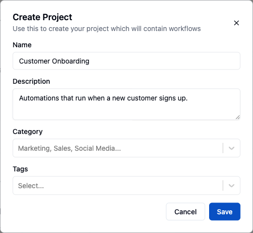
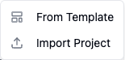
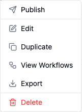
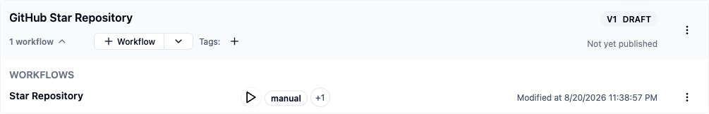
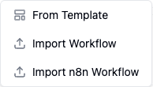
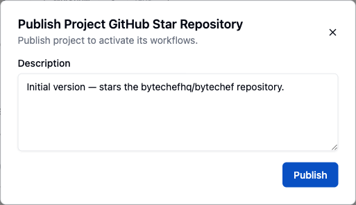
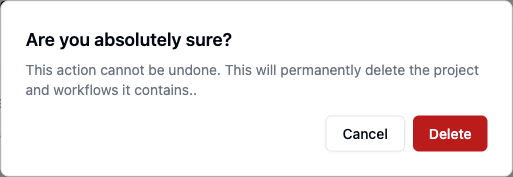

Every project on ByteChef consists of one or more workflows. Projects help organize and manage workflows, making it
easier to group related automation processes together.

## A project is the unit you publish

A project is not only a folder. It is the thing that gets versioned and deployed, so where you draw
the project boundary decides what ships together.

- **Workflows in one project are published together.** Publishing snapshots *every* workflow in the
  project into one immutable version - you cannot publish half a project.
- **Versions are immutable.** Once a version is published, its workflows are frozen; further edits
  go to a fresh draft. A published version is what a deployment runs, and it stays available for
  rolling back. See [Deploy Workflows](/platform/automation/deploy/workflows).
- **Deployment is separate from publishing.** A project deployment binds one published version to
  one [environment](/platform/automation/deploy/environments), with its own connections and its own
  set of enabled workflows. The same version can be deployed to several environments.
- **A project belongs to exactly one workspace.** Data tables, knowledge bases, and connections are
  workspace-scoped, so they are shared across the workspace's projects rather than owned by one of
  them. See [Workspaces](/platform/settings/workspaces).

Access is governed by [workspace roles](/platform/settings/users#roles-and-permissions) - Admin,
Editor, or Viewer - granted per member on the workspace and applying to every project inside it.
There are no per-project roles. In the Enterprise Edition a project also has a **visibility**, which
decides who in the workspace can see it at all; see [Project visibility](#project-visibility) below.

A project has two states, not three: a live **draft** that the editor writes to, and any number of
**published** versions. Deleting a project is permanent - export it first if you might want it back.

## Project visibility

<Callout type="warn" title="Coming soon">
    Project visibility is on the upcoming release track and is not yet available in the latest
    released version of ByteChef. It is an Enterprise Edition feature.
</Callout>

Every project carries one visibility:

| Visibility | Who can see the project |
|---|---|
| **Shared with workspace** (`WORKSPACE`) | Every member of the project's workspace. This is the default. |
| **Private** (`PRIVATE`) | The project's creator, plus anyone it is shared with. |

A project belongs to exactly one workspace, so it cannot be shared across the organization: the
`ORGANIZATION` level that connections have does not exist for projects.

**Specific people** is not a third level. It is a private project plus a list of named workspace
members who were given access. Switching a project back to **Shared with workspace** keeps that list,
so making it private again restores the same audience. Only members of the project's workspace can be
named.

### Everything in a project follows its visibility

A project's workflows, deployments and workflow executions have no visibility of their own: they are
exactly as visible as the project. When a project is private, a member who cannot see it

- does not find the project, its workflows, its deployments or its executions in any list or search, and
- is refused (HTTP 403, or a GraphQL `FORBIDDEN` error) when opening any of them directly.

Visibility comes on top of workspace roles, not instead of them: a member still needs the scope for
what they do, such as `WORKFLOW_EDIT` to change a workflow. Visibility only decides whether the project
exists for them. It does not stop anything from running: deployments of a private project keep
executing on their triggers as before.

Organization admins (the `ROLE_ADMIN` authority) see every project, private or not.

### Choosing and changing visibility

- **When creating a project**, the **New Project** dialog offers **Shared with workspace** and
  **Private**. People can be named only after the project exists.
- **On the Projects page**, a project's visibility shows as a badge next to its name. For the
  project's creator and for organization admins the badge is a button: click it to choose **Shared
  with workspace**, **Private** or **Specific people**, and pick members from the workspace list.
  Everyone else sees a read-only badge.
- **Inside a project**, the project menu has a **Visibility** item that opens the same choices. It
  is offered to the project's creator and to organization admins.

Changes apply immediately; there is no separate save step. A workspace admin may also change a
project's visibility and sharing through the API.

When a project is deleted, its list of named people is deleted with it.

Each change is recorded in the audit log as `PROJECT_VISIBILITY_CHANGED`, `PROJECT_ACCESS_GRANTED`
or `PROJECT_ACCESS_REVOKED`. See [Audit Events](/platform/settings/audit-events).

In the Community Edition every project is shared with its workspace and there is no visibility
picker.

## Create Project

<Steps>
<Step>

Navigate to the **Projects** tab.

</Step>
<Step>

Click on the **New Project** button located in the top right corner.

</Step>
<Step>

Enter a name for your project. Optionally, provide a description, select a category, and add relevant tags.

</Step>
<Step>

Click **Save**.

</Step>
</Steps>

The dropdown arrow next to the **New Project** button offers two more ways to start a project: **From Template** and **Import Project**.

## Create Project from Template

<Steps>
<Step>

Click the dropdown arrow next to the **New Project** button in the top right corner.

</Step>
<Step>

Select **From Template** from the dropdown menu.

</Step>
<Step>

Browse the template gallery, pick a pre-built or community-shared project template, and import it.

</Step>
</Steps>

For details on the gallery and the import flow, see [Templates](/platform/automation/build/workflows/templates).

## Import Project

<Steps>
<Step>

Click the dropdown arrow next to the **New Project** button in the top right corner.

</Step>
<Step>

Select **Import Project** from the dropdown menu.

</Step>
<Step>

Choose the project archive (`.zip`) file exported from ByteChef.

</Step>
<Step>

The imported project, together with its workflows, appears in the project list.

</Step>
</Steps>

## New Code Workflow

<Callout type="warn" title="Coming soon">
    Creating a code workflow from the Projects page is on the upcoming release track and is not yet
    available in the latest released version of ByteChef. Today a code workflow is authored outside
    the product and deployed through the API - see
    [Code Workflows](/platform/automation/build/workflows/code-workflows).
</Callout>

<Steps>
<Step>

Click the dropdown arrow next to the **New Project** button in the top right corner.

</Step>
<Step>

Select **New Code Workflow** from the dropdown menu.

</Step>
<Step>

Give the code workflow a name and pick its language, then edit the workflow definition directly in code.

</Step>
</Steps>

A code workflow runs on the same engine as a visually built one - see [Build Approaches](/platform/automation/build/workflows/build-approaches) for when to choose full-code.

## Edit Project

<Steps>
<Step>

Locate the project you wish to edit and click on the three dots next to its name.

</Step>
<Step>

Select **Edit** from the dropdown menu.

</Step>
<Step>

Modify the project name, description, category, or tags as needed.

</Step>
<Step>

Click **Save** to apply your changes.

</Step>
</Steps>

## Duplicate Project

<Steps>
<Step>

Find the project you want to duplicate and click on the three dots next to its name.

</Step>
<Step>

Select **Duplicate** from the dropdown menu.

</Step>
<Step>

The duplicated project will appear in the project list with the same name followed by a numerical suffix (e.g., Project Name (1)).

</Step>
</Steps>

## Export Project

<Steps>
<Step>

Click on the three dots next to the project name you wish to export.

</Step>
<Step>

Select **Export** from the dropdown menu.

</Step>
<Step>

A project archive (`.zip`) containing the project and all of its workflows downloads to your computer. Use it to back up a project or import it into another workspace or ByteChef instance.

</Step>
</Steps>

## Create Workflow

<Steps>
<Step>

Click **+ Workflow** on the row of the project you want to add a workflow to.

</Step>
<Step>

Enter a label for your workflow and optionally provide a description.

</Step>
<Step>

Click **Save** to create the workflow.

</Step>
</Steps>

## Import Workflow

<Steps>
<Step>

Click the dropdown arrow next to the **Workflow** button on the project where you want to import a workflow.

</Step>
<Step>

Select **Import Workflow** from the dropdown menu.

</Step>
<Step>

Choose the JSON file containing the workflow you wish to import.

</Step>
</Steps>

## Import n8n Workflow

<Steps>
<Step>

Click the dropdown arrow next to the **Workflow** button on the project where you want to import a workflow.

</Step>
<Step>

Select **Import n8n Workflow** from the dropdown menu.

</Step>
<Step>

Choose the JSON file exported from n8n.

</Step>
<Step>

ByteChef converts the n8n workflow and adds it to the selected project.

</Step>
</Steps>

## Publish Project

<Steps>
<Step>

Click on the three dots next to the project name you wish to publish.

</Step>
<Step>

Select **Publish** from the dropdown menu.

</Step>
<Step>

Provide a description for this published version to document any changes or updates.

</Step>
<Step>

Click **Publish** to make the project available.

</Step>
</Steps>

## Share Projects and Workflows as Templates

Beyond [exporting a project](#export-project) to a `.zip` file for your own backups, a project - or
an individual workflow, from its own three-dot menu - can be shared as a **template** that anyone
with the link can import into their own workspace.

<Steps>
<Step>

Click on the three dots next to the project (or workflow) name and choose **Share**.

</Step>
<Step>

Write a **Description** of what it does - this is required before you can export it.

</Step>
<Step>

Click **Export and generate template link**. The dialog turns into a link card with a **Copy link** button; anyone who opens the link can import it through `/import/shared/projects/{uuid}` (workflows use `/import/shared/workflows/{uuid}`).

</Step>
<Step>

Use the toggle at the top of the dialog to **disable** the link at any time - the existing link stops working - and to re-enable it later, which generates a fresh export.

</Step>
<Step>

If you keep editing the project after sharing it, the dialog notes that "an older version... is shared as a template" and offers an **Update template based on the current version** button, so the link always points at what you intend.

</Step>
</Steps>

A second, separate action - **Share with Community** - opens ByteChef's public template submission
form in a new tab, for projects and workflows you want listed in the official gallery (see
[Templates](/platform/automation/build/workflows/templates)) rather than shared privately by link.

## Delete Project

<Steps>
<Step>

Locate the project you want to delete and click on the three dots next to its name.

</Step>
<Step>

Select **Delete** from the dropdown menu.

</Step>
<Step>

Confirm the deletion if prompted.

</Step>
</Steps>

