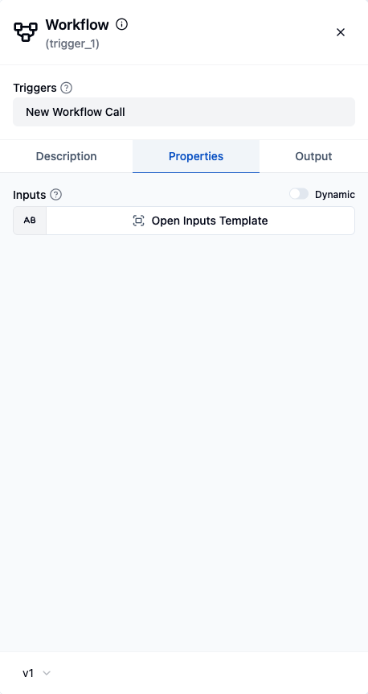

A **subflow** runs another workflow as a single step of the current workflow. The called workflow is a regular workflow that is *callable*: it declares the data it accepts, does the work and sends a response back. Use subflows to reuse logic instead of copying it into every workflow.

A callable workflow uses two operations of the built-in **Workflow** component:

| Piece | Type | Role |
|---|---|---|
| **New Workflow Call** | Trigger (`workflow/v1/newWorkflowCall`) | The entry point. Its **Inputs** property defines the input schema that the caller must provide. |
| **Response to Workflow Call** | Action (`workflow/v1/responseToWorkflowCall`) | The exit point. Its **Output Schema** defines what the caller receives. Must be the last step. |

The [API Platform](/platform/automation/deploy/api-platform) uses the same model (trigger in, response out) for HTTP callers.

## Build a callable workflow

1. Set the trigger to **New Workflow Call**. In **Inputs**, define the fields the workflow expects from callers. The fields are available to later steps as [data pills](/platform/automation/build/workflows/data-pills).
2. Add the steps that do the work: components, flow controls or nested subflows.
3. Add **Response to Workflow Call** as the last step. Define the **Output Schema**, then fill in the response fields that the schema generates. The caller receives this data as the step output.



In the workflow definition, both schemas are stored as JSON Schema strings. The trigger and the last task look like this:

```json
{
  "name": "trigger_1",
  "type": "workflow/v1/newWorkflowCall",
  "parameters": {
    "inputSchema": "{\"type\":\"object\",\"properties\":{\"customerId\":{\"type\":\"string\"}}}"
  }
}
```

```json
{
  "name": "workflow_1",
  "type": "workflow/v1/responseToWorkflowCall",
  "parameters": {
    "outputSchema": "{\"type\":\"object\",\"properties\":{\"score\":{\"type\":\"number\"}}}",
    "response": { "score": "${script_1.score}" }
  }
}
```

## Call it from another workflow

There are two ways to call a callable workflow:

- **[Subflow](/reference/flow-controls/subflow_v1) flow control** - add a **Subflow** step and select the target in **Workflow**. The list shows workflows that start with **New Workflow Call**, as `Project > Workflow`. The step then shows the input fields of the selected workflow. The step output is the response data, available to later steps like any other step output.
- **Call Workflow tool** - the Workflow component also provides a **Call Workflow** cluster element. Attach it to an [AI agent](/platform/automation/build/workflows/ai/agent) as a tool; the agent supplies the inputs.

In the workflow definition, a Subflow step that calls the workflow above looks like this. `workflowUuid` identifies the callable workflow (the editor fills it in when you select the workflow), and `inputs` has one key per field of its input schema:

```json
{
  "name": "subflow_1",
  "type": "subflow/v1",
  "parameters": {
    "workflowUuid": "<uuid of the callable workflow>",
    "inputs": {
      "customerId": "${trigger_1.body.customerId}"
    }
  }
}
```

Later steps read the response with `${subflow_1.score}`.

## How it runs

A subflow runs as an isolated child job of the parent's Subflow step. The parent starts it directly through the workflow engine.

- **No external trigger fires.** The New Workflow Call trigger defines the interface (the input schema); it is not an event source. Nothing polls and no webhook is called. A callable workflow does not need a webhook or schedule trigger.
- **Inputs and outputs are the whole contract.** The caller provides data that matches the input schema and receives the Response to Workflow Call output. No other data crosses the boundary.
- **Pause and resume work across the boundary.** A child job can pause (for an approval, a question to a person or an agent step) and resume. The parent's Subflow step waits until the child completes.
- **Synchronous runs cannot pause.** A run that must answer its caller immediately cannot wait for a person. This applies to a workflow whose webhook trigger returns a synchronous response, and to a subflow called synchronously from such a workflow or from the editor. A webhook workflow that returns a synchronous response is rejected before it starts if it contains a step that pauses the run, such as an approval or wait step, and a step that still tries to pause a synchronous run fails it with an error that names the step. Use a trigger that responds asynchronously for workflows that need to pause.

## When an AI agent calls a subflow

When an [AI agent](/platform/automation/build/workflows/ai/agent) calls a callable workflow through the **Call Workflow** tool, the agent does not hold a worker while the subflow runs:

- **The agent pauses and the subflow runs as its own job.** It runs as the same user as the agent's run. When it finishes, the agent continues with the subflow's response as the tool result. If the subflow fails, the agent gets the failed step's error message instead, so it can react to it.
- **The agent keeps waiting while the subflow pauses.** A subflow that stops for an approval or a wait step keeps the agent paused until the subflow resumes and finishes.
- **One agent run can call several subflows,** one after another. Only one tool call that pauses the agent is allowed per turn; a second one in the same turn gets an error back.
- **A synchronous run calls the subflow in place.** When the agent's own run cannot pause (see above), the tool runs the subflow synchronously and waits for its response.
- **Nesting is bounded.** An agent can call a subflow whose agent calls another subflow, and so on, up to 10 levels by default (`BYTECHEF_WORKFLOW_EXECUTION_AGENT_MAX_SUBFLOW_DEPTH`; Subflow steps count toward the same depth). A call past the limit is not started and the agent gets an error back, so agents that call each other in a cycle stop instead of looping forever.

<Callout type="info">
A workflow is callable when it has an enabled **New Workflow Call** trigger. To also run the same logic on a schedule or from a webhook, create a separate workflow with that trigger and call the callable workflow from it with a Subflow step.
</Callout>

## Reference

- [Subflow flow control](/reference/flow-controls/subflow_v1) - the step that invokes a callable workflow, with its `workflowUuid`/`inputs` properties.
- [Workflow component](/reference/components/workflow_v1) - the New Workflow Call trigger and Response to Workflow Call action, with their properties.
- [API Platform](/platform/automation/deploy/api-platform) - the same trigger-in/response-out model, exposed to HTTP callers instead of parent workflows.
