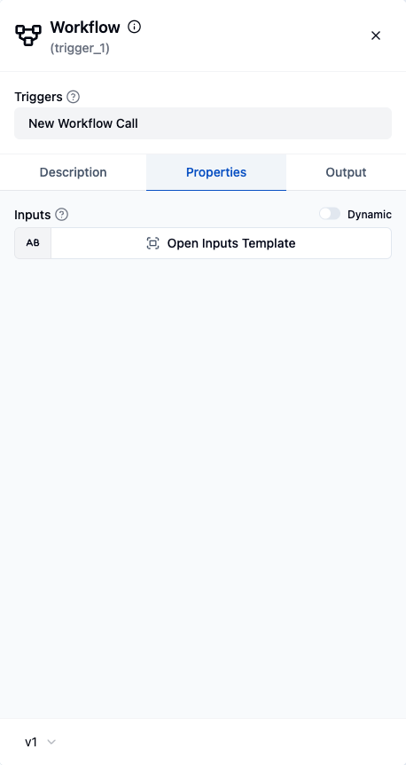

A **subflow** runs another workflow as a single step of the current one. The workflow it calls is a normal workflow that's been set up to be *callable*: it declares what data it accepts, does the work, and sends a response back. So a piece of logic you'd otherwise copy into every workflow becomes one reusable building block.

The callable side is two halves of the built-in **Workflow** component:

| Piece | Type | Role |
|---|---|---|
| **New Workflow Call** | Trigger (`workflow/v1/newWorkflowCall`) | The entry point. Its **input schema** declares what the caller must provide. |
| **Response to Workflow Call** | Action (`workflow/v1/responseToWorkflowCall`) | The exit point. Its **output schema** declares what the caller gets back. *Must be the last step.* |

Think of it as **trigger in, response out** - the same mental model the [API Platform](/platform/automation/deploy/api-platform) uses for HTTP callers.

## Build a callable workflow

1. **Start with the New Workflow Call trigger.** In the trigger's *Inputs* field, define the input schema - the fields this workflow expects from whoever calls it. Callers must supply data matching this shape, and the fields become available downstream as [data pills](/platform/automation/build/workflows/data-pills).
2. **Do the work.** Add any steps you like - components, flow controls, even nested subflows. It's a normal workflow in every other respect.
3. **End with the Response to Workflow Call action.** Define the *Output Schema*, then fill in the *Response* data (built from that schema). This is what the caller receives as the step's output. Because it returns to the caller, it must be the workflow's **last** step.



```json
// The two ends of a callable workflow definition
{
  "name": "newWorkflowCall",
  "type": "workflow/v1/newWorkflowCall",
  "parameters": { "inputSchema": "{ \"customerId\": \"string\" }" }
}
// … your steps …
{
  "name": "responseToWorkflowCall",
  "type": "workflow/v1/responseToWorkflowCall",
  "parameters": {
    "outputSchema": "{ \"score\": \"number\" }",
    "response": { "score": "${computeScore.result}" }
  }
}
```

## Call it from another workflow

Two ways to invoke a callable workflow:

- **[Subflow](/reference/flow-controls/subflow_v1) flow control** - add a *Subflow* step, pick the target workflow, and map the inputs. Its output (the Response data) is available to the rest of the parent workflow, exactly like any other step's output.
- **Call Workflow tool** - the Workflow component also exposes a cluster element so an [AI agent](/platform/automation/build/workflows/ai/universal-ai) can invoke a callable workflow as a tool, choosing the inputs itself.

## How it runs

A subflow runs as an **isolated child job** owned by the parent's Subflow step - the parent launches it directly through the workflow engine. A few practical consequences worth understanding:

- **No external trigger fires.** The New Workflow Call trigger is the *declared interface* (it defines the input schema), not an event source. Nothing polls, no webhook is hit - the parent invokes the child programmatically. So a callable workflow doesn't need - and shouldn't rely on - a webhook or schedule trigger to be reachable as a subflow.
- **Inputs and outputs are the whole contract.** The caller provides data matching the New Workflow Call input schema; it reads back exactly the Response to Workflow Call output. Nothing else crosses the boundary.
- **Suspend/resume works across the boundary.** A child job can pause (for an approval, a human-in-the-loop question, or an agent step) and resume without breaking the parent - the parent's Subflow step waits for the child to complete.
- **Synchronous runs can't pause.** A run that has to answer its caller right away - a workflow whose webhook trigger returns a synchronous response, or a subflow called synchronously from such a workflow or from the editor - has no way to wait for a person. A webhook workflow that returns a synchronous response is rejected before it starts if it contains a step that pauses the run, such as an approval or wait step, and a step that still tries to pause a synchronous run fails it with an error that names the step. Use a trigger that responds asynchronously for workflows that need to pause.

## When an AI agent calls a subflow

When an [AI agent](/platform/automation/build/workflows/ai/universal-ai) calls a callable workflow through the **Call Workflow** tool, the agent doesn't hold a worker while the subflow runs:

- **The agent pauses and the subflow runs as its own job.** It runs as the same user as the agent's run. When it finishes, the agent continues with the subflow's response as the tool result. If the subflow fails, the agent gets the failed step's error message instead, so it can react to it.
- **The agent keeps waiting while the subflow pauses.** A subflow that stops for an approval or a wait step keeps the agent paused until the subflow resumes and finishes.
- **One agent run can call several subflows,** one after another. Only one tool call that pauses the agent is allowed per turn; a second one in the same turn gets an error back.
- **A synchronous run calls the subflow in place.** When the agent's own run can't pause (see above), the tool runs the subflow synchronously and waits for its response.
- **Nesting is bounded.** An agent can call a subflow whose agent calls another subflow, and so on, up to 10 levels by default (`BYTECHEF_WORKFLOW_EXECUTION_AGENT_MAX_SUBFLOW_DEPTH`; Subflow steps count toward the same depth). A call past the limit is not started and the agent gets an error back, so agents that call each other in a cycle stop instead of looping forever.

<Callout type="info">
If you want the *same* workflow to also run on its own - say, on a schedule or from a webhook - give it that trigger separately. Being callable as a subflow is independent of, and doesn't conflict with, having a normal trigger for standalone runs.
</Callout>

## Reference

- [Subflow flow control](/reference/flow-controls/subflow_v1) - the step that invokes a callable workflow, with its `workflowUuid`/`inputs` properties.
- [Workflow component](/reference/components/workflow_v1) - the New Workflow Call trigger and Response to Workflow Call action, with their properties.
- [API Platform](/platform/automation/deploy/api-platform) - the same trigger-in/response-out model, exposed to HTTP callers instead of parent workflows.
