A workflow is a trigger followed by a sequence of steps (components and flow controls) that runs on the ByteChef workflow engine. Workflows belong to a [project](/platform/automation/build/workflows/projects) and are published and deployed with it. This page describes how to build a workflow in the visual editor, test it, and manage it.

## Create Workflow

<Steps>
<Step>

On the **Projects** page, expand the project and click **New Workflow** on the **Workflows** tab. In the workflow editor, you can also click **New Workflow** in the left sidebar.

</Step>
<Step>

Provide a label for your workflow. Optionally, add a description to explain its purpose.

</Step>
<Step>

Click **Save** to create the workflow.

</Step>
</Steps>

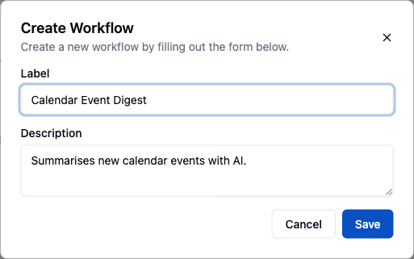


### Add Component

<Steps>
<Step>

Click the **+** icon to add a new component to the workflow.

</Step>
<Step>

Find and select **Math Helper** component.

</Step>
<Step>

Select the **Addition** action from the list.

</Step>
<Step>

In the **Properties** tab, enter the numbers you want to add.

</Step>
<Step>

For **First Number**, input the first value (e.g., `2`).

</Step>
<Step>

For **Second Number**, input the second value (e.g., `3`).

</Step>
<Step>

Click **Test** in the editor header.

</Step>
<Step>

In the Output panel at the bottom of the editor, check the input and output of the addition action.

</Step>
</Steps>

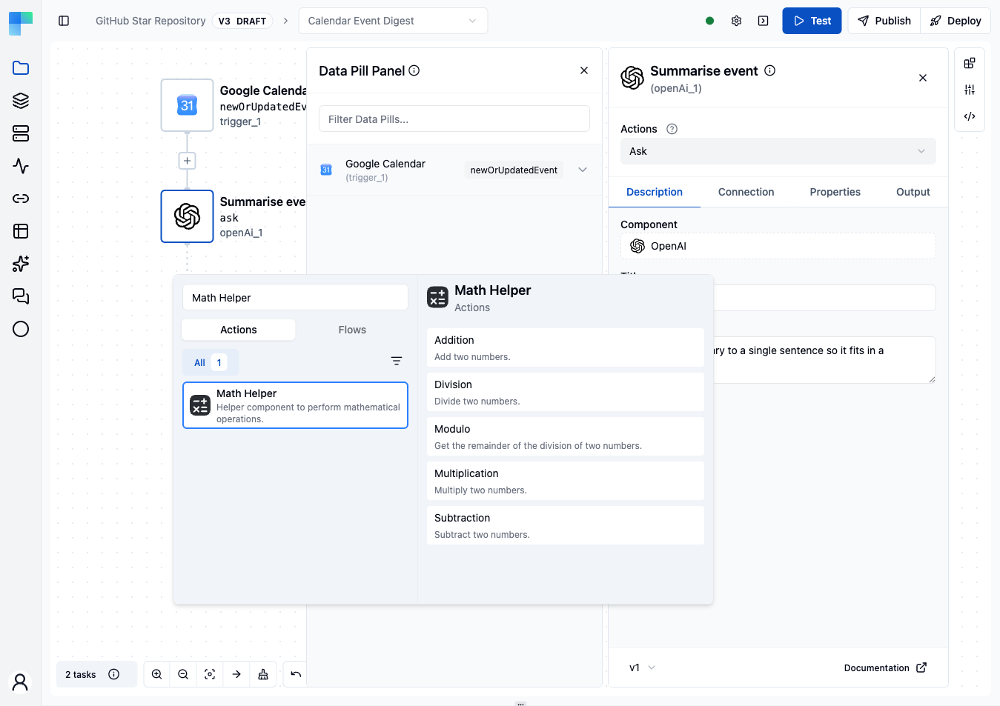


### Use Data Pill

<Steps>
<Step>

Click the **+** icon to add a new component to the workflow.

</Step>
<Step>

Find and select **OpenAI** component.

</Step>
<Step>

Select the **Ask** action from the list.

</Step>
<Step>

Click the **OpenAI** component to open its configuration panel.

</Step>
<Step>

In the **Connection** tab, click **Create Connection**.

</Step>
<Step>

Enter a connection name and paste your OpenAI API key into **Token**.

</Step>
<Step>

Click **Save**.

</Step>
<Step>

Click **Choose Connection**.

</Step>
<Step>

Select the connection you just created.

</Step>
<Step>

Go to the **Properties** tab.

</Step>
<Step>

For **Model**, choose the desired model (e.g., `gpt-4`).

</Step>
<Step>

Leave **Format** on **Simple** (the default), which asks for a prompt instead of a message list.

</Step>
<Step>

For **Prompt**, enter the prompt text, such as `Tell me something about this number:`.

</Step>
<Step>

Click the prompt field. The Data Pill Panel opens on the left. Use it to insert output from a previous component.

</Step>
<Step>

Click the **Math Helper** component in the Data Pill Panel.

</Step>
<Step>

Click **mathHelper_1**, which is the output of the addition action for the Math Helper component.

</Step>
<Step>

The output of the Math Helper component is now inserted into the prompt field. Click **Test** in the editor header.

</Step>
<Step>

In the Output panel, review the input and output of each action in the workflow. Click **OpenAI**.

</Step>
<Step>

Verify that the result of the addition action is correctly inserted in the prompt field.

</Step>
</Steps>

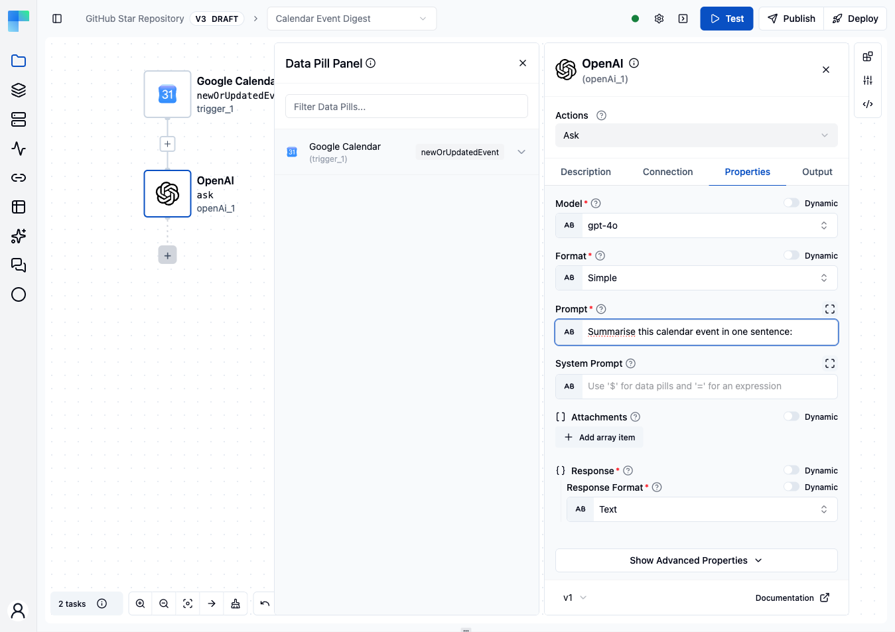


### Output

Each component in a workflow can be tested individually to verify its output. In the Configuration Panel, you can explore the output structure of an action through the **Output** tab.

<Steps>
<Step>

Click the component you want to test within your workflow.

</Step>
<Step>

Go to the **Output** tab to view the output of the component.

</Step>
<Step>

The output schema is displayed here, illustrating the structure of the output data. For example, the output of the **Addition** action is represented as a number, indicated by hashtag icons.

</Step>
<Step>

Note that the value `23.34` shown in the output schema is a placeholder and not the actual result of the action.

</Step>
<Step>

Use **Test Action** to run the action for real, or the **…** menu beside it for **Upload Sample Output** and **Reset**.

</Step>
<Step>

**Test Action** executes the action and shows its real output - in this case, `5`.

</Step>
<Step>

**Upload Sample Output** lets you supply your own sample payload instead of running the action.

</Step>
<Step>

**Reset** returns the tab to the generated schema with sample values.

</Step>
</Steps>

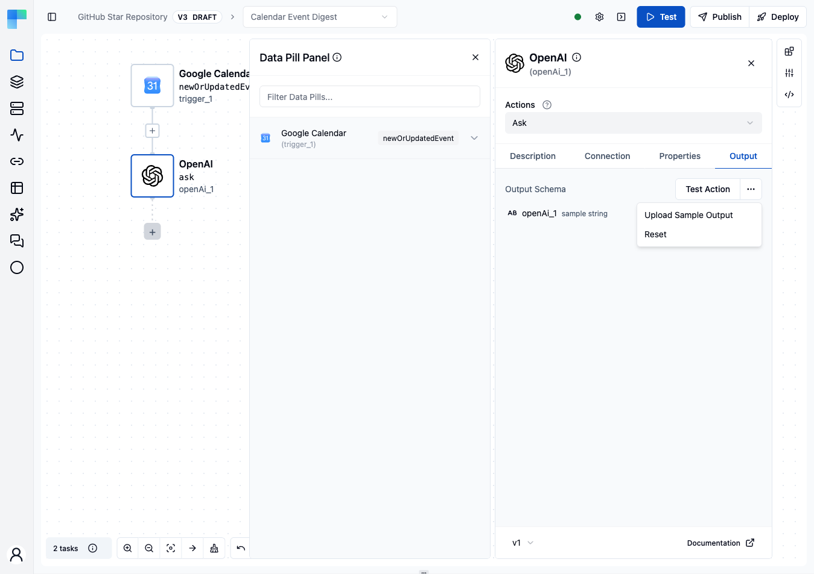

To summarize:

- **Test Action**: Executes the action and displays the real output.
- **Upload Sample Output**: Uploads your own sample output data.
- **Reset**: Displays the structure of the output data with sample values.

Some components have no predefined output schema because their output is dynamic. Test the component to see its output.


### Add Trigger

<Steps>
<Step>

Hover the trigger node, open its **⋮ Node actions** menu, and choose **Replace**.

</Step>
<Step>

Search for and select **Schedule**.

</Step>
<Step>

Select **Cron**.

</Step>
<Step>

Click the **Properties** tab.

</Step>
<Step>

In **Cron Expression**, enter `* * ? * *`. The expression has five fields (minute, hour, day of month, month, day of week), without seconds.

</Step>
<Step>

Select a **Timezone**.

</Step>
</Steps>

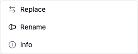

After picking **Schedule → Cron**, set the expression and timezone on the **Properties** tab.

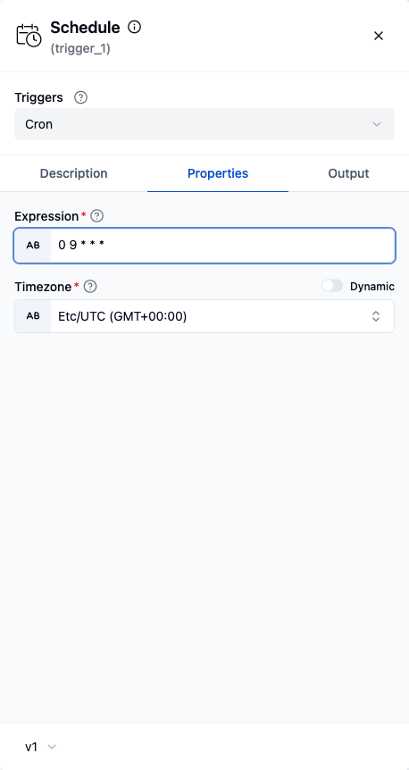


#### Multiple triggers

A workflow can have **more than one trigger** - for example, run on a schedule *and* on an incoming webhook. On deployment every trigger that is not disabled is activated, and any of them can start a run of the same workflow.

- **Add a trigger:** click the dashed **+** slot next to the last trigger (to its right in the vertical layout, below it in the horizontal layout) and pick a trigger, or drag a trigger from the components list onto the slot.
- **Replace a trigger:** open the trigger's node menu and choose **Replace**, or drop a different trigger onto it.
- **Remove a trigger:** open the trigger's node menu, or right-click the trigger, and choose **Delete**. Delete is offered only while the workflow has more than one trigger, so a workflow always keeps at least one.
- **Test from a specific trigger:** click the trigger to open its panel, then click **Test** in the header. The test run starts from that trigger if it is enabled, with its sample output as the trigger's output. With no trigger panel open, a test run starts from the first enabled trigger.
- **Disable a trigger:** open the trigger's node menu (⋮) or right-click the trigger, and choose **Disable**. Choose **Enable** to turn it back on. The trigger keeps its configuration and is shown muted with a **Disabled** badge. See [Disabling a trigger](#disabling-a-trigger).

Every trigger connects to the first step of the workflow, and their connections join into a single line with one **+** for inserting a step after the triggers.

#### Disabling a trigger

Disabling a trigger keeps it in the workflow without letting it start runs. This is useful when you want to pause one trigger and keep the others.

Disabling takes effect the next time the workflow is published and deployed. A running deployment keeps its triggers until then.

While a trigger is disabled:

- It never starts a run, and it is not activated on deployment.
- Incoming requests to its webhook, chat or form URL are refused.
- It is not exposed through MCP, A2A or the API Platform.
- A subflow step that calls a workflow whose callable trigger is disabled fails.

A disabled trigger still needs its connections to be set up before you deploy.

The last enabled trigger cannot be disabled, so a workflow always keeps at least one. Manual triggers cannot be disabled.

### Node actions

Hover a node and open its **⋮** menu, or right-click the node.

| Node | Actions |
|---|---|
| Trigger | **Replace**, **Rename**, **Disable** / **Enable**, **Info**, **Delete** (only when the workflow has more than one trigger) |
| Task | **Cut**, **Replace**, **Copy**, **Paste**, **Rename**, **Disable** / **Enable**, **Reset position** (only when the node was moved), **Info**, **Delete** |

A disabled task is skipped during execution. It keeps its configuration and is shown muted with a **Disabled** badge.

### Edit Component

<Steps>
<Step>

Click the component you want to edit.

</Step>
<Step>

On the **Description** tab, change the **Title** and add **Notes**.

</Step>
</Steps>

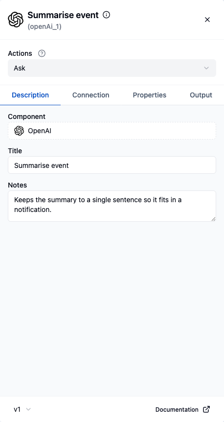


### Stream data in bulk

<Callout type="warn" title="Coming soon">The Data Stream node for bulk record transfer is not available yet.</Callout>

For moving large volumes of records between systems (bulk sync, export, migration), use a **[Data Stream](/platform/automation/build/workflows/data-streams)** node instead of looping over single-record actions.

### Canvas Layout

The editor arranges nodes automatically in a top-down flow as you build. Nodes are locked in place by default. Click **Unlock node movement** in the canvas toolbar to drag nodes to custom positions; the positions are saved with the workflow.

To discard your manual positions and snap everything back to the automatic layout, click the **Reset layout** button (the broom icon) in the canvas toolbar. To reset a single node instead, open that node's menu and choose **Reset position** (shown only when the node has been moved).

### Add Sticky Notes

Sticky notes let you annotate the workflow canvas - describe what a section does, leave review comments, or link a walkthrough video. They are documentation only and are never executed.

<Steps>
<Step>

Click **Add note** (the sticky note icon) in the canvas toolbar. A note appears in the middle of the visible canvas.

</Step>
<Step>

**Double-click** the note to edit its text. Markdown is supported. To embed a YouTube video, add `@[youtube](<video URL or ID>)` where the video should appear. Click outside the note or press **Esc** to save.

</Step>
<Step>

Drag the note anywhere on the canvas. Select it to show resize handles on its edges.

</Step>
<Step>

Hover over or select the note to show its toolbar. Pick a preset color, or open the custom color picker and enter any hex color; your recently used custom colors are remembered in your browser. The trash icon deletes the note.

</Step>
</Steps>

Sticky notes are saved with the workflow, so everyone who opens it sees the same annotations. They sit behind the workflow's nodes, don't affect the automatic layout, and can be moved even while node movement is locked. In read-only views notes are shown but can't be edited.

### Canvas Controls

Two groups of controls change how the workflow is laid out and viewed. They do not change what the workflow does.

The toolbar in the bottom-left corner of the canvas:

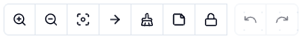

| Control | What it does |
|---|---|
| **Zoom in** / **Zoom out** | Scale the canvas up or down. |
| **Fit to screen** | Frame the whole workflow in the viewport. |
| **Switch to horizontal layout** / **Switch to vertical layout** | Switch the auto-layout direction. The choice is saved per workflow. |
| **Reset layout** | Run the auto-layout again and discard manual node positions. |
| **Add note** | Add a [sticky note](#add-sticky-notes) in the middle of the visible canvas. |
| **Lock node movement** / **Unlock node movement** | Prevent or allow dragging nodes. Nodes are locked by default. |
| **Undo** / **Redo** | Step backward or forward through recent edits. |

The two buttons in the top-left corner of the canvas:

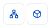

| Control | What it does |
|---|---|
| **Switch to experimental layout engine** / **Switch to standard layout engine** | Switch between the standard and the experimental layout engine. When the workflow contains a flow control the experimental engine does not support, the button is disabled with the tooltip "Experimental layout does not support this workflow yet". |
| **Show cluster elements in the editor dialog** / **Show cluster elements inline** | Switch how cluster roots such as AI agents are shown. See [Cluster roots on the canvas](#cluster-roots-on-the-canvas). |

### Cluster roots on the canvas

A cluster root, such as an AI agent, is drawn by default as a frame on the main canvas, with its model, memory, RAG, guardrails and tools laid out inside it. Each element type has its own lane. The button in the top-left corner of the canvas switches between the inline frame and the cluster element editor dialog. It reads **Show cluster elements in the editor dialog** while the frame is shown and **Show cluster elements inline** while the dialog is used. The choice is remembered in your browser.

The frame starts locked. Unlock it from the frame header to drag its elements. The frame header also resets the elements' layout and collapses the frame to a compact card.

## Workflow Inputs

Workflow inputs are values supplied to a run from outside: a caller's parameters, a deployment configuration value, or a test value you enter in the editor. Define them in the **Workflow Inputs** panel.

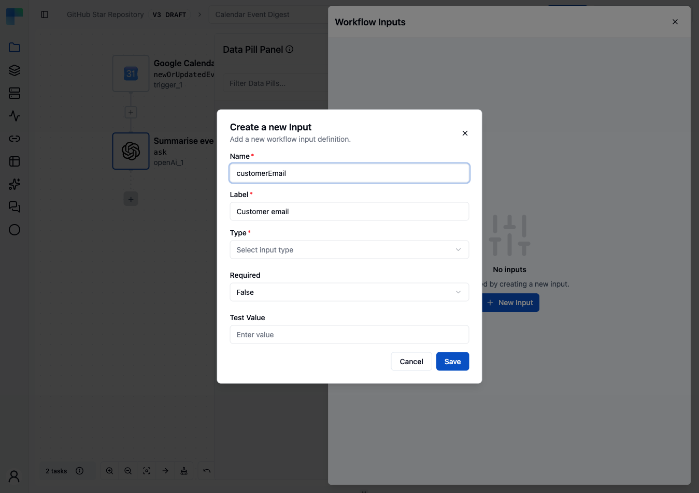

<Steps>
<Step>

In the workflow editor, click the **Workflow Inputs** icon in the right sidebar.

</Step>
<Step>

Click **New Input** and set the fields of the **Create a new Input** dialog:

- **Name** (required) - the key used to reference the input.
- **Label** (required) - the label shown when the input is filled in.
- **Type** (required) - one of Boolean, Date, Date Time, Integer, Number, String or Time.
- **Required** - whether a value must be provided. Default `False`.
- **Test Value** - a value used only when you test the workflow in the editor.

Click **Save**.

</Step>
<Step>

Use the row actions to edit or delete an existing input.

</Step>
</Steps>

Defined inputs are available downstream as [data pills](/platform/automation/build/workflows/data-pills) under the workflow's inputs.

In the workflow definition, inputs are stored in the top-level `inputs` list. The **Test Value** is not part of the definition; it is kept in the editor's test configuration.

```json
"inputs": [
  {
    "label": "Customer ID",
    "name": "customerId",
    "required": true,
    "type": "string"
  }
]
```

A step references an input by its name alone, without a node name: `${customerId}`.

## Workflow Outputs

<Callout type="warn" title="Coming soon">The **Workflow Outputs** panel is not available yet.</Callout>

Workflow outputs declare what the workflow returns to its caller. Open the **Workflow Outputs** panel from the right sidebar.

<Steps>
<Step>

In the workflow editor, click the **Workflow Outputs** icon in the right sidebar.

</Step>
<Step>

The panel lists each output as a **Name** / **Value** row.

</Step>
<Step>

Click **New Output**, then set its **Name** and **Value**. The value is built with data pills or a [formula expression](/platform/automation/build/workflows/data-pills#input-modes), so an output can reference the result of any earlier step.

</Step>
<Step>

Use the row actions to edit or delete an existing output.

</Step>
</Steps>

## Workflow actions

The settings menu (gear icon in the editor header) has a **Workflow** tab with **Edit**, **Duplicate**, **Share**, **Share with Community** (only when a template submission form is configured), **Export** and **Delete**. **Share** works as described in [Share Projects and Workflows as Templates](/platform/automation/build/workflows/projects#share-projects-and-workflows-as-templates).

## Edit Workflow

<Steps>
<Step>

Click the gear icon in the editor header and open the **Workflow** tab.

</Step>
<Step>

Choose **Edit**.

</Step>
<Step>

Change the workflow name or description as needed.

</Step>
<Step>

Click **Save** to apply your changes.

</Step>
</Steps>

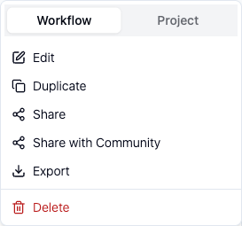


## Duplicate Workflow

<Steps>
<Step>

Click the gear icon in the editor header and open the **Workflow** tab.

</Step>
<Step>

Choose **Duplicate**.

</Step>
</Steps>

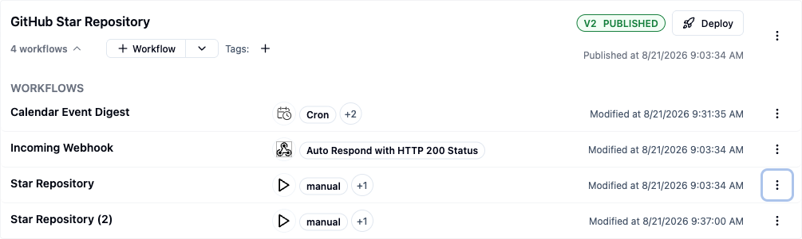


## Export Workflow

<Steps>
<Step>

Click the gear icon in the editor header and open the **Workflow** tab.

</Step>
<Step>

Choose **Export** to download the workflow JSON file.

</Step>
</Steps>


## Publish Workflow

Publishing creates a new version of the whole project, including all its workflows. See [Projects](/platform/automation/build/workflows/projects#a-project-is-the-unit-you-publish).

<Steps>
<Step>

Click **Publish** in the editor header.

</Step>
<Step>

Enter a description of the changes in this version.

</Step>
<Step>

Click **Publish**.

</Step>
</Steps>

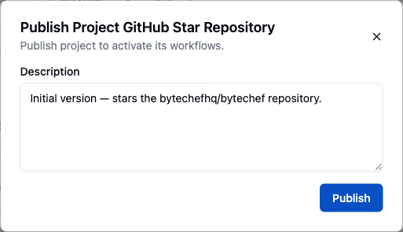


## Editor Header Controls

The editor header, next to **Publish**, contains the controls for testing and deploying the current project.

### Deploy

**Deploy** (tooltip "Deploy the published project version") opens the deployment dialog for the current
project, the same dialog as on the project's **Deployments** tab. See
[Deploy Workflows](/platform/automation/deploy/workflows). Until the project has a published version,
**Deploy** is disabled with the tooltip "Publish the project before deploying it.", because a
deployment always uses a published version. The dialog has two tabs:

- **New** - creates a deployment (**Environment**, **Version**, **Name**, **Description**, **Tags**).
- **Change Version** - points an existing deployment to a different published version.

### Project Deployments

The **Project Deployments** button next to **Deploy** opens a side panel that lists the project's
deployments in the current environment. Use it to enable a deployment, change its version or open a
workflow's executions without leaving the editor. See
[View a Project's Deployments](/platform/automation/deploy/workflows#view-a-projects-deployments).

### Run, Test, and the Output panel

**Test** in the header runs the current workflow from its trigger and shows progress and results in
the **Output panel** at the bottom of the editor. While a run is in progress, the button changes to
**Stop**, which cancels the run. In a workflow with
[multiple triggers](#multiple-triggers), the run starts from the trigger whose panel is open if it is enabled, otherwise from
the first enabled trigger. If the trigger the run starts from is a
chat trigger, the button is labeled **Chat** and opens the [test chat panel](#test-with-chat); you run
the workflow by sending messages.

The button after **Publish** and **Deploy** (tooltip "Show the current workflow test execution output")
opens or closes the Output panel, so you can see the last run's result without starting a new run.

The canvas follows a test run as it executes. A task shows a blue status while it runs, then green with
its duration when it completes, or red when it fails. Edges along the path the run took are colored the
same way, so a branch the run did not take stays grey. A task that runs more than once, for example
inside a loop, shows its total time when the run has finished. Stopping a run, or a failed run, clears
the status of tasks that were still running.

The tools an [AI Agent](/platform/automation/build/workflows/ai/agent#seeing-which-tools-ran) calls are
colored the same way inside its frame and in the cluster element dialog. When the agent is drawn as a
compact card, the card shows the agent's own status and each element icon gets a ring: red if any
element of that type failed, blue if any is still running, otherwise green.

### Settings menu

The gear icon in the header opens the settings menu. It has a **Workflow** tab for the current
workflow and a **Project** tab for its project. The **Project** tab contains **Edit**, **Duplicate**,
**Share**, **Export**, **New Workflow**, **Workflow from Template**, **Import Workflow**, **Import n8n
Workflow** (requires an enabled AI provider), **Project History** and **Delete**. A small indicator on
the gear shows while changes are being saved and turns red when you are offline.

The left workflows sidebar offers the same actions: the **New Workflow** button creates a workflow in
the selected project, and its arrow menu contains **From Template**, **Import Workflow** and
**Import n8n Workflow**. The **+** button beside the project selector creates a new project from
scratch, from a template, or by importing one.

### Project History

**Project History** on the settings menu's **Project** tab opens a side sheet that lists every
version of the project: version number, publish date, a **Published** or **Draft** badge, and the
version description. It shows every version, regardless of which environment, if any, deploys it.
For deployments per environment, see [Deploy Workflows](/platform/automation/deploy/workflows).

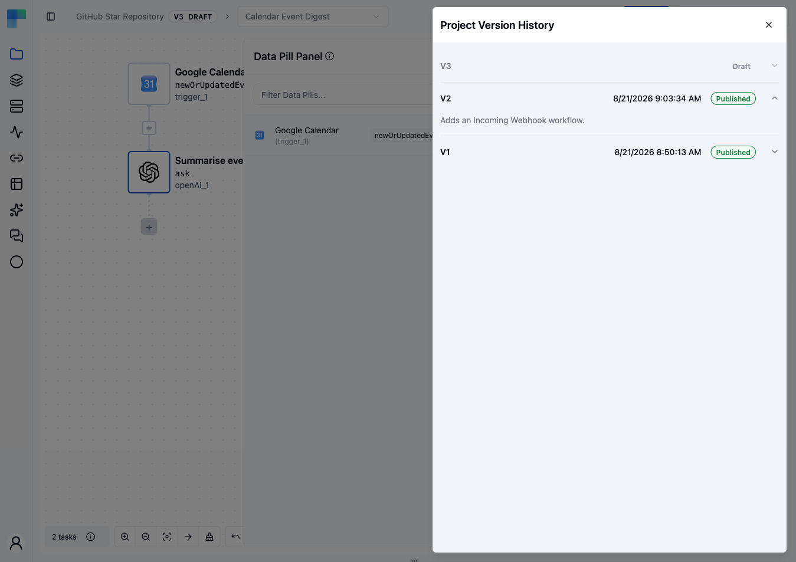

Click the chevron next to a version, the draft included, to see which workflows changed in it compared
with the previous version. The list shows each added, removed or modified workflow, with the change
count for modified workflows, under a summary such as "3 workflows changed (1 added, 2 modified)". The draft is compared with
the last published version. Expanding or clicking inside the list doesn't select the version for restore.

Click a workflow in the list to open its changes in a dialog with three tabs:

- **Changes** - workflow-level changes such as the label and description, and the trigger, task, cluster
  element, input and output changes, with old → new values for every changed parameter. An added or
  removed workflow says so instead of listing changes.
- **Canvas** - a read-only canvas of the workflow with added nodes in green, modified nodes in amber,
  moved nodes in blue and removed nodes in red. A toggle switches between the previous and the selected
  version.
- **Definition** - a side-by-side diff of the workflow definition.

Values of sensitive parameters such as passwords, tokens and API keys are shown as `••••••`.

### Test with Chat

For a chat-triggered workflow, the test chat panel lets you exchange messages with the workflow the
same way an end user does through a deployed [chat](/platform/automation/deploy/chats). Type a
message and send it; the reply streams into the thread as the run executes.

{/* Voice test sessions are coming soon - not in the latest released version, so this section is
commented out until the browser/v1/voiceSession trigger ships. Tracked in
.agents/coming-soon-inventory.md.

On top of typed messages, the panel offers a voice test session. A round mic button appears next to
the composer only when your browser supports the required APIs (AudioContext, AudioWorklet,
microphone access, and WebSocket, over a secure connection) and the trigger you're testing is one
that supports a live, streaming connection. Starting a session asks for microphone permission,
streams your audio to the workflow over a WebSocket, and speaks the assistant's replies back while
transcribing both sides into the same chat thread as typed messages. Click the button again - now
shown as a red stop icon - to end the session; a red banner surfaces any connection or permission
error inline in the panel. */}

## Delete Workflow

<Steps>
<Step>

Click the gear icon in the editor header and open the **Workflow** tab.

</Step>
<Step>

Choose **Delete**.

</Step>
<Step>

Confirm with **Delete**.

</Step>
</Steps>

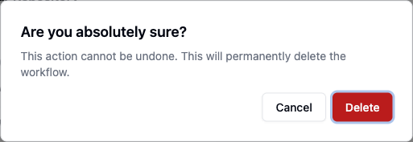


## Code Editor

Every workflow is stored as a JSON definition that you can edit in the code editor. Changes in the code editor are reflected on the canvas and the other way around. Use the code editor for bulk changes or to fix problems that are hard to fix on the canvas.

### Access the Code Editor

<Steps>
<Step>

Click the **Workflow Code Editor** icon in the right sidebar of the editor.

</Step>
<Step>

The code editor opens and shows the JSON definition of the workflow.

</Step>
</Steps>

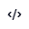

A definition has a `label`, an optional `description`, the workflow `inputs`, the `triggers` list and the `tasks` list. Each trigger and task has a unique `name`, a `type` in the form `component/version/operation`, and its `parameters`. A minimal workflow with a manual trigger and one Logger step looks like this:

```json
{
  "label": "Log a greeting",
  "description": "",
  "inputs": [],
  "triggers": [
    {
      "label": "Manual",
      "name": "trigger_1",
      "type": "manual/v1/manual"
    }
  ],
  "tasks": [
    {
      "label": "Logger",
      "name": "logger_1",
      "parameters": {
        "text": "Hello from ByteChef"
      },
      "type": "logger/v1/info"
    }
  ]
}
```

The editor may also add a `metadata` object to a task. It holds editor state, such as the node position on the canvas, and does not change how the task runs.


### Add Component

To add a component in the code editor, look up its action and properties in the component reference and add a task object to the definition.

<Steps>
<Step>

Go to the [Component Reference](/reference) page.

</Step>
<Step>

Search for the component you want to add. This example uses the **Random Helper** component.

</Step>
<Step>

Click the **Random Helper** component to view its documentation.

</Step>
<Step>

In the Actions section, find the **Random Integer** action.

</Step>
<Step>

Under the `tasks` key, add a new object for the **Random Integer** action.

</Step>
<Step>

Enter the `label` for the UI display, e.g., `Generate Integer`.

</Step>
<Step>

Set the `name` as the action key, e.g., `generatedInt`.

</Step>
<Step>

Under `parameters`, specify the required properties. Here, we need `startInclusive` and `endInclusive` to generate a random integer between two numbers. Set `startInclusive` to `1` and `endInclusive` to `100`.

</Step>
<Step>

Add the `type` for this task: `randomHelper/v1/randomInt`. The `randomHelper/v1` is the component type, and `randomInt` is the action name.

</Step>
</Steps>

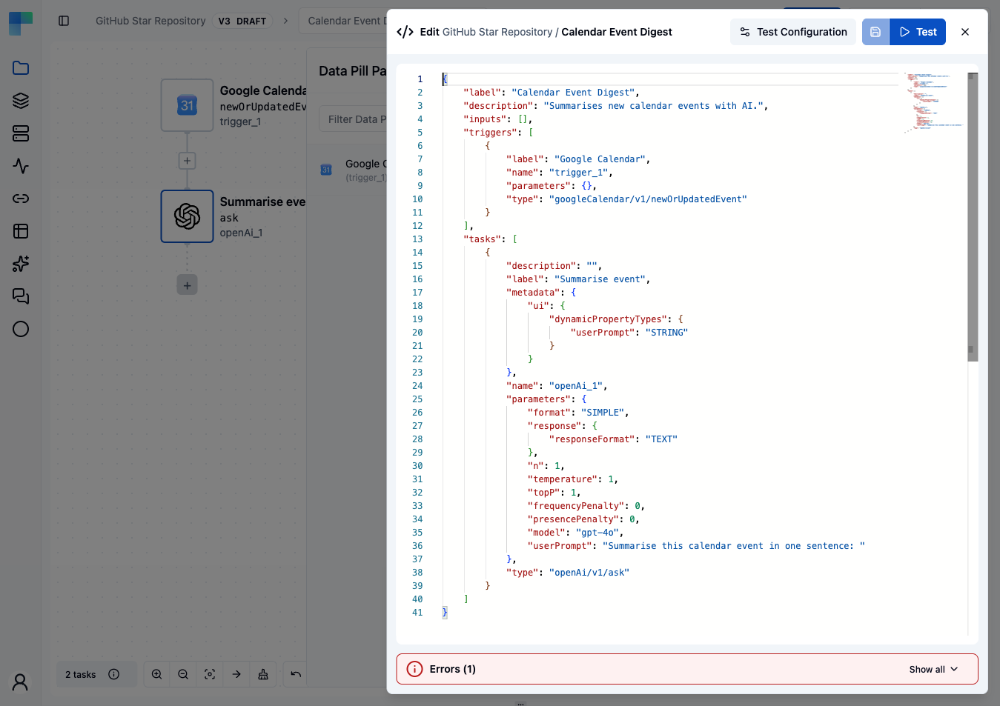

The task looks like this:

 ```json
  {
    "label": "Generate Integer",
    "name": "generatedInt",
    "parameters": {
        "startInclusive": 1,
        "endInclusive": 100
    },
    "type": "randomHelper/v1/randomInt"
}
 ```

<Steps>
<Step>

Click the save icon (tooltip "Save current workflow"). Saving is disabled while the definition has errors.

</Step>
</Steps>

