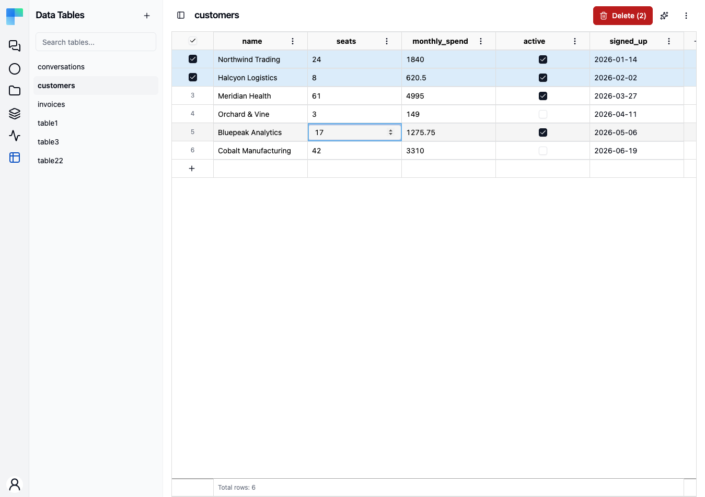
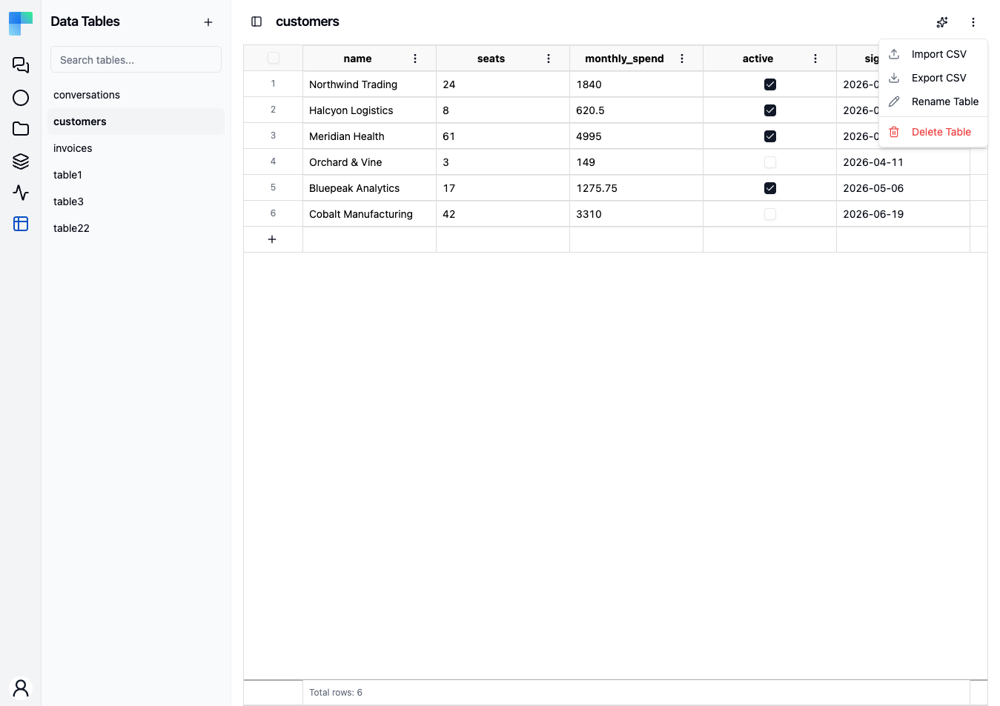

Data Tables give you first-class relational storage inside ByteChef. Create a table with typed columns, manage rows in a spreadsheet-like grid (or by importing a CSV), and read or write that data from your workflows - without standing up an external database.

Use them for lookup tables, configuration, queues, feature flags, deduplication keys, or any small structured dataset your automations need to share.

Data Tables are **workspace-scoped** and **per-environment**: each table belongs to a workspace, and the rows you see depend on the selected environment (Development, Staging, Production).

---

## Create a table

1. In the Automation workspace, open **Data Tables** from the sidebar.
2. Click **New Table**.
3. Enter a **name** and an optional **description**.
4. Define at least one **column** - give it a name and a type (see below).
5. Click **Create**.

Every table automatically has an `id` column that uniquely identifies each row, so `id` is reserved and can't be used as a column name.

### Column types

| Type | Stores |
|---|---|
| **String** | Text |
| **Number** | Decimal numbers |
| **Integer** | Whole numbers |
| **Boolean** | `true` / `false` |
| **Date** | A calendar date |
| **Date Time** | A date and time |

Values are coerced to the column's type, so a row written from a workflow or imported from CSV is stored in the correct shape.

---

## Manage columns

Open a table and use its column menu to:

- **Add a column** - pick a name and type.
- **Rename a column.**
- **Delete a column** - removes that column's values from every row.

---

## Manage rows

The table opens in a spreadsheet-like grid where you can:

- **Add a row** - fill in the new empty row at the bottom.
- **Edit a cell** - click it and type; changes save when you move off the cell. Each cell uses an editor matched to its column type (text, number, checkbox, date, or date-time picker).
- **Delete rows** - select one or more with the row checkboxes and delete them.
- **Import a CSV** - from the grid's **⋮** actions menu, bulk-load rows from a file whose header matches your column names. Header columns the table does not have are skipped. A cell that does not fit its column type stops the import and no row is imported; the error names the CSV line to fix.
- **Export a CSV** - from the same **⋮** menu, download the current rows.

Larger tables load more rows as you scroll. Use **tags** to organize tables once you have several.

On the **Data Tables** list page you can **rename**, **duplicate**, or **delete** a table from its row, and filter the list by tag from the left sidebar.

---

## Use a table in workflows

Add the **Data Table** component to a workflow to read and write your tables as part of an automation. Select the target table, and the action's inputs adapt to that table's columns.

### Actions

| Action | What it does |
|---|---|
| **Create Records** | Insert one or more new rows |
| **Get Record** | Fetch a single row by its `id` |
| **Find Records** | List the rows that match **OR Conditions**, sorted by a column, with **Limit** and **Offset** for paging |
| **Update Record** | Update an existing row by its `id` |
| **Update Records** | Update every row that matches **OR Conditions** with the same values |
| **Delete Record(s)** | Delete rows by their `id`s, or set **Delete By** to **Conditions** to delete every matching row |
| **Clear Table** | Remove every row from the table |

Select the table on any action and its inputs adapt to that table's columns.

### Finding records

**Find Records**, **Update Records** and **Delete Record(s)** (with **Delete By** set to **Conditions**)
group conditions the same way the **Condition** task does. **OR Conditions** holds one or
more **AND Condition** groups. A row matches when it meets every condition in at least one group,
and **Find Records** with no conditions returns every row, up to **Limit** (100 by default). **Update Records** and
**Delete Record(s)** by **Conditions** require at least one condition, so an empty list never rewrites or deletes
the whole table - use **Clear Table** for that. **Update Records**, and **Delete Record(s)** by **Record IDs** or
**Conditions**, change every selected row in one transaction, so either all of them change or none do. When no row
matches, nothing changes and the step reports a count of 0. Each condition picks a **Column**, an
**Operation** and the value to compare with:

| Operation | Matches rows where the column |
|---|---|
| **Equals** / **Not Equals** | is, or is not, the value. **Not Equals** also matches cells with no value |
| **Equals Ignore Case** | equals the text, ignoring upper and lower case |
| **Contains** / **Not Contains** / **Starts With** / **Ends With** | contains, does not contain, starts with or ends with the text. These comparisons are case-sensitive. **Not Contains** also matches cells with no value |
| **Greater** / **Greater or Equals** / **Less** / **Less or Equals** | compares as a number, date, boolean or text |
| **In** | is one of the listed **Values** |
| **Between** | lies between **Value** and **To Value**, both included. If **Value** is greater than **To Value**, no row matches |
| **Empty** / **Not Empty** | does not have, or has, a value. For text columns an empty string counts as empty |

The text operations - **Equals Ignore Case**, **Contains**, **Not Contains**, **Starts With** and
**Ends With** - work only on text columns. Values are converted to the column's type, so `10` in the
**Value** field compares as a number against an integer column, and text values are trimmed - except for **Contains**,
**Not Contains**, **Starts With** and **Ends With**, which use the text exactly as given, spaces included (a value of only spaces counts as blank). A value
that does not fit the column type stops the step with an error instead of matching other rows: for
example `abc` or `10.5` for an integer column, `2025` for a date column, or `2026-02-30`, a date that does not
exist. Date columns take a date such as `2026-01-31`; a date and time is accepted too and only its date is used, after
converting it to UTC when it has a zone offset. Date-time columns need a date and a time such as `2026-01-31T08:00:00`; one with a zone offset, such as
`2026-01-31T10:00:00+02:00` or `2026-01-31T08:00:00Z`, is converted to UTC, and one without is used as written. In
a condition, a number such as a Unix timestamp is rejected for both. **Create Records**, **Update Record** and
**Update Records** still accept a whole number for a date or date-time column and read it as Unix epoch milliseconds
in UTC, so `1769846400000` is stored as `2026-01-31T08:00:00`. A number too small to be epoch milliseconds, such as
epoch seconds or `20260131`, is rejected. Every operation except **Empty** and **Not Empty** needs a
value: a blank **Value**, for example an expression that resolves to an empty string, or an **In** with
no **Values**, stops the step instead of matching every row or none. Use **Empty** or **Not Empty** to
match rows by whether a column has a value. An **Operation** left unset means **Equals**, but one that
resolves to a blank value stops the step. Each condition accepts only the **Column**, **Operation**,
**Value**, **To Value** and **Values** fields, so a misspelled field name in a condition written by hand
stops the step.

**Update Records** sets every column it is given to the same value on all matching rows. Its values
must not be blank and must not include `id`; to clear a column, use **Update Record** on a single row,
where a blank value empties the column: a text column is set to an empty string and other columns to no value. **Create Records**, **Update Record** and **Update Records**
reject a column the table does not have and a value that does not fit the column type.

**Sort Column** and **Sort Direction** set the order of the results; rows with no value come last, while an
empty string in a text column sorts as text. Without a **Sort Column** rows come back sorted by `id`, which is insertion order.

### Triggers

A workflow can also start in response to a row change:

- **Record Created** - a new row was added
- **Record Updated** - a row was changed
- **Record Deleted** - a row was removed

**Update Records**, **Delete Record(s)** and a CSV import send one trigger event for every row they change, after
the change is saved. A slow or unreachable endpoint never holds up the step that changed the rows. Delivery is best
effort: unreachable endpoints, server errors and rate-limit responses are retried with backoff, with retry waits adding
up to about a minute per row on top of the request timeouts. If an endpoint answers that it does not exist or does not
accept the request, redirects it elsewhere, or has an invalid URL, the remaining rows of that step are not sent to it.
Other failures, such as refusing access or errors that persist after retries, do the same after 10 consecutive failed
rows. After either stop, no rows are sent to that webhook for 5 minutes, or until its URL is changed. When too many
deliveries to a webhook are already pending, none of the step's rows are sent to it. Failed and skipped rows are
reported only in the server log, so check it when a trigger did not fire.

This makes Data Tables a lightweight event source - for example, "when a row is added to the *Customers* table, send a welcome email."

---

## Scope and access

- **Workspace-scoped** - a table is available to every project and workflow in its workspace.
- **Per-environment** - the rows are tied to the selected environment, so Development data stays separate from Production.
- **Workspace membership** - a table is reachable by the members of its workspace. There is no
  per-operation role split for data tables in the latest released version: a member who can open the
  workspace can read and write its tables. Finer-grained viewer/editor enforcement is on the upcoming
  release track.

---

## Storage limits

> **Coming soon.** Storage limits are on the upcoming release track and are not yet enforced in the latest released version of ByteChef.

The total size of all data tables in a tenant is capped - by default at **50 MB**. As usage approaches the cap, a warning alert appears in the Data Tables UI; once the cap is reached, writes that would grow the data (inserting rows, importing CSV, updating rows) are rejected with a limit-exceeded error until space is freed.

{/* TODO screenshot: Data Tables page with the storage-usage warning alert visible (usage approaching the cap) */}

Self-hosted administrators can change or remove the cap with the [`BYTECHEF_DATA_TABLE_MAX_SIZE_BYTES`](/platform/use-bytechef/self-hosted/configuration/environment-variables#data-table-configuration) environment variable (`0` = unlimited).

---

## When to use a Data Table

A Data Table is a small relational store you get without provisioning anything. That makes it the
right shape for some jobs and the wrong shape for others.

### Patterns it fits

| Use case | How to model it |
|---|---|
| **Lookup tables** - map a code to a label, an SKU to a price, a country to a region. | One row per mapping, looked up with **Find Records** and an **Equals** condition on the key column. |
| **Configuration data** - regional overrides, per-tenant knobs. | One row per configuration key. |
| **Feature flags** - turn workflow behavior on and off without republishing. | A Boolean column keyed by flag name. |
| **Work queues** - items pending processing. | Insert on enqueue; **Find Records** then **Delete Record(s)** on consume. Add conditions to consume only a slice of the queue. |
| **Deduplication keys** - record processed external IDs so redeliveries are ignored. | One row per external ID, checked before processing with **Find Records** and an **Equals** condition on the ID column. |
| **Reference data** - data too dynamic for static configuration. | One row per record, refreshed by a workflow when the upstream changes. |

### What a Data Table is not

- **Not a transactional system of record.** A single step's changes are all-or-nothing, but there
  is no transaction spanning several workflow steps and no multi-writer locking. If several systems
  write the same data concurrently, point the workflow at a real database through the matching
  component instead.
- **Not a data warehouse.** The bound to plan against is total stored size, not a row count - see
  [Storage limits](#storage-limits) above. How many rows fit under a given size depends entirely on
  how wide they are, so size the data, not the row count.
- **Not a search index.** For matching by meaning rather than by column value, use the
  [Knowledge Base](/platform/automation/data/knowledge-base).

### Data Table or external database

| Reach for a Data Table when… | Reach for an external database when… |
|---|---|
| The dataset is small. | The dataset is large. |
| Workflows are the only writers. | Several external services write the same data. |
| You want no infrastructure to operate. | You already run a database and want one source of truth. |
| The people maintaining the data are the people building the workflows. | The data is owned by engineers or DBAs outside ByteChef. |
