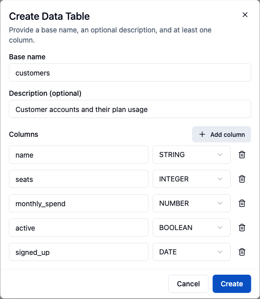
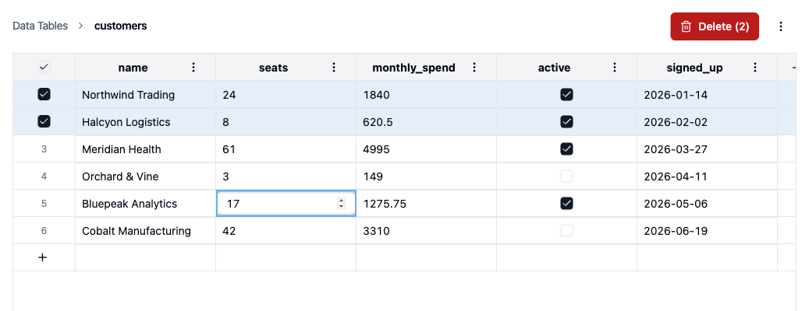
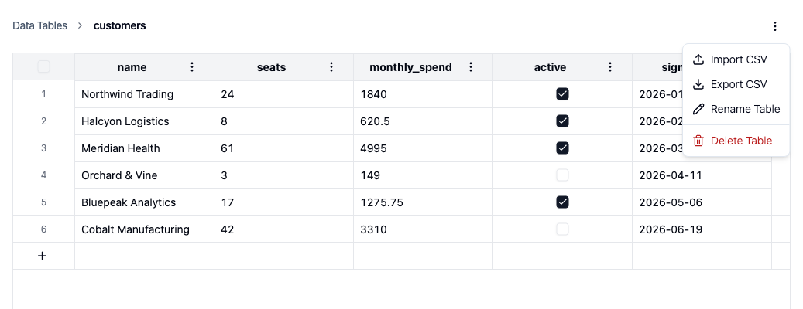

Data Tables are relational tables stored inside ByteChef. You create a table with typed columns, manage its rows in a spreadsheet-like grid or by importing a CSV file, and read or write the rows from workflows. No external database is required.

Use them for lookup tables, configuration, queues, feature flags, deduplication keys, or any small structured dataset that workflows share.

Each table belongs to a workspace, and its rows belong to an environment. The rows you see depend on the selected environment (Development, Staging, or Production).

---

## Create a table

1. Click **Data Tables** in the Automation sidebar.
2. Click **New Table** (or **Create Table** when no table exists yet).
3. Enter a **Base name** and an optional **Description**.
4. Under **Columns**, click **Add column** and enter a **Column name** and a **Type** for each column. Define at least one column.
5. Click **Create**.

Every table has an automatic `id` column that uniquely identifies each row. `id` is reserved and cannot be used as a column name.

### Column types

| Type | Stores |
|---|---|
| `STRING` | Text |
| `NUMBER` | Decimal numbers |
| `INTEGER` | Whole numbers |
| `DATE` | A calendar date |
| `DATE_TIME` | A date and time |
| `BOOLEAN` | `true` or `false` |

Values written from a workflow or imported from CSV are converted to the column's type.

---

## Manage columns

Open a table to manage its columns:

- **Add a column** - Click the **Add column** button at the right end of the header row, then enter a **Name** and a **Type** and click **Add**.
- **Rename a column** - Open the column header's menu and click **Rename**.
- **Delete a column** - Open the column header's menu and click **Delete**. This removes the column's values from every row.

---

## Manage rows

The table opens in a spreadsheet-like grid where you can:

- **Add a row** - Click **Add row** (**+**) below the last row.
- **Edit a cell** - Click the cell and type. Changes are saved when you leave the cell. Each cell uses an editor for its column type (text, number, checkbox, date, or date-time picker).
- **Delete rows** - Select rows with the row checkboxes, click **Delete (n)** in the header, and confirm.
- **Import a CSV** - In the **⋮** actions menu, click **Import CSV** and select a file whose header row matches the column names. Header columns that the table does not have are skipped. A header that matches no column (for example, a file that uses semicolons instead of commas) stops the import. A cell that does not fit its column type also stops the import, and no row is imported; the error names the CSV line to fix.
- **Export a CSV** - In the same menu, click **Export CSV** to download the current rows.

The actions menu also has **Rename Table** and **Delete Table**.

Larger tables load more rows as you scroll. The footer shows the total row count.

On the **Data Tables** list page, each table's menu has **Rename**, **Duplicate**, **Export CSV**, and **Delete**. Add tags to a table on its row, and filter the list by tag in the left sidebar.

---

## Use a table in workflows

Add the **Data Table** component to a workflow to read and write tables. Select the target **Table**; the action's inputs adapt to that table's columns.

### Actions

| Action | Description |
|---|---|
| **Create Record(s)** | Insert one or more new rows; an invalid record stops the step and no row is inserted |
| **Get Record** | Fetch a single row by its `id` |
| **Find Records** | List the rows that match **OR Conditions**, sorted by a column, with **Limit** and **Offset** for paging |
| **Update Record** | Update an existing row by its `id` |
| **Update Records** | Update every row that matches **OR Conditions** with the same values |
| **Delete Record(s)** | Delete rows by their `id`s, or set **Delete By** to **Conditions** to delete every matching row |
| **Clear Table** | Remove every row from the table |

### Finding records

**Find Records**, **Update Records** and **Delete Record(s)** (with **Delete By** set to **Conditions**)
group conditions the same way the **Condition** task does. **OR Conditions** holds one or
more **AND Condition** groups. A row matches when it meets every condition in at least one group,
and **Find Records** with no conditions returns every row, up to **Limit** (100 by default). **Update Records** and
**Delete Record(s)** by **Conditions** require at least one condition, so an empty list never rewrites or deletes
the whole table - use **Clear Table** for that. **Update Records**, and **Delete Record(s)** by **Record IDs** or
**Conditions**, change every selected row in one transaction, so either all of them change or none do. When no row
matches, nothing changes and the step reports a count of 0. Each condition picks a **Column**, an
**Operation** and the value to compare with:

| Operation | Matches rows where the column |
|---|---|
| **Equals** / **Not Equals** | is, or is not, the value. **Not Equals** also matches cells with no value |
| **Equals Ignore Case** | equals the text, ignoring upper and lower case |
| **Contains** / **Not Contains** / **Starts With** / **Ends With** | contains, does not contain, starts with or ends with the text. These comparisons are case-sensitive. **Not Contains** also matches cells with no value |
| **Greater** / **Greater or Equals** / **Less** / **Less or Equals** | compares as a number, date, boolean or text. Text is ordered by the database's collation, so letter case and accents may not order the way you expect |
| **In** | is one of the listed **Values** |
| **Between** | lies between **Value** and **To Value**, both included. On number, date, date-time and boolean columns a **Value** after **To Value** is rejected; on text columns it matches no row |
| **Empty** / **Not Empty** | does not have, or has, a value. For text columns an empty string counts as empty |

The text operations - **Equals Ignore Case**, **Contains**, **Not Contains**, **Starts With** and
**Ends With** - work only on text columns. Values are converted to the column's type, so `10` in the
**Value** field compares as a number against an integer column, and text values are trimmed - except for **Contains**,
**Not Contains**, **Starts With** and **Ends With**, which use the text exactly as given, spaces included (a value of only spaces counts as blank). A value
that does not fit the column type stops the step with an error instead of matching other rows: for
example `abc` or `10.5` for an integer column, `2025` for a date column, or `2026-02-30`, a date that does not
exist. Date columns take a date such as `2026-01-31`; a date and time is accepted too and only its date is used, after
converting it to UTC when it has a zone offset. Date-time columns need a date and a time such as `2026-01-31T08:00:00`; one with a zone offset, such as
`2026-01-31T10:00:00+02:00` or `2026-01-31T08:00:00Z`, is converted to UTC, and one without is used as written. In
a condition, a number such as a Unix timestamp is rejected for both. **Create Record(s)**, **Update Record** and
**Update Records** still accept a whole number for a date or date-time column and read it as Unix epoch milliseconds
in UTC, so `1769846400000` is stored as `2026-01-31T08:00:00`. A number too small to be epoch milliseconds, such as
epoch seconds or `20260131`, is rejected. Every operation except **Empty** and **Not Empty** needs a
value: a blank **Value**, for example an expression that resolves to an empty string, or an **In** with
no **Values**, stops the step instead of matching every row or none. Use **Empty** or **Not Empty** to
match rows by whether a column has a value. An **Operation** left unset means **Equals**, but one that
resolves to a blank value stops the step. Each condition accepts only the **Column**, **Operation**,
**Value**, **To Value** and **Values** fields, so a misspelled field name in a condition written by hand
stops the step.

**OR Conditions** and each **AND Condition** are built in the editor, one condition at a time, like in the
**Condition** task: they have no Text or Formula mode, so the whole list cannot come from a data pill or a
formula. The fields of each condition still can: **Column**, **Operation**, **Value**, **To Value** and **Values**
each accept a data pill, or a [formula](/platform/automation/build/workflows/data-pills#formula-mode) with the
**Formula** switch, for example `${trigger.customerId}` in **Value** to find the rows of the customer that started
the workflow.

**Update Records** sets every column it is given to the same value on all matching rows. Its values
must not be blank and must not include `id`; to clear a column, use **Update Record** on a single row,
where a blank value empties the column: a text column is set to an empty string and other columns to no value. **Update Records**
rejects a column the table does not have. **Create Record(s)** and **Update Record** ignore such a column and log a warning,
but stop with an error when none of the given columns exists. All three reject a value that does not fit the column type.

**Sort Column** and **Sort Direction** set the order of the results; rows with no value come last, while an
empty string in a text column sorts as text. Without a **Sort Column** rows come back sorted by `id`, which is insertion order.

### Triggers

A workflow can also start in response to a row change:

- **Record Created** - a new row was added
- **Record Updated** - a row was changed
- **Record Deleted** - a row was removed

Every row change starts one run per changed row for each enabled trigger on that table, whether the change comes from
a Data Table action (**Clear Table** included), from editing rows in the table, or from a CSV import. Runs start once
the change is saved; a change that is rolled back starts none. The rows of one change may run in any order, and a run
that fails shows up in the workflow's execution history like any other run.

For example, a workflow with **Record Created** on a *Customers* table can send a welcome email for each new row.

---

## Scope and access

- **Workspace** - A table is available to every project and workflow in its workspace.
- **Environment** - Rows belong to an environment, so Development data stays separate from Production.
- **Access** - Any member who can open the workspace can read and write its tables. There are no
  separate viewer and editor permissions for data tables.

---

## Storage limits

> **Coming soon.** Storage limits are not enforced in the latest released version of ByteChef.

The total size of all data tables in a tenant is limited to **50 MB** by default. As usage approaches the limit, the Data Tables page shows a warning. When the limit is reached, writes that would grow the data (inserting rows, importing CSV, updating rows) fail with a limit-exceeded error until space is freed.

{/* TODO screenshot: Data Tables page with the storage-usage warning alert visible (usage approaching the cap) */}

Self-hosted administrators can change or remove the cap with the [`BYTECHEF_DATA_TABLE_MAX_SIZE_BYTES`](/platform/use-bytechef/self-hosted/configuration/environment-variables#data-table-configuration) environment variable (`0` = unlimited).

---

## When to use a Data Table

A Data Table is a small relational store that needs no infrastructure. It fits some jobs and not
others.

### Patterns it fits

| Use case | How to model it |
|---|---|
| **Lookup tables** - map a code to a label, an SKU to a price, a country to a region. | One row per mapping, looked up with **Find Records** and an **Equals** condition on the key column. |
| **Configuration data** - regional overrides, per-tenant knobs. | One row per configuration key. |
| **Feature flags** - turn workflow behavior on and off without republishing. | A Boolean column keyed by flag name. |
| **Work queues** - items pending processing. | Insert on enqueue; **Find Records** then **Delete Record(s)** on consume. Add conditions to consume only a slice of the queue. |
| **Deduplication keys** - record processed external IDs so redeliveries are ignored. | One row per external ID, checked before processing with **Find Records** and an **Equals** condition on the ID column. |
| **Reference data** - data too dynamic for static configuration. | One row per record, refreshed by a workflow when the upstream changes. |

### What a Data Table is not

- **Not a transactional system of record.** A single step's changes are all-or-nothing, but there
  is no transaction spanning several workflow steps and no multi-writer locking. If several systems
  write the same data concurrently, point the workflow at a real database through the matching
  component instead.
- **Not a data warehouse.** Plan for small datasets. When [storage limits](#storage-limits) apply,
  they cap total stored size, not row count, so the number of rows that fit depends on how wide
  they are.
- **Not a search index.** For matching by meaning rather than by column value, use the
  [Knowledge Base](/platform/automation/data/knowledge-base).

### Data Table or external database

| Use a Data Table when | Use an external database when |
|---|---|
| The dataset is small. | The dataset is large. |
| Workflows are the only writers. | Several external services write the same data. |
| You want no infrastructure to operate. | You already run a database and want one source of truth. |
| The people maintaining the data are the people building the workflows. | The data is owned by engineers or DBAs outside ByteChef. |
