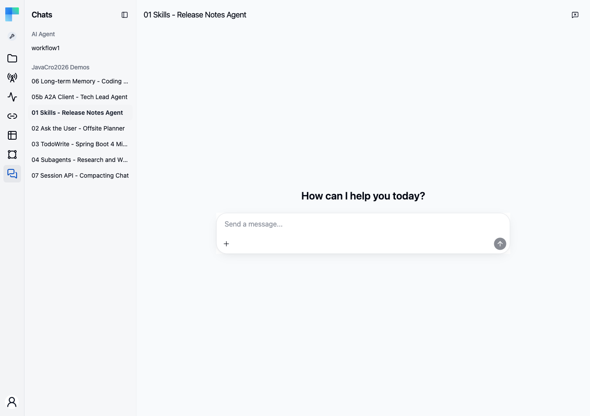

**Chats** in the automation sidebar is ByteChef's hosted chat interface. It lists every deployed workflow you can
chat with and lets you exchange messages and files with it. It works like the **Chat** button in the workflow
editor, but runs the deployed workflow instead of the draft.

## What makes a workflow appear here

A workflow is listed only when **all** of the following are true. It disappears when any one of them stops being
true:

1. Its **project deployment is enabled** in the environment selected in the left sidebar.
2. The **workflow itself is enabled** within that deployment. A deployment can contain workflows that are
   individually switched off.
3. The workflow has a **[Chat](/reference/components/chat_v1) trigger**.
4. That trigger's **Mode** is **Hosted Chat**. *Embedded Chat* keeps the workflow off this page; that mode is for
   chat interfaces you build yourself.
5. The trigger resolves to a webhook URL, which it does once the workflow is deployed.

<Callout title="Nothing listed?">
  Check the conditions above in order. The most common causes are a workflow switched off inside an enabled
  deployment, and a chat trigger left on *Embedded Chat*. The list is also per environment: a workflow deployed
  only to Development does not appear while Production is selected. When no workflow qualifies, the page shows
  **No chat workflows yet** with getting-started steps.
</Callout>

Matching workflows are grouped by project, and each entry shows the workflow's label.

## Chat with a workflow

1. Select a workflow in the left sidebar.
2. Type a message in the composer and send it. To attach files, click **+** in the composer.

Each message starts a run of that workflow. Your text and attachments are delivered as the trigger's output, the
same payload the workflow receives from any other caller.

**Attachments.** Images and text files can be attached to a message and arrive as the trigger's
`attachments`.

**Streaming.** If the workflow contains an action that streams its response (for example an AI Agent chat
action), the reply appears token by token. Otherwise the reply appears when the run finishes. ByteChef detects this
from the actions in the workflow; there is nothing to configure.

**Questions from the workflow.** When a streaming workflow pauses to ask you something, the question appears in the
thread. Your next message answers it, and the run resumes where it stopped instead of starting a new one. A
workflow that does not stream cannot pause: if it reaches an approval or wait step, the chat shows an error asking
you to add a step that streams, such as an AI Agent, after it.

## One conversation at a time

A run in progress locks the page. The other chats in the sidebar are disabled until it finishes, and navigating to
one returns you to the running conversation. This prevents a reply from arriving in a thread you have left.

## Limitations

**Conversation history is held in the browser, not on the server.** Switching between chats in the sidebar keeps
each thread. Leaving the Chats page discards every thread: navigating to Projects and back shows empty
conversations. Nothing is stored for later retrieval.

**Clear messages starts a new conversation.** The **Clear messages** button in the page header (enabled only when no
run is in progress) removes the transcript and creates a new conversation ID. A workflow that keys its chat memory on
that ID starts the next message with no memory of the earlier conversation.

For a durable record of a chat run, open the run in
[Workflow Executions](/platform/automation/monitor/workflow-executions).

## Related

- [Chat trigger reference](/reference/components/chat_v1) - the trigger's modes and output shape
- [Deploy Workflows](/platform/automation/deploy/workflows) - enabling a deployment and its workflows
- [Workflow Executions](/platform/automation/monitor/workflow-executions) - the runs a chat produces
