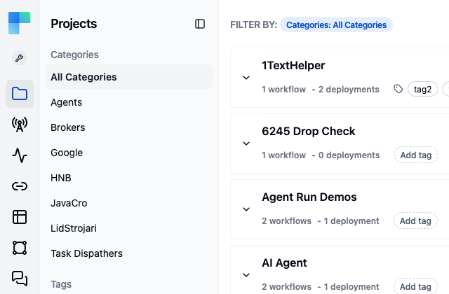
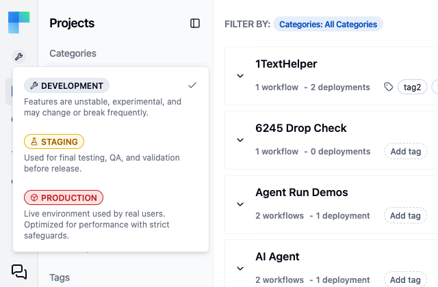

Every workspace has the same three environments: **Development**, **Staging**, and **Production**.
Most records you create in ByteChef belong to exactly one of them. The selected environment determines
which connections you can pick, which deployments are listed, and which runs appear in the execution
history.

The set is fixed. The platform defines the three environments; you cannot rename, remove, or add
environments.

<Callout title="Community Edition">
    The environment selector appears on Enterprise Edition only. A Community Edition instance works in
    a single environment and shows no selector, so nothing on this page needs configuring there.
</Callout>

## Choosing an environment

The selector is the round environment icon in the left sidebar header, next to the workspace menu. It
applies to the whole application, not to one page. Switching it changes what the pages list; it never
moves or copies records between environments. The sidebar takes on the color of the selected
environment.

1. Click the environment icon in the left sidebar header.
2. Select **Development**, **Staging**, or **Production**.



| Environment | Intended for |
|---|---|
| **Development** | Where you build. Connections point at sandbox or test accounts. |
| **Staging** | Final testing, QA, and validation before release. |
| **Production** | Live traffic. |

Development is selected by default when you sign in.



## What carries an environment

Most records you create:

- **Connections** - a connection belongs to one environment. The Stripe connection you pick in
  Development is a different record, with different keys, from the one in Production.
- **Project deployments** - a deployment binds a published project version to one environment. See
  [Deploy Workflows](/platform/automation/deploy/workflows).
- **Data tables** - the table definition is workspace-wide, but its **rows** are per environment.
  Development data is not visible in Production.
- **Knowledge bases**.
- **API keys** - a key is issued for one environment and only authenticates requests for it.
- **MCP servers**, **A2A servers**, and **API collections** - each publishes a different set of tools
  or endpoints per environment.
- **AI providers** - activated per environment, so Development and Production can use different
  models and keys without a workflow change.
- **Workflow executions**, **approval tasks**, and [external invocations](/platform/automation/monitor/external-invocations) -
  history is listed per environment.

Projects and their **workflows** are not environment-scoped. A project holds one editable draft and a
series of published versions. A version reaches an environment when you deploy it there. In Enterprise
Edition the **Projects** page is shown only in Development; in Staging and Production you work with
**Project Deployments**.

## How work moves forward

```
draft  ──publish──▶  version 3  ──deploy──▶  Development
                          │
                          ├──deploy──▶  Staging
                          └──deploy──▶  Production
```

Editing always happens on the draft. Publishing freezes it as a version, and deploying binds that
version to an environment. The same version can back deployments in all three environments at once,
each with its own connections. Staging and Production therefore run identical definitions, and any
difference in behavior comes from configuration.

A deployment is created in the environment that is selected when you open the **New Deployment**
dialog; the dialog shows it as a read-only **Environment** badge. To deploy to Staging or Production,
switch the environment selector first.

Triggers are enabled per deployment, so a schedule or a webhook fires only for the deployments where
it is enabled. A cron trigger in a Development deployment does not fire in Production. Webhook URLs are
issued per deployment, so each environment's deployment has its own URL.

## Environments in the API

Workspace API keys are issued for one environment. Requests carry the environment in the
`X-ENVIRONMENT` header (`DEVELOPMENT`, `STAGING`, or `PRODUCTION`, case-insensitive). When the header is
omitted, the environment is `PRODUCTION`. The header must match the key: a Development key cannot
reach Production data. Scripts that call the API should set the header explicitly.

## When three environments are not enough

The set of environments is fixed. Model other kinds of separation as follows:

| What you actually want | Model it as |
|---|---|
| A separate team or business unit | A separate [workspace](/platform/automation/settings/workspaces) |
| Per-customer isolation | One workspace per tenant |
| A load-testing or canary slice | A dedicated workspace whose Production points at a test backend |

Do not use workspaces as stages. Environments already exist inside every workspace, and deployments
select a version per environment. Three workspaces used as stages require copying projects by hand
and lose the shared version history that makes a rollback a single version change.

## Related

- [Deploy workflows](/platform/automation/deploy/workflows)
- [Workspaces](/platform/automation/settings/workspaces)
- [API keys](/platform/automation/settings/api-keys)
