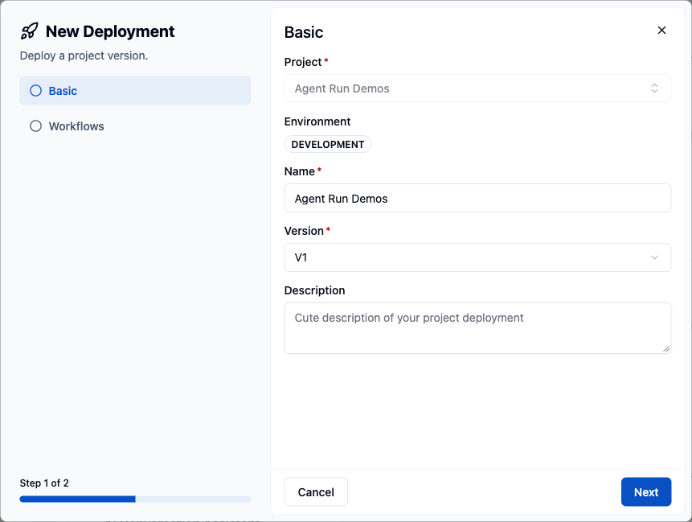
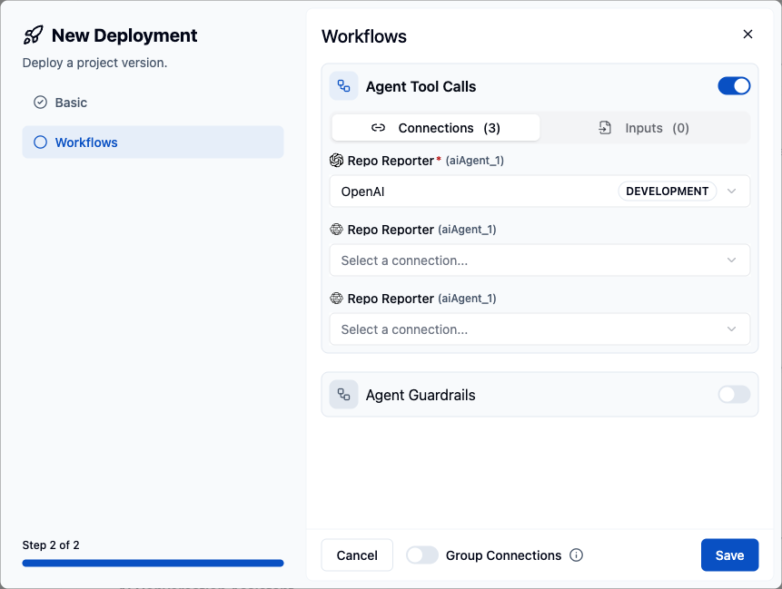
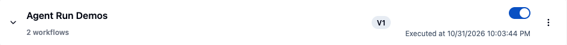
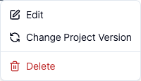
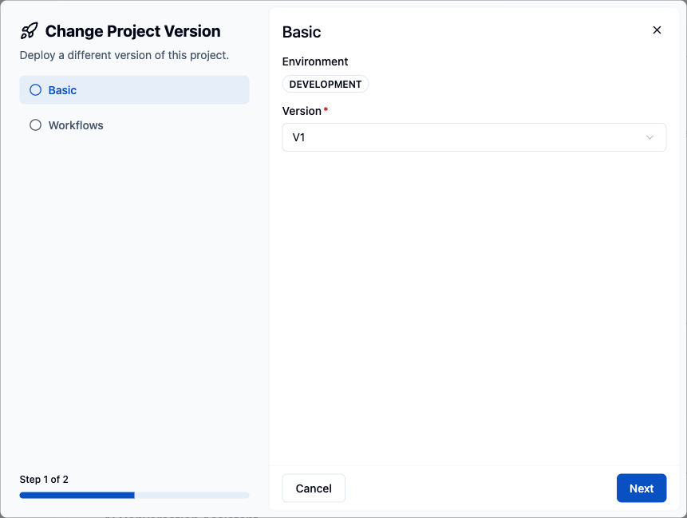
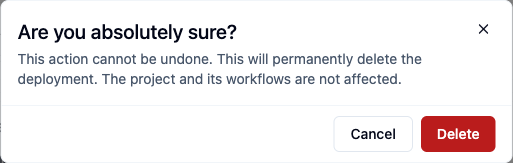
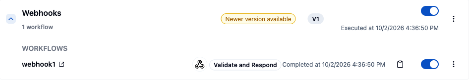

A deployment runs the workflows of a published project version without further input from you: triggers fire,
schedules run, and webhook URLs accept requests. You publish a project in the editor and deploy it from the editor,
the **Projects** page, or the **Project Deployments** page.

## Publishing and deploying

Building a workflow and running it in an environment are separate steps:

- **Publish** freezes the project's current draft as a numbered, immutable **version**. All workflows in the project
  are included. The editor continues on a new draft, so later edits do not change the published version.
- **Deploy** creates a **project deployment**: one published version bound to one
  [environment](/platform/automation/deploy/environments), with its own name, description, tags, set of enabled
  workflows, and connections.

You can edit the draft without affecting what is running, and the same version can run in Staging and in Production
against different credentials.

### What a version contains

A published version contains the workflow definitions (tasks, ordering, parameters, expressions, the component
versions they reference, trigger configuration, and input and output schemas), the publish description, and the
publish date.

A version does **not** contain connections or credentials. Connections are selected on the deployment, so the same
version can use a sandbox account in Development and the live account in Production. Rotating a credential does not
invalidate any version.

### Review versions

1. Open the project in the editor.
2. Open the **Settings** menu (gear icon), select the **Project** tab, and click **Project History**.

The **Project Version History** panel lists each version with its number, published date, a **Draft** or
**Published** badge, and the description entered at publish time. From the panel you can:

- **Export** a version from its **⋮** menu.
- **Delete** a published version from its **⋮** menu. This cannot be undone.
- Select a version and click **Apply selected version** to replace the current draft with the workflows of that
  version. Unpublished changes in the draft are lost.

### Roll back or apply a hotfix

Deployments run published versions, so you never change a running deployment in place.

- **Roll back** - use [Change Project Version](#change-the-project-version) on the deployment and select the earlier
  version. Earlier versions stay stored and deployable.
- **Hotfix** - edit the draft, publish it, and change the affected deployment to the new version. A Production
  deployment can move to a new version without that version being deployed anywhere else first.

## Deploy a project

<Callout>
  A deployment is created in the environment that is currently selected in the left sidebar. The dialog shows it as a
  read-only **Environment** badge. To deploy to Staging or Production (Enterprise Edition), switch the
  [environment](/platform/automation/deploy/environments) first.
</Callout>

<Steps>
<Step>

Open the deployment dialog in one of these ways:

- In the editor, click **Deploy** in the header. The button is disabled until the project has a published version.
- On the **Projects** page, expand the project, open its **Deployments** tab, and click **Deploy** (or
  **New Deployment** when the project already has deployments). The project's **⋮** menu also has a
  **New Deployment** item.
- On the **Project Deployments** page, click **New Deployment** (or **Create Deployment** when the list is empty). In
  the Development environment this page is not in the sidebar; use the **Projects** page instead.

</Step>
<Step>

On the **Basic** step, check or set the fields:

| Field | Description |
|---|---|
| **Project** | The project to deploy. Preselected and locked when you open the dialog from a project. |
| **Environment** | The current environment. Read-only. |
| **Name** | Required. Defaults to the project name. |
| **Version** | Required. Defaults to the latest published version. |
| **Description** | Optional. |
| **Tags** | Optional. Used to filter the **Project Deployments** page. |

When you open the dialog from the editor and the project already has deployments, the **Basic** step has two tabs:
**New** creates a deployment, and **Change Version** moves an existing deployment to another version.



</Step>
<Step>

Click **Next**. On the **Workflows** step, turn on each workflow to include. For each enabled workflow, select a
connection for every component that needs one on the **Connections** tab, and fill in workflow inputs on the
**Inputs** tab. Turn on **Group Connections** to group the connection fields by app.



</Step>
<Step>

Click **Save**. **Save** is disabled until at least one workflow is enabled.

</Step>
<Step>

Turn on the switch on the deployment's row to enable it.



</Step>
</Steps>

Where you land after saving depends on the environment:

- **Development** - you stay where you are. On the **Projects** page the project opens on its **Deployments** tab; in
  the editor the **Project Deployments** panel opens. The new deployment is expanded.
- **Staging** or **Production** - ByteChef switches to that environment and opens the **Project Deployments** page with
  the new deployment expanded.

## View a project's deployments

- **Projects page (Development)** - expand a project and open its **Deployments** tab. It lists the project's
  Development deployments. Each row has the enable switch, the **⋮** menu, the tags, and an arrow that expands the
  deployment's workflows. Clicking a workflow opens its
  [workflow executions](/platform/automation/monitor/workflow-executions).
- **Editor** - the **Project Deployments** button (list icon) next to **Deploy** opens a side panel with the project's
  deployments in the current environment. The panel header takes the environment's color, and its refresh button
  reloads the list.
- **Project Deployments page** - lists all deployments in the current environment. Filter by project or tag in the
  left sidebar.

When the project has no deployment in the current environment, the tab and the panel show a **Deploy** button. A
project that has never been published shows **Publish the project to deploy it**.

In Development, the **Project Deployments** page is not in the sidebar. Links to it open the project's **Deployments**
tab on the **Projects** page instead.

## Change the project version

<Steps>
<Step>

Open the deployment's **⋮** menu and click **Change Project Version**.



</Step>
<Step>

Select the **Version** and click **Next**.



</Step>
<Step>

Enable the workflows to run, update connections and inputs if needed, and click **Save**.

</Step>
</Steps>

## Edit a deployment

1. Open the deployment's **⋮** menu and click **Edit**.
2. Change the name, description, or tags.
3. Click **Save**.

The **⋮** menu also has **Open Project** (when available) and **Delete**.

## Update a workflow's connections and inputs

<Steps>
<Step>

Click the arrow under the deployment name to expand its workflows.

</Step>
<Step>

Open the workflow's **⋮** menu and click **Edit**. The item is disabled when the workflow has no connections and no
inputs.

</Step>
<Step>

In the **Edit &lt;workflow&gt; Workflow** dialog, select a different connection, or click **+** to create one. Update
inputs if needed.

</Step>
<Step>

Click **Save**.

</Step>
</Steps>

The workflow's **⋮** menu also has **Open in Project**, which opens the workflow in the editor.

## Run a workflow manually

A deployed workflow without a trigger, or with a **Manual** trigger, shows a run button (play icon, tooltip **Run
workflow manually**) on its row. The button is enabled when both the deployment and the workflow are enabled. Click it
to start a run; ByteChef shows **Workflow request sent.**

## Delete a deployment

1. Open the deployment's **⋮** menu and click **Delete**.
2. Click **Delete** in the confirmation dialog.

Deleting a deployment cannot be undone. The project and its workflows are not affected.



## Get a webhook URL

A workflow that starts with a static webhook trigger exposes a webhook URL on its deployment.

<Steps>
<Step>

Click the arrow under the deployment name to expand its workflows.

</Step>
<Step>

On the workflow's row, click the clipboard icon (tooltip **Copy static workflow webhook trigger url**). The URL is
copied to the clipboard. The icon is disabled while the workflow is disabled.

</Step>
<Step>

Use the URL in the external service that triggers the workflow.

</Step>
</Steps>

The URL has the form `<public URL>/webhooks/<id>` and accepts `GET` and `POST` requests. To try it from a terminal,
send a JSON body to the copied URL:

```bash
curl -X POST "https://your-bytechef-host.example.com/webhooks/<id>" \
  -H "Content-Type: application/json" \
  -d '{"orderId": 1042, "status": "paid"}'
```

The run then appears in [Workflow Executions](/platform/automation/monitor/workflow-executions).



<Callout type="info">
  Workflows that start with a **form** or **chat** trigger show a form or chat icon instead of the clipboard icon.
  Clicking it opens the hosted page instead of copying a URL.
</Callout>

## Related

- [Environments](/platform/automation/deploy/environments)
- [Projects](/platform/automation/build/workflows/projects)
- [Workflow executions](/platform/automation/monitor/workflow-executions)
