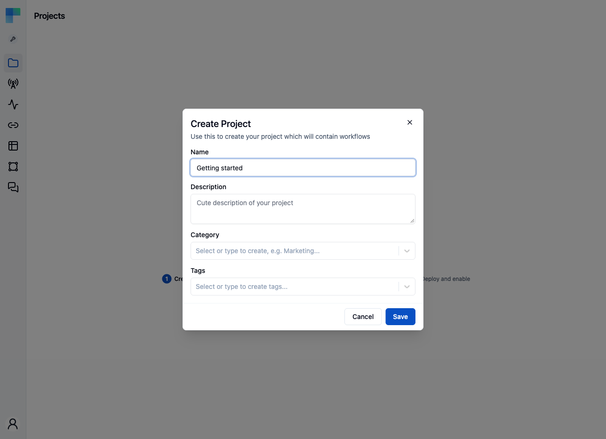
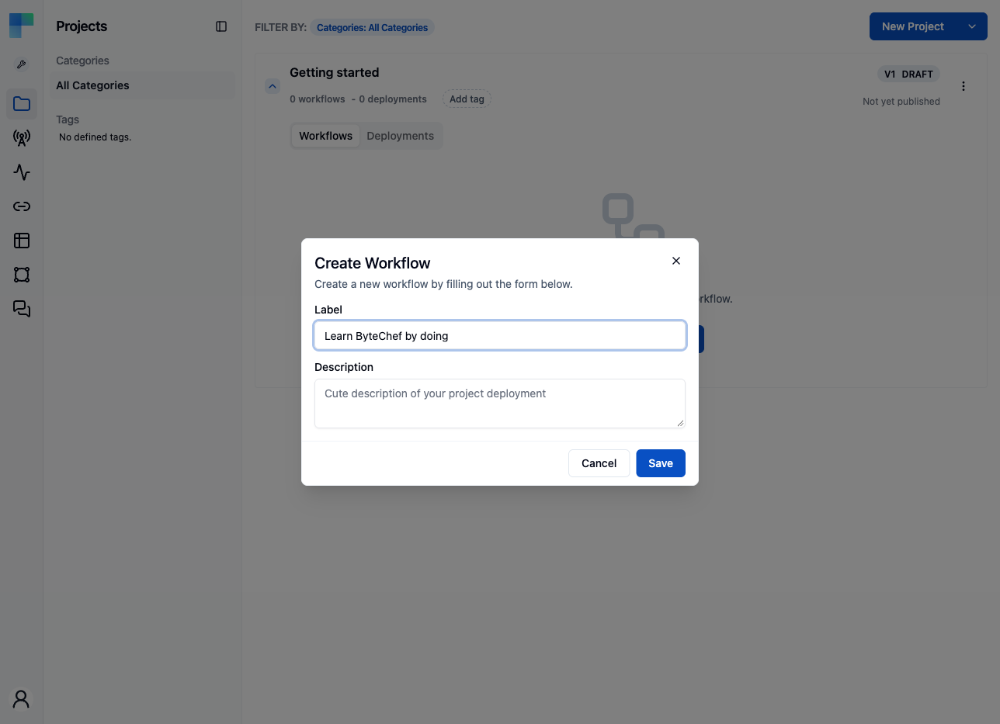
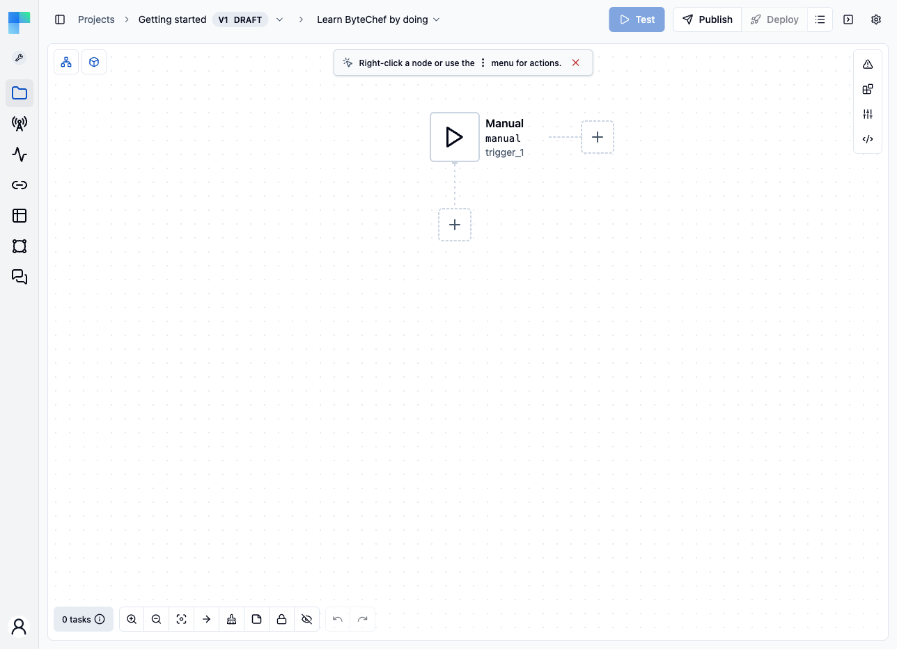
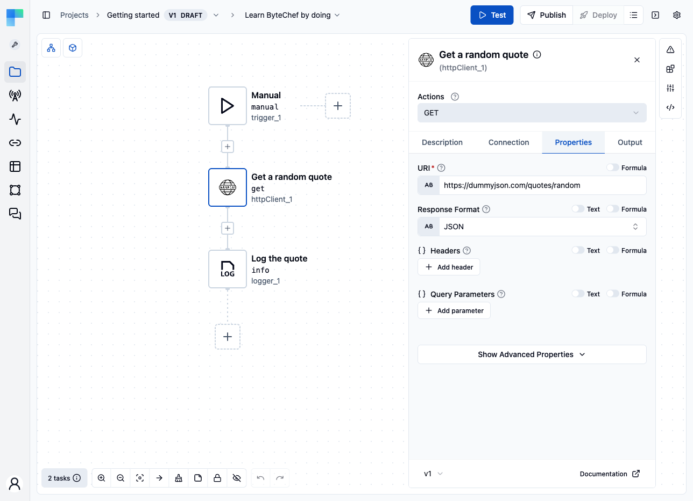
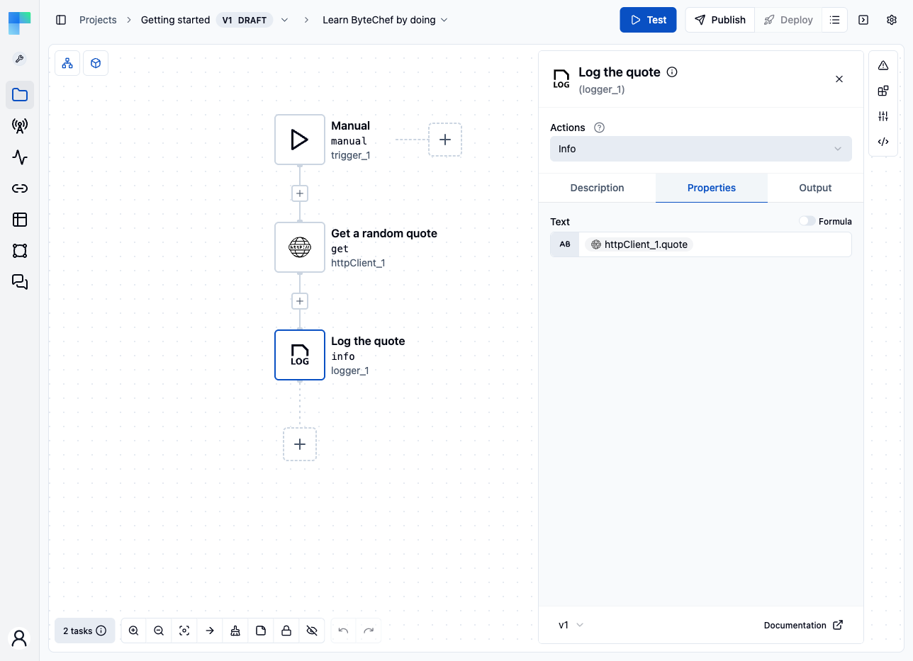
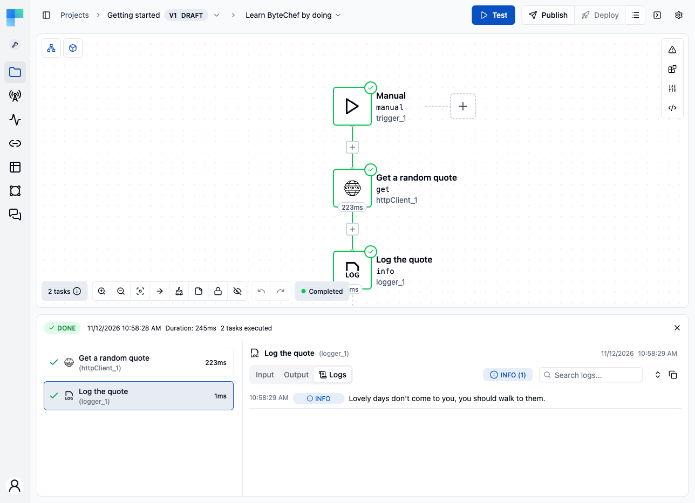
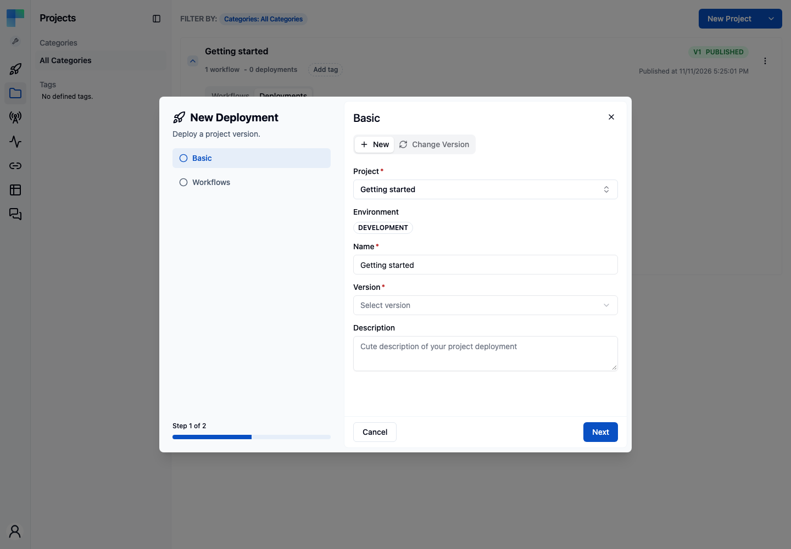
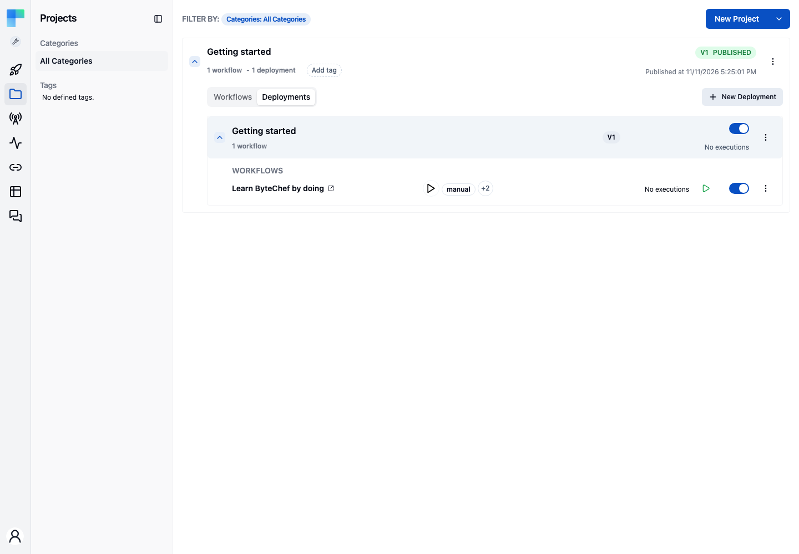
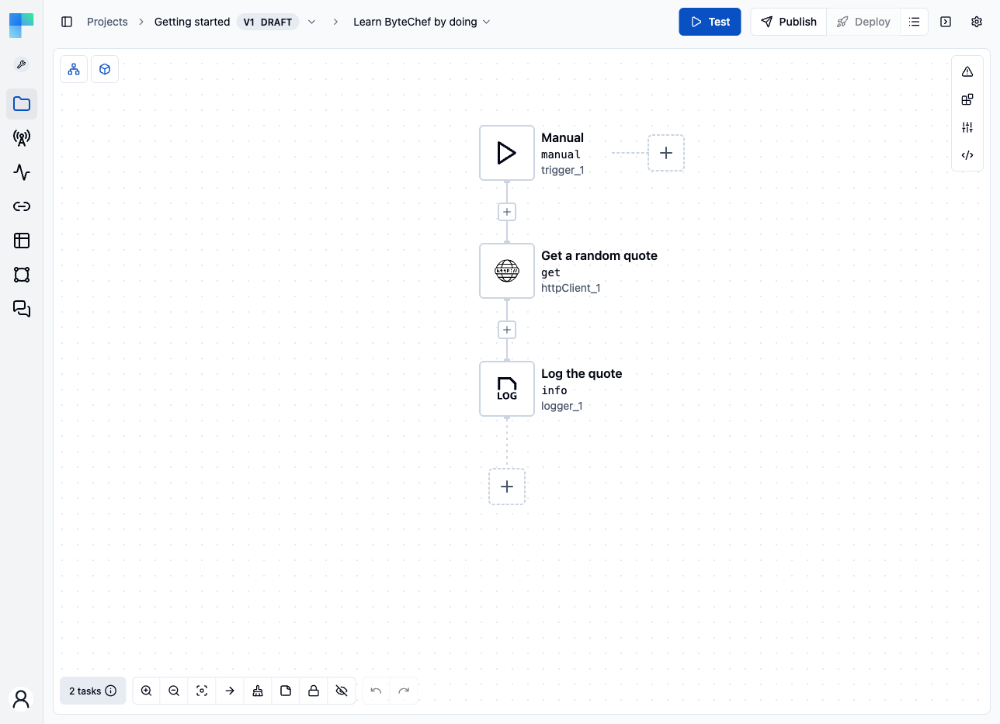

In this guide you build a small workflow: a Manual trigger, an HTTP call to a public API, and a logger that prints the result. It needs no connections, so it runs the moment you finish it. The in-app **Getting Started** page follows this guide step by step.

You will learn:

- How to create a project and a workflow
- How to add and configure components
- How to pass data between steps with an expression
- How to test a workflow and read its execution log
- How to publish, deploy and enable a workflow, and how to run it

## Before you start

Sign in to [ByteChef Cloud](https://app.bytechef.io/) or run ByteChef yourself. The quickest self-hosted option is one command, with [Docker Desktop](https://www.docker.com/products/docker-desktop/) installed:

```bash
docker run --name bytechef -it -p 8080:8080 \
    --env BYTECHEF_DATABASE=h2 \
    -v ~/.bytechef:/root/.bytechef \
    docker.bytechef.io/bytechef/bytechef:latest
```

Open [http://localhost:8080/login](http://localhost:8080/login) and click **Create account**. This runs on an embedded H2 database and is meant for evaluation. For anything you intend to keep, use PostgreSQL through [Docker Compose](/platform/use-bytechef/self-hosted/installation/local-docker), or see the guides for [Kubernetes](/platform/use-bytechef/self-hosted/installation/kubernetes), [AWS EC2](/platform/use-bytechef/self-hosted/installation/aws-ec2), [AWS ECS](/platform/use-bytechef/self-hosted/installation/aws-ecs), [Azure](/platform/use-bytechef/self-hosted/installation/azure), [Google Cloud](/platform/use-bytechef/self-hosted/installation/google-cloud) and [DigitalOcean](/platform/use-bytechef/self-hosted/installation/digitalocean).

On first sign-in you land on the Automation **Getting Started** page, which tracks the steps below as you complete them.

## 1. Create a project

A project is the container that holds your workflows.

<Steps>
<Step>

Open the **Projects** page and click **Create Project**. Once a project exists, the button at the top right reads **New Project**.

</Step>
<Step>

Enter a project name, for example `Getting started`. Optionally add a description, choose a category, and add tags. Then click **Save**.



</Step>
</Steps>

## 2. Create a workflow

If you started from the in-app Getting Started page, it opens the Create Project and Create Workflow dialogs for you, and the editor shows a Getting started checklist for the remaining steps.

<Steps>
<Step>

Your new project's row opens with an empty **Workflows** tab. Click **Create Workflow**. Once a project has workflows, the same button reads **New Workflow**.

</Step>
<Step>

Enter the label `Learn ByteChef by doing` and click **Save**.



</Step>
<Step>

ByteChef opens the new workflow in the editor with a **Manual** trigger already in place. The Manual trigger starts the workflow when you click **Test** or **Run**.



</Step>
</Steps>

## 3. Fetch a random quote

<Steps>
<Step>

Click the **+** button below the **Manual** trigger, search for **HTTP Client**, and select it. Choose the **GET** action.

</Step>
<Step>

The step's panel opens on the right. Open its **Properties** tab and set **URI** to:

```
https://dummyjson.com/quotes/random
```

Leave **Response Format** on **JSON** and everything else at its default. There is no connection to create: the API is public.



</Step>
<Step>

Optionally rename the step on the **Description** tab, for example to `Get a random quote`. The step's **name**, `httpClient_1`, is what other steps use to reference its output; it does not change when you edit the title.

</Step>
<Step>

Open the **Output** tab and click **Test Action**. ByteChef calls the API once and records the fields it returned (`id`, `quote`, `author`). Later steps need these to offer the fields as data pills, and the editor warns about a reference it cannot find in them.

</Step>
</Steps>

## 4. Log the quote

<Steps>
<Step>

Click the **+** button below the HTTP Client step and search for **Logger**. Logger is a helper, so open the **Helpers** tab, select **Logger**, and choose the **Info** action.

</Step>
<Step>

On the **Properties** tab, click into the **Text** field. The **Data Pill Panel** opens and lists the output of every earlier step. Under **HTTP Client**, click **quote**: the editor inserts it into the field as a chip.

This is a data pill: it pulls the `quote` field out of the JSON the HTTP Client step returned. Behind the chip is the expression `${httpClient_1.quote}`.

If you skipped testing the HTTP Client step, the panel has no **quote** pill yet, because the editor does not know the shape of the response. Enter the expression in the **Text** field instead:

```
${httpClient_1.quote}
```



</Step>
</Steps>

## 5. Test the workflow

Click **Test** at the top right of the editor. ByteChef runs the workflow once:

- The **Manual** trigger starts it
- The HTTP Client step calls the quotes API
- The Logger step prints the quote

The execution panel opens below the canvas. Click the Logger step and open its **Logs** tab: the quote is there. Click the HTTP Client step to see the full JSON it received on its **Output** tab.



Run it again and you get a different quote.

## 6. Publish

<Steps>
<Step>

Open the project's **⋮** menu and click **Publish**.

</Step>
<Step>

Optionally, provide a description for this published version and click **Publish**.

</Step>
</Steps>

## 7. Deploy and enable

<Steps>
<Step>

On the **Projects** page, click your project's row and open its **Deployments** tab. Click **Deploy** (**New Deployment** once the project has a deployment).

In the Staging or Production environment, open the **Deployments** page and click **New Deployment** instead.

</Step>
<Step>

The project and name are filled in. Pick the latest **Version** and click **Next**.



</Step>
<Step>

Turn on the workflow, then click **Save**.

</Step>
<Step>

The deployment appears in the tab with its workflow already on. Switch on the deployment with the toggle at the right of its row.



</Step>
</Steps>

## 8. See it run

A Manual workflow never runs by itself, so start it yourself: click **Run** (the play button with the tooltip **Run workflow manually**) on the deployment's workflow. Open **Executions** to see the run, click it, and open the Logger step to read the quote. The Getting Started page also shows **Run received**.

## 9. Disable it (optional)

To tidy up, switch the deployment off in the project's **Deployments** tab.

## What you have built



This is the shape of every ByteChef workflow:

- **Trigger**: something starts the workflow, on demand, on a schedule, from a webhook or from an app event. To run a workflow on a schedule, see [Configure Workflow Trigger](/platform/automation/get-started/quick-start/configure-workflow-trigger)
- **Components**: do the work, such as fetching, creating or sending
- **Data pills**: pass data between steps with `${stepName.fieldName}`. See [Data Pills & Input Modes](/platform/automation/build/workflows/data-pills)

A similar workflow is available as a template. To import it instead of building it, open the [Learn ByteChef by doing](https://www.bytechef.io/workflow-templates/learn-bytechef-by-doing) page, click **Use template**, and then click **Test** in the editor.

## Next steps

- [Configure Workflow Trigger](/platform/automation/get-started/quick-start/configure-workflow-trigger): start workflows from a schedule, a webhook or an app event
- [Star Repository on GitHub](/platform/automation/get-started/quick-start/star-repository-on-github): your first workflow with a connection
- [Build First Agent](/platform/automation/get-started/quick-start/build-first-agent): add an AI agent with a tool, with one API key
- [Browse 250+ components](/reference/components)
- [Templates library](https://www.bytechef.io/workflow-templates)
