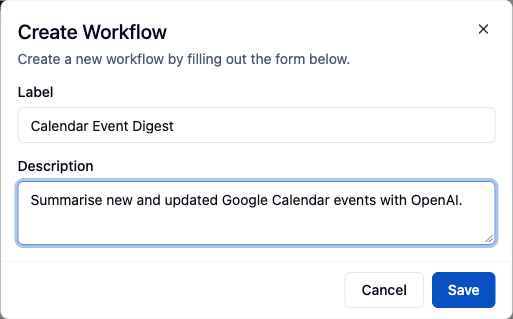
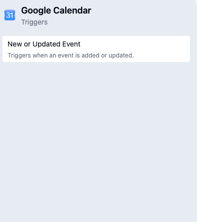
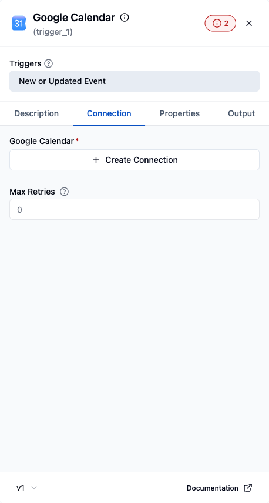
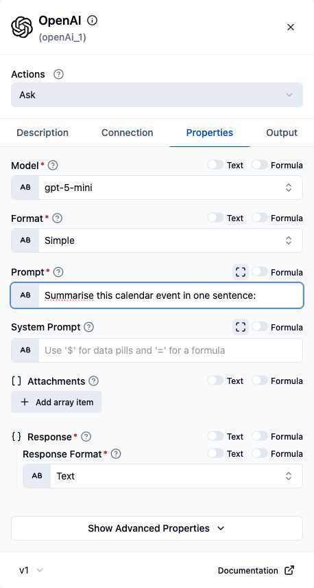
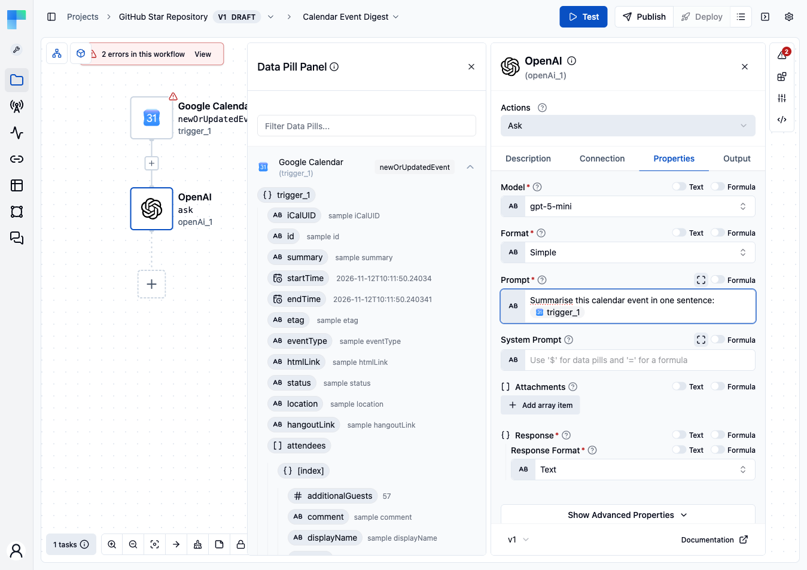
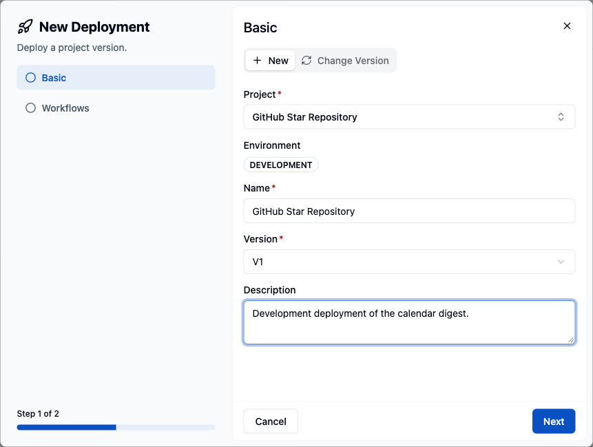
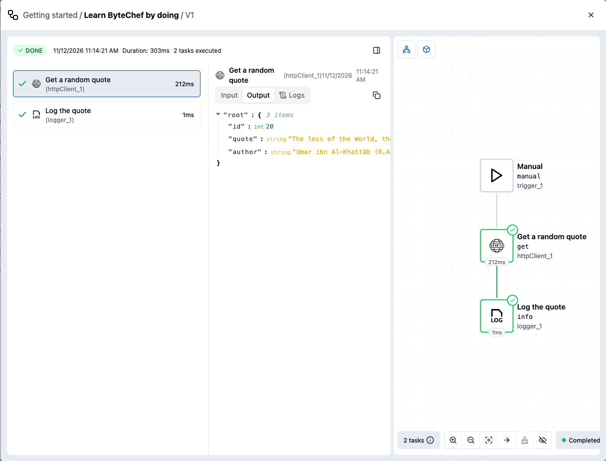

This guide builds a workflow that starts when an event is created or updated in Google Calendar, sends the event to
OpenAI for a one-sentence summary, and runs as a deployment. It covers adding a trigger, creating an OAuth 2.0
connection, passing data with a data pill, publishing the project, creating a deployment, and reading the execution.

## Before you start

- A ByteChef project. See [Build First Workflow](/platform/automation/get-started/quick-start/build-first-workflow).
- A Google OAuth 2.0 client with the Google Calendar API enabled. See [Create an OAuth 2.0 client](#create-an-oauth-20-client) and [Enable the Google Calendar API](#enable-the-google-calendar-api).
- An OpenAI API key. See [Create an OpenAI API key](#create-an-openai-api-key).

<Callout>
  **New or Updated Event** is a webhook trigger: Google must be able to reach your ByteChef instance over a public
  URL. If you run ByteChef locally, expose it with a tunnel first. See [Working with Triggers](/developer-guide/working-with-triggers).
</Callout>

## 1. Create the workflow

<Steps>
<Step>

On the **Projects** page, expand your project. On its **Workflows** tab, click **Create Workflow** (or **New Workflow** when the project already has workflows).

</Step>
<Step>

Enter a **Label**, optionally a **Description**, and click **Save**.

</Step>
</Steps>

## 2. Add the trigger

<Steps>
<Step>

Right-click the **Manual** trigger node, or hover it and open its **Node actions** menu (**⋮**), and choose **Replace**.

</Step>
<Step>

Search for **Google Calendar**, select it, and choose the **New or Updated Event** trigger.

</Step>
<Step>

The trigger's panel opens on the **Connection** tab. Click **Create Connection**.

</Step>
<Step>

Enter a connection name, paste the **Client ID** and **Client Secret** of your Google OAuth 2.0 client, and click **Next**.

</Step>
<Step>

Click **Connect**. In the Google window, select your account, click **Continue**, grant ByteChef access to the requested scopes, and click **Continue** again. The new connection is selected in the **Choose Connection...** list.

</Step>
<Step>

Open the **Properties** tab and, in **Calendar ID**, select the calendar to watch.

</Step>
</Steps>

## 3. Add the OpenAI action

<Steps>
<Step>

Click the **+** button below the trigger, search for **OpenAI**, and choose the **Ask** action.

</Step>
<Step>

On the step's **Connection** tab, click **Create Connection**, enter a connection name, paste your OpenAI API key into **Token**, and click **Save**.

</Step>
<Step>

Open the **Properties** tab. In **Model**, choose a model, for example `gpt-5-mini`. In **Prompt**, enter `Summarise this calendar event in one sentence:`.

</Step>
</Steps>

## 4. Insert the event with a data pill

<Steps>
<Step>

Click into the **Prompt** field. The **Data Pill Panel** opens next to the step's panel.

</Step>
<Step>

Expand the **Google Calendar** row and click **trigger_1**. The trigger's output is inserted into **Prompt** as a data pill.

</Step>
</Steps>

## 5. Publish the project and create a deployment

<Steps>
<Step>

Click **Publish** in the editor header, optionally enter a description for the version, and click **Publish**.

</Step>
<Step>

Go to **Projects**, expand your project, and open its **Deployments** tab. Click **Deploy** (or **New Deployment** when the project already has deployments). The **New Deployment** dialog opens with the project and the latest published version selected.

</Step>
<Step>

Click **Next**. On the **Workflows** step, turn on the workflow and select a connection for each component that needs one.

</Step>
<Step>

Click **Save**, then turn on the deployment's switch to enable it. The workflow now runs whenever an event is created or updated in the selected calendar.

</Step>
</Steps>

## 6. Monitor the execution

<Steps>
<Step>

In the left sidebar, open **Executions** and choose **Workflow Executions**. The list shows the status of each run.

</Step>
<Step>

Click an execution to open its details. Select the Google Calendar trigger to review its output, and the **OpenAI** step to read the summary.

</Step>
<Step>

Click the panel icon in the top-right corner of the details to show the workflow graph beside them.

</Step>
</Steps>

## Reference

### Create an OAuth 2.0 client

<Steps>
<Step>

Go to the [Google Cloud Console](https://console.cloud.google.com/).

</Step>
<Step>

Click the project dropdown in the top navigation bar.

</Step>
<Step>

Click **New Project**.

</Step>
<Step>

Enter a project name and click **Create**.

</Step>
<Step>

Click the project dropdown again.

</Step>
<Step>

Select the project you just created.

</Step>
<Step>

Go to **APIs & Services**.

</Step>
<Step>

Go to **OAuth consent screen**.

</Step>
<Step>

Click **Get Started**.

</Step>
<Step>

Enter an App name and add user support email. Click **Next**.

</Step>
<Step>

Select your Audience and click **Next**.

</Step>
<Step>

Add email addresses and click **Next**.

</Step>
<Step>

Agree to the terms and click **Create**.

</Step>
<Step>

Go to **Data Access**.

</Step>
<Step>

Click **Add or Remove Scopes**.

</Step>
<Step>

Select all necessary scopes.

</Step>
<Step>

Click **Update**.

</Step>
<Step>

Click **Save**.

</Step>
<Step>

Go to **Clients**.

</Step>
<Step>

Click **Create Client**.

</Step>
<Step>

Click application type dropdown.

</Step>
<Step>

Choose **Web application** as the application type.

</Step>
<Step>

Click **Add Uri**.

</Step>
<Step>

Enter the redirect URI of your ByteChef instance, `<public URL>/callback` (for example `https://app.bytechef.io/callback`, or `http://localhost:8080/callback` for a local instance). Click **Create**.

</Step>
<Step>

Click the client you just created.

</Step>
<Step>

Copy the **Client ID** and **Client Secret**. Use these credentials to create a connection in ByteChef.

</Step>
</Steps>

### Enable the Google Calendar API

<Steps>
<Step>

In the [Google Cloud Console](https://console.cloud.google.com/), select your project.

</Step>
<Step>

Go to **APIs & Services**.

</Step>
<Step>

Click **ENABLE APIS AND SERVICES**.

</Step>
<Step>

Search for "calendar" in the search bar.

</Step>
<Step>

Click **Google Calendar API**.

</Step>
<Step>

Click **Enable**.

</Step>
</Steps>

### Create an OpenAI API key

<Steps>
<Step>

Go to the [OpenAI API](https://platform.openai.com/settings/organization/general).

</Step>
<Step>

In the left sidebar, click **API Keys**.

</Step>
<Step>

Click **Create new secret key**.

</Step>
<Step>

Enter a name and select the project for the key and click **Create secret key**.

</Step>
<Step>

Copy the API key. Paste it into the **Token** field of the OpenAI connection in ByteChef.

</Step>
</Steps>

