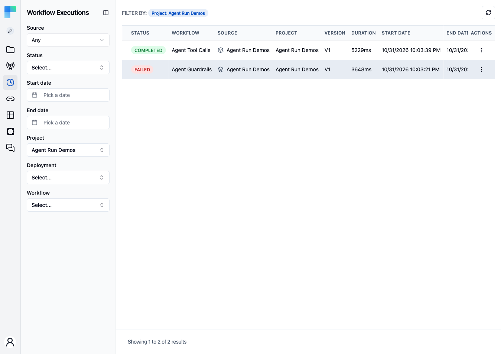
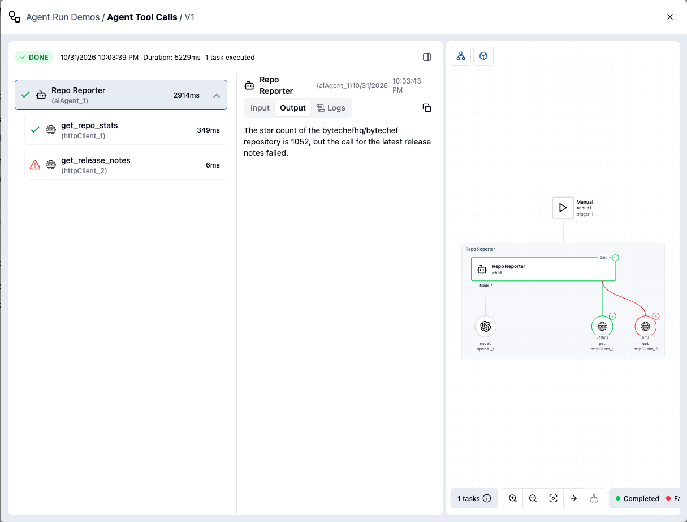
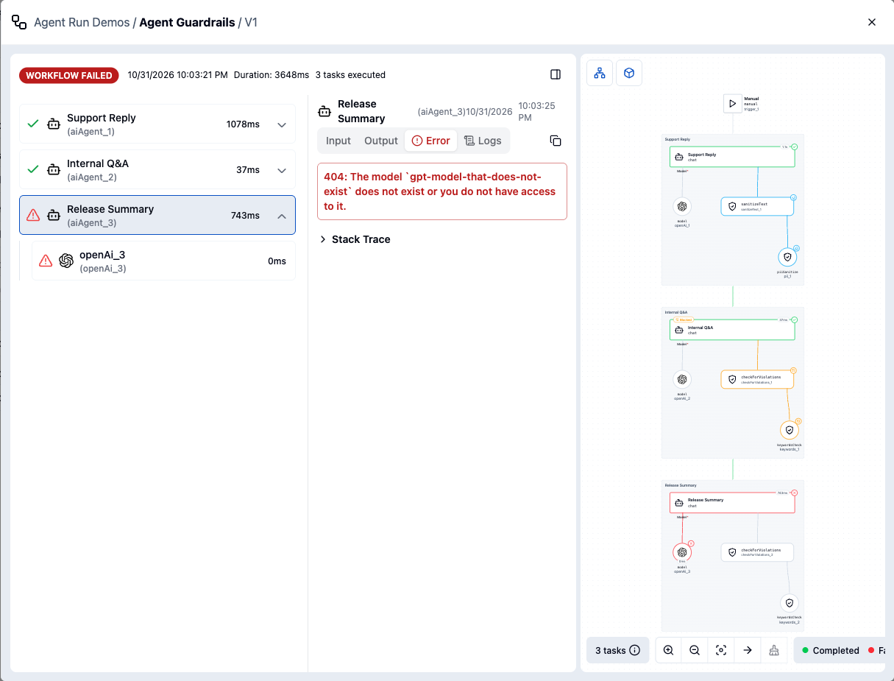

The **Workflow Executions** page (**Executions** > **Workflow Executions** in the left sidebar) lists every run of a
deployed workflow in the current workspace and environment. Use it to check whether runs succeed, filter them, open a
run to inspect each task's input and output, and restart or stop a run.

## Where runs come from

The **Source** select at the top of the left sidebar picks which runs the page lists:

| Source | Lists runs of |
|---|---|
| **Any** | Every source below in one list. This is the default. |
| **Project Deployments** | Runs started by a trigger, a schedule, or by hand. |
| **MCP Servers** | Workflow tools an AI client called through an MCP server in the workspace. |
| **A2A Servers** | Skills another agent called through an A2A server in the workspace. |
| **API Collections** | Endpoints called on an API collection. Enterprise Edition only. |

Adding a project to an MCP server, an A2A server or an API collection creates a separate deployment of that project.
Its runs are listed under that source and under **Any**, but not under **Project Deployments**.

## The executions table

Each run is one row:

| Column | What it shows |
|---|---|
| **Status** | The run's job status: `CREATED`, `STARTED`, `COMPLETED`, `FAILED`, or `STOPPED`. `STOPPED` covers a run interrupted at any point, whether or not it had started. All five are offered by the filter below. |
| **Workflow** | The workflow that ran. Nested rows for a subflow show **Subflow** instead. |
| **Source** | Shown for **Any**, right after **Workflow**: an icon for where the run came from (project deployment, MCP server, A2A server or API collection), followed by its name, for example *Sales MCP*. The icon's tooltip names the kind of source. |
| **Project** | The project the workflow belongs to. |
| **Deployment** | Shown for a single source: the project deployment, server or collection the run came through. The column is named after the source: **Deployment**, **MCP server**, **A2A server** or **API collection**. |
| **Version** | The published project version the deployment is on. |
| **Duration** | How long the run took. |
| **Start date** / **End date** | When the run started and finished. |
| **Actions** | The per-row **⋮** menu. |

## Filter Executions

Executions can be narrowed by any combination of these filters:

| Filter | Narrows the list to |
|---|---|
| **Source** | Runs from every source, or from one: project deployments, MCP servers, A2A servers or API collections. See [Where runs come from](#where-runs-come-from) |
| **Status** | Runs in one execution state |
| **Start date** / **End date** | Runs that began or ended within a date range |
| **Project** | Runs belonging to one project |
| **Deployment** | Runs from one project deployment. Shown for the **Any** and **Project Deployments** sources only |
| **Workflow** | Runs of one workflow |

The **Status** filter offers `STARTED`, `COMPLETED`, `CREATED`, `STOPPED`, and `FAILED`. The
[environment](/platform/automation/deploy/environments) selector in the left sidebar header scopes the whole list. It
is available in Enterprise Edition only; a Community Edition instance works in a single environment.

Click the refresh button in the page header to reload the list.

## Actions on a run

From a row's **⋮** menu:

- **View** - open the execution detail described below.
- **Restart** - run a failed or stopped run again. The item is disabled unless the run's status is
  `FAILED` or `STOPPED`. It is also disabled for a run started by a subflow.
- **Stop** - cancel a run that is still going. The item is disabled unless the run's status is
  `STARTED`.

## What the detail view shows

The detail opens as two panes:

- **Left** - the run's task list, one entry per task with its status. Selecting a task shows its
  **Input**, **Output**, and **Logs**, and an **Error** tab for a failed task. From a subflow run, **Back to parent**
  returns to the parent run.
- **Right** - the workflow rendered read-only on the canvas. Toggle it with the panel icon in the top-right corner of
  the details.

The read-only canvas is colored from the stored run: each task that ran is green
with its duration or red if it failed, the edges along the path the run took are colored too, and
tasks the run never reached stay gray. A task that ran more than once shows its total time. Each AI Agent is
drawn as a frame holding its elements, and the tools it called are colored the same way, so a failed
run shows which tool failed.

Each tool the agent called is also a row nested under the agent's task, and a Task Tool sub-agent's
tool calls nest under it. Selecting a row shows that call's Input, Output or Error, and its Logs show
only that call's entries. Input and Output are read from the call's log entry, so a tool backed by an
external provider, such as an MCP Client tool, shows only that entry in its Logs. See
[Seeing which tools ran](/platform/automation/build/workflows/ai/agent#seeing-which-tools-ran).

On a normal run an agent's model, chat memory, RAG, and guardrail elements stay gray. The element that
raised an error turns red and the agent fails, including an error from below a guardrail. A Check for
Violations check that blocked the input or output turns amber with its frame, and the agent stays green
with a Blocked badge. A Sanitize Text sanitizer that changed the text turns blue, and its row's Details
show how many values were masked; one that crashed turns red, its frame amber, and the agent shows a
Withheld badge. These
rows show a Details tab with the side (input or output) and the match count or confidence score, never the matched or redacted text.

<Callout type="warn">
    Task inputs and outputs are recorded verbatim. They are serialized to JSON and stored without
    redaction: a password, token, or customer record that a task receives or returns is readable in that
    task's Input and Output panels by anyone who can open the execution. Treat the execution history as
    being as sensitive as the data flowing through the workflow, and keep secrets in connections, whose
    parameters are never returned in the clear.
</Callout>

## View an execution

<Steps>
<Step>

Click a row, or choose **View** from its **⋮** menu. The execution detail opens.

</Step>
<Step>

Select a task in the task list to inspect its **Input**, **Output**, and **Logs**.

To see the workflow graph next to the task list, click **Show workflow** (the panel icon in the top-right corner of the detail). The graph colors each task that ran: green for completed, red for failed.

</Step>
<Step>

For a failed run, select the task marked with an error icon. Its **Error** tab shows the error message.

</Step>
</Steps>

## Reading executions programmatically

> **Coming soon.** The public executions endpoints are on the upcoming release track and are not yet available in the latest released version of ByteChef.

The same records are readable through the Workflow Executions API: `GET
/workflow-executions` for the filtered page, and `GET /workflow-executions/{id}` for one run
including its inputs, outputs, error, and task executions.

## Related

- [Deploy workflows](/platform/automation/deploy/workflows)
- [External invocations](/platform/automation/monitor/external-invocations)
- [Environments](/platform/automation/deploy/environments)
