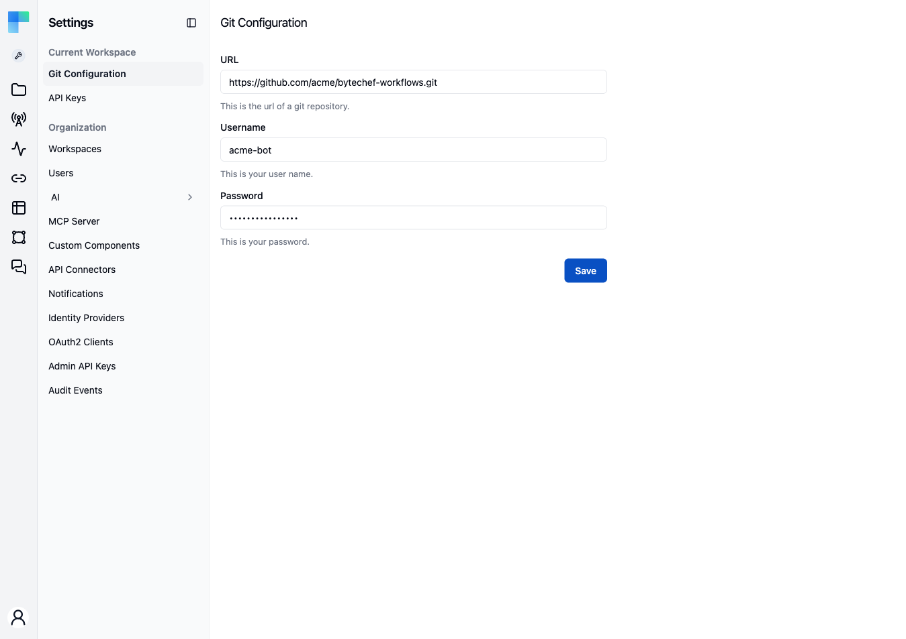

Every workflow has a file form: a single JSON document with its tasks, their parameters, its
trigger configuration, its connection references (by name, never by secret), and its input and
output schemas. When a workspace is connected to a Git repository, projects push these files to a
branch when they publish, and can be pulled back from that branch.

<Callout>
    Git integration is gated behind the **`ff-1039`** feature flag as well as Enterprise Edition. With
    the flag off, the **Git Configuration** settings entry and the per-project Git menu items are
    hidden.
</Callout>

## Configure the repository

The repository is configured once per workspace, by an admin.

1. Go to **Settings → Git Configuration** in the Automation area.
2. Fill in **URL** with the Git repository URL. Any HTTPS remote works: GitHub, GitLab, Bitbucket, or
   self-hosted.
3. Fill in **Username** and **Password**. The password field accepts a personal access token, which
   is what most hosts want.
4. Click **Save**.

Every project in the workspace shares this repository. The stored password is never sent back to
the browser: the field reads `********` once a password is saved, and saving the form with that
placeholder unchanged keeps the existing password. Type a new value only to rotate the credential.

## Point a project at a branch

Each project then picks its branch. Open a project's **⋮** menu on the Projects list (or the
project editor's **Settings** menu, **Project** tab) and choose **Git Configuration**:

1. In the **Update Git Configuration** dialog, pick a **Branch**. The dropdown lists the
   repository's remote branches, so a typo cannot create a new branch.
2. Turn **Enabled** on.
3. Click **Save**.

One project maps to one branch. The sibling **Pull Project from Git** menu item stays disabled until
the project's Git configuration is enabled.

### Required permissions

| Action | Permission |
|---|---|
| Read or configure the workspace repository | `WORKSPACE_MANAGE` on the workspace. The settings page itself is additionally restricted to the organization admin authority. |
| Push (publishing with sync enabled) | `DEPLOYMENT_PUSH` on the project |
| Pull Project from Git, and listing the remote branches | `DEPLOYMENT_PULL` on the project |

## Push on publish

With the project's Git configuration enabled, **publishing the project pushes it**. There is no
separate push action.

- The commit message is the version description you type at publish time. If you leave it empty, the
  commit message is `Update workflows`.
- After the push, the version's description is annotated with the repository URL, the branch, and the
  commit hash, so a ByteChef version and a Git commit reference each other.
- The push writes the complete workflow set of the project's latest version and clears everything
  else from the branch first, so a workflow deleted from the project disappears from the branch on
  the next publish.

Each workflow is one file, named after its label with the workflow's format as the extension:
a workflow labeled `Invoice Import` becomes `Invoice Import.json`. Renaming a workflow therefore
renames its file.

## Pull from Git

**Pull Project from Git** reads the workflow files from the project's configured branch and:

1. Matches each file to an existing workflow **by label**. A file whose label has no match becomes a
   new workflow; a file that matches updates the existing one.
2. Publishes a new project version, whose description records the Git commit message, the repository,
   the branch, and the commit hash.

Because a pull ends in a publish, any change on the branch (a merged pull request, a `git revert`,
a refactor) arrives as an ordinary immutable version that you deploy like one published from the
editor.

<Callout type="warn">
    Matching is by label, and a pull never deletes. A file removed from the branch leaves its workflow
    in the project; renaming a workflow in ByteChef without renaming its file produces a second
    workflow on the next pull.
</Callout>

## Working from either side

You can combine both directions:

- **UI to Git** - build in the visual editor, publish, and the push happens for you. Suited to
  prototyping and to teams whose primary builders are not developers.
- **Git to UI** - edit the JSON in your editor, open a pull request, merge it, then pull. Suited to
  refactors, bulk edits, and any change your review policy requires a PR for.

Once the workflows are files on a branch, standard repository tooling applies: diffs in pull
requests, `git blame`, CODEOWNERS reviews, `git bisect`, and `git revert` followed by a pull to undo a
change as a new version.
