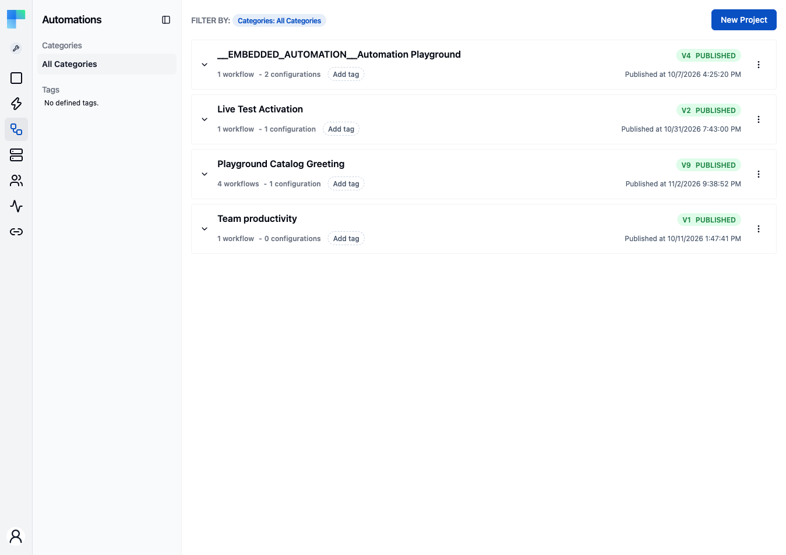

---

> **Feature flag.** Automations are behind a deployment feature flag. The **Automations** entry appears in the Embedded sidebar only where that flag is enabled; without it the pages below are not linked from the UI.

The **Automations** page is the authoring surface for your **workflow templates**. Templates are grouped under **Projects**, organized by **Category** and **Tag**, and made available to end users by publishing the project and releasing a version to an environment through a **configuration**.

Conceptually:

- A **project** is a logical bundle of related templates (for example, "HubSpot sync" or "Slack notifications").
- A **workflow template** is a workflow definition you author once in your workspace. It is not tied to any specific connected user - it's a reusable blueprint.

Runtime activity for end users lives in [Workflow Executions](/platform/embedded/monitor/workflow-executions); this page is strictly about authoring.

---

## Key Features

| Feature | Description |
|---|---|
| Project CRUD | Create, edit, and delete projects from a single list. |
| Template CRUD | Create a workflow template from scratch or import one from a `.json`/`.yaml`/`.yml` file. |
| Publish | Cut a new project version. Publishing alone exposes nothing to connected users. |
| Configurations | Release a published version to an environment: pin the version, switch it on or off, switch individual workflows, and choose whether it shows in the Automation Hub. |
| Tags & Categories | Group projects by category (single) and tag (many) for filtering. |
| Category / Tag filter sidebar | Narrow the list with two stacked navs - **Categories** and **Tags** - in the left sidebar. |
| Inline template list | Expand any project row to see its **Workflows** (templates, their trigger, the components they use, and the last modified date) and its **Configurations**. |
| Environment scoping | Projects and workflows are edited in Development only. In Staging and Production, the **Automation Configurations** page takes the place of Automations. |

### Project row

Each project row displays:

- **Name** -- clicking it opens the project's first template in the editor (or expands the template list if the project has none yet).
- **Template count** -- a collapsible trigger; click to expand the template list.
- **Tabs** -- once expanded, the row shows **Workflows** and **Configurations** tabs. The **+ Workflow** button group (with **Import Workflow** in its chevron menu) sits in the Workflows tab; **New Configuration** sits in the Configurations tab.
- **Tags** -- inline editable; add or remove tags directly from the row.
- **Status badge** -- `DRAFT` while unpublished, `V<n> PUBLISHED` once a version has been cut.
- **Actions menu** (⋮) -- Publish, New Workflow, Import Workflow, Edit, Delete.

### Template row

Inside an expanded project, the **Workflows** heading carries the create-template button group: a **New Workflow** button (new from scratch) with a chevron menu containing **Import Workflow**. Each template row below it shows:

- **Label** (or workflow UUID as fallback).
- **Trigger** -- the first trigger's icon plus a badge with its title.
- **Components** -- icons of the components the template uses.
- **Last modified date**.
- **Actions menu** (⋮) -- Edit, Delete.

Clicking a template row opens it in the embedded workflow editor. Template executions are no longer in this menu: open them from a configuration, as described below.

### Configurations

A published version reaches connected users only through a **configuration**. Open the **Configurations** tab of an expanded project to manage them. An environment can have several configurations of the same project, for example one for everyone and one for a beta group. Nothing is exposed in an environment until one of its configurations points at a published version.

Each configuration row shows:

- **Name** -- in an environment with one configuration, the name defaults to the environment name.
- **Users** -- how many connected users are on this configuration.
- **Version badge** -- `V<n>`, the published version the environment is pinned to.
- **Newer version available** badge -- shown when a later version has been published than the one the configuration points at.
- **Hidden from hub** badge -- shown when the configuration's **Show in Automation Hub** switch is off.
- **Enabled switch** -- turns the whole configuration on or off.
- **Actions menu** (⋮) -- Edit, Update Project Version, Move Users…, Delete.

Expand a row to list the workflows of that version, each with its own switch. Turning a workflow off hides that template in the environment without affecting the others. Click a workflow to open its executions for that environment.

#### Configuration dialog

**New Configuration** opens a dialog with:

- **Project** -- required, shown only on the Automation Configurations page, where the dialog is not opened from a project. It lists the published projects; choosing one preselects its latest published version.
- **Name** -- required. It must be unique for the project and environment (upper and lower case count as the same).
- **Environment** -- the environment the configuration belongs to. It is fixed when you edit a configuration.
- **Version** -- the published versions of the project. Pointing a configuration at an older version is allowed, which is how you roll an environment back.
- **Enabled** -- whether the configuration is on.
- **Show in Automation Hub** -- list the project through the API for this environment, and so in the [Automation Hub](/platform/embedded/build/automation-hub) and in custom UIs. Turn it off for flows you only activate by UUID; they can still be provisioned. Turning off the configuration or a workflow is what stops provisioning and running.
- **Assignment rule** -- optional. An expression that decides which new users can be placed on this configuration on their own. Empty means everyone. See [Several configurations in one environment](#several-configurations-in-one-environment).

The **New Configuration** button is disabled, with the tooltip "Publish the project first", until the project has a published version.

#### Several configurations in one environment

Give a group of users a different version, or different provided values, by adding another configuration in the same environment. Each configuration has its own name, version, enabled switch, hub visibility and provided values.

- **Every connected user is assigned to one configuration of a project.** The assignment is stored. It never changes by itself.
- **Users stay where they started.** Publishing a version, creating a configuration or enabling one does not move users who already have the project. Only new users can land on it.
- **New users pick themselves a configuration.** When a user first activates or copies a workflow of the project, they are placed on the enabled configuration in their environment whose assignment rule lets them in. If several qualify, the one with the highest project version wins, and among equal versions the one created last.
- **The assignment rule is checked once, at assignment.** If a user's metadata changes later, they stay where they are until you move them. Assigning a user when you provision them and moving users ignore the rule, so you can put anyone on any configuration of the project. The permission expressions on the project and its workflows still decide what a user can see.
- **A user with no matching configuration** does not see the project in the hub, the same as when the project's own expression hides it.

Metadata values are strings, so compare against a quoted value. To keep a beta configuration for flagged users only:

```
metadata['beta'] == 'true'
```

An assignment rule uses the same syntax as a permission expression. See [Permission Expressions](/platform/embedded/build/permission-expressions) for everything an expression can reference.

#### Moving users between configurations

Use a move to put chosen users on another configuration of the same project and environment.

1. Open the configuration's ⋮ menu and pick **Move Users…**. It is unavailable when the environment has no other configuration, or when no user is on this one.
2. The dialog lists every user on the configuration, all selected. Search to narrow the list, and clear the ones you want to leave.
3. Pick the target configuration. The target can be disabled, in which case it is marked "(disabled)" and the moved users' references are switched off.
4. Review the warnings (new required inputs or connections in the target version), then confirm. **Move** stays unavailable until the preview has loaded. If the preview cannot load, the dialog says so and you can still move.

To move chosen users from the Connected Users page instead, see [Upgrading Several Users at Once](/platform/embedded/monitor/connected-users#upgrading-several-users-at-once).

Moved users' references roll to the target's version, with provided values taken from the target. Their copies are not changed.

A user is **skipped** when the target version does not have a workflow they still reference. The dialog lists these users, with the missing workflows, before you confirm, and the rest of the batch still moves. If a moved user is missing a connection or input, their reference is paused with a reason and the dialog counts how many need attention.

To move a single user, open the user in [Connected Users](/platform/embedded/monitor/connected-users) and pick **Change configuration…** on the project row. It works the same way, also offers the disabled configurations of the environment, and it is how you pin an existing self-serve user to a configuration. When you provision a project for a user who already has it, the configuration is read-only and the dialog points you to **Change configuration**.

#### What a configuration does to connected users

- **References** follow the version of the configuration their user is assigned to, not the latest publish. When you move the configuration to another version, the roll-out runs in the background and can finish a moment after the change. Each reference keeps the user's connections and input values. If the version needs a connection or an input value the user hasn't supplied, the reference is disabled. Enable it again once they have.
- **Turning off** a configuration, or one of its workflows, switches the affected references off and marks them "turned off by the administrator". Turning it back on restores exactly what each user had chosen. The users stay assigned to the configuration. They are not moved.
- **Deleting** a configuration is destructive. It deletes the references of every user assigned to it, and the dialog says how many users and workflows. It cannot be undone, and recreating the configuration does not bring the references back. Users' copies keep working.
- **Copies** keep working. Only new activations and new copies are gated: activating or copying a template that is not released in the user's environment fails with an error.

#### Configuration executions

Click a workflow in an expanded configuration row to open a side panel with two tabs:

- **Executions** - the template's executions in the configuration's environment, a page at a time, with a **Connected user** column that names whose run it was and the version of each run. The list covers connected users' references to the template, the copies they made of it, and runs of earlier versions, so runs of a copy show up even though the copy is its own workflow. Click an execution to see its step-by-step results; the refresh button reloads the list.
- **Workflow** - a read-only view of the template.

---

## How to Use

### Creating a project

1. Click **New Project** in the page header (top right).
2. In the dialog, enter a **Name**, optional **Description**, an optional **Category**, and any **Tags**.
3. Optionally enter a **Permission Expression** to limit which connected users see the project. See [Permission Expressions](/platform/embedded/build/permission-expressions).
4. Submit. The new project appears in the list as a `DRAFT`.

Showing the project in the [Automation Hub](/platform/embedded/build/automation-hub) is set per environment on its configuration, not on the project.

If no projects exist yet, the empty state shows a **Create Project** button that opens the same dialog.

### Adding templates

Expand a project row and, on the **Workflows** tab, you can:

- Click **+ Workflow** in the Workflows tab (or **New Workflow** in the project's ⋮ menu) to open the new-template dialog. Provide a label and description; the template is created with empty `inputs`, `tasks`, and `triggers`, then opened in the editor.
- Click the chevron next to **+ Workflow** and pick **Import Workflow** to upload a `.json`, `.yaml`, or `.yml` file. The file's contents become the template definition and the template opens in the editor.
- Use the project's ⋮ menu for the same two actions plus **Edit** and **Delete**.

The buttons are there whenever the project is expanded, including when it has no templates yet.

### Editing or deleting a project

Open the project's ⋮ menu and pick **Edit** (reopens the project dialog with current values) or **Delete** (confirms via dialog, then removes the project and its templates).

Deleting a project marks every connected user's reference to its workflows as dangling and disabled, with the reason "The automation workflow project was deleted". See [Dangling references](/platform/embedded/build/automations/automation-code-workflows#dangling-references).

### Publishing

Open the project's ⋮ menu and pick **Publish**. The badge updates from `DRAFT` to `V<n> PUBLISHED`, and the new version can then be chosen in a [configuration](#configurations).

Publishing does not release anything. Connected users keep seeing the version of the configuration they are assigned to, and a project with no configuration is not exposed at all. To roll the new version out, edit the configuration of each environment and pick it, or move chosen users to a configuration that already uses it. The **Newer version available** badge reminds you which configurations are behind.

What a version change does to connected users who already use the project:

- **References** move to the configuration's version, as described under [What a configuration does to connected users](#what-a-configuration-does-to-connected-users).
- **References to removed workflows** - a workflow that is no longer in the version the configuration points at - become dangling and disabled, with the reason "Not in the version released to this environment". This also happens on a rollback: moving a configuration back to an older version dangles references to templates that version lacks, and the configuration dialog warns about it. This is permanent, unlike the recoverable "turned off by the administrator" state above.
- **Copies** are not changed. A connected user's copy keeps running the version they copied.

If the background roll-out fails for a user, their reference catches up the next time it is enabled or provisioned, or the next time the configuration's version changes.

### Filtering

The left sidebar exposes two stacked filters:

- **Categories** -- a single-select list; the default entry is **All Categories**.
- **Tags** -- a single-select list of every tag in use; empty state shows "No defined tags."

Selecting an entry sets `?categoryId=` or `?tagId=` in the URL so the view is shareable and back-button friendly.

### Environment selection

Projects and their workflows are shared by every environment, so you build and edit them only in **Development**. There, the **Configurations** tab of a project lists its Development configurations.

In **Staging** and **Production**, the sidebar shows **Automation Configurations** instead of Automations, and the workflow editor is not available. The page lists the published projects that have configurations in that environment, each with its configurations. Pick a project in the left sidebar to show only its configurations. **New Configuration** in the header opens the configuration dialog with a **Project** field. When no project has a configuration in the environment yet, the page shows the steps to get there instead: create a project, publish a version, create a configuration. You can create, edit, turn on or off, move users between and delete configurations there, but not change a project or its workflows.

Switching environment from the selector in the left sidebar (next to the user menu) moves you between the two pages.

## Related

- [Automation Hub](/platform/embedded/build/automation-hub) - the embeddable catalog where connected users find published projects.
- [Activate templates from your app](/platform/embedded/build/activation-dialog) - open the activation dialog for a published template from your own page.
- [Permission Expressions](/platform/embedded/build/permission-expressions) - limit which connected users see a project or workflow.
- [Automation Code Workflows](/platform/embedded/build/automations/automation-code-workflows) - references, provisioning and dangling references.
- [Request Triggers](/platform/embedded/build/request-triggers) - run a connected user's workflow and get its result in the response.
