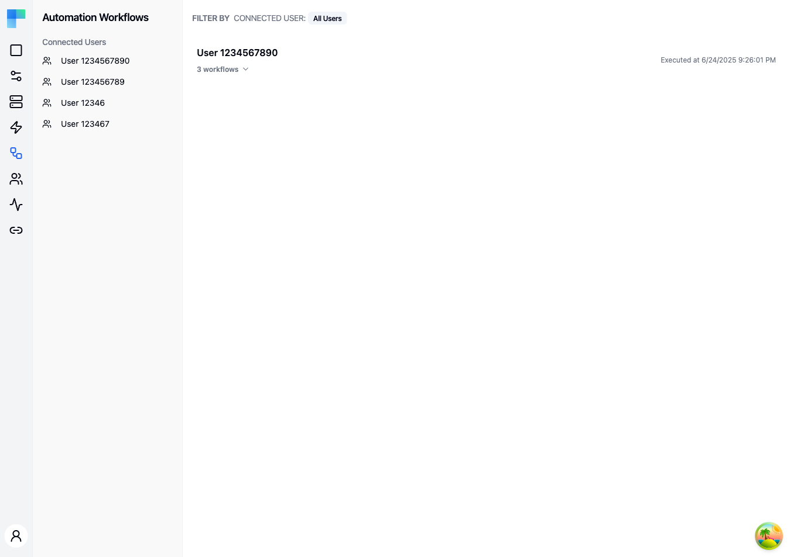

---

> **Feature flag.** Automations are behind a deployment feature flag. The **Automations** entry appears in the Embedded sidebar only where that flag is enabled; without it the pages below are not linked from the UI.

The **Automations** page is the authoring surface for your **workflow templates**. Templates are grouped under **Projects**, organized by **Category** and **Tag**, and made available to end users by publishing the project and releasing a version to an environment through a **configuration**.

Conceptually:

- A **project** is a logical bundle of related templates (for example, "HubSpot sync" or "Slack notifications").
- A **workflow template** is a workflow definition you author once in your workspace. It is not tied to any specific connected user - it's a reusable blueprint.

Runtime activity for end users lives in [Workflow Executions](/platform/embedded/monitor/workflow-executions); this page is strictly about authoring.

---

## Key Features

| Feature | Description |
|---|---|
| Project CRUD | Create, edit, and delete projects from a single list. |
| Template CRUD | Create a workflow template from scratch or import one from a `.json`/`.yaml`/`.yml` file. |
| Publish | Cut a new project version. Publishing alone exposes nothing to connected users. |
| Configurations | Release a published version to an environment: pin the version, switch it on or off, switch individual workflows, and choose whether it shows in the Automation Hub. |
| Tags & Categories | Group projects by category (single) and tag (many) for filtering. |
| Category / Tag filter sidebar | Narrow the list with two stacked navs - **Categories** and **Tags** - in the left sidebar. |
| Inline template list | Expand any project row to see its **Workflows** (templates, their trigger, the components they use, and the last modified date) and its **Configurations**. |
| Environment scoping | The page reflects projects in the currently selected environment (Development / Staging / Production). |

### Project row

Each project row displays:

- **Name** -- clicking it opens the project's first template in the editor (or expands the template list if the project has none yet).
- **Template count** -- a collapsible trigger; click to expand the template list.
- **Tabs** -- once expanded, the row shows **Workflows** and **Configurations** tabs. The **New Workflow** button group (with **Import Workflow** in its chevron menu) sits in the Workflows tab; **New Configuration** sits in the Configurations tab.
- **Tags** -- inline editable; add or remove tags directly from the row.
- **Status badge** -- `DRAFT` while unpublished, `V<n> PUBLISHED` once a version has been cut.
- **Actions menu** (⋮) -- Publish, New Workflow, Import Workflow, Edit, Delete.

### Template row

Inside an expanded project, the **Workflows** heading carries the create-template button group: a **New Workflow** button (new from scratch) with a chevron menu containing **Import Workflow**. Each template row below it shows:

- **Label** (or workflow UUID as fallback).
- **Trigger** -- the first trigger's icon plus a badge with its title.
- **Components** -- icons of the components the template uses.
- **Last modified date**.
- **Actions menu** (⋮) -- Edit, Delete.

Clicking a template row opens it in the embedded workflow editor. Template executions are no longer in this menu: open them from a configuration, as described below.

### Configurations

A published version reaches connected users only through a **configuration**. Open the **Configurations** tab of an expanded project to manage them. Each project has at most one configuration per environment, and nothing is exposed in an environment until its configuration points at a published version.

Each configuration row shows:

- **Environment** (Development, Staging or Production).
- **Version badge** -- `V<n>`, the published version the environment is pinned to.
- **Newer version available** badge -- shown when a later version has been published than the one the configuration points at.
- **Hidden from hub** badge -- shown when the configuration's **Show in Automation Hub** switch is off.
- **Enabled switch** -- turns the whole configuration on or off.
- **Actions menu** (⋮) -- Edit, Delete.

Expand a row to list the workflows of that version, each with its own switch. Turning a workflow off hides that template in the environment without affecting the others. Click a workflow to open its executions for that environment.

#### Configuration dialog

**New Configuration** opens a dialog with:

- **Environment** -- only environments that do not have a configuration yet. It is fixed when you edit a configuration.
- **Version** -- the published versions of the project. Pointing a configuration at an older version is allowed, which is how you roll an environment back.
- **Enabled** -- whether the configuration is on.
- **Show in Automation Hub** -- list the project in the [Automation Hub](/platform/embedded/build/automation-hub) for this environment. Turn it off for flows you only activate through the API.

The **New Configuration** button is disabled, with the tooltip "Publish the project first", until the project has a published version.

#### What a configuration does to connected users

- **References** follow the version their environment's configuration points at, not the latest publish. When you move the configuration to another version, the roll-out runs in the background and can finish a moment after the change. Each reference keeps the user's connections and input values. If the version needs a connection or an input value the user hasn't supplied, the reference is disabled. Enable it again once they have.
- **Turning off** a configuration, or one of its workflows, switches the affected references off and marks them "turned off by the administrator". Turning it back on restores exactly what each user had chosen.
- **Deleting** a configuration behaves like turning it off. Recreating a configuration for that environment brings the references back with their connections and inputs.
- **Copies** keep working. Only new activations and new copies are gated: activating or copying a template that is not released in the user's environment fails with an error.

#### Configuration executions

Click a workflow in an expanded configuration row to open a side panel with two tabs:

- **Executions** - the template's executions in the configuration's environment, a page at a time, with a **Connected user** column that names whose run it was and the version of each run. The list covers connected users' references to the template, the copies they made of it, and runs of earlier versions, so runs of a copy show up even though the copy is its own workflow. Click an execution to see its step-by-step results; the refresh button reloads the list.
 a page at a time, with a **Connected user** column that names whose run it was. The list covers connected users' references to the template and the copies they made of it, so runs of a copy show up even though the copy is its own workflow. Click an execution to see its step-by-step results; the refresh button reloads the list.
- **Workflow** - a read-only view of the template.

---

## How to Use

### Creating a project

1. Click **New Project** in the page header (top right).
2. In the dialog, enter a **Name**, optional **Description**, an optional **Category**, and any **Tags**.
3. Optionally enter a **Permission Expression** to limit which connected users see the project. See [Permission Expressions](/platform/embedded/build/permission-expressions).
4. Submit. The new project appears in the list as a `DRAFT`.

Showing the project in the [Automation Hub](/platform/embedded/build/automation-hub) is set per environment on its configuration, not on the project.

If no projects exist yet, the empty state shows a **Create Project** button that opens the same dialog.

### Adding templates

Expand a project row and, on the **Workflows** tab, you can:

- Click **New Workflow** to open the new-template dialog. Provide a label and description; the template is created with empty `inputs`, `tasks`, and `triggers`, then opened in the editor.
- Click the chevron next to **New Workflow** and pick **Import Workflow** to upload a `.json`, `.yaml`, or `.yml` file. The file's contents become the template definition and the template opens in the editor.
- Use the project's ⋮ menu for the same two actions plus **Edit** and **Delete**.

The buttons are there whenever the project is expanded, including when it has no templates yet.

### Editing or deleting a project

Open the project's ⋮ menu and pick **Edit** (reopens the project dialog with current values) or **Delete** (confirms via dialog, then removes the project and its templates).

Deleting a project marks every connected user's reference to its workflows as dangling and disabled, with the reason "The catalog project was deleted". See [Dangling references](/platform/embedded/build/automations/automation-code-workflows#dangling-references).

### Publishing

Open the project's ⋮ menu and pick **Publish**. The badge updates from `DRAFT` to `V<n> PUBLISHED`, and the new version can then be chosen in a [configuration](#configurations).

Publishing does not release anything. Connected users keep seeing the version their environment's configuration points at, and a project with no configuration is not exposed at all. To roll the new version out, edit the configuration of each environment and pick it. The **Newer version available** badge reminds you which configurations are behind.

What a version change does to connected users who already use the project:

- **References** move to the configuration's version, as described under [What a configuration does to connected users](#what-a-configuration-does-to-connected-users).
- **References to removed workflows** - a workflow that is no longer in the version the configuration points at - become dangling and disabled, with the reason "Removed from the catalog project on publish".
- **Copies** are not changed. A connected user's copy keeps running the version they copied.

If the background roll-out fails for a user, their reference catches up the next time it is enabled or provisioned, or the next time the configuration's version changes.

### Filtering

The left sidebar exposes two stacked filters:

- **Categories** -- a single-select list; the default entry is **All Categories**.
- **Tags** -- a single-select list of every tag in use; empty state shows "No defined tags."

Selecting an entry sets `?categoryId=` or `?tagId=` in the URL so the view is shareable and back-button friendly.

### Environment selection

Projects are scoped to the current environment. Switch environments from the selector in the left sidebar (next to the user menu) to see projects in **Development**, **Staging**, or **Production**.

## Related

- [Automation Hub](/platform/embedded/build/automation-hub) - the embeddable catalog where connected users find published projects.
- [Activate templates from your app](/platform/embedded/build/activation-dialog) - open the activation dialog for a published template from your own page.
- [Permission Expressions](/platform/embedded/build/permission-expressions) - limit which connected users see a project or workflow.
- [Automation Code Workflows](/platform/embedded/build/automations/automation-code-workflows) - references, provisioning and dangling references.
- [Request Triggers](/platform/embedded/build/request-triggers) - run a connected user's workflow and get its result in the response.
