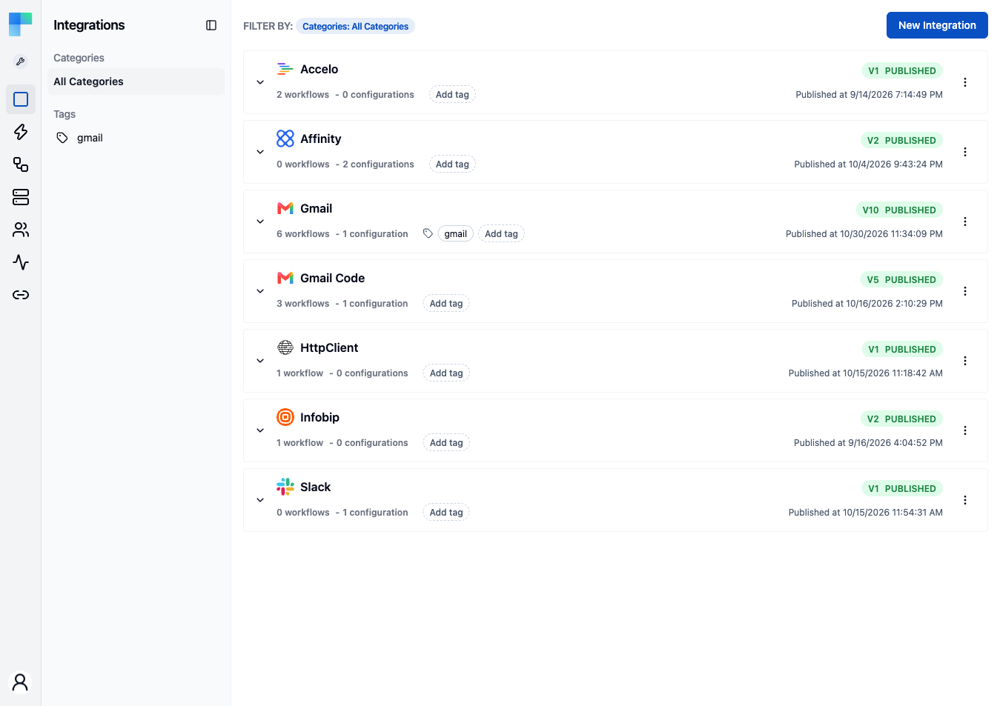

An integration connects your product to one third-party service, such as Slack or HubSpot. You build the integration's workflows on the **Integrations** page, publish a version, and then activate that version for your connected users through an [Integration Configuration](/platform/embedded/configure/instance-configurations). Tenant admins use this page to author everything your end users later turn on from inside your product.

> **Integrations are authored in Development.** The **Integrations** entry appears in the Embedded sidebar only while the **Development** environment is selected. In Staging and Production, the sidebar shows **Integration Configurations** instead.

## Key Features

| Feature | Description |
|---|---|
| Categories | Organize integrations by category. The left sidebar lists all categories. |
| Tags | Assign tags to integrations for flexible grouping and filtering. |
| Versioning | Each integration tracks versions with a status of `DRAFT` or `PUBLISHED`. |
| Workflow and configuration counts | The integration card shows how many workflows belong to the integration and how many Development instance configurations use it. |
| Publish date | The card shows when the integration was last published, or **Not yet published** for drafts. |
| Permission expression | An optional SpEL expression that restricts which connected users can see the integration (and, per workflow, which workflows). |

### Integration Card Details

Each integration in the list displays:

- **Icon and name** - the component icon and integration name, linking to the workflow editor.
- **Summary** - for example **2 workflows - 1 configuration**. Click it, or the empty space on the card, to expand the integration (see [Expanded integration](#expanded-integration)). The configuration count covers all of the integration's Development instance configurations, enabled or not.
- **Tags** - assigned tags shown as badges. Click **+** to add a tag or the **x** on a badge to remove it.
- **Version badge** - the current version number and status, for example `V1 PUBLISHED` or `V2 DRAFT`.
- **Last published date** - the timestamp of the most recent publish, or **Not yet published**.

---

## How to Use

### Creating an Integration

1. Click **New Integration** in the top-right corner of the Integrations page. On an empty page, click **Create Integration**.
2. In **Component**, select the third-party service to integrate with. **Name** is filled in from the component title.
3. Optionally set **Category**, **Description**, **Permission Expression** and **Tags**.
4. Click **Save**. ByteChef creates the integration with a default workflow and opens the workflow editor.

The component cannot be changed after the integration is created.

### Managing Integrations

The three-dot menu on each integration card contains:

| Action | Description |
|---|---|
| **Edit** | Update the name, category, description, permission expression or tags. |
| **Publish** | Publish the current draft as a new version. Disabled until the integration has at least one workflow. |
| **New Workflow** | Create a workflow in this integration. |
| **Import Workflow** | Import a workflow from a JSON or YAML file. |
| **View Workflows** | Open the workflow editor. Shown when the integration has at least one workflow. |
| **New Configuration** | Create a Development [instance configuration](/platform/embedded/configure/instance-configurations). Disabled, with the tooltip "Publish the integration before configuring it.", until the integration has a published version. |
| **Delete** | Permanently delete the integration and all its workflows. |

### Expanded integration

An expanded integration has four tabs. It always opens on **Workflows**.

| Tab | Content |
|---|---|
| **Workflows** | The integration's workflows. **New Workflow** sits on the right; its dropdown arrow offers **Import Workflow**. Each workflow row has its own menu with **Edit** (label, description and the workflow's permission expression), **Export** and **Delete**. |
| **Configurations** | The integration's [instance configurations](/platform/embedded/configure/instance-configurations) in the Development environment, each expanded to show its workflows, with **New Configuration** on the right. Clicking a configuration workflow opens its executions. Before the first publish, the tab shows **Publish the integration to configure it** with a **Publish** button. After a publish, with no configuration yet, it shows **No configurations in Development** with a **Configure** button. |
| **Actions** | The actions of the integration's component, with their description and a copyable **Action ID**. The tab label shows the count. |
| **Tools** | The tools of the integration's component, with their description and a copyable **Tool ID**. The tab label shows the count. |

### Filtering Integrations

Use the left sidebar to filter the integration list:

- **Categories** - click a category name to show only integrations in that category, or select **All Categories** to view everything.
- **Tags** - click a tag to filter by that tag.

The page title shows the active filter, for example **Filter by: Categories: All Categories**.

#### Filtering by Unified API category

> **Coming soon.** Filtering integrations by [Unified API](/platform/embedded/build/unified-api) category (Accounting, Commerce, CRM) is not generally available yet.

### Publishing an Integration

Publishing creates a new, read-only version of the integration that you can activate for connected users through an instance configuration. The version number increments with each publish. Only published versions can be activated in Staging and Production.

1. Open the integration's three-dot menu and click **Publish**.
2. Optionally enter a **Description** of the changes.
3. Click **Publish**.

### Restricting who sees an integration

By default every active integration is offered to every connected user. To scope an integration to a subset of your users, set a **Permission Expression**: an optional [SpEL](https://docs.spring.io/spring-framework/reference/core/expressions.html) expression evaluated against the calling connected user. When the expression evaluates to `true`, the integration is visible to that user; otherwise it is hidden. A blank expression makes the integration visible to everyone.

The expression is evaluated against the connected user's attributes: `email`, `name`, `externalId`, `environment`, and any custom `metadata` your backend attached with `PATCH /api/embedded/v1/me` or `PATCH /api/embedded/v1/{externalUserId}`. Metadata does not come from JWT claims; the JWT contributes only the `sub` claim, which becomes `externalId`. Metadata values are stored as strings. For example:

```text
metadata['plan'] == 'pro'
email.endsWith('@acme.com')
```

Permission expressions apply at two levels:

- **Integration level** - set in the integration's create or edit dialog. Controls whether the entire integration (all of its workflows) is offered to the user.
- **Workflow level** - set in the workflow's **Edit** dialog from the integration's workflow list. Controls whether that single workflow is offered, even when the parent integration is visible.

Both filters are fail-closed: an expression that errors or evaluates to `false` hides the resource. See [Permission Expressions](/platform/embedded/build/permission-expressions) for the full reference.

---

## AI Copilot

> **Coming soon.** The AI Copilot is on the upcoming release track and is not yet available in the latest released version of ByteChef.

The integration workflow editor carries the [AI Copilot](/platform/automation/build/ai-copilot) panel, the same assistant as in the automation project editor, scoped to the current integration. It has **Ask** and **Build** modes for understanding and building the integration's workflows. Copilot is an Enterprise Edition feature and is disabled by default.
