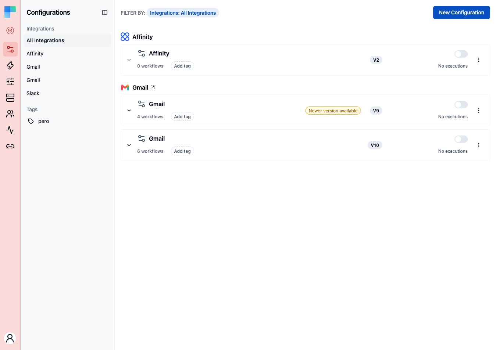

An integration instance configuration deploys a published version of an integration to an environment (Staging or Production). It holds the shared settings that every connected user on that configuration gets: the integration version, the shared authorization parameters (for example an OAuth2 app's client id and secret), and which of the integration's workflows are enabled with their connections and inputs. When a connected user connects the integration, ByteChef creates an integration instance for that user from a configuration.

Configurations are managed under **Embedded → Integration Configurations**. Each environment has its own set of configurations. Switch environments with the environment selector in the left sidebar.

> **In Development, configurations live on the integration.** While the **Development** environment is selected, the **Integration Configurations** entry is not in the Embedded sidebar. Open **Integrations**, expand an integration and select its **Configurations** tab, which lists the integration's Development configurations with the same rows, switches and menus described below. Links to this page open the integration list instead, on the right integration's **Configurations** tab when the link names one. See [Expanded integration](/platform/embedded/build/integrations#expanded-integration).

## Configuration list

Each row in the list shows:

| Element | Description |
|---|---|
| Name | The configuration name, with the integration icon when the list shows all integrations. |
| Workflow count | The number of workflows in the configuration. Click it to expand the row and list the workflows. |
| Tags | Tags assigned to the configuration. Click **+** to add one. |
| **Newer version available** | Shown when the integration has a later published version than the one the configuration deploys. A newer draft does not count. |
| Version badge | The deployed integration version, for example **V3**. |
| Enabled switch | Turns the configuration on or off without deleting it. |
| Last execution | **Executed at** with a date and time, or **No executions**. |
| ⋮ menu | **Edit**, **Change Integration Version**, **Move Users…** and **Delete**. |

## Creating a Configuration

Click **New Configuration** in the top-right corner. The **New Configuration** wizard shows a step indicator and **Next** / **Previous** buttons. The steps depend on the integration you pick.

1. **Basic**: set the fields in the table below.
2. **OAuth2 Connection** (only when the integration's component authenticates with OAuth2): enter the **OAuth2 Credentials**. You can switch between your own app credentials and predefined app credentials.
3. **Workflows**: for each workflow in the integration, enable or disable it and set its connections and input values.
4. Click **Save** on the last step.

| Field | Required | Description |
|---|---|---|
| **Integration** | Yes | The integration to deploy. |
| **Name** | Yes | The configuration name. |
| **Version** | Yes | The published integration version to deploy. |
| **Authorization** | When the integration requires it | Shown when the integration's connection offers more than one authorization type. Cannot be changed after the configuration is created. |
| **Environment** | n/a | Read-only. The environment currently selected. |
| **Description** | No | Free text. |
| **Assignment rule** | No | An expression that limits which connected users self-serve places on this configuration. Empty means everyone. See [Several Configurations of One Integration](#several-configurations-of-one-integration). |
| **Tags** | No | Tags for filtering. Not shown in Development. |

<!-- TODO screenshot: The New Configuration wizard on the Workflows step, showing the step indicator (Basic / OAuth2 Connection / Workflows) and the per-workflow enable toggles with connection and input fields -->

## Internal-only workflow inputs

A workflow input can be marked internal-only. Set it in the workflow editor of an integration or an automation workflow:

1. Open **Workflow Inputs** in the editor's right sidebar.
2. Click **New Input**, or edit an existing input.
3. In the **Create a new Input** or **Edit Input** dialog, set **Internal only** to **True**.
4. Click **Save**.

The **Workflow Inputs** table shows the setting in its **Internal only** column. In the workflow definition it is stored as the input's `internalOnly` flag. In this example the connected user fills in `channel`, while `accountId` is set by you in the configuration:

```json
{
  "inputs": [
    {"name": "accountId", "label": "Account ID", "type": "string", "required": true, "internalOnly": true},
    {"name": "channel", "label": "Slack Channel", "type": "string", "required": true}
  ]
}
```

- **`internalOnly: true`** - the connect dialog filters the input out, so it is never shown to the connected user. Use it for values you set yourself (an account ID, a default that should not be end-user editable).
- **`internalOnly` absent or `false`** *(default)* - the input is collected from the connected user in the [connect dialog](/platform/embedded/get-started/quick-start#7-render-the-connect-dialog).

The flag is enforced by the React SDK, which drops internal-only inputs from the forms it renders. Existing inputs carry no flag and so are end-user-facing.

## Managing Configurations

Use the switch and the ⋮ menu on a configuration row:

- **Enabled switch**: controls whether the configuration's workflows run.
- **Edit**: opens the **Edit Configuration** dialog to change the name, description, assignment rule, tags and connection parameters, or to [rotate shared credentials](#rotating-shared-credentials).
- **Change Integration Version**: opens the **Change Version** wizard to move the configuration to another published version of the integration.
- **Move Users…**: moves connected users to another configuration of the same integration and environment. See [Moving Users Between Configurations](#moving-users-between-configurations).
- **Delete**: removes the configuration after you confirm.

Expand a configuration row to see its workflows. Each workflow has its own switch and an **Edit** action in its ⋮ menu. **Edit** opens the **Edit *Workflow name* Workflow** dialog, where you set the workflow's input values and connections for this configuration.

A workflow that an [MCP server](/platform/embedded/configure/mcp-servers) exposes as a tool stays a normal workflow of the configuration. It is marked **MCP**, its switch and menu work like any other workflow's, and it can keep other triggers, such as a webhook or a schedule, next to the tool trigger. Removing it from the MCP server, or deleting the server, leaves it in the configuration.

Click a configuration workflow to open a side panel with two tabs:

- **Executions** - the workflow's executions in this configuration, a page at a time, with a **Connected user** column that names whose instance ran. Click an execution to see its step-by-step results. The refresh button reloads the list.
- **Workflow** - a read-only view of the workflow.

## Rotating Shared Credentials

The **Authorization Parameters** of a configuration, such as the OAuth2 app's client id and client secret, are shared by every connected user on it. To rotate them, choose **Edit** on the configuration and click **Update credentials** in the **Edit Configuration** dialog. Enter the new values and click **Save**. Fields you leave empty keep their current value.

- The new values replace the configuration's shared parameters and are written to the connection of every connected user's instance on this configuration in the same step, so nobody has to reconnect. Each user's own tokens are kept.
- Only parameters the configuration already shares can be replaced, and a parameter cannot be set to an empty value.
- If someone else changed the configuration in the meantime, the save is refused and you reload before trying again.
- Each replacement is recorded as an `INTEGRATION_INSTANCE_CONFIGURATION_CREDENTIALS_UPDATED` audit event that holds the configuration id only, never the credential values.

## Several Configurations of One Integration

An environment can have more than one enabled configuration of the same integration, for example one on version 3 and one on version 4 while you move customers across.

- **Self-serve users get the enabled configuration with the highest version.** When a connected user connects an integration on their own (through the Connect dialog, the integration marketplace, or the embedded API), ByteChef uses that one. If two enabled configurations have the same version, the most recently created one wins. The provisioning dialog preselects it.
- **An admin can put a connected user on any enabled configuration.** [Provisioning an integration](/platform/embedded/monitor/connected-users#provisioning-an-integration) from the connected user's sheet lets you choose the configuration, so a customer can stay on an older version, or use a configuration with different settings.
- **A configuration can limit who self-serve lands on it.** The configuration dialog has an optional **Assignment rule**, an expression with the same syntax as a [permission expression](/platform/embedded/build/permission-expressions). Empty means everyone. When a user connects on their own, only enabled configurations whose rule lets that user in are considered, and the highest version among them wins. The expression is checked once, when the instance is created. Provisioning by an admin and moving users ignore it, and the integration's own permission expression still decides whether the user sees the integration. For example, `metadata['beta'] == 'true'` keeps a configuration for flagged users. See [Permission Expressions](/platform/embedded/build/permission-expressions).
- **Each instance keeps its own configuration.** A connected user's existing instances keep the configuration they were created on. Enabling a newer configuration does not move them. The user's embedded UI shows each instance's own workflows and authorization.

## Moving Users Between Configurations

Use a move to put connected users on another configuration of the same integration and environment, for example to finish a migration to a newer version.

1. Open the configuration's ⋮ menu and pick **Move Users…**. It is unavailable when the environment has no other configuration.
2. Choose the users to move (all are selected by default, and you can search), pick the target configuration, and confirm. A disabled target is marked "(disabled)" in the list.

The dialog previews the move before you confirm, and **Move** stays unavailable until the preview has loaded. If the preview cannot load, the dialog says so and you can still move. When MCP servers use either configuration, the dialog notes how many, because their tools follow the configuration each user lands on.

To move chosen users from the Connected Users page instead, see [Upgrading Several Users at Once](/platform/embedded/monitor/connected-users#upgrading-several-users-at-once).

To move one user, open them in [Connected Users](/platform/embedded/monitor/connected-users) and pick **Change configuration…** on the integration row. It also offers disabled configurations of the environment.

A move keeps each instance's enabled state and inputs, matching workflows between the two configurations. A user is **skipped** and reported, and the rest still move, when:

- the target does not have an enabled counterpart of a workflow the user has enabled, or
- the target uses a different authorization type than the user's connection.

A workflow the user had switched off, which has no counterpart in the target, is removed from the instance during the move.

A user with several instances of the integration on the configuration can be **partly moved**: the instances that can move do, and the others stay. Such a user is listed both as skipped, with the reason, and as needing attention.

## Filtering Configurations

Use the left sidebar to narrow the list:

- **Integrations**: select an integration to show only its configurations, or **All Integrations** to show everything.
- **Tags**: click a tag to show only configurations with that tag.

### Filtering by Unified API category

> **Coming soon.** Filtering configurations by Unified API category (Accounting, Commerce, CRM) is not generally available yet.

## Related

- [Integrations](/platform/embedded/build/integrations)
- [Permission Expressions](/platform/embedded/build/permission-expressions)
- [Connected Users](/platform/embedded/monitor/connected-users)
- [MCP Servers](/platform/embedded/configure/mcp-servers)
