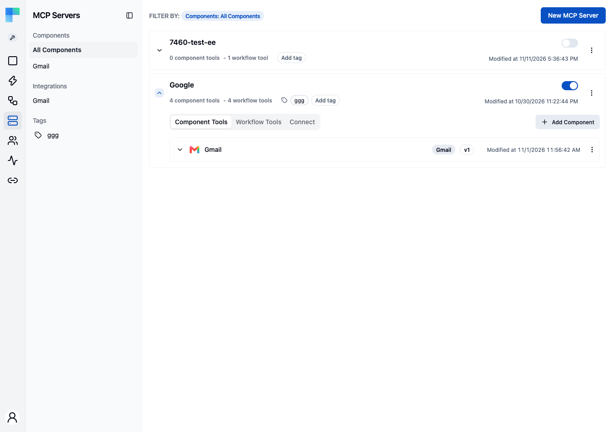

An embedded MCP server exposes component actions and integration workflows as tools over the [Model Context Protocol](https://modelcontextprotocol.io), so an AI agent in your product can act in your connected users' accounts. Each request to the server is made on behalf of one connected user, identified by a JWT signed with your [Signing Key](/platform/embedded/administration/signing-keys), and tools run with that user's connections.

MCP servers are managed under **Embedded → MCP Servers**. Creating, editing and deleting servers, their components, tools and workflows, and switching tools on or off, require a tenant admin. Editing checks the `MCP_EDIT` permission, which only a tenant admin holds for embedded servers. Connected users can only switch tools and workflows on or off, and set workflow inputs, for their own integration instances (see [Which tools a user's agent sees](#which-tools-a-users-agent-sees)).

Servers are scoped to an environment. The list shows the servers of the environment selected in the application sidebar.

## Server list

Each row in the list shows:

| Element | Description |
|---|---|
| Name | The server name. |
| Tool counts | The number of component tools (component actions, across all components) and workflow tools (one per workflow) the server exposes. |
| Tags | Tags assigned to the server. Click **+** to add one. |
| Enabled switch | Turns the server on or off. |
| Last modified | **Modified at** with a date and time, or **No modifications**. |
| ⋮ menu | **Edit** (rename the server) and **Delete** (after you confirm). |

Use the left sidebar to filter the list by **Components** (servers that expose a component), **Integrations**, or **Tags**.

## Creating an MCP Server

1. Click **New MCP Server** in the top-right corner (**Create MCP Server** when the list is empty).
2. Enter a **Name**.
3. Click **Save**.

The server is created empty and disabled. Add the components and workflows it exposes from the server row (see below), then turn it on with its **Enabled** switch. A new server requires authentication (see [Authentication](#authentication)).

## Adding components and workflows to a server

Expand the server row. It has **Component Tools**, **Workflow Tools** and **Connect** tabs.

### Component tools

1. On the **Component Tools** tab, click **Add Component**.
2. In **Select Component**, pick the component.
3. In **Select Tools from &lt;component&gt;**, choose which of its actions are exposed as tools and configure each tool's parameters.
4. Save the dialog.

For each exposed action, you choose which parameters you fix yourself and which the connected agent fills at call time with the `fromAi(...)` expression, the same mechanism used to attach tools to an AI Agent. See [Supplying tool parameters with fromAi](/platform/automation/build/workflows/ai/agent#supplying-tool-parameters-with-fromai) for the syntax.

<!-- TODO screenshot: Add Component dialog on the Select Tools step, showing the list of the component's actions with per-tool selection and the tool properties popover -->

### Workflow tools

1. On the **Workflow Tools** tab, click **Add Workflows**.
2. In the **Basic** step, pick the **Integration**, **Integration Version** and **Integration Instance Configuration**.
3. In the **Workflows** step, switch on the workflows to expose and set each one's **Inputs** and the **Connections** of components other than the integration's own (each connected user supplies the integration's own connection).
4. Save the dialog.

Only workflows with a **New Workflow Call** trigger are eligible. A configuration without one shows "No tool-eligible workflows found". The inputs and connections are saved on the instance configuration's workflows. A workflow you add is also added to the instance configuration and enabled there, and every connected user who already has the server gets it as a tool.

The **Workflow Tools** tab groups workflows by instance configuration. Each configuration row has a ⋮ menu with **Edit Workflows**, **Change Integration Version** and **Delete**. Each workflow has a **Configure** button (the tool's property values), a switch, and a ⋮ menu with **Edit** (its connections and inputs in the instance configuration) and **Delete**.

**Delete** removes a workflow from this server only. It stays in the instance configuration, enabled, with its other triggers. Deleting the whole server works the same way: the instance configurations it used, and their workflows, are kept.

### Connect tab

The **Connect** tab shows the **Server URL**. Click the refresh button to generate a new secret key. The old URL stops working immediately.

## Enabling and disabling individual tools

Expand a server row, then expand one of its components to see the tools it exposes. Each tool has a **Configure** button, which opens the tool's parameters, a switch, and an ellipsis (⋮) menu with **Delete**.

- **Switch on** - the tool is offered to agents.
- **Switch off** - the tool is not offered to any agent and cannot be called, whatever a connected user has enabled for themselves.

The switch applies to the whole server, for every connected user. When you edit a component's tools, each tool keeps its switch state. Newly added tools start switched on.

## Connecting to a server

Each server is reachable at `/api/embedded/{secretKey}/mcp`. A request names its environment with the `X-Environment` header (`PRODUCTION` when omitted), and it must be the server's own environment: an authenticated request for another environment is rejected with `401`, and so is an anonymous one that sends the header with another environment. Send `X-Environment` on every request to a Development or Staging server, and sign the JWT with that environment's signing key.

### Authentication

Each server has a **Require authentication** setting (`authenticationRequired`), on for every newly created server. The **MCP Servers** page has no control for it. It can be changed only through the `updateEmbeddedMcpServer` GraphQL mutation, which a tenant admin can call.

- **On** - the request's `Authorization` header must carry a JWT that your backend signed with one of your [Signing Keys](/platform/embedded/administration/signing-keys) for the server's environment. Its `kid` header identifies the signing key and its `sub` claim carries the external user id. The JWT resolves the caller to a connected user, created on first use. A disabled connected user is rejected. A request without a valid JWT is rejected with `401`. An API key is not accepted.
- **Off** - the endpoint serves the request using the URL secret alone. No credential is required, any token sent is ignored, and no ConnectedUser is resolved. A component tool that needs a connection, and every workflow tool, then fails with an error saying the tool requires a connected user and that authentication must be enabled on the MCP server.

A disabled server answers a request carrying a valid JWT (or any request, when authentication is off) with `403` and the JSON body `{"error": "server_disabled", "message": "…"}`, and no sign-in challenge. A request without a valid JWT to a server that requires one still gets `401`.

Servers created before this setting existed default to off, so they keep working unchanged. Servers that already had **Enforce tool authorization** (`enforceToolAuthorization`) on default to on. The server rejects **Enforce tool authorization** without **Require authentication**, because an anonymous caller has no identity to authorize.

### Example: connecting from your agent

The endpoint speaks the MCP Streamable HTTP transport. With the official TypeScript SDK (`@modelcontextprotocol/sdk`), your backend connects on behalf of one connected user like this:

```ts
import {Client} from '@modelcontextprotocol/sdk/client/index.js';
import {StreamableHTTPClientTransport} from '@modelcontextprotocol/sdk/client/streamableHttp.js';

const serverUrl = new URL('https://your-bytechef-host.example.com/api/embedded/<secret-key>/mcp');

const transport = new StreamableHTTPClientTransport(serverUrl, {
    requestInit: {
        headers: {
            Authorization: `Bearer ${jwtToken}`, // signed for this user, with sub = 'user-123'
            'X-Environment': 'PRODUCTION',
        },
    },
});

const client = new Client({name: 'my-product-agent', version: '1.0.0'});

await client.connect(transport);

const {tools} = await client.listTools();
```

Mint a fresh JWT per user and per session, as for the SDK. A client that does not send `X-Environment` reaches the server only if it is a Production server.

### When a tool needs the user's account

A tool that needs a connection does not run until the ConnectedUser has connected that integration in the request's environment. Until then, calling it returns a `connection_required` result instead:

```json
{
  "error": "connection_required",
  "message": "The googleMail integration is not connected for this user. To connect, visit: ...",
  "setupUrl": "https://your-bytechef-host.example.com/connect.html?token=..."
}
```

The message asks the agent to show the link to the user as a markdown link labelled **Connect &lt;component&gt;** rather than as the raw URL. A host that renders tool results itself can read `setupUrl` directly, for example to show a Connect button.

`setupUrl` opens ByteChef's hosted connect page, which shows the same [Connect dialog](/platform/embedded/get-started/initial-setup/displaying-the-connect-dialog) your app uses. Its token identifies the user, the integration and the environment, and is valid for 10 minutes. An expired link shows **Link Expired**, and the next call to the tool returns a fresh one. When the user closes the dialog, the page tells them they can close the tab and return to the application that sent them there.

### Which tools a user's agent sees

Tools you switched off on the server are never listed. A workflow tool is listed only while its workflow is enabled in the instance configuration.

Before a user connects an integration, the server lists every remaining tool it exposes for that integration. Workflow tools, and component tools whose component needs a connection, return `connection_required` when called. A component tool that needs no connection runs directly.

Once the user has connected, the server lists only the tools that user has enabled. For a workflow tool, the user's switch for that tool decides, independently of the workflow's other triggers: switching the tool off does not stop the workflow's webhook or schedule, and switching the workflow off on the user's integration does not hide the tool. Tools start disabled. When you later add a component tool or a workflow to the server, or switch one back on, users who already have the server get it straight away, switched on unless the server is switched off for them. The user enables them on the **Tools** tab of the Connect dialog, which lists the server's component tools and workflow tools for that integration. The list appears only when an MCP server exposes something for the integration; it is shown as a tab when the integration also has regular workflows, and on its own otherwise.

To switch a server's tools off for a single user, use the **MCP Servers** tab in [Connected Users](/platform/embedded/monitor/connected-users#user-details).

### Workflow tool runs

Calling a workflow tool starts a run of the workflow and waits up to 300 seconds for it to finish. If it does not finish in time, the tool call fails with an error saying the job did not finish within 300 seconds.

When the run finishes, the tool returns the workflow's output. A failed run returns its error. A run that stops before it finishes returns its `jobId` and a `status`:

| Status | Meaning |
|---|---|
| `approval_required` | The run is paused waiting for a human approval decision. |
| `suspended` | The run is paused and resumes later on its own. |
| `stopped` | The run was stopped before it finished. |

### Recorded tool calls

Every component tool and workflow tool call made through an embedded MCP server is recorded, including calls that return `connection_required` and workflow runs that time out. The records are listed under **Monitor > [External Invocations](/platform/embedded/monitor/external-invocations)**. A workflow tool's record carries the `jobId` of the run it started, so you can find the run in [Workflow Executions](/platform/embedded/monitor/workflow-executions).

### Tenant scoping

A session only exposes the tenant's own workflows, connections, and execution history.

## Related

- [Signing Keys](/platform/embedded/administration/signing-keys)
- [Instance Configurations](/platform/embedded/configure/instance-configurations)
- [Connected Users](/platform/embedded/monitor/connected-users)
- [External Invocations](/platform/embedded/monitor/external-invocations)
