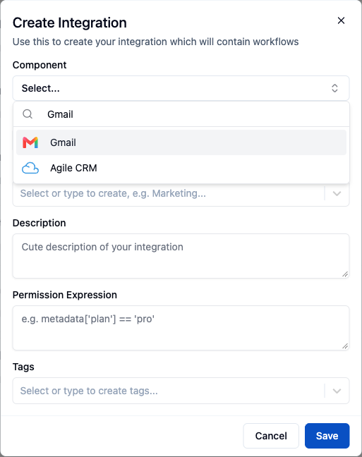
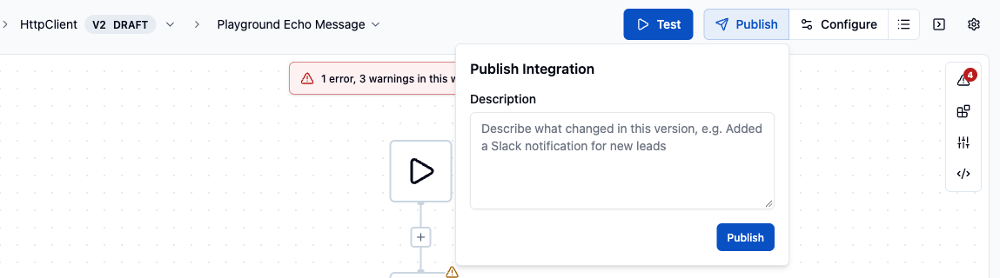
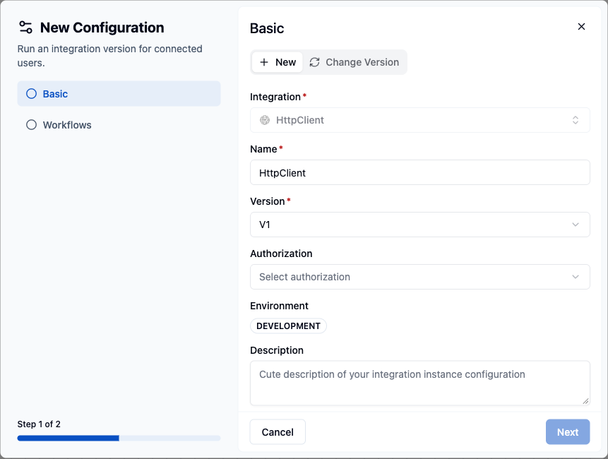

An **Integration** is what your end users see in the [Connect dialog](/platform/embedded/get-started/initial-setup/displaying-the-connect-dialog): a component (Gmail, Slack, Salesforce and so on) plus the workflows you ship with it. This page describes how to create an integration, register the provider's developer app, and make the integration available in an environment.

Create integrations in the **Development** environment. The **Integrations** page is shown only there.

## 1. Choose a component

1. In the ByteChef UI, go to **Embedded** → **Integrations** and click **New Integration**.
2. In the **Create Integration** dialog, select the **Component** you want to offer (for example **Gmail**). The **Name** defaults to the component title. Optionally set **Category**, **Description**, **Permission Expression** and **Tags**, then click **Save**.
3. The new integration opens on its **Workflows** tab. Click **Create Workflow** (or **Import Workflow**), then add the triggers and actions that make up the integration's behavior in the workflow editor.



See [Integrations](/platform/embedded/build/integrations) for versioning, categories, and the rest of the authoring surface.

## 2. Create a developer app

For OAuth2-based components, the third-party provider requires a registered **developer app**. Your end users see its name on the provider's consent screen ("*YourProduct* wants to access your Gmail"). Register the app in the provider's developer console (Google Cloud Console, Slack API dashboard and so on). The provider issues a **Client ID** and a **Client Secret**.

When the provider asks for an **authorized redirect URL**, use your ByteChef instance's OAuth callback:

```
https://<your-bytechef-host>/callback
```

The callback URL is set with `BYTECHEF_OAUTH2_REDIRECT_URI`. The default is `<BYTECHEF_PUBLIC_URL>/callback`.

<Callout title="Provider-specific setup">
    Some components ship an application-setup guide with exact console steps - see for example the [Google application setup](/reference/components/google-application-setup_v1) and [Microsoft Graph application setup](/reference/components/microsoft-graph-application-setup_v1) references.
</Callout>

## 3. Connect your developer app to ByteChef

Your end users never enter a client id or secret. Give ByteChef the developer app's credentials in one of two ways:

- **Per configuration.** When you create the integration's configuration (step 5), the **OAuth2 Connection** step asks for the **OAuth2 Credentials**. Enter the client id and secret there. Each configuration can use its own developer app.
- **Instance-wide predefined app.** Set the credentials as server environment variables, keyed by component name:

  ```
  BYTECHEF_OAUTH2_PREDEFINED_APPS_<COMPONENT_NAME>_CLIENT_ID=<client id>
  BYTECHEF_OAUTH2_PREDEFINED_APPS_<COMPONENT_NAME>_CLIENT_SECRET=<client secret>
  ```

  When a predefined app exists for the component, the **OAuth2 Connection** step uses it by default. Click **I want to use my own app credentials** to enter different ones for that configuration.

Components that use API keys or other non-OAuth authorization need no developer app. The Connect dialog collects the credential from the end user.

## 4. Configure scopes

The OAuth scopes a connection requests come from the component's connection definition. The scopes enabled on your developer app in the provider's console must cover what the component requests. A mismatch appears as a consent error at the provider when your user connects.

## 5. Publish and deploy

An integration becomes connectable once a version is published and a configuration for it is enabled in an environment:

1. In the workflow editor header, click **Publish**, optionally enter a **Description** in the **Publish Integration** popover, and click **Publish**. This freezes the current version (V1) and opens the next version as a draft, so the header badge then shows `V2 DRAFT`.

   

2. Create a configuration for the published version. Any of these opens the **New Configuration** dialog:
   - In the editor header, click **Configure**.
   - In Development, open **Integrations**, expand the integration, select its **Configurations** tab and click **Create Configuration** (**New Configuration** once the integration has configurations).
   - In Staging or Production, go to **Embedded** → **Integration Configurations** and click **New Configuration**. That page is not shown in Development.
3. In the **Basic** step, select the **Integration** and **Version**, and enter a **Name**. The **Environment** is the one selected in the sidebar. Complete the **OAuth2 Connection** step (OAuth2 components only) and the **Workflows** step, then save.

   

4. In the configuration list, turn on the configuration's switch.

See [Integration Configurations](/platform/embedded/configure/instance-configurations) for per-environment settings and internal-only workflow inputs.

## Next step

[Display the Connect dialog](/platform/embedded/get-started/initial-setup/displaying-the-connect-dialog) so your users can connect their accounts.
