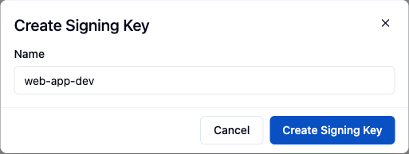

The `@bytechef/embedded` SDK renders ByteChef's embedded surfaces inside your own product: the [Connect dialog](/platform/embedded/get-started/initial-setup/displaying-the-connect-dialog), the [activation dialog](/platform/embedded/build/automations/activation-dialog), the [Automation Hub](/platform/embedded/build/automations/automation-hub), the [Integration Marketplace](/platform/embedded/build/integration-marketplace) and the embedded workflow builder. This page covers installing the package and authenticating your end users.

## Installing from npm

```package-install
npm install @bytechef/embedded
```

The package (version `0.4.0`) exports these surfaces:

- **`useConnectDialog`** - a React hook that opens the hosted [Connect dialog](/platform/embedded/get-started/initial-setup/displaying-the-connect-dialog) so an end user can authorize an integration.
- **`AutomationHub`** - a React component that embeds the [Automation Hub](/platform/embedded/build/automations/automation-hub), a catalog of automation templates the end user activates, with tabs, an activation dialog and a `theme` prop.
- **`useActivationDialog`** and **`ActivationDialog`** - a hook and a component that open the [activation dialog](/platform/embedded/build/automations/activation-dialog) from your own page, so a connected user can connect accounts, fill in inputs and turn on a published template.
- **`IntegrationMarketplace`** - a React component that embeds the [Integration Marketplace](/platform/embedded/build/integration-marketplace), an integration catalog that opens the Connect dialog in your page.
- **`EmbeddedWorkflowBuilder`** - a React component that embeds the [workflow editor](/platform/embedded/build/automations/automation-workflows#the-embeddable-workflow-builder) so end users can build their own automations.

The package also exports the `AutomationHubTabsConfig` and `AutomationHubTheme` types for the hub's `tabs` and `theme` props, and the `ActivationDialogProps` and `UseActivationDialogProps` types.

All surfaces take the same three values:

| Prop | Type | Default | Description |
|---|---|---|---|
| `baseUrl` | `string` | `https://app.bytechef.io` | URL of your ByteChef instance. Set it for a self-hosted instance. |
| `environment` | `'DEVELOPMENT' \| 'STAGING' \| 'PRODUCTION'` | `'PRODUCTION'` | Environment whose integrations, connections and workflows the surface uses. |
| `jwtToken` | `string` | - | JWT that identifies the current end user. Required. |

### Upgrading to 0.4.0

- `sharedConnectionIds` is removed from `AutomationHub` and `EmbeddedWorkflowBuilder`. It had no effect, because the server never added the connections it named. Connected users see their own connections plus the ones a tenant admin marks as shared. Delete the prop from your code.
- `EmbeddedWorkflowBuilder` now loads `workflow-builder.html#/embedded/builder/:workflowUuid`. Iframes created by 0.3.0 and earlier that still point at `/embedded/workflow-builder/:workflowUuid` are redirected there.

The `connectionDialogAllowed` prop of `AutomationHub` and `EmbeddedWorkflowBuilder` is deprecated. Set the `connectionDialogAllowed` claim in the JWT instead (see [JWT claims](#jwt-claims)). Until the prop is removed, `false` still hides the connection dialog, but `true` cannot grant what the token denies.

## Setup

ByteChef needs to know which of your users is using an embedded surface. Your backend proves this with a short-lived JWT signed with a private key that only you hold. ByteChef verifies the token with the matching public key and resolves (or creates) the **Connected User** identified by the token's `sub` claim.

### 1. Create a Signing Key

Signing Keys belong to an environment. A key verifies only tokens used against the environment it was created in, so create one key per environment you use.

1. In the sidebar, select the environment the key is for.
2. In the ByteChef UI, go to **Embedded** → **Settings** → **Signing Keys**.
3. Click **New Signing Key**, enter a **Name** (for example `web-app-dev`) and click **Create Signing Key**.
4. Copy the **private key** shown in the dialog. It is displayed only once. Store it as a secret in your backend, for example in a `BYTECHEF_SIGNING_PRIVATE_KEY` environment variable.
5. Copy the **Key Id** shown in the table. You set it as the JWT's `kid` header so ByteChef knows which public key to verify with.



<Callout title="Keep the private key server-side">
    The private key must never reach the browser. Your backend signs tokens; your frontend only ever sees the resulting short-lived JWT.
</Callout>

### 2. Generate a user token in your backend

Sign an RS256 JWT whose `sub` claim is your user's unique id. ByteChef stores this value as the Connected User's **external user id**. Every connection and workflow the user activates belongs to that id.

```ts
// Node.js example using jsonwebtoken
import jwt from 'jsonwebtoken';

const token = jwt.sign(
    {
        sub: externalUserId, // your user's unique id
        iat: Math.floor(Date.now() / 1000),
    },
    process.env.BYTECHEF_SIGNING_PRIVATE_KEY!,
    {
        algorithm: 'RS256',
        expiresIn: '10m',
        keyid: process.env.BYTECHEF_SIGNING_KEY_ID!,
    }
);
```

Keep the lifetime short (10 minutes is a reasonable default) and mint a fresh token per session. A common pattern is a small authenticated endpoint in your backend (for example `POST /api/token`) that returns a token for the signed-in user. The [Sample App](/platform/embedded/get-started/quick-start/sample-app) implements this with Fastify.

#### JWT claims

| Field | Location | Required | Description |
|---|---|---|---|
| `kid` | Header | Yes | **Key Id** of the Signing Key. It also identifies the tenant. A token without `kid`, or with an unknown one, is rejected. |
| `alg` | Header | Yes | `RS256`. |
| `sub` | Payload | Yes | Your user's unique, stable id. Becomes the external user id. |
| `exp` | Payload | Recommended | Expiry time. |
| `environmentId` | Payload | No | Numeric environment id (`0` Development, `1` Staging, `2` Production). When present, it must match the request's `X-Environment` header or the token is rejected. |
| `connectionDialogAllowed` | Payload | No | Boolean, default `true`. With `false`, the user cannot create connections from the embedded workflow builder or the embedded connections API, and the Automation Hub activation dialog hides **Connect**. It does not affect `useConnectDialog`. A non-boolean value makes the token invalid. |

### 3. Pass the token to the SDK

There is no global `authenticate()` call. Each SDK surface takes the JWT directly:

```tsx
'use client';
import {useConnectDialog} from '@bytechef/embedded';

const {openDialog} = useConnectDialog({
    baseUrl: 'https://your-bytechef-host.example.com',
    environment: 'DEVELOPMENT',
    integrationId,
    jwtToken,
});
```

The same `jwtToken` also authenticates direct calls to the embedded REST API: send it as `Authorization: Bearer <token>` together with an `X-Environment` header (`DEVELOPMENT`, `STAGING` or `PRODUCTION`). Without the header, ByteChef uses `PRODUCTION`. For example, `GET /api/embedded/v1/integrations` lists the integrations available to that user.

For server-to-server calls without a user token, use an [API Key](/platform/embedded/administration/api-keys) and put the user's external id in the path, for example `GET /api/embedded/v1/{externalUserId}/integrations`.

## Next step

With the SDK installed and tokens flowing, [add an integration](/platform/embedded/get-started/initial-setup/adding-an-integration) for your users to connect.
