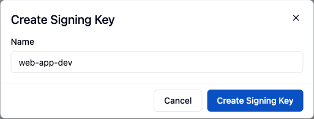
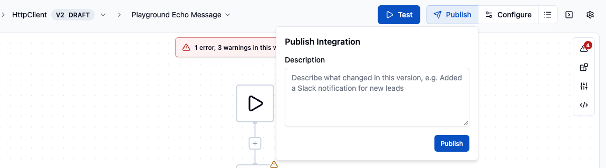
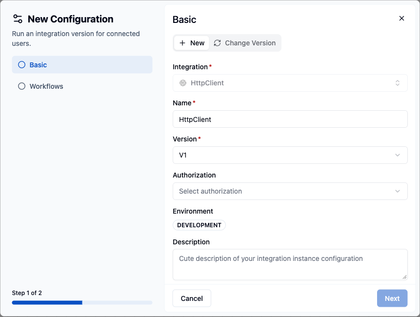

This guide covers every step needed to embed a working integration in your product: creating a Signing Key, publishing an integration, minting a user token in your backend, and rendering the Connect dialog with the React SDK. Do steps 1 to 4 in the **Development** environment, selected in the ByteChef sidebar.

<Callout title="Prefer working from a runnable example?">
    The **[Sample App](/platform/embedded/get-started/quick-start/sample-app)** is a complete Next.js + Fastify reference implementation that demonstrates this flow plus other embedded patterns (Automations API, ComponentKit, MCP servers and tool-based AI chat).
</Callout>

<Callout title="Before you start">
    You need:
    - A ByteChef Enterprise Edition deployment running with `bytechef.edition=EE`.
    - Admin access to the ByteChef UI.
    - A React or Next.js app where you want to embed the connect flow.
</Callout>

---

## 1. Create a Signing Key

A Signing Key is an RSA key pair. The **public key stays in ByteChef**. The **private key is shown once**; your backend uses it to sign the JWTs that authenticate each end user. Signing Keys belong to the environment selected when you create them.

1. In the ByteChef UI, go to **Embedded → Settings → Signing Keys**.
2. Click **New Signing Key**, enter a **Name** (for example `web-app-dev`) and click **Create Signing Key**.
3. Copy the **private key**. It is not shown again.
4. Copy the **Key Id** shown in the table after the dialog closes.



Store the private key as a secret in your backend (for example in `BYTECHEF_SIGNING_PRIVATE_KEY`) and the Key Id in `BYTECHEF_SIGNING_KEY_ID`; step 5 uses both.

---

## 2. Create an API Key (optional, for server-to-server calls)

Create an API Key if your backend calls the embedded API for your users without minting a JWT, for example to list a user's integrations, manage their workflows or execute a component action:

1. Go to **Embedded → Settings → API Keys**.
2. Click **New API Key** and enter a name.
3. Copy the **secret key**. It is shown only once.

Send it as `Authorization: Bearer <secret>` to the public API routes that start with `/{externalUserId}`, for example `GET /api/embedded/v1/{externalUserId}/integrations`. With an API Key, the path segment identifies the connected user instead of a JWT `sub` claim, so a request without it is rejected. Workflow execution history is not part of the public API; view it in the ByteChef UI under **Embedded → Workflow Executions**.

---

## 3. Build and publish an Integration

1. Go to **Embedded → Integrations** and click **New Integration**.
2. Select a **Component** (for example **Gmail**), keep or change the **Name**, and click **Save**.
3. The integration opens on its **Workflows** tab. Click **Create Workflow** and add triggers and actions in the workflow editor.
4. In the editor header, click **Publish**, optionally enter a **Description**, and click **Publish**. This publishes V1 and opens V2 as a draft, so the header badge shows `V2 DRAFT`.



---

## 4. Create a Configuration

A configuration makes a published integration version available in one environment so connected users can connect it.

1. In the editor header, click **Configure**. Alternatively, go to **Embedded → Integrations**, expand your integration, select its **Configurations** tab and click **Create Configuration**. In Staging and Production, use **Embedded → Integration Configurations** → **New Configuration** instead.
2. In the **Basic** step, select the published **Version** and enter a **Name**. The **Environment** is the one selected in the sidebar.
3. For an OAuth2 component, enter your developer app's client id and secret in the **OAuth2 Connection** step, unless a predefined app is configured. See [Adding an Integration](/platform/embedded/get-started/initial-setup/adding-an-integration#3-connect-your-developer-app-to-bytechef).
4. Complete the **Workflows** step and save.
5. In the configuration list, turn the configuration **on**.



---

## 5. Generate a JWT for an end user

In your backend, mint a short-lived JWT for the user you want to authorize. Use RS256 and set the `kid` header to the Key Id from step 1.

```ts
// Node.js example using jsonwebtoken
import jwt from 'jsonwebtoken';

const token = jwt.sign(
    {
        sub: externalUserId, // your user's unique id; ByteChef stores it as the external user id
        iat: Math.floor(Date.now() / 1000),
    },
    process.env.BYTECHEF_SIGNING_PRIVATE_KEY!,
    {
        algorithm: 'RS256',
        expiresIn: '10m',
        keyid: process.env.BYTECHEF_SIGNING_KEY_ID!,
    }
);
```

Keep the lifetime short (10 minutes is a reasonable default) and mint a fresh token per session.

The token can also carry these optional claims (see [JWT claims](/platform/embedded/get-started/initial-setup/installing-the-sdk#jwt-claims) for the full list):

| Claim | Default | Purpose |
|---|---|---|
| `connectionDialogAllowed` | `true` | Whether the user may create new connections from the [embedded workflow builder](/platform/embedded/build/automations/automation-workflows) and the [Automation Hub](/platform/embedded/build/automations/automation-hub). The server enforces it: with `false`, creating a connection in the builder, or through the embedded connections API, is rejected with `403`, and the builder offers only existing connections. In the Automation Hub the activation dialog also hides its **Connect** button, but only in the UI. The claim does not affect the standalone Connect dialog (`useConnectDialog`), the integration instance connections it creates, or reauthorizing an existing connection. A claim that is not a boolean makes the token invalid. |

ByteChef cannot tell which SDK component a request comes from. To give the Automation Hub and the workflow builder different values, mint a separate token for each.

<Callout title="Connected Users are created automatically">
    The embedded API has no "create connected user" endpoint. The first request authenticated with a user's JWT, or with an API Key against that user's `/{externalUserId}/…` routes, creates the **Connected User** record for that external id. If a user was disabled by an admin, later requests are rejected until they are re-enabled under **Embedded → Connected Users**. See [Syncing Connected Users](/platform/embedded/get-started/initial-setup/syncing-connected-users-programmatically) for the identity contract and for attaching your own data to the record.
</Callout>

---

## 6. Install the React SDK

```package-install
npm install @bytechef/embedded
```

---

## 7. Render the Connect dialog

Pass the JWT to `useConnectDialog`, together with the `integrationId` of the integration you want the user to connect (returned by `GET /api/embedded/v1/integrations`):

```tsx
'use client';
import {useConnectDialog} from '@bytechef/embedded';

export function ConnectGmailButton({jwtToken, integrationId}: {
    jwtToken: string;
    integrationId: string;
}) {
    const {openDialog} = useConnectDialog({
        baseUrl: 'https://your-bytechef-host.example.com',
        environment: 'DEVELOPMENT',
        integrationId,
        jwtToken,
    });

    return <button onClick={openDialog}>Connect Gmail</button>;
}
```

When the user clicks the button, the SDK opens the Connect dialog, runs the authorization the integration requires (OAuth2, API key and so on), and stores the credentials as a **Connection** under the user's **Connected User** record.

{/* TODO screenshot: the ByteChef Connect dialog as it renders inside a host application, showing the integration list and a Connect button */}

<Callout title="Component-defined workflow inputs">
    Beyond connecting and enabling workflows, the connect dialog can also collect **workflow inputs** from the user. When a workflow input references a component (for example, "pick a Slack channel" or "choose a HubSpot pipeline"), the dialog renders the component's own input group - including dynamic dropdowns whose options are fetched live against the user's connection. Dependent fields resolve in order, so a selection can filter the next one (for example, choose a workspace and then one of its channels). This works the same for workflows you expose as MCP tools. The user's selections are saved per integration instance, so each connected user configures the workflow with their own data without you building any of those forms yourself.

    The dialog can also collect a **[Field Mapping](/platform/embedded/build/workflows/field-mapping)** - let the user pick a remote object type and map your application's fields to the connected integration's fields, with the option lists fetched live against their connection.

    An input declared `internalOnly` in the workflow definition is filtered out of the connect dialog - see [internal-only workflow inputs](/platform/embedded/configure/instance-configurations#internal-only-workflow-inputs). Inputs are end-user-facing by default.
</Callout>

---

## 8. Trigger workflows with an App Event (optional)

If your integration's workflows use an **App Event** trigger, fire them for the connected user with a `POST` to the embedded API:

```http
POST /api/embedded/v1/app-events HTTP/1.1
Host: your-bytechef-host.example.com
Authorization: Bearer <end-user JWT>
Content-Type: application/json
X-Environment: DEVELOPMENT

{"orderId": "ord_1234", "total": 99.5}
```

The JWT `sub` claim identifies the connected user. ByteChef starts an execution for every enabled workflow of that user that has an **App Event** trigger, and passes the request body to each as the trigger's output. From your backend, use an API Key with `POST /api/embedded/v1/{externalUserId}/app-events`. The endpoint takes no event name, so the App Event selected on a trigger does not limit which workflows start.

See **[App Events](/platform/embedded/build/app-events)** for how to declare event names and JSON schemas.

---

## 9. Inspect what happened

- **Embedded → Connected Users** - confirm your end user appears. Open the user; the **Integrations** tab shows the connected integration, its credential status and its enabled workflows.
- **Embedded → Workflow Executions** - every run, step by step.

---

## Let your users build their own workflows (optional)

`@bytechef/embedded` exports two components that let your end users automate inside your product. Both load in an iframe and use the same end-user JWT as the Connect dialog.

- **`AutomationHub`** is the complete surface. Users browse the automation templates you released, activate them with their own accounts, turn their automations on and off, and open the workflow builder to customize a template or start from a blank automation. Start here.
- **`EmbeddedWorkflowBuilder`** is the workflow editor alone, opened on one workflow. Use it when your own UI lists and manages workflows and only needs the editor.

### Automation Hub

```tsx
'use client';
import {AutomationHub} from '@bytechef/embedded';

export function AutomationsPage({jwtToken}: {jwtToken: string}) {
    return (
        <AutomationHub
            baseUrl="https://your-bytechef-host.example.com"
            className="h-[800px] w-full"
            environment="DEVELOPMENT"
            jwtToken={jwtToken}
        />
    );
}
```

The hub lists the templates of each automation project that is published and has an enabled configuration in the hub's `environment`; with none, the catalog is empty. Give the wrapping element a height, because the iframe fills it. The `tabs`, `editWorkflowAllowed` and `theme` props control which parts are shown, whether users can edit copies of your templates, and the colors of the hub and the builder it opens. See [Automation Hub](/platform/embedded/build/automations/automation-hub).

### Workflow builder only

`EmbeddedWorkflowBuilder` opens the workflow with the given `workflowUuid`. It has no `theme` prop and renders the default light theme:

```tsx
'use client';
import {EmbeddedWorkflowBuilder} from '@bytechef/embedded';

export function WorkflowEditor({jwtToken, workflowUuid}: {jwtToken: string; workflowUuid: string}) {
    return (
        <div style={{height: '100vh', position: 'relative', width: '100%'}}>
            <EmbeddedWorkflowBuilder
                baseUrl="https://your-bytechef-host.example.com"
                environment="DEVELOPMENT"
                jwtToken={jwtToken}
                workflowUuid={workflowUuid}
            />
        </div>
    );
}
```

Pass `includeComponents={['slack', 'googleMail']}` to restrict the component palette to a specific set; omit it to allow all components. Users can create new connections in the builder unless their token sets the `connectionDialogAllowed` claim to `false` (see [step 5](#5-generate-a-jwt-for-an-end-user)). The parent container must be positioned (`position: relative`) with a defined height because the builder fills it.

For both components, set `BYTECHEF_EMBEDDED_ALLOWED_PARENT_ORIGINS` on your ByteChef server to your app's origin (for example `https://app.example.com`; separate several with commas). The hub and the builder then only render inside, and only accept their session token from, those origins - see [the embed handshake](/platform/embedded/build/automations/automation-workflows#the-embed-handshake).

To generate a starter workflow for a user from a natural-language prompt, call `POST /api/embedded/v1/automation/workflows/generate` with `{"prompt": "..."}` and the user's JWT (or `POST /api/embedded/v1/{externalUserId}/automation/workflows/generate` with an API Key). An optional `systemPrompt` adds instructions for the AI. The response is the new workflow's UUID, which you can open in the builder. `POST .../automation/workflows/{workflowUuid}/generate` revises an existing workflow the same way. Generation requires AI Copilot to be enabled on the server (`BYTECHEF_AI_COPILOT_ENABLED=true`); otherwise the request fails.

---

## Next steps

- Match the Connect dialog to your product with `mode` and the `--bytechef-dialog-*` CSS variables. See [Theming and Localization](/platform/embedded/build/theming-and-localization).
- Add more integrations and version them: publish `V2` while `V1` keeps running for existing users.
- Restrict integrations or individual workflows to a subset of users with **[Permission Expressions](/platform/embedded/build/permission-expressions)**.
- Create the equivalent configuration in Staging and Production. Each environment keeps its own configurations; there is no operation that promotes a configuration from one environment to another.
- Expose components and workflows as **[MCP Servers](/platform/embedded/configure/mcp-servers)** so AI agents can use them as tools.

For help, contact [support@bytechef.io](mailto:support@bytechef.io).
