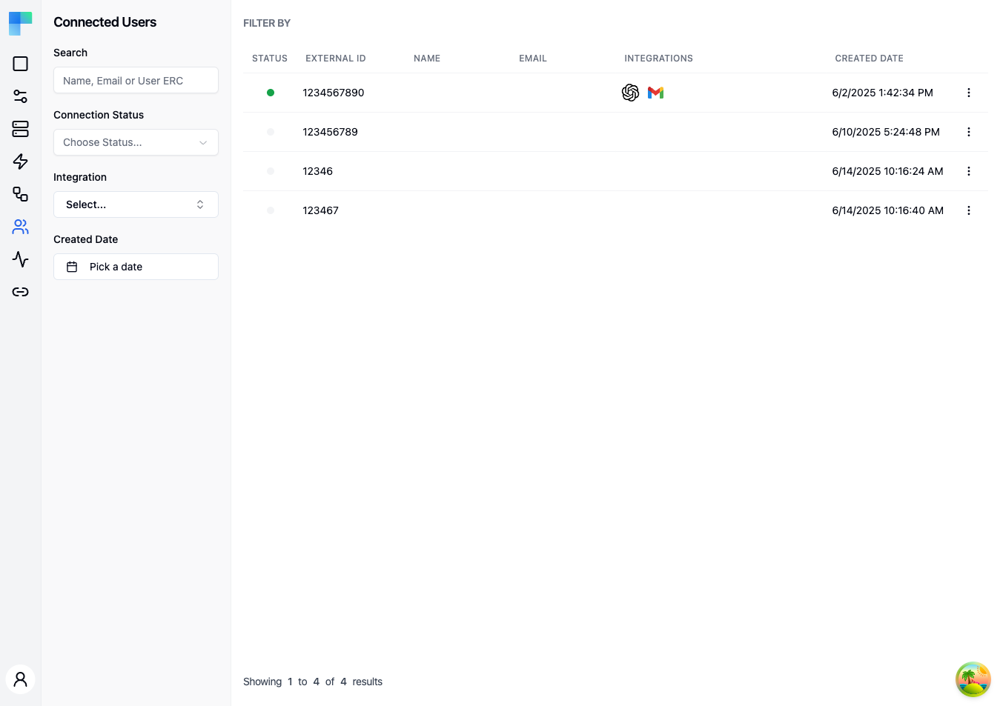

This page covers the ByteChef console view. For how a Connected User record comes into existence and how your backend attaches a name, email, or its own metadata to it, see [Syncing Connected Users](/platform/embedded/get-started/initial-setup/syncing-connected-users-programmatically).



---

## Key Features

| Feature | Description |
|---|---|
| User table | A paginated table of all connected users with key details. |
| Search | Search by name, email, or **External Id** - the unique identifier your application assigns to each user (also referred to as "User ERC" in the search placeholder). |
| Status filtering | Filter by connection status (Valid or Invalid). |
| Integration filtering | Filter by specific integration to find users of a particular service. |
| Date range filtering | Filter by the date range when users were created. |
| Pagination | Navigate through large user lists with page controls. |
| Create and import | Add a connected user by hand, or many at once from a CSV file, before they ever open your product. |
| Edit | Change a connected user's name, email, and metadata. |
| Provisioning | Add an integration instance for a connected user, on a configuration and version you choose. |

### Table Columns

| Column | Description |
|---|---|
| Status | Connection credential status indicator -- green for Valid, gray for Invalid. |
| External Id | The unique identifier your application assigns to the user (this is the `sub` claim of the JWT you sign with your Signing Key). |
| Name | The user's display name. |
| Email | The user's email address. |
| Integrations | Icons representing which integrations the user has connected. |
| Created Date | When the connected user record was created. |

---

## How to Use

### Viewing Connected Users

1. Navigate to the **Connected Users** page from the Embedded sidebar.
2. The table displays all connected users for the current environment.
3. Click on a user row to open a detail sheet with full information about their connections and integrations.

### Creating a Connected User

Click **New connected user** in the page header. The dialog asks for:

- **External ID** *(required)* -- the identifier your application uses for this user, the same value your backend puts in the JWT `sub` claim. It must be unique in the environment, is case-sensitive, and must not start or end with whitespace.
- **Name** and **Email** *(optional)*.
- **Metadata** *(optional)* -- key/value rows; click **Add metadata** for each one.

Click **Create**. The user is created enabled, in the environment selected in the sidebar. When that user later authenticates through the SDK with the same external ID, ByteChef reuses this record instead of creating a new one.

Name, email, metadata keys, and metadata values are limited to 256 characters each.

### Importing Connected Users from CSV

Click **Import** in the page header, choose a **CSV file**, and click **Import**. The file needs a header row:

| Column | Meaning |
|---|---|
| `externalId` | Required. The user's external ID, with the same rules as above. |
| `name` | Optional. |
| `email` | Optional. |
| any other column | Stored as a metadata key, named exactly as in the header. |

The `externalId`, `name`, and `email` headers are matched case-insensitively. An empty cell means "no value": no metadata key is created for it.

```csv
externalId,name,email,plan,region
user-1001,Ada Lovelace,ada@example.com,enterprise,eu
user-1002,Alan Turing,,free,
```

A file can hold at most 1,000 data rows and 1 MB; a larger file, or a metadata header longer than 256 characters, refuses the whole import. Otherwise each row is created on its own, so one bad row does not stop the others. When the import finishes, the dialog shows how many users were created and lists:

- **Skipped (duplicates)** -- external IDs that already exist in the environment, or repeat an earlier row of the same file. Existing users are never overwritten.
- **Rejected** -- rows that could not be created, with the spreadsheet row number (the header is row 1) and the reason.

### Filtering Users

Use the left sidebar filters to narrow the user list:

- **Search** -- enter a name, email address, or External Id (User ERC) to find specific users.
- **Connection Status** -- select "Valid" or "Invalid" to filter by credential status.
- **Integration** -- select an integration to show only users who have connected that service.
- **Created Date** -- pick a date range to filter users by when they were created.

Click **Filter** to apply the selected filters.

### User Details

Click on a connected user row to open a side sheet. At the top is a **Profile** header card with the user's ID, name, email, external ID, and account metadata, followed by three tabs:

1. **Integrations** tab (default) -- every integration the user has connected, with the integration's status and the workflows enabled for each integration instance. Use this tab to inspect and manage the connect-flow side of the relationship, and **Add integration** to provision a new instance for the user (see [Provisioning an Integration](#provisioning-an-integration)).
2. **MCP Servers** tab -- the MCP servers this user has access to, so you can control which tools are exposed to that user's AI agents. Each server card shows how many component tools and workflow tools it exposes to the user, with a switch that turns all of them on or off at once. Expand a card to see its **Component Tools** and **Workflow Tools**, grouped by component, each with its own switch. A workflow tool's switch is the same setting as that workflow's switch on the **Integrations** tab, so changing one changes the other. **Delete** removes the server's component tools for this user; it isn't offered for a server that exposes workflow tools, because those stay visible until the workflows are removed from the server on the MCP Servers page. Shows "No MCP servers expose this user's integrations." when none apply.
3. **Automation Workflows** tab -- the automation workflows associated with this user across all projects they have access to, listed flat with the workflow label, the version currently in use for this user, and the last execution date (or "No executions" if it hasn't run yet). The tab shows "No automation workflows." when nothing is associated.

The sheet header also carries actions for the user, in its ellipsis (⋮) menu:

- **Edit** -- opens the **Edit connected user** dialog (see [Editing a Connected User](#editing-a-connected-user)).
- **Enable / Disable** -- a button that toggles the user's active state. A disabled connected user cannot start executions; the button label flips between **Enable** and **Disable** based on the current state.
- **Delete** -- opens a confirmation dialog that removes the connected user and their integration instances.

The sheet stays open across outside clicks (only the close button or the **Escape** key dismisses it), so you can keep it open while navigating other UI.

<!-- TODO screenshot: Connected user detail side sheet open, showing the Profile header card and the Integrations / MCP Servers / Automation Workflows tabs, plus the Enable/Disable and Delete actions in the sheet header -->

### Editing a Connected User

Choose **Edit** in the sheet's ⋮ menu. You can change the **Name**, **Email**, and **Metadata**; the **External ID** is shown read-only. Name and email can be cleared.

Saving **replaces** the user's metadata with what the form shows, so a key you remove in the form is removed from the user. This is different from the SDK's `PATCH` call, which only adds or overwrites keys (see [Syncing Connected Users](/platform/embedded/get-started/initial-setup/syncing-connected-users-programmatically#what-happens-to-each-key)). If the user changed after you opened the dialog, for example because your backend updated its metadata, the save is refused and the dialog asks you to **Reload** the latest values before editing again.

### Provisioning an Integration

Provisioning sets an integration up for a connected user from the console, so the user does not have to go through the Connect dialog. It is also how you keep a customer on a specific configuration or integration version while new users get another.

1. Open the connected user's sheet and click **Add integration** on the **Integrations** tab.
2. In the **Provision integration** dialog, choose the **Integration**. Only integrations the user is allowed to use (by their [permission expressions](/platform/embedded/build/permission-expressions)) are listed.
3. Choose the **Configuration**. Each enabled [instance configuration](/platform/embedded/configure/instance-configurations) of the integration is listed with its version; the one marked **Self-serve** is the one users get when they connect on their own.
4. Fill in the **connection** fields. Fields the configuration already sets (such as a shared OAuth2 client ID and secret) are hidden. For an OAuth2 configuration, sign in through the popup with the customer's account.
5. Select the **workflows** to enable and fill in their inputs. Required inputs of a selected workflow must be filled before you can provision.
6. Click **Provision**.

ByteChef creates the connection, the integration instance on the chosen configuration, and the selected workflows, and the new instance appears on the **Integrations** tab. If any step fails, nothing is kept: the workflows already enabled are disabled and the instance and connection are deleted.

The instance is created in the connected user's own environment. Provisioning always adds a new instance, even when the user already has one for the same integration (for example, two accounts of the same service). The user's own embedded UI then shows that instance's configuration and workflows, not the self-serve one.

### Row actions menu

Each table row has an ellipsis (⋮) menu with the same three actions available without opening the sheet:

- **Open** -- opens the detail sheet for that user.
- **Enable / Disable** -- toggles the user's active state.
- **Delete** -- removes the user record along with their integration instances (the workflows they had enabled stop executing). A confirmation dialog guards the action.

### Environment Selection

Connected users are scoped to the current environment. Use the environment selector in the left sidebar header, beside the ByteChef name, to switch between Development, Staging, and Production to see users in each environment.
