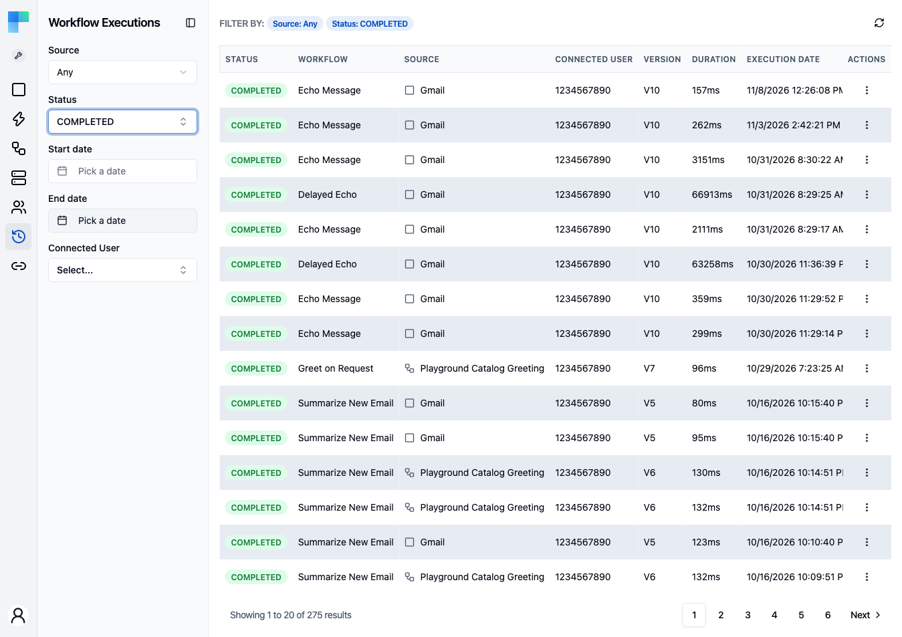

---

## Key Features

| Feature | Description |
|---|---|
| Source filtering | List integration and automation executions together, or only one of them. |
| Status filtering | Filter by execution status: Started, Completed, Created, Stopped, or Failed. |
| Date range filtering | Filter by start date and end date to narrow the time window. |
| Integration filtering | Filter by a specific integration (Integrations source only). |
| Instance Configuration filtering | Filter by a specific instance configuration (Integrations source only). |
| Workflow filtering | Filter by a specific workflow (Integrations and Automations sources). |
| Connected User filtering | Filter by connected user (every source). |
| Pagination | Navigate through large execution lists with page controls. |

### Where executions come from

The **Source** select at the top of the left sidebar picks which executions the page lists:

| Source | Lists |
|---|---|
| **Any** | Integration and automation executions in one list, newest first. This is the default. |
| **Integrations** | Executions of integration instances your connected users enabled. |
| **Automations** | Executions of the workflows your connected users built in the Automation Hub. |

With **Any**, the table adds a **Source** column right after **Workflow**: an icon for where the run came from (a
square for an integration, a workflow icon for an automation), followed by the integration's component or the
automation's project. The icon's tooltip names the kind of source.
With **Automations**, the table shows each execution's **Project**, and with **Integrations**, its **Integration**.
The **Connected user** column shows the integration instance's connected user, or the automation's deployment.
Clicking a row opens the detail view that matches where it came from.

### Execution Details

Each execution entry shows:

- **Status** -- the current state of the execution (Started, Completed, Failed, etc.).
- **Duration** -- how long the execution took.
- **Timestamps** -- when the execution started and ended.
- **Step-by-step results** -- click an execution to view detailed results for each workflow step.

---

## How to Use

### Viewing Executions

1. Navigate to the **Executions** page from the Embedded sidebar.
2. The table displays all workflow executions for the current environment.
3. Click on an execution row to open a detail sheet with full step-by-step results.

### Filtering Executions

Use the left sidebar to apply filters:

| Filter | Applies To | Description |
|---|---|---|
| Source | All | Any (the default), Integrations, or Automations. See [Where executions come from](#where-executions-come-from). |
| Status | All | Select a status to show only executions in that state. |
| Start date | All | Show only executions that started on or after this date. |
| End date | All | Show only executions that started on or before this date. |
| Integration | Integrations | Select an integration to filter by. |
| Instance Configuration | Integrations | Select a specific instance configuration. |
| Workflow | Integrations, Automations | Select a specific workflow. |
| Connected User | Any, Integrations | Select a connected user to see their executions. |
| Connected Users | Automations | Select a connected user to see the executions of the automations they built. |

### Execution Detail View

Click on any execution row to open a detail sheet that shows:

- The overall execution status and timing.
- Each workflow step with its input, output, and status.
- Error messages and stack traces for failed steps.
- The data passed between steps in the workflow.

<!-- TODO screenshot: Workflow execution detail sheet open, showing the workflow panel with a selected step and its Input / Output / Error tabs -->

For an automation execution, the detail sheet reuses the automation execution view and carries an [AI Copilot](/platform/automation/build/ai-copilot): it analyzes the finished or failed execution and helps debug errors. Copilot is an Enterprise Edition feature and is disabled by default _(the AI Copilot is coming soon - not yet available in the latest released version)_.

For both kinds of execution the detail colours the run on its read-only canvas and lists each AI
Agent tool call as a row under the agent's task, the same way the
[automation execution detail](/platform/automation/monitor/workflow-executions#what-the-detail-view-shows)
does. See [Seeing which tools ran](/platform/automation/build/workflows/ai/agent#seeing-which-tools-ran).

### Environment Selection

Executions are scoped to the current environment. Use the environment selector in the left sidebar header to switch between Development, Staging, and Production.
