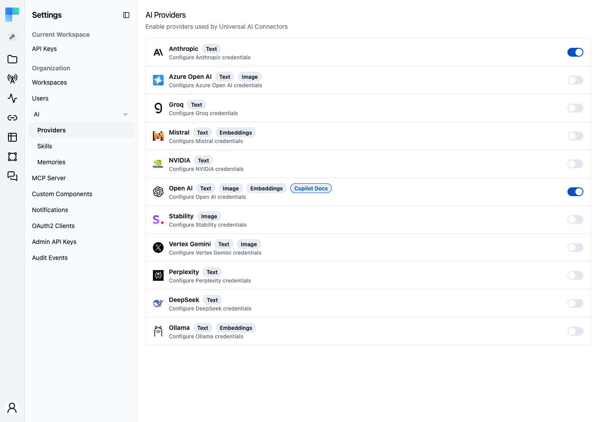
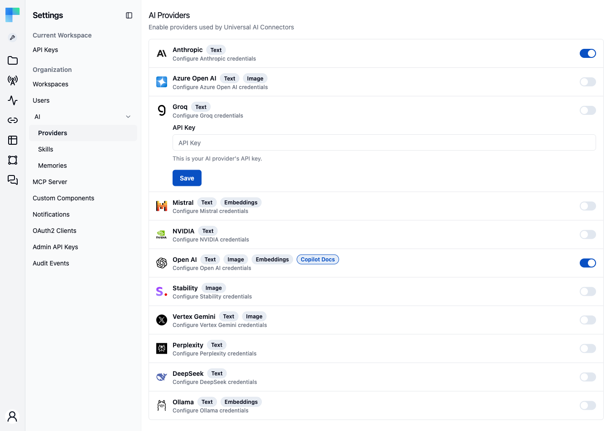

**AI Providers** is the catalog where an administrator activates the AI providers (OpenAI, Anthropic, Mistral, and others) used by ByteChef's AI features. You enter a provider's API key once, and every AI feature that needs a model reads the credentials from this catalog instead of from a per-workflow connection.

The page requires the `ADMIN` authority. Keys are stored **per environment**, so Development, Staging, and Production can each use their own providers and credentials. Self-hosted deployments can also supply keys through environment variables such as `BYTECHEF_AI_PROVIDER_OPEN_AI_API_KEY`. See [Self-hosting: static keys](#self-hosting-static-keys).

---

## Activate a provider

1. Go to **Settings → AI → Providers**.
2. Select the environment (Development, Staging, or Production) in the environment selector in the left sidebar.
3. Turn on the provider's toggle. If the provider has no credentials yet, its row expands to the credentials form.
4. Enter the credentials and click **Save**:
   - Most providers: **API Key**.
   - Azure OpenAI: **API Key** and **Endpoint** (for example `https://<resource>.openai.azure.com`).
   - Ollama: **Base URL** (default `http://localhost:11434`) and an optional **API Key** for Ollama's hosted API. Clearing the Ollama key removes it.

   A saved API key is shown masked. Leave it unchanged to keep it.

After you save, the toggle stays on. To review or change a credential, expand the row and click **Edit**. To stop using a provider, turn off its toggle.

The API key is encrypted at rest and is only shown in obfuscated form. Repeat the steps for each environment: activating OpenAI in Development does not activate it in Production.

### Available providers

The catalog lists Anthropic, Azure Open AI, Groq, Mistral, NVIDIA, Open AI, Stability, Vertex Gemini, Perplexity, DeepSeek, and Ollama. Each row has badges for the capabilities the provider supports. Hover a badge to see its description.

| Badge | Meaning | Providers |
|---|---|---|
| **Text** | Chat models for text generation, used by AI components and agents. | All except Stability |
| **Image** | Image generation from text prompts. | Azure Open AI, Open AI, Stability, Vertex Gemini |
| **Embeddings** | Embedding models for knowledge bases and semantic search. | Mistral, Open AI, Ollama |
| **Copilot Docs** | The provider whose embeddings Copilot uses to search the ByteChef documentation. | The provider currently configured for it |

---

## What uses activated providers

A provider activated for an environment is available to:

- **Universal AI components** - workflow steps where you pick a provider from the catalog and then a model, without a separate connection.
- **The Copilot model picker** *(coming soon)* - choose which activated provider and model answers a Copilot conversation.
- **The AI Hub** *(coming soon)* - the same catalog backs the AI Hub's model selection.
- **The Knowledge Base** - document embedding uses the first activated embedding provider in the environment, checked in the order Mistral, OpenAI, Ollama.

Each feature reads the key for the **current environment**, so a workflow uses that environment's credentials as it moves from Development to Production.

---

## Default models

Each provider has a default model per kind (chat, embedding, and, for OpenAI, image generation), defined in configuration as `bytechef.ai.provider.{chat,embedding,image}.<provider>.options.model` and overridable through the matching environment variables. See the [chat](/platform/use-bytechef/self-hosted/configuration/environment-variables#ai-chat-model-configuration), [embedding](/platform/use-bytechef/self-hosted/configuration/environment-variables#ai-embedding-model-configuration), and [image](/platform/use-bytechef/self-hosted/configuration/environment-variables#ai-image-model-configuration) model references. The AI Providers page stores credentials and enablement, not model names.

The page decides **which** default applies. Features where ByteChef picks the model (Knowledge Base embedding and, once available, the Copilot default, the workflow converter, the property Copilot, and AI Hub image generation) use the first **enabled** provider in the current environment, or the provider set in `BYTECHEF_AI_COPILOT_PROVIDER` when it is enabled, together with that provider's configured model. Enabling or disabling a provider takes effect at the next request, without a restart. Universal AI workflow steps are not affected, because their authors pick the model per step.

Two providers work differently:

- **Azure OpenAI** has no default model, and the default resolution skips it until you set one. The model is your deployment name: set `BYTECHEF_AI_PROVIDER_CHAT_AZURE_OPEN_AI_OPTIONS_MODEL` to it.
- **Ollama** uses the models installed on your Ollama server. The AI model picker lists its chat models, read from the server. Unless you set `BYTECHEF_AI_PROVIDER_CHAT_OLLAMA_OPTIONS_MODEL` (for example `qwen3:8b`), the default chat model is the first **local** chat model the server reports. Ollama lists the most recently pulled model first. Cloud models (names ending in `:cloud`) are listed after local ones and never become the default. Knowledge Base embedding works the same way with the installed embedding models, or with `BYTECHEF_AI_PROVIDER_EMBEDDING_OLLAMA_OPTIONS_MODEL` (for example `nomic-embed-text`).

<Callout title="Choosing an embedding model">
    Documents already stored in knowledge bases keep the embeddings produced by the model that was active at upload time. Switching to a different embedding model degrades semantic search over existing documents until they are uploaded again.
</Callout>

---

## Embedding models

Embeddings are the vectors behind [Knowledge Base](/platform/automation/data/knowledge-base) search. Three providers in the catalog offer them:

| Provider | Default model | Configuration key |
|---|---|---|
| **OpenAI** | `text-embedding-3-small` | `BYTECHEF_AI_PROVIDER_EMBEDDING_OPEN_AI_OPTIONS_MODEL` |
| **Mistral** | `mistral-embed` | `BYTECHEF_AI_PROVIDER_EMBEDDING_MISTRAL_OPTIONS_MODEL` |
| **Ollama** | *(first embedding model installed on the server)* | `BYTECHEF_AI_PROVIDER_EMBEDDING_OLLAMA_OPTIONS_MODEL` |

The corresponding property form is `bytechef.ai.provider.embedding.<provider>.options.model`. For the full list of embedding keys, see the [AI Embedding Model configuration reference](/platform/use-bytechef/self-hosted/configuration/environment-variables#ai-embedding-model-configuration).

Anthropic publishes no embedding models. A deployment that uses Anthropic for chat still needs OpenAI, Mistral, or Ollama activated for embeddings.

<Callout title="Models are configuration">
    The model is always set in configuration. The AI Providers page stores credentials and enablement, not model names. The exception is Ollama with no model configured: ByteChef then picks one of the models installed on the server. The API key can also be set in configuration (for example `BYTECHEF_AI_PROVIDER_OPEN_AI_API_KEY`), so a deployment can set both the embedding model and its key through properties.
</Callout>

### Vector dimensions are fixed per deployment

Embedding models produce vectors of different widths (`text-embedding-3-small` produces 1536 dimensions, `text-embedding-3-large` produces 3072), and a pgvector column has one width. The vector store is configured for **1536 dimensions** by default (`bytechef.ai.vectorstore.pgvector.dimensions`, or `BYTECHEF_AI_VECTORSTORE_PGVECTOR_DIMENSIONS`). When you switch to a model of a different width, change that property as well. A mismatch fails at write time.

### Changing the embedding model

Chunks are embedded once, when their document is ingested. There is no re-embedding operation. Changing the model affects documents added afterwards, and existing documents keep their vectors. Retrieval quality degrades until the older documents are deleted and uploaded again. Plan a model change as a re-ingestion, per environment.

---

## Self-hosting: static keys

A self-hosted deployment can supply provider keys as configuration instead of, or in addition to, the UI. For example, set `BYTECHEF_AI_PROVIDER_OPEN_AI_API_KEY` or `BYTECHEF_AI_PROVIDER_ANTHROPIC_API_KEY`. See the [environment variables reference](/platform/use-bytechef/self-hosted/configuration/environment-variables#ai-provider-api-keys).

**Precedence:** a provider configured through the UI for an environment always wins. The configuration key is used only as a fallback when the provider has no settings saved for that environment.

> The Copilot documentation corpus is an exception: it is shared by the whole instance and embeds with its own key rather than the per-environment catalog. See [AI Copilot → Documentation embeddings](/platform/automation/build/ai-copilot#documentation-embeddings).
