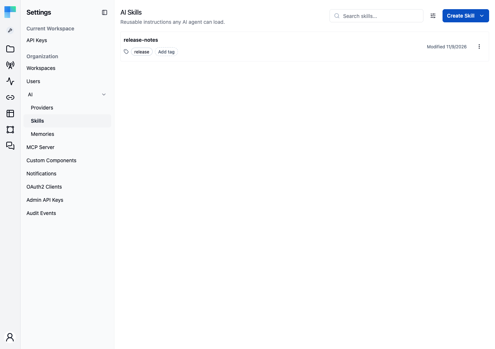
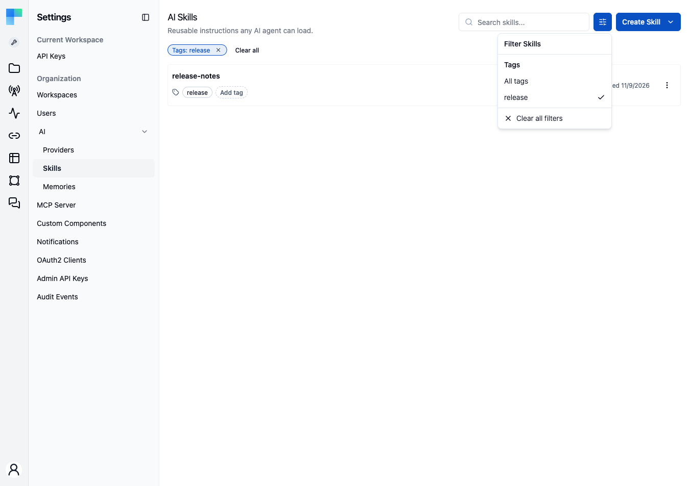
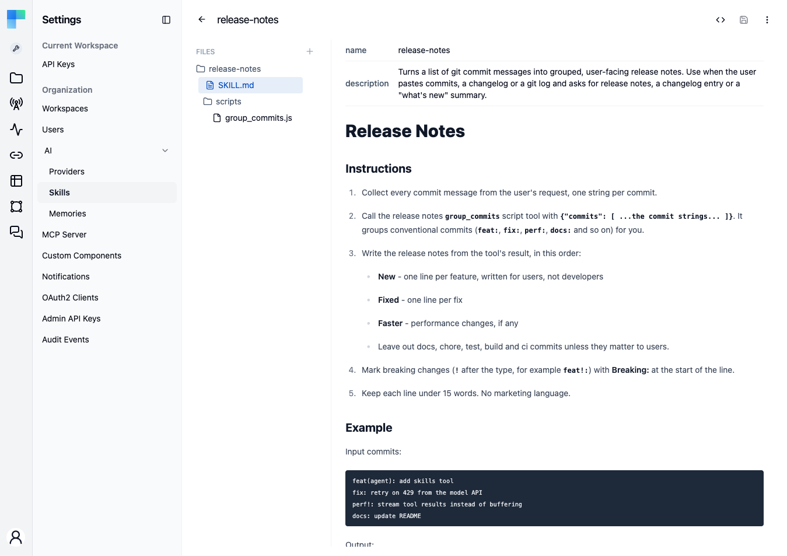
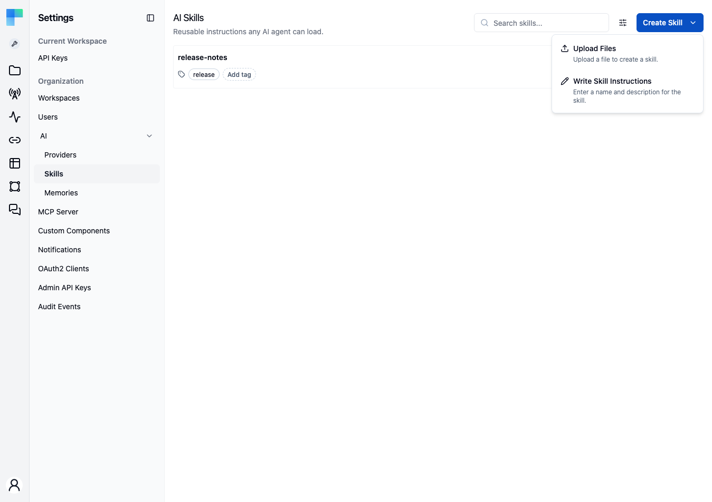
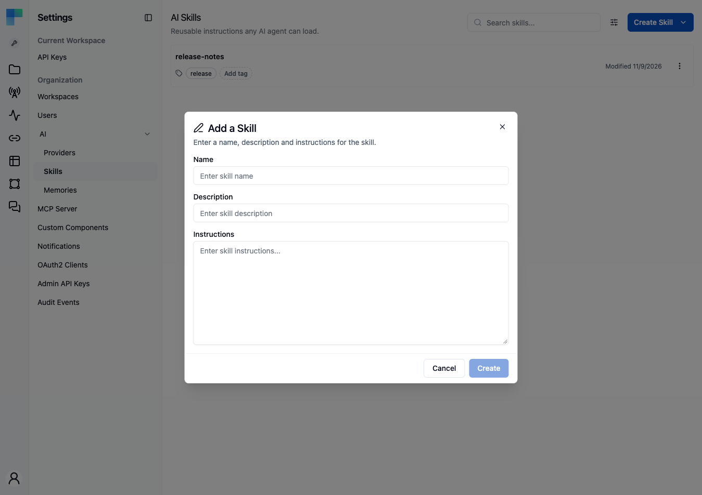
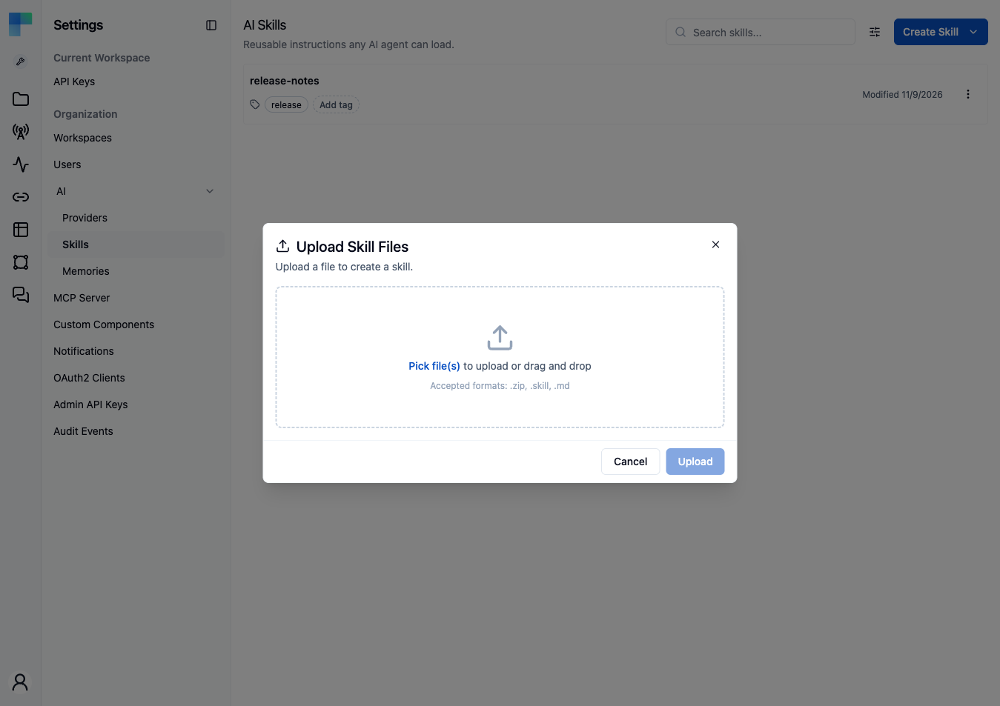

A skill is a packaged set of instructions and supporting files that an AI agent can read at runtime, for example coding standards, a troubleshooting runbook, or a business process. The **Skills** page lets administrators create, edit, and manage skills, which AI agents then load through the Skills tool.

Skills follow the [agentskills.io](https://agentskills.io) SKILL.md format, so a `.skill` archive created in ByteChef works with other agentskills.io-compatible tools, and the reverse.



---

## What You Can Do with Skills

### Capture domain knowledge

Package specialized knowledge (coding guidelines, API references, troubleshooting runbooks, compliance rules) into standalone skills that agents can reference.

### Reuse across agents

Skills are not scoped to a workspace. A skill can be attached in any project and any workflow.

The [Claude Code](/reference/components/claude-code_v1#skills) component can use the same skills: select them in the **Skills** property of its **Chat** action, and every file of each selected skill is available to Claude Code.

### Edit in place

Open a skill, switch between a rendered **Preview** and the raw **Source**, edit markdown or other archive files, and save without leaving the page. The frontmatter `name` and `description` are written to the skill's metadata on save, so a rename appears immediately in the page header, search, and skill list.

### Create skills

Write instructions directly or upload existing documentation files. Generating a skill with the AI Copilot is [coming soon](#create-with-ai).

---

## Accessing Skills

Skills live under **Settings → AI → Skills**. They belong to the organization rather than to one workspace, so the page is available under both the Automation settings (`/automation/settings/ai/skills`) and the Embedded settings (`/embedded/settings/ai/skills`), and both list the same skills. Links inside the page keep you in the settings area you opened it from.

The Skills list requires the `ADMIN` authority. Administrators see every skill. Other users can work only with skills they created.

The page has two layouts:

- **List view** - opens by default. Shows each skill as a row with name, description, tags, and modified date.
- **Detail view** - opens when you click a skill. The header shows the skill's name with a **back arrow** that returns to the list, and the toolbar shows the editing controls described below.

---

## Viewing Skills

The Skills list shows every skill in your organization. Each row displays:

| Field | Description |
|---|---|
| **Name** | The skill's name (must follow the agentskills.io format - see [Skill File Format](#skill-file-format)) |
| **Description** | A brief summary of what the skill covers |
| **Tags** | The tags assigned to the skill, editable inline on the row |
| **Modified Date** | When the skill was last updated |

Use the **Search skills...** field at the top to filter skills by name, and the **Filter Skills** button beside it to narrow the list to a single tag.

An active tag appears as a chip above the list, with its own clear button and a **Clear all** link. The selection is stored in the URL as `?tagId=`, so a filtered list survives a reload and can be bookmarked or shared as a link.



Click any skill to open the **detail view**. The detail view contains:

- A **Files** tree on the left showing every file and folder in the skill archive. The **Add file** button adds a file by **File Path** (for example `scripts/extract.py`), and each file has a remove action that asks for confirmation.
- A content viewer and editor on the right, with syntax highlighting for code files and a rendered preview for `.md` files. Markdown files show their YAML frontmatter as a metadata table above the rendered body.
- A page-header toolbar with the **Preview / Source** toggle, **Save**, **Open Copilot** *(coming soon)*, and a **⋮** menu containing **Download Skill** and **Delete Skill**.



---

## Editing Skills

You can edit any file in a skill archive directly in the detail view, without downloading and uploading it again.

### Switching Between Preview and Source (Markdown only)

The **Preview / Source toggle** in the header is visible whenever the selected file is markdown.

- **Preview** (default on file load) - read-only rendering of the body, with frontmatter shown as a metadata table.
- **Source** - a code editor in markdown mode. Edit the raw markdown, including frontmatter.

The toggle resets to **Preview** every time you switch files.

For non-markdown files (`.json`, `.yaml`, `.txt`, code files, etc.) the code editor is shown directly, with the language inferred from the file extension.

### Saving Changes

The **Save** button in the header enables as soon as the editor content differs from what was last loaded. Click it to persist the change.

When you save a `SKILL.md` file, ByteChef parses the YAML frontmatter and saves the `name` and `description` to the skill's metadata **before** it writes the file body. A validation error (an invalid name, or a description over 1024 characters) is reported before the file changes. The page header and skill list read the saved metadata, so a frontmatter rename appears everywhere immediately.

### Skill Actions

Each skill in the list has a **⋮ menu** with the following actions:

| Action | Description |
|---|---|
| **Download** | Download the skill as a `.skill` file (ZIP archive). |
| **Edit** | Change the skill's name and description through a dialog. |
| **Delete** | Permanently remove the skill (confirmation dialog). |

The same actions are available on the detail page header - **Download** and **Delete** live under the **⋮ menu** next to **Save** and **Open Copilot**.

---

## Creating Skills

Click the **Create Skill** dropdown button to choose a creation method:



### Write Skill Instructions

Choose **Write Skill Instructions** to open the **Add a Skill** dialog. Enter a name, description, and markdown instructions. ByteChef writes them to a SKILL.md file and packages it into a new skill archive.



| Field | Description |
|---|---|
| **Name** | A descriptive name for the skill. Must match the [agentskills.io format](#skill-file-format) - letters, digits, and single hyphens or spaces as separators, 1–64 characters. |
| **Description** | A short summary (max 1024 characters) of what the skill covers - helps agents decide when to use it. |
| **Instructions** | The full skill content in markdown format. Include guidelines, examples, rules, and any context the agent needs. |

Click **Create** to save. The instructions are packaged into a skill archive and added to your skills library.

### Upload Files

Choose **Upload Files** to create skills from existing documentation files, or to import a `.skill` archive from another agentskills.io-compatible tool.



Supported file formats:

| Format | Description |
|---|---|
| `.zip` | ZIP archive containing multiple files (documentation, code, configs). |
| `.skill` | ByteChef skill archive format (ZIP-based, agentskills.io-compatible). |
| `.md` | Markdown file - automatically converted into a skill. |

You can drag and drop or click to browse. Multiple files can be uploaded at once - each file creates a separate skill. For `.md` files, the skill `name` and `description` are extracted from YAML frontmatter when present.

If you upload a single file from the **detail view**, ByteChef navigates straight to the newly-created skill once the upload completes. Multi-file uploads instead refresh the skill list and leave you where you are.

### Create With AI

> **Coming soon.** Create With AI depends on the AI Copilot, which is on the upcoming release track and not yet available in the latest released version of ByteChef.

Let the AI Copilot generate a skill for you through a conversational interface. Selecting this option opens the Copilot panel - pre-scoped to creating a skill - where you describe the domain knowledge you want to capture and the Copilot iterates with you, validates the SKILL.md format, and creates the skill via the `createAiSkill` tool when you're satisfied.

The Copilot runs in **Build mode** here - it has write access to skills. The list refreshes automatically after each assistant turn so newly-created skills appear without a manual reload.

> **Note** - *Create With AI* requires the Copilot to be enabled in your deployment. See [AI Copilot](/platform/automation/build/ai-copilot) for setup.

---

## The Skills Copilot

> **Coming soon.** The Skills Copilot depends on the AI Copilot, which is on the upcoming release track and not yet available in the latest released version of ByteChef.

The same AI Copilot you use in the workflow editor is available on the Skills page, with a Skills-specific toolset and a split between **Ask** and **Build** agents.

### Ask Mode

Read-only. The Ask agent exposes only the four read methods of the Skills toolset (`getAiSkill`, `getAiSkills`, `getAiSkillFilePaths`, `getAiSkillFileContent`) and is scoped to *explaining* and *auditing* skills:

- Summarize what a skill does.
- Diff an attached SKILL.md against the agentskills.io format.
- Suggest improvements to wording, structure, or examples.
- Surface broken cross-file references inside the archive.

Ask mode refuses mutations and directs you to BUILD mode when you ask it to change something.

### Build Mode

Full read/write. The Build agent has the entire Skills toolset - create, update content, update metadata, delete - plus the read methods. Build mode is what powers **Create With AI** and what opens when you click the **Open Copilot** button from a skill's detail page.

Both agents are **context-aware**: when you have a skill open in the detail view, the client injects `currentSelectedSkillId` and `currentSelectedSkillName` into every chat turn. Saying "explain this skill" or "tighten the description" works without naming the skill - the Copilot resolves "this" against the currently-viewed skill.

### Skills as Tools for Other Agents

Beyond the Copilot, any AI Agent in any workflow can attach the **Skills tool** ([aiAgentUtils/v1](/reference/components/ai_agent-utils_v1)) as a child of its **Tools** slot. That tool surfaces the chosen skills to the agent at runtime, so the model can read skill content on demand instead of carrying it in every prompt. See the [AI Agent overview - Tools slot](/platform/automation/build/workflows/ai/agent#tools-slot) for wiring.

Your skills are also available in the [AI Hub](/platform/automation/build/hub) *(coming soon)*: type `/` at the start of the composer to pick a skill by name (e.g. `/email-triage-rules summarize this thread`), and the assistant loads that skill's archive to steer the run.

---

## Skill File Format

Skills are stored as ZIP archives following the [agentskills.io](https://agentskills.io) SKILL.md specification. The archive **must** contain a top-level `SKILL.md` file whose YAML frontmatter defines the skill's identity.

### SKILL.md Frontmatter

```markdown
---
name: email-triage-rules
description: Rules for categorizing and prioritizing incoming support emails
---

# Email Triage Rules

## Priority Levels
...
```

ByteChef validates the frontmatter against the agentskills.io spec on every create and update path - whether the value arrives from the **Create Skill** form, the `.md`/`SKILL.md` upload, or a Copilot tool call:

| Field | Rule |
|---|---|
| `name` | 1–64 characters; letters (`a-z`, `A-Z`) and digits (`0-9`), with single hyphens or single spaces as separators. No leading, trailing, or consecutive separators. |
| `description` | Optional. Max 1024 characters when present. |

Both fields are read from the frontmatter wherever it is present, and the frontmatter wins over any name or description supplied alongside it. For example, a file named `refund-policy.md` whose frontmatter says `name: customer-refunds` becomes the skill `customer-refunds`.

When two skills end up with the same name, ByteChef appends a `-N` suffix (for example `email-triage-rules-2`, up to `-100`) so the name stays unique and valid.

### Archive Structure

A skill archive must contain `SKILL.md` and may contain any other files:

```
my-skill.skill
├── SKILL.md            # Required - name + description in frontmatter, body is the main instructions
├── examples/
│   ├── good-response.md
│   └── bad-response.md
├── reference/
│   └── api-spec.json
└── templates/
    └── email-template.txt
```

All files in the archive are accessible to the agent when the skill is attached. The agent decides which files to read based on the SKILL.md instructions and the file names.

---

## Writing Effective Skills

### Be Specific and Structured

Write clear, well-organized instructions. Use headings, bullet points, and tables so the agent can parse the structure.

```markdown
# Customer Support Escalation Rules

## When to Escalate
- Customer mentions legal action
- Issue involves data loss or security breach
- Customer has been waiting more than 48 hours
- Issue requires access to internal systems

## Escalation Process
1. Acknowledge the customer's concern
2. Inform them that a specialist will follow up
3. Create a ticket with priority: HIGH
4. Include full conversation history
```

### Include Examples

Show the agent what good and bad responses look like. Concrete examples are more effective than abstract rules.

### Define Boundaries

Specify what the agent should and should not do. Clear boundaries prevent the agent from overstepping or making assumptions.

### Use Descriptive Names

Choose skill names that clearly communicate the skill's purpose. The agentskills.io constraints push you toward short kebab-case names like `email-triage-rules` or `pr-review-checklist` - name + description together help the agent decide *when* to consult the skill.

---

## Best Practices

### Start with Core Knowledge

Begin by creating skills for your agent's most critical responsibilities. Add specialized skills as you identify gaps in agent performance.

### Keep Skills Focused

Each skill should cover a single domain or topic. Smaller, focused skills are easier to maintain and can be combined as needed.

### Edit Inline, Download for Backup

For day-to-day tweaks, edit the SKILL.md directly in the detail view. Frontmatter changes are saved to the skill metadata on save. Use **Download Skill** to take a snapshot before risky edits or to store an offline backup in version control.

### Update Regularly

Review and update skills when processes change, new edge cases are discovered, or agent performance reveals gaps in the current instructions.

### Test with Evals

Use [Evals](/platform/automation/build/workflows/ai/agent/evals) *(coming soon)* to verify that your skills are working as intended. Create test scenarios that exercise the knowledge in your skills and confirm the agent responds correctly.

### Version Control Your Skills

Download skills as `.skill` files and store them in version control alongside your code. This lets you track changes, review updates, and roll back if needed.

---

## Frequently Asked Questions (FAQs)

<Accordions type="single">
<Accordion title="How many skills can I create?">

There is no limit on the number of skills. An uploaded skill file or archive can be up to 10 MB. Attaching many large skills to one agent increases the context size and can affect performance, so prefer small, focused skills.

</Accordion>

<Accordion title="Can I share skills between agents?">

Yes. Skills are not scoped to a workspace. A skill is available to attach to any AI agent in any workflow, and to the Skills tool in [aiAgentUtils/v1](/reference/components/ai_agent-utils_v1).

</Accordion>

<Accordion title="What file types are supported in skill archives?">

Skill archives can contain any file type. The built-in viewer provides syntax highlighting for common formats including JavaScript, TypeScript, Python, Java, JSON, YAML, HTML, CSS, SQL, and Markdown.

</Accordion>

<Accordion title="How are skills used by the agent at runtime?">

When a skill is attached to an agent (via the Skills tool), the agent receives the skill's name and description in its tool catalogue and can call the tool to fetch SKILL.md or any other archive file on demand. The agent decides *which* skill to read based on the user's request.

</Accordion>

<Accordion title="Can I edit a skill after creating it?">

Yes. The name and description are editable through **Edit** in the list row menu or in the SKILL.md frontmatter, and file contents are editable in the detail view. A rename appears in the page header and skill list immediately after you save.

</Accordion>

<Accordion title="What happens if I delete a skill that's attached to an agent?">

The skill is removed from the organization and no longer appears in the agent's Skills tool catalogue. Agents continue to function but without the knowledge that skill provided.

</Accordion>

<Accordion title="Why does ByteChef enforce the agentskills.io name/description rules?">

The rules keep `.skill` archives portable between ByteChef and other agentskills.io-compatible tools. Short names and bounded descriptions also keep the list of skills an agent sees readable.

</Accordion>

</Accordions>
