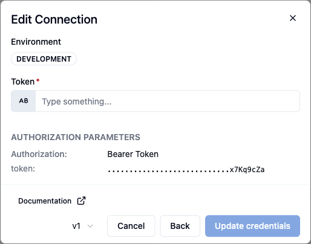

A connection stores the credentials and settings a component needs to reach an external service. Its secret values are encrypted at rest. This page covers how administrators and connection owners maintain an existing automation connection (editing its properties and replacing its credentials) and, in Enterprise Edition, how connection **visibility** controls who can see that a connection exists and reuse it.

For creating and using connections in workflows, see [Connections](/platform/automation/build/connections).

---

## Editing connection properties

Some connections have properties besides their credentials, for example the base URI of an HTTP Client connection.

1. In the automation **Connections** list, choose **Edit** on the connection. The dialog shows the connection's name, its properties filled in with the stored values, and its tags.
2. Change the values you need.
3. Click **Save**.

- Only the connection's properties are changed. The stored credentials are kept. To replace them, use **Update credentials** (see [Replacing credentials](#replacing-credentials)).
- A property you clear is removed from the connection.
- If someone else changed the connection after you opened it, the save is rejected. Reload and try again.

## Replacing credentials

When a connection's credentials stop working, for example after a password change or a revoked token, you can enter new credentials instead of creating a new connection. Every workflow that uses the connection keeps using it.

1. In the automation **Connections** list, choose **Edit** on the connection. When the connection's credentials were rejected, the dialog opens on the credentials form. Otherwise, click **Update credentials** in the dialog footer.
2. Enter the new values.
3. Click **Update credentials**. The dialog confirms with "Credentials updated".

Behavior:

- The new values **replace** the stored authorization parameters. A credential field you leave blank is cleared, not kept. Tokens saved for the previous credentials, such as an OAuth2 refresh token, are discarded.
- Properties outside the authorization, such as a base URL or region, are not changed. The authorization type cannot be switched.
- Saving stores the values without testing them. A wrong credential is flagged as invalid the next time the connection runs.
- Saving clears the connection's invalid-credentials flag, so workflows that were blocked by it run again.
- The replacement is refused when someone changed the connection after you opened it (reload and try again), and on a connection that is not active.
- Managed connections do not offer **Update credentials**.

Only the connection's owner (the member who created it, or the member it was reassigned to) can replace its credentials; a tenant admin cannot replace the credentials of a connection they do not own. Organization connections are the exception: any organization admin can replace their credentials. The server rejects the request for anyone else. Each replacement is recorded as a `CONNECTION_CREDENTIALS_UPDATED` [audit event](/platform/settings/audit-events). The event holds the connection ID only. Credential values are never recorded.

This applies to automation connections. Embedded connections are covered in [Embedded connections](/platform/embedded/build/connections).

---

## Organization Connections

<EEBadge />

<Callout type="warn" title="Coming soon">
    The **Settings → Connections** page and connection visibility are not available in the latest released version of ByteChef.
</Callout>

The page is headed **Organization Connections**, described as "Manage organization-wide shared connections.", with a **New Connection** button. It requires the `ADMIN` authority. Connections belong to the environment selected in the left sidebar header.

| Column | Description |
|---|---|
| **Name** | The connection's name. |
| **Component** | The component the connection authenticates, with its icon. If the component no longer exists, the raw component name is shown. |
| **Environment** | The environment the connection belongs to. |
| **Created By** | The user who created the connection. |
| **Last Modified** | When the connection last changed. |

**New Connection** opens the standard connection dialog, with the same component picker, connection properties and OAuth2 flow as any other connection. Organization connections cannot be narrowed to a smaller visibility. To remove one, delete it.

Organization connections are listed on every workspace's **Connections** page. Creating, renaming and deleting them is reserved for organization admins (the `ROLE_ADMIN` authority). Every organization admin can also view and replace an organization connection's credentials, whoever created it; other members can only use it in workflows.

{/* TODO screenshot: Settings → Connections - the Organization Connections table with Name / Component / Environment / Created By / Last Modified columns, and the New Connection button */}

## The visibility model

<EEBadge />

<Callout type="warn" title="Coming soon">
    Connection visibility is not available in the latest released version of ByteChef.
</Callout>

Visibility is a property of the connection and is set at the workspace level. There is no project-level connection visibility: a connection is shared with its workspace (or the whole organization), never with a single project, and every project in the workspace that can see the connection can use it.

Every connection carries exactly one visibility, ordered `PRIVATE < WORKSPACE < ORGANIZATION`:

| Visibility | Who can reach it | Typical use |
|---|---|---|
| **PRIVATE** | The owner, plus anyone named in a grant. | A personal sandbox credential. |
| **WORKSPACE** | Every member of the owning workspace. | A credential shared across a workspace's projects. |
| **ORGANIZATION** | Every member of every workspace in the organization. | An organization-wide credential. |

New connections are created with `WORKSPACE` visibility by default.

The visibility picker in the connection dialog offers three choices:

| Choice | Stored value |
|---|---|
| **Shared with workspace** | `WORKSPACE` (default). |
| **Private** | `PRIVATE`, withheld from the workspace. |
| **Specific people** | `PRIVATE`, plus grants that name individual users. |

Switching away from **Specific people** keeps the grants, so switching back restores the same audience.

`ORGANIZATION` is not offered in the picker. It is set by creating the connection on the **Organization Connections** page. A request that asks for `ORGANIZATION` at creation time is rejected with "Only PRIVATE or WORKSPACE visibility can be set on connection creation".

Granting the same user twice has no effect.

### Per-edition behavior

| Edition or platform | Behavior |
|---|---|
| Community Edition | Every connection is stored as `WORKSPACE`. There is no picker and there are no grants. |
| Embedded | Every connection is stored as `PRIVATE`, because it belongs to one connected user of your product. |

Both rules are applied on the server and ignore the request body.

### What sharing exposes

`WORKSPACE` visibility lets members **use** a connection and see that it exists. It does not let them read or change the credential:

- The connection APIs obfuscate `authorizationParameters` and return `parameters` as null.
- Only the connection's **owner** (the member who created it, or the member it was reassigned to) sees its secret values; the owner and organization admins can replace them. Organization connections are the exception: every organization admin can view and replace their secrets.
- Only the connection's owner and tenant admins can edit connection properties.

A colleague can run a workflow with a shared connection but cannot extract the credential or point it at another account.

| Connection | View its secrets | Replace its secrets | Use it in workflows | Rename, tag and delete it |
|---|---|---|---|---|
| A connection you own (you created it, or it was reassigned to you) | You, with `CONNECTION_EDIT` | You, with `CONNECTION_EDIT` | Yes | You, with `CONNECTION_EDIT` / `CONNECTION_DELETE` |
| A connection another member owns | Nobody but its owner, not even an organization admin | Its owner and organization admins | Yes, where you can reach it | Organization admins, who can also reassign it to another member |
| An organization connection | Every organization admin | Every organization admin | Every member | Organization admins |
| An embedded connection created for a connected user | No ByteChef user | No ByteChef user | Only that connected user's integrations | Members with `CONNECTION_EDIT` / `CONNECTION_DELETE` |

Visibility is also a **precondition** of the permission check, not a filter running beside it: a member who cannot see a connection is refused by id even where their workspace role would otherwise allow the action.

## Who can edit, delete or re-authorize a connection

Renaming, retagging and deleting a connection each need two things at once:

1. the matching scope in the connection's workspace: `CONNECTION_EDIT` to rename or retag, `CONNECTION_DELETE` to delete; **and**
2. being the connection's **owner** (the member who created it, or the member it was reassigned to) or an **organization admin** (the `ROLE_ADMIN` authority).

With the built-in roles, `CONNECTION_EDIT` and `CONNECTION_DELETE` come with Editor, so an Editor or Admin can change the connections they own; a Viewer who owns a connection cannot change it, and neither an Editor nor a workspace Admin can change a connection someone else owns. A custom role can carry the scopes too. Organization admins pass both checks. The **Connections** list offers **Edit** and **Delete** only to those who may use them, and a request from anyone else is refused (HTTP 403, or a GraphQL `FORBIDDEN` error).

Replacing credentials is stricter: it needs `CONNECTION_EDIT` **and** being the connection's owner. An organization admin who does not own a connection can rename, retag, delete or reassign it, but cannot view or replace its credentials. The exception is an organization connection, whose credentials every organization admin can view and replace.

Replacing credentials keeps the connection's id, so every workflow and deployment that uses it follows the new credentials. The submitted authorization fields replace the stored ones as a whole, the connection's credentials are marked valid again, and the operation is refused for a connection that is not active. It is available in the edit dialog as **Update credentials**, and through the `updateConnectionCredentials` GraphQL mutation, which takes the connection's current version so a concurrent change is rejected rather than overwritten. See [Connections](/platform/automation/build/connections#replacing-a-connections-credentials).

## When a member leaves a workspace

Removing a member from a workspace does two things to the connections in that workspace:

1. Every grant naming that member on the workspace's connections is revoked at once.
2. Every connection the member owns moves to **Pending reassignment** (status `PENDING_REASSIGNMENT`). A former member no longer counts as the owner.

A pending connection stays in place, but workflows cannot run on it (see the next section). An organization admin resolves it from the connection's menu with **Reassign owner**, choosing a new owner from the workspace; the connection becomes active again, and the new owner can edit it and, as its owner, view and replace its credentials. The previous owner loses that access. Reassigning an active connection hands over its credentials the same way. A connection whose status is `REVOKED` cannot be reassigned.

## Runs are blocked while a connection is not active

Before a deployed workflow runs, every connection it uses must be active. If any of them is pending reassignment or revoked, the run is refused instead of starting:

- a manual run returns the error "Workflow execution blocked: ... non-ACTIVE connection(s) ... Reassign or reactivate to resume.", and
- a run started by a trigger does not start a job and fails with the same error.

Each refused run is recorded in the audit log as `WORKFLOW_PAUSED`. Reassigning the connection lets the next run go through.

## Changing visibility

<EEBadge />

<Callout type="warn" title="Coming soon">
    Connection visibility is not available in the latest released version of ByteChef.
</Callout>

Every connection in the automation **Connections** list shows a **scope badge** next to its name:

| Badge | Icon | Meaning |
|---|---|---|
| **Private** | lock | "Visible only to you. Share it to give named colleagues access." |
| **Specific people** | people | "Withheld from the workspace and shared with named colleagues." |
| **Workspace** | building | "Visible to every member of the current workspace." |
| **Organization** | globe | "Visible to every member across all workspaces in the organization." |

For the connection's owner and for organization admins the badge is a button: click it and the visibility picker opens beneath, with the same three choices as the creation dialog. Everyone else sees the same badge as plain text.

- **Share with the whole workspace** - choose **Shared with workspace**.
- **Share with named colleagues** - choose **Specific people** and add users from the workspace member list. Removing a user from the list revokes their access. The badge then shows **Specific people** with the number of people named.
- **Withhold the connection** - choose **Private**. Named people keep their grants, so switching back restores the same audience.

Changes apply immediately. There is no separate save step.

In Community Edition, and on screens without a workspace context, no badge is shown.

### API operations

Each operation is allowed for the connection's owner, a workspace admin of the owning workspace, or an organization admin; the UI offers the picker to the owner and organization admins.

| Operation | Effect |
|---|---|
| `setConnectionVisibility(workspaceId, connectionId, visibility)` | Sets a connection's visibility. Rejects `ORGANIZATION`, and refuses to narrow to `PRIVATE` while an active deployment uses the connection. |
| `grantConnectionAccess(workspaceId, connectionId, userId)` | Names one user on a `PRIVATE` connection. Idempotent. |
| `revokeConnectionAccess(workspaceId, connectionId, userId)` | Removes that user's grant. |
| `connectionGrants(workspaceId, connectionId)` | Lists the users a connection is shared with. |

A grantee must be a member of the owning workspace. Grants are deleted with the connection.

## What gets audited

Every one of these actions is recorded under the acting user's login. Besides the keys below, each entry carries `method` (the operation that ran) and `result` (`SUCCESS`, `DENIED` or `ERROR`, or `ROLLED_BACK` when an enclosing transaction rolled back, plus `errorClass` on an error), so a refused attempt is recorded too. No credential material is ever recorded.

| Event | When | Data |
|---|---|---|
| `CONNECTION_CREATED` | A workspace or organization connection was created. | `connectionId`, `workspaceId` (workspace connections), `visibility` (as stored) |
| `CONNECTION_DELETED` | A workspace or organization connection was deleted. | `connectionId` |
| `CONNECTION_VISIBILITY_CHANGED` | A connection's reach changed. | `connectionId`, `workspaceId`, `fromVisibility`, `toVisibility` |
| `CONNECTION_ACCESS_GRANTED` | A user was named on a private connection. | `connectionId`, `workspaceId`, `targetUserId` |
| `CONNECTION_ACCESS_REVOKED` | A user's grant was removed. | `connectionId`, `workspaceId`, `targetUserId` |
| `CONNECTION_CREDENTIALS_UPDATED` | A connection's credentials were replaced. | `connectionId` |
| `CONNECTION_DISCONNECTED` | A connection was detached from deployments and test configurations. | `connectionId` |
| `CONNECTION_REASSIGNED` | An organization admin gave a connection a new owner. | `connectionId`, `workspaceId`, `newOwnerUserId`; a bulk reassignment of everything a former member owned records one entry with `previousOwnerUserId`, `connectionIds` and `connectionCount` instead of `connectionId` |
| `WORKFLOW_PAUSED` | A deployed workflow run was refused because a connection it uses is not active. | `jobPrincipalId` (the project deployment), `workflowId`, `connectionIds`, `connectionStatuses` |

A refused manual run is recorded under the user who started it. A refused run fired by a webhook trigger is recorded under `anonymousUser`, the principal of the incoming webhook request; where no security context exists at all, the principal is `SYSTEM`. See [Audit Events](/platform/settings/audit-events).

See [Audit Events](/platform/settings/audit-events).

## Metrics

`bytechef_connection_create` (counter) increments on every connection created through the workspace facade, tagged `visibility=PRIVATE|WORKSPACE`, so you can watch how much credential sharing actually happens against how much stays private. The tag reads the *persisted* visibility rather than the request body, so it reflects the CE and embedded overrides. Organization connections are created through their own facade and are not counted here.
