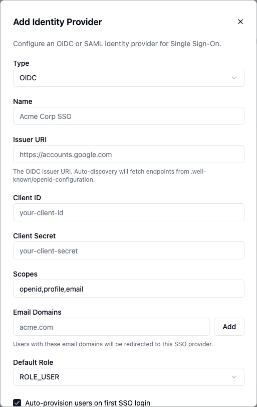

<EEBadge />

Enterprise SSO replaces ByteChef's local user store with your existing identity provider, so identity, group membership, and de-provisioning are managed in one place rather than in a second directory kept in sync by hand.

<Callout title="Availability">
    External identity provider federation is an Enterprise Edition feature, enabled with `bytechef.security.sso.enabled` (`BYTECHEF_SECURITY_SSO_ENABLED`). The **Settings → Identity Providers** page is behind the `ff-1040` feature flag and requires the `ADMIN` authority. Community Edition ships local email/password login, plus optional [social login](#social-login) with Google and GitHub.
</Callout>

---

## Protocols

Both protocols are first-class:

- **SAML 2.0** - assertion-based SSO, typical of ADFS, Shibboleth, and other large-enterprise IdPs.
- **OIDC / OAuth 2.0** - for OIDC-native IdPs such as Okta, Auth0, Google Workspace, Keycloak, and Azure AD / Entra ID.

If your IdP advertises a SAML metadata URL or an OIDC discovery document, it will plug in.

Providers are registered at runtime - metadata URLs, client IDs, secrets, and attribute mappings are all admin-editable without a redeploy. That matters most for multi-tenant deployments where each tenant brings its own IdP, and for onboarding a new identity domain without an outage window.

## The providers list

**Settings → Identity Providers** lists configured providers with these columns: **Name**, **Type**, **Issuer / Metadata URI**, **Domains**, **Status**, and **Enforced**, plus per-row edit and delete actions. **Add Identity Provider** opens the configuration dialog.

## Configuring a provider

The dialog is titled **Add Identity Provider** (or **Edit Identity Provider**) and adapts to the selected **Type**:

| Field | Applies to | Purpose |
|---|---|---|
| **Type** | Both | `OIDC` or `SAML`. Fixed once created - the selector is disabled on edit. |
| **Name** | Both | Display name for the provider, e.g. `Acme Corp SSO`. |
| **Issuer URI** | OIDC | Issuer whose `.well-known/openid-configuration` is auto-discovered, e.g. `https://accounts.google.com`. |
| **Client ID** / **Client Secret** | OIDC | OAuth client credentials. The secret can be left blank on edit to keep the current one. |
| **Scopes** | OIDC | Requested scopes, e.g. `openid,profile,email`. |
| **Metadata URI** | SAML | IdP metadata URL used to auto-configure endpoints and certificates. |
| **Signing Certificate** | SAML | Optional PEM certificate, when not carried in the metadata. |
| **NameID Format** | SAML | Optional NameID format - Email Address, Persistent, Transient, Unspecified, or the metadata default. |
| **Email Domains** | Both | Domains that route users to this provider at login, added and removed as chips. |
| **Default Role** | Both | `ROLE_USER` or `ROLE_ADMIN` granted to users arriving from this provider. |

Four checkboxes control behavior:

- **Auto-provision users on first SSO login**
- **Enforce SSO (block password login for matching domains)**
- **Enabled**
- **Require MFA (policy only)** - with an **MFA Method** selector (TOTP or Email). This is a policy flag; enforcement is planned for a future release and the selector is disabled.

For SAML, editing a saved provider exposes a **Download SP Metadata** button to hand to your IdP.

OIDC providers also offer the MCP settings described in [MCP servers](#mcp-servers).

### MCP servers

Identity providers configured here are used for signing in to ByteChef. An OIDC provider can also authorize MCP clients for this account. OIDC providers have two more checkboxes (SAML providers cannot be used for MCP):

- **Use for automation MCP servers** - accept this provider's tokens on the account's [automation MCP servers](/platform/automation/deploy/mcp-servers) (`https://<your-host>/api/automation/<secret-key>/mcp`).
- **Use for management MCP servers** - accept this provider's tokens on the account's [management MCP server](/platform/settings/mcp-server) (`https://<your-host>/api/management/<secret-key>/mcp`).

These tokens are accepted on the secret-key URLs only; the tenant-less management URL (`/api/management/mcp`) rejects them with `401`. A provider is trusted only by the account it is registered in, so the same token sent to another account's MCP server is rejected, and an unknown or forged secret key is rejected before the account's providers are consulted.

Like any other MCP access token, the token must carry the endpoint's scope in its `scope` (or `scp`) claim: `mcp:automation` for automation MCP servers and `mcp:management` for the management MCP server. Configure your identity provider to issue that scope; a token without it is rejected with `403` and an `insufficient_scope` challenge. Group claims and group mappings never stand in for the scope.

A token from the provider acts as a ByteChef user. ByteChef reads the token's `email` claim and looks for an **active** user with that email in the account the MCP URL belongs to. The request is rejected with `401` when there is no such user, when the user is deactivated, or when the token's `email_verified` claim is `false`. An accepted request carries that user's roles, plus any authorities granted by the group mappings below.

Once either checkbox is ticked, three more settings appear:

| Field | Purpose |
|---|---|
| **Require token audience to match the MCP endpoint** | Reject tokens whose `aud` claim does not include the URL of the MCP server being called. The URL is built from `BYTECHEF_PUBLIC_URL` when it is set. Turn this on when one identity provider issues tokens for more than one account, so a token minted for one account's server cannot be used against another. |
| **Groups Claim** | The token claim that lists the caller's groups. Defaults to `groups`. |
| **Group → Authority Mappings** | Pairs of an identity provider group and the ByteChef authority it grants, e.g. `sales` → `ROLE_SALES`, used for MCP tool authorization. When no mapping is configured, group values are granted as they are, except values starting with `ROLE_` or `SCOPE_`, which are never taken from a token. A mapping to a `SCOPE_` authority is ignored. |

MCP clients find the provider through the server's protected resource metadata (`/.well-known/oauth-protected-resource/api/<automation|management>/<secret-key>/mcp`), which lists the account's identity providers before the installation's own issuers. The account's providers are listed only for a valid secret key; for an unknown key the metadata lists the installation's issuers alone.

Accepting identity provider tokens on MCP servers requires the installation to trust at least one issuer under the `BYTECHEF_OAUTH2_RESOURCE_SERVER_ISSUERS_*` properties - see [MCP Server → JWT from a trusted issuer](/platform/settings/mcp-server#jwt-from-a-trusted-issuer-optional). Those installation-wide issuers keep working alongside the providers configured here. A change to a provider takes effect on every server node within 30 seconds.

## What gets federated

- **Authentication** - your IdP performs the login; ByteChef trusts the assertion or ID token.
- **Identity attributes** - email, display name, and, configurably, group membership.
- **Group-to-role mapping** - IdP group claims map onto ByteChef [roles](/platform/settings/users#roles-and-permissions), so adding a new hire to an IdP group grants the corresponding ByteChef permissions automatically.

## What does not get federated

Service-account credentials - the API keys, OAuth tokens, and basic-auth secrets that workflows use - stay in ByteChef's encrypted [connection](/platform/settings/connections) storage. SSO governs **human** identities, not machine credentials.

## Migrating from local accounts

Existing local accounts are matched by email. Once SSO is live, tick **Enforce SSO** on the provider to block password login for its email domains, so users cannot fall back to a local password.

---

## Social login

<Callout type="warn" title="Coming soon">
    Social login is on the upcoming release track and is not yet available in the latest released version of ByteChef.
</Callout>

In addition to local email/password, users can sign in with **Google** or **GitHub**. Enable it with `bytechef.security.social-login.enabled` (`BYTECHEF_SECURITY_SOCIAL_LOGIN_ENABLED`) and supply each provider's client id and secret. This is separate from the IdP federation above - social login targets Community Edition and small teams, where a full IdP is overkill.

## Two-factor authentication

<Callout type="warn" title="Coming soon">
    Two-factor authentication is on the upcoming release track and is not yet available in the latest released version of ByteChef.
</Callout>

For local accounts, ByteChef can require a time-based one-time password (TOTP) as a second factor at sign-in, enabled with `bytechef.security.two-factor-authentication.enabled` (`BYTECHEF_SECURITY_TWO_FACTOR_AUTHENTICATION_ENABLED`). Users register an authenticator app and enter the rotating code after their password.
