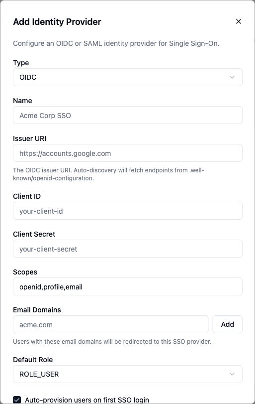

<EEBadge />

Enterprise SSO replaces ByteChef's local user store with your existing identity provider, so identity, group membership, and de-provisioning are managed in one place rather than in a second directory kept in sync by hand.

<Callout title="Availability">
    External identity provider federation is an Enterprise Edition feature, enabled with `bytechef.security.sso.enabled` (`BYTECHEF_SECURITY_SSO_ENABLED`). The **Settings → Identity Providers** page appears when that setting is on and requires the `ADMIN` authority. The same setting enables [SCIM provisioning](#scim-provisioning). Community Edition ships local email/password login, plus optional [social login](#social-login) with Google and GitHub. All of these work in both single-tenant and multi-tenant deployments.
</Callout>

---

## Protocols

Both protocols are first-class:

- **SAML 2.0** - assertion-based SSO, typical of ADFS, Shibboleth, and other large-enterprise IdPs.
- **OIDC / OAuth 2.0** - for OIDC-native IdPs such as Okta, Auth0, Google Workspace, Keycloak, and Azure AD / Entra ID.

If your IdP advertises a SAML metadata URL or an OIDC discovery document, it will plug in.

Providers are registered at runtime - metadata URLs, client IDs, secrets, and attribute mappings are all admin-editable without a redeploy. That matters most for multi-tenant deployments where each tenant brings its own IdP, and for onboarding a new identity domain without an outage window.

## The providers list

**Settings → Identity Providers** lists configured providers with these columns: **Name**, **Type**, **Issuer / Metadata URI**, **Domains**, **Status**, **Enforced**, and **MCP**, plus per-row edit and delete actions. **Add Identity Provider** opens the configuration dialog.

## Configuring a provider

The dialog is titled **Add Identity Provider** (or **Edit Identity Provider**) and adapts to the selected **Type**:

| Field | Applies to | Purpose |
|---|---|---|
| **Type** | Both | `OIDC` or `SAML`. Fixed once created - the selector is disabled on edit. |
| **Name** | Both | Display name for the provider, e.g. `Acme Corp SSO`. |
| **Issuer URI** | OIDC | Issuer whose `.well-known/openid-configuration` is auto-discovered, e.g. `https://accounts.google.com`. |
| **Client ID** / **Client Secret** | OIDC | OAuth client credentials. The secret can be left blank on edit to keep the current one. |
| **Scopes** | OIDC | Requested scopes, e.g. `openid,profile,email`. |
| **Metadata URI** | SAML | IdP metadata URL used to auto-configure endpoints and certificates. A SAML provider needs no client ID or secret. |
| **Signing Certificate** | SAML | Optional PEM certificate, when not carried in the metadata. |
| **NameID Format** | SAML | Optional NameID format - Email Address, Persistent, Transient, Unspecified, or the metadata default. |
| **Email Domains** | Both | Domains that route users to this provider at login, added and removed as chips. |
| **Default Role** | Both | `ROLE_USER` or `ROLE_ADMIN` granted to users arriving from this provider. |

Four checkboxes control behavior:

- **Auto-provision users on first SSO login**
- **Enforce SSO (block password login for matching domains)**
- **Enabled**
- **Require MFA (policy only)** - with an **MFA Method** selector (TOTP or Email). This is a policy flag; enforcement is planned for a future release and the selector is disabled.

### Redirect URI and SP metadata

Each saved provider has a **registration id** that ByteChef uses in the URLs your IdP calls back. In a single-tenant deployment it is `sso-{id}` (OIDC) or `saml-{id}` (SAML); in a multi-tenant deployment it also names the tenant, `sso-{tenantId}-{id}` or `saml-{tenantId}-{id}`, because the callback arrives before anyone is signed in and must find the tenant that owns the provider.

- **OIDC** - editing a saved provider shows the **Redirect URI** to register with your IdP: `{your ByteChef URL}/login/oauth2/code/{registration id}`.
- **SAML** - editing a saved provider exposes a **Download SP Metadata** button (served from `/saml2/metadata/{registration id}`) to hand to your IdP. The assertion consumer service is `{your ByteChef URL}/login/saml2/sso/{registration id}`.

Save the provider first; the registration id exists only once it has been created.

### Using a provider for MCP endpoints

OIDC providers additionally expose three per-surface toggles:

- **Use for embedded MCP servers** - advertise this provider as the authorization server for embedded MCP endpoints, so MCP clients authenticate directly against it.
- **Use for automation MCP servers** - trust this provider's tokens on the automation MCP endpoint.
- **Use for management MCP servers** - trust this provider's tokens on the management MCP endpoint.

Enabling any of them reveals two more settings:

- **Require token audience to match the MCP endpoint** - reject tokens whose audience does not include this tenant's MCP URL. Enable this when the identity provider is shared across tenants.
- **Groups Claim** (default `groups`) plus a group-to-authority mapping table - map the provider's group claim values, e.g. `idp-group` → `ROLE_SALES`, to ByteChef authorities used for MCP tool authorization.

## Signing in with SSO

On the login page, a user who types an email on one of a provider's **Email Domains** is offered a **Continue with** button for that provider. A login link can also name the provider with `?company={provider name}`. Disabled providers are never offered.

## What gets federated

- **Authentication** - your IdP performs the login; ByteChef trusts the assertion or ID token.
- **Identity attributes** - email, first name, and last name. For SAML, the email is read from the `http://schemas.xmlsoap.org/ws/2005/05/identity/claims/emailaddress`, `email`, `mail`, or `urn:oid:0.9.2342.19200300.100.1.3` attribute, falling back to the NameID; names come from the `givenname`/`surname` claims or the `givenName`, `firstName`, `sn`, `surname`, and `lastName` attributes.
- **Account linking** - a user is resolved inside the tenant that owns the provider. A returning user is matched by the subject (OIDC) or NameID (SAML) of *that* provider, so an identity from one provider can never sign in as an account linked through another. A first login matches an existing account by email, and creates one when **Auto-provision users on first SSO login** is on, with the provider's **Default Role**. The email must be on one of the provider's **Email Domains** before it can link to or create an account, so a provider cannot claim accounts outside its own domains.

Group claims are not applied at sign-in: an SSO user gets the provider's **Default Role** when the account is created and keeps whatever [roles](/platform/settings/users#roles-and-permissions) are assigned in ByteChef afterwards. The group-to-authority mapping above applies only to MCP tokens.

An OIDC identity whose provider reports `email_verified=false` is refused. When auto-provisioning is off, an unknown user is sent back to the login page with an explanation rather than an error.

## What does not get federated

Service-account credentials - the API keys, OAuth tokens, and basic-auth secrets that workflows use - stay in ByteChef's encrypted [connection](/platform/settings/connections) storage. SSO governs **human** identities, not machine credentials.

## Migrating from local accounts

Existing local accounts are matched by email when that email is on one of the provider's **Email Domains**, and linked to the provider on their first SSO login. Once SSO is live, tick **Enforce SSO** on the provider: password login and Google/GitHub [social login](#social-login) are then refused for its email domains, so users cannot fall back to a local password or a personal social account.

---

## SCIM provisioning

SCIM 2.0 lets your IdP create, update, and deactivate ByteChef users automatically. It is available whenever SSO is enabled.

1. Edit a saved identity provider. The **SCIM Provisioning** section shows the **SCIM base URL**, `{your ByteChef URL}/api/scim/v2`.
2. Click **Generate SCIM Token**. The token is shown **once** - copy it into your IdP's SCIM configuration as the bearer token. ByteChef stores only a hash of it.
3. **Rotate SCIM Token** issues a new token and invalidates the previous one.

A token belongs to the tenant whose provider issued it, and every SCIM request acts on that tenant only.

| Resource | Supported |
|---|---|
| **Users** | `GET` (list and by id), `POST`, `PUT`, `PATCH`, `DELETE`. |
| **Filters** | `userName eq "…"` (case-insensitive), `emails.value eq "…"`, `externalId eq "…"` (matched against the email), and `id eq "…"`. Other filters are rejected with `invalidFilter`. |
| **PATCH** | `add`, `replace`, and `remove` for `active`, `userName`, `name.givenName`, `name.familyName`, and `emails`, with or without a `path` (the forms Okta and Entra ID send). `displayName`, `name.formatted`, and `externalId` are accepted but not stored. |
| **Groups** | Read-only. Groups are ByteChef's roles, so an IdP can list them but create, replace, patch, and delete return `501 Not Implemented`. Group membership push is not supported. |
| **Discovery** | `/ServiceProviderConfig`, `/ResourceTypes`, and `/Schemas`. |

Behavior worth knowing:

- New users get `ROLE_USER` and honor the `active` flag they are created with. Creating a `userName` or email that already exists returns `409` with `scimType: uniqueness`.
- `PUT` replaces the name, email, and `userName` but keeps the user's roles; leaving `active` out does not deactivate the user.
- Setting `active` to `false` takes effect immediately for new sign-ins of every kind (password, social, and SSO) and revokes the user's remember-me tokens. Browser sessions that are already open stay valid until they expire.
- The list includes deactivated users, so your IdP can reconcile them, and reports the real `totalResults`.
- Errors use the SCIM error schema (`urn:ietf:params:scim:api:messages:2.0:Error`).

---

## Social login

<Callout type="warn" title="Coming soon">
    Social login is on the upcoming release track and is not yet available in the latest released version of ByteChef.
</Callout>

In addition to local email/password, users can sign in with **Google** or **GitHub**. Enable it with `bytechef.security.social-login.enabled` (`BYTECHEF_SECURITY_SOCIAL_LOGIN_ENABLED`) and supply the client id and secret of at least one provider; the server refuses to start with social login enabled and no provider configured. This is separate from the IdP federation above - social login targets Community Edition and small teams, where a full IdP is overkill.

Register these redirect URIs with the providers:

- Google: `{your ByteChef URL}/login/oauth2/code/google`
- GitHub: `{your ByteChef URL}/login/oauth2/code/github`

The login and sign-up pages show a button only for the providers that have a client id. To use a GitHub Enterprise Server instead of GitHub.com, also set its authorization, token, and user endpoints (`BYTECHEF_SECURITY_SOCIAL_LOGIN_GITHUB_AUTHORIZATION_URI`, `..._TOKEN_URI`, `..._USER_INFO_URI`; see [environment variables](/platform/use-bytechef/self-hosted/configuration/environment-variables)).

**Who can sign in.** A Google or GitHub identity signs in to the ByteChef account with the same email, or the account already linked to it. In a multi-tenant deployment the user lands in the tenant that holds that account. A pending invitation is accepted by signing in with the invited email. Deactivated accounts are refused, and so is a Google account whose email is not verified, so an unverified address cannot take over an existing account.

**Who can sign up.** Social sign-up follows the same rules as email sign-up:

- **Single tenant** - only the first user of an empty instance can sign up, and becomes its administrator. After that, people need an account or an invitation.
- **Multi tenant** - when sign-up is enabled (`BYTECHEF_SIGN_UP_ENABLED`) and the sign-up webhook accepts the email domain, signing up creates a new tenant with the user as its administrator.

When a sign-in is refused, the login page says why - no account yet, account deactivated, email not verified, sign-up disabled, email domain not allowed, or SSO required for the domain.

## Two-factor authentication

<Callout type="warn" title="Coming soon">
    Two-factor authentication is on the upcoming release track and is not yet available in the latest released version of ByteChef.
</Callout>

ByteChef can require a time-based one-time password (TOTP) as a second factor at sign-in, enabled with `bytechef.security.two-factor-authentication.enabled` (`BYTECHEF_SECURITY_TWO_FACTOR_AUTHENTICATION_ENABLED`). Users register an authenticator app in their [profile](/platform/your-account/profile#two-factor-authentication) and enter the rotating code after signing in. The profile section appears only while the setting is on.

- The code is required after every kind of sign-in - password, Google/GitHub, and SSO - in both single-tenant and multi-tenant deployments.
- **Stay logged in** issues its remember-me cookie only after the code is verified, so the cookie can never stand in for the second factor.
- After five wrong codes, code verification is locked for that user for 15 minutes and the pending sign-in ends; signing in again does not lift the lock.
