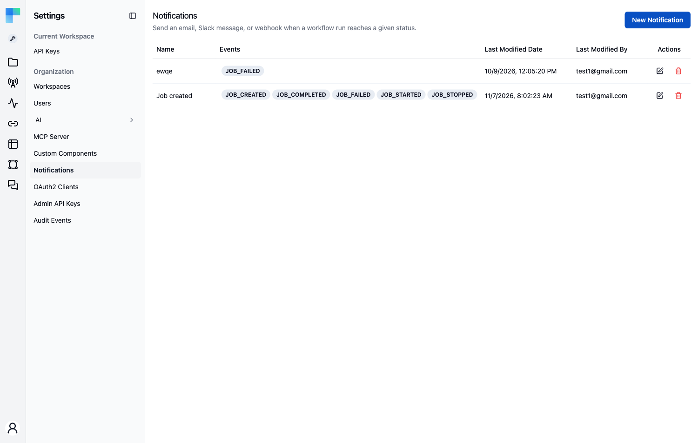

A **notification** is a rule that says *"when a job reaches this status, tell this target"*. Each rule
names one or more job lifecycle events and one delivery target: an email address, a Slack channel, or a
webhook URL. When a workflow run hits one of those
events, every notification subscribed to it fires.

**Settings → Notifications** requires the `ADMIN` authority. Unlike most of the Settings area, the page
is available in both Community and Enterprise Edition. The **Email** and **Slack** delivery types work
in both editions; the **Webhook** delivery type is Enterprise Edition only.

---



## The page

The header reads **Notifications**, with a **New Notification** button. With no rules yet, the body
shows an empty state titled **No Notifications** with the message "You do not have any Notifications
created yet."

| Column | Description |
|---|---|
| **Name** | The label you gave the rule. |
| **Events** | The subscribed events, one badge each. |
| **Last Modified Date** | When the rule last changed. |
| **Last Modified By** | Who changed it. |
| **Actions** | An **edit** (pencil) and a **delete** (trash) button. |

## Create a notification

1. Click **New Notification**. The **Create Notification** dialog opens, described as "Define
   notification parameters."
2. Enter a **Name** - required, up to 256 characters.
3. Pick one or more **Events** from the multi-select. At least one is required.
4. Choose a **Type**.
5. Fill in the type's one delivery field.
6. Click **Save**.

Editing works the same way: the pencil icon reopens the dialog, titled **Edit Notification**, with the
current values loaded.

## Events

Events are job lifecycle transitions, plus two reminders about runs paused on an approval. The full set:

| Event | Fires when |
|---|---|
| `JOB_CREATED` | A run has been created but not started. |
| `JOB_STARTED` | A run has started executing. |
| `JOB_COMPLETED` | A run finished successfully. |
| `JOB_FAILED` | A run failed. |
| `JOB_CANCELLED` | A run was cancelled before it ever started. |
| `JOB_STOPPED` | A run was stopped mid-execution. |
| `JOB_APPROVAL_EXPIRING` | A run paused on an approval is about to expire. Sent once, a configurable lead time (24 hours by default) before the approval expires. |
| `JOB_APPROVAL_ESCALATED` | A run has been waiting on an approval past the configured escalation window. Off until an escalation window is set. |

The list is not per-workspace or per-project: a notification subscribes to an event across the whole
deployment. The approval reminder and escalation timings are set with environment variables; see
[Human in the loop](/platform/automation/build/workflows/human-in-the-loop) and
[Environment variables](/platform/use-bytechef/self-hosted/configuration/environment-variables).

## Delivery types

| Type | Field | Edition | Notes |
|---|---|---|---|
| **EMAIL** | **Email** - the recipient address. | Community and Enterprise | The default. Requires a mail host to be configured; without one the send is skipped with a warning. |
| **SLACK** | **Slack Webhook URL** - a Slack [incoming webhook](https://api.slack.com/messaging/webhooks) URL. | Community and Enterprise | Posts one message to the channel the incoming webhook belongs to. |
| **WEBHOOK** | **Webhook URL** - any HTTPS or HTTP endpoint. | Enterprise only | Sends a JSON `POST` to the URL. See [Webhook requests](#webhook-requests). |

In Community Edition the **Type** dropdown offers only **Email** and **Slack**, and the API refuses to
save a Webhook notification. A Webhook notification created earlier under an Enterprise license is kept
but skipped, with a warning in the server log, while the deployment runs as Community Edition.

### Message content

Email subject and body come from the platform's message bundle, parameterised with the workflow's
label and the job id; the approval events also carry the approval's expiry time and a link to resolve
it. A Slack message carries the same text as the email body, prefixed with an emoji. There is no
per-notification template.

Email and Slack messages now end with the same details lines, one per line, each shown only when the
value is known: `Workflow`, `Project` (with the version, for example `CRM (v3)`), `Environment`,
`Failed task` (with the task type), `Error` and `Execution` (the link to the run).

### Webhook requests

Each delivery is a single `POST` with a `Content-Type: application/json` body. The body starts with the
fields it has always had (`eventType`, `jobId`, `jobName`, `timestamp`, and on approval events
`approvalExpiresAt` and `approvalFormUrl`). These are unchanged. A summary of the event is added beside
them:

| Field | Type | Present when |
|---|---|---|
| `eventType` | string | Always. |
| `jobId` | number | Always. |
| `jobName` | string | Always. |
| `approvalExpiresAt` | string | Approval events. |
| `approvalFormUrl` | string | Approval events. |
| `timestamp` | string | Always. ISO-8601, for example `2026-11-03T10:00:00Z`. |
| `deliveryId` | string | Always. Unique per delivery: each notification gets its own id, and the value equals the `X-ByteChef-Delivery` header. |
| `source` | string | The job belongs to an automation project (`AUTOMATION`) or an embedded integration (`EMBEDDED`). |
| `job.id` | number | The job exists. |
| `job.name` | string | The job has a name. |
| `job.status` | string | The job has a status, for example `FAILED`. |
| `job.startDate` | string | The run has started. ISO-8601. |
| `job.endDate` | string | The run has ended. ISO-8601. |
| `job.durationMillis` | number | The run has started and ended. |
| `workflow.id` | string | The job has a workflow. |
| `workflow.name` | string | The workflow still exists. A deleted workflow still gives `workflow.id`. |
| `project.id` | number | The project could be resolved. For an embedded job, the integration id. |
| `project.name` | string | The project could be resolved. For an embedded job, the integration name. |
| `project.version` | number | The project could be resolved. For an embedded job, the integration version. |
| `environment` | string | The environment could be resolved: `DEVELOPMENT`, `STAGING` or `PRODUCTION`. |
| `error.taskName` | string | `JOB_FAILED` only, when a failed task was found. |
| `error.taskType` | string | `JOB_FAILED` only, when a failed task was found. |
| `error.message` | string | `JOB_FAILED` only, and only when the failing task's error has a message. |
| `error.stackTrace` | string | `JOB_FAILED` only, when the error has a stack trace. Cut to 2000 characters. |
| `executionUrl` | string | `bytechef.public-url` is set and the run's project or integration could be resolved. Opens the execution. |
| `approval.expiresAt` | string | Approval events. Same value as `approvalExpiresAt`. |
| `approval.formUrl` | string | Approval events. Same value as `approvalFormUrl`. |

A field that has no value is left out of the body, not sent as `null`. The one exception is `approvalExpiresAt` and `approvalFormUrl`, which are always present on approval events and can be `null`. If a lookup fails (for example
the workflow was deleted), the field is left out and the notification is still sent.

`deliveryId` is the same value as the `X-ByteChef-Delivery` header, and `timestamp` is the same moment
as the `X-ByteChef-Timestamp` header. The header is in milliseconds since the epoch, the body field is
ISO-8601.

`executionUrl` opens the execution in ByteChef: `<public-url>/automation/executions?id=<jobId>` for an
automation run and `<public-url>/embedded/executions?id=<jobId>` for an embedded run. It is left out
when `bytechef.public-url` is not set.

Task inputs and outputs are never included. Open the execution through `executionUrl` to see them.

A `JOB_FAILED` event from an automation run:

```json
{
  "eventType": "JOB_FAILED",
  "jobId": 1042,
  "jobName": "Sync new leads",
  "timestamp": "2026-11-03T14:03:27.512Z",
  "deliveryId": "6f1c2d3e-8a4b-4c5d-9e6f-7a8b9c0d1e2f",
  "source": "AUTOMATION",
  "job": {
    "id": 1042,
    "name": "Sync new leads",
    "status": "FAILED",
    "startDate": "2026-11-03T14:03:25.101Z",
    "endDate": "2026-11-03T14:03:27.480Z",
    "durationMillis": 2379
  },
  "workflow": {
    "id": "wf-3a9f1c",
    "name": "Sync new leads"
  },
  "project": {
    "id": 7,
    "name": "CRM",
    "version": 3
  },
  "environment": "PRODUCTION",
  "error": {
    "taskName": "Create contact",
    "taskType": "hubspot/v1/createContact",
    "message": "401 Unauthorized",
    "stackTrace": "com.bytechef.exception.ConfigurationException: 401 Unauthorized\n\tat ..."
  },
  "executionUrl": "https://bytechef.example.com/automation/executions?id=1042"
}
```

A `JOB_APPROVAL_EXPIRING` event. The two top-level approval fields come right after `jobName`, and the
`approval` object comes last:

```json
{
  "eventType": "JOB_APPROVAL_EXPIRING",
  "jobId": 1043,
  "jobName": "Approve refund",
  "approvalExpiresAt": "2026-11-04T10:00:00Z",
  "approvalFormUrl": "https://bytechef.example.com/resume/eyJ0b2tlbiI6Li4ufQ",
  "timestamp": "2026-11-03T10:00:00Z",
  "deliveryId": "0b7d9a51-2c3e-4f60-8a71-5d4c3b2a1f09",
  "source": "AUTOMATION",
  "job": {
    "id": 1043,
    "name": "Approve refund",
    "status": "STARTED",
    "startDate": "2026-11-02T10:00:00Z"
  },
  "workflow": {
    "id": "wf-8d2e4b",
    "name": "Approve refund"
  },
  "project": {
    "id": 7,
    "name": "CRM",
    "version": 3
  },
  "environment": "PRODUCTION",
  "executionUrl": "https://bytechef.example.com/automation/executions?id=1043",
  "approval": {
    "expiresAt": "2026-11-04T10:00:00Z",
    "formUrl": "https://bytechef.example.com/resume/eyJ0b2tlbiI6Li4ufQ"
  }
}
```

Every request carries these headers:

| Header | Value |
|---|---|
| `X-ByteChef-Event` | `job.status` |
| `X-ByteChef-Timestamp` | The send time, in milliseconds since the epoch. |
| `X-ByteChef-Delivery` | A random UUID, unique per delivery. It equals `deliveryId` in the body. Use it to deduplicate. |

The URL must use `http` or `https` and must resolve to a public address: loopback, private,
link-local and carrier-grade NAT ranges are refused. Each request has a 10-second connect timeout and
a 30-second read timeout, and a `4xx` or `5xx` response counts as a failure. A failed job-status
delivery is logged and not retried. For the two approval events, if every subscribed notification
fails, the next approval sweep tries again.

<Callout type="warn" title="Coming soon">
    Signing webhook payloads with a shared secret (HMAC) and per-workspace scoping of a notification
    are on the upcoming release track and are not yet available.
</Callout>

## Delete a notification

Click the **delete** (trash) icon on the row and confirm in the **Delete &lt;name&gt; notification?** dialog
("This action cannot be undone."). The rule stops firing immediately; runs already in flight are
unaffected.

## See also

- [Workflow Executions](/platform/automation/monitor/workflow-executions) - the run history a notification points you at.
