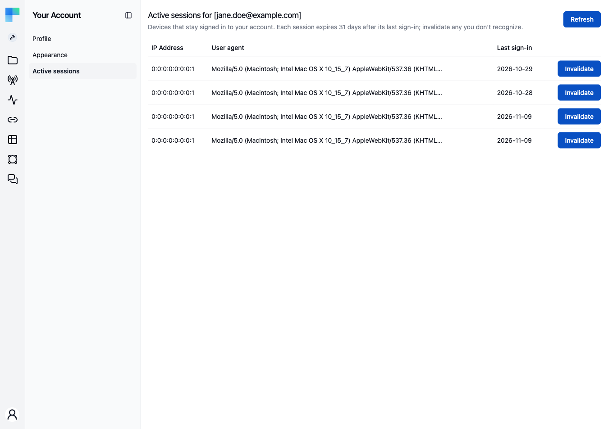

**Your Account → Active sessions** lists the persistent sign-in tokens issued to your account and lets you invalidate any of them. These are the "remember me" credentials that let a browser sign you back in without a password.

The page is headed **Active sessions for [your login]**, with the description "Devices that stay signed in to your account. Each session expires 31 days after its last sign-in; invalidate any you don't recognize." The header has a **Refresh** button.

---

## The table

| Column | Description |
|---|---|
| **IP Address** | The address the token was last used from. |
| **User agent** | The browser and platform string that browser sent. |
| **Last sign-in** | When the token was issued or last renewed. |

Each row ends with an **Invalidate** button. With no tokens, the page shows **No active sessions**.

You see only your own tokens. There is no administrator view of another user's sessions.

## Invalidate a session

Click **Invalidate** on the row. A "The session has been invalidated." toast confirms the change and the list reloads. On failure, the toast reads "The session could not be invalidated."

<Callout type="warn" title="What invalidating does and does not do">
    Invalidating removes the **remember-me token**, not the live browser session. A user already signed
    in on that browser stays signed in until they sign out or the session times out; they lose only the
    automatic sign-in afterwards. This applies to your current browser too: you can invalidate your own
    current token and keep working.
</Callout>

Tokens are valid for **31 days** from issue and are renewed as you keep using the browser, so a
browser you have not opened in over a month falls off the list on its own.

If you invalidate a session because you do not recognize it, also change your password on [Profile](/platform/your-account/profile). Invalidating a token does not stop anyone who knows the password from signing in again.
