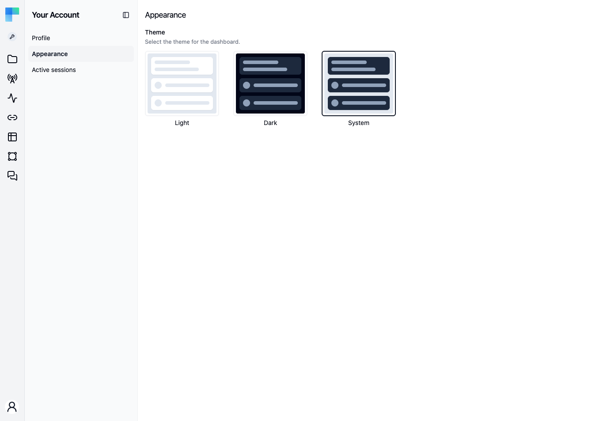

**Your Account → Appearance** has one setting: the **Theme**, described as "Select the theme for the dashboard."

---

## The three choices

The theme is chosen from three preview cards, each a radio option:

| Choice | Effect |
|---|---|
| **Light** | Always the light palette, whatever the operating system is set to. |
| **Dark** | Always the dark palette. |
| **System** | Follows the light or dark preference of the operating system. |

**System** is the default in a browser that has no stored choice. Selecting a card applies it immediately; there is no **Save** button.

## Where the choice is stored

The theme is stored in the **local storage** of your browser under the `bytechef.ui-theme` key, not on your ByteChef account. As a result:

- The choice does not follow you to another browser, another device or a private window. Set it once per browser.
- Clearing site data resets the theme to **System**.

Under **System**, an open ByteChef tab switches between light and dark as soon as the operating system preference changes.
