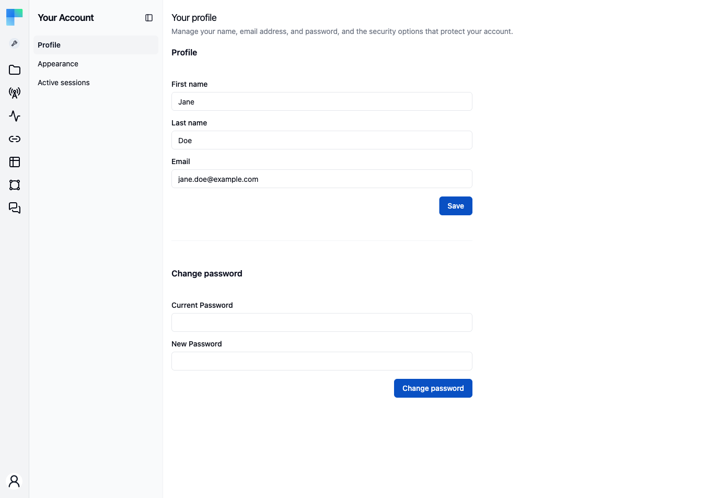

**Your Account → Profile** holds the settings of your own account. Every signed-in user can open it; nothing on it requires an administrator.

The page is headed **Your profile**, with the description "Manage your name, email address, and password, and the security options that protect your account." It shows the **Profile** and **Change password** sections. The **Two-Factor Authentication** and **Linked Accounts** sections appear only when the `ff-1040` feature flag is on.

---

## Profile

Three fields, all editable:

| Field | Notes |
|---|---|
| **First name** | Required. |
| **Last name** | Required. |
| **Email** | Required. Must be a valid address of at most 191 characters. |

Click **Save**. An "Account has been updated." toast confirms the change. An email address that another account already uses is rejected. Your login name is not shown and cannot be edited here; changing the email does not change it.

## Change password

Enter your **Current Password** and a **New Password**, then click **Change password**. A "Password has been changed." toast confirms the change.

The server requires the new password to be **8 to 100 characters with at least one uppercase letter and at least one digit**. The form only checks for 4 to 50 characters, so a password the form accepts can still be rejected on save.

A password change does not sign out your other sessions. To end them, use [Active Sessions](/platform/your-account/active-sessions).

## Two-Factor Authentication

<Callout type="warn" title="Coming soon">
    Two-factor authentication is behind the `ff-1040` feature flag and is not generally available yet.
</Callout>

The section is described as "Add an extra layer of security to your account using an authenticator app."

1. Click **Set up 2FA**. The section shows a QR code and the secret as text, for authenticator apps that cannot scan.
2. Scan the code, enter the current code from the app and click **Verify & Enable**. **Cancel** abandons the setup.
3. When 2FA is on, the section reads "Two-factor authentication is enabled." and offers **Disable 2FA**, which opens the **Disable Two-Factor Authentication** dialog and asks for your current password and a code.

## Linked Accounts

<Callout type="warn" title="Coming soon">
    Linked accounts are behind the `ff-1040` feature flag and are not generally available yet.
</Callout>

The section is described as "Manage external identity providers linked to your account."

With no provider linked, the section offers **Link Google** and **Link GitHub**. Each starts that provider's authorization flow. With a provider linked, the section shows the provider name, the account identifier the provider returned and an **Unlink** button. **Unlink** opens the **Unlink Provider** confirmation, and a "Provider has been unlinked." toast confirms the change.

**Unlink** is disabled while your account has no password, and the section shows "Set a password before unlinking your provider to maintain account access." Set a password in **Change password** first, otherwise unlinking would remove your only way to sign in.

Linked accounts apply to your own account only. Federating the identities of a whole organization is an administrator feature; see [Identity Providers](/platform/settings/identity-providers).
